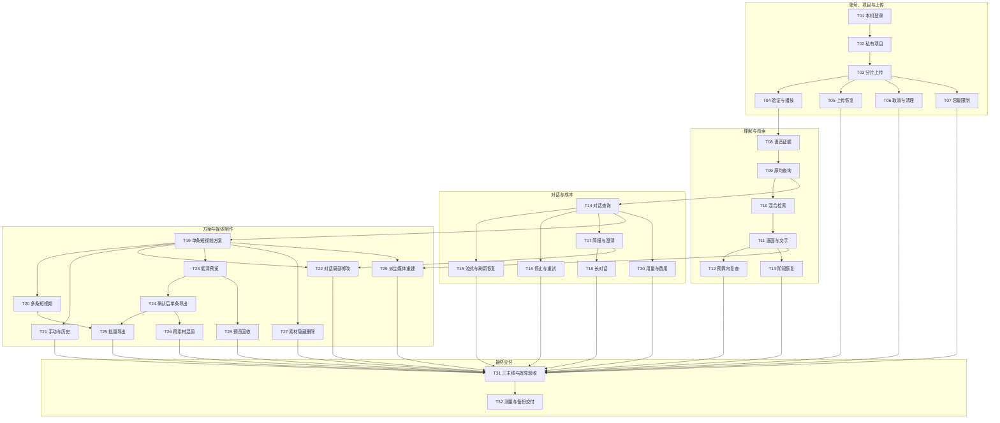

# GitHub Issues 拆分与发布记录

状态：用户已确认，32 张任务已发布并完成回读验证。见 [发布映射与实际依赖图](published.md)。

依据：[已确认总需求 #1](https://github.com/Hou1464851806/AgenticVideoProject/issues/1)。其正文与本地需求一致（仅有末尾空行差异），当前无评论；仓库尚无应用代码，因此不另建预重构任务。

共 32 票：P0 11 票、P1 19 票、P2 2 票。

沿用现有标签：P0 优先建立可运行主线，P1 补齐全部首版能力，P2 跨功能验证与交付；优先级不削减 MVP 范围。标签 ready-for-agent 表示需求清楚，不代表所有前置任务已完成。

每票包含对应的数据、接口、界面和必要测试，不按技术层拆票。任务状态、权限、容量和幂等从首次触及该能力的票实现，最终验收只做跨功能复验。全部 88 条用户故事、AC-01～AC-33 已映射；逐票正文含映射与详细完成标准。

T 编号是审阅时的草稿编号，真实 Issue 编号见发布映射；箭头表示前置任务 → 被阻塞任务，仅列直接阻塞边。模型票另需对应凭据及人工可核对样本，不以模拟结果冒充真实完成。

## 任务清单

1. **[本机启动后注册、登录与退出](https://github.com/Hou1464851806/AgenticVideoProject/issues/2)** — P0；前置：无，可立即开始。
   交付：部署者通过 Compose 启动系统，用户在浏览器注册、登录、退出，重启后账号仍可使用。
   完成标准：固定当前切片所需的依赖版本及 arm64 镜像，实测本机内存与磁盘，记录资源限额；后续执行服务沿用已确认的独立进程边界。；注册、登录和退出可以从浏览器完成；重名注册、错误密码和未登录访问返回明确结果。；同源入口、数据库迁移和持久卷有效；重启服务不丢账号，退出后原登录资格失效。；浏览器不接触内部服务凭据；修改请求具备匹配登录方式的 CSRF／Origin 防护，日志不记录密码或密钥。

2. **[创建与打开自己的私有项目](https://github.com/Hou1464851806/AgenticVideoProject/issues/3)** — P0；前置：T01。
   交付：登录用户创建项目、浏览项目列表并进入自己的项目工作区。
   完成标准：浏览器能创建、列出和打开项目，刷新后名称及归属仍保留。；两个账号只能列出自己的项目，直接请求他人项目也被业务后端拒绝。；工作区提供素材、对话及播放器／结果的入口，窄屏能够进入同样的操作区域。；后续素材、消息、证据、任务和产物操作复用服务端项目授权边界，不能根据前端或模型自报身份授权。

3. **[分片上传视频并看到待验证状态](https://github.com/Hou1464851806/AgenticVideoProject/issues/4)** — P0；前置：T02。
   交付：用户在项目中选择一个或多个视频，看到逐文件上传进度，传输成功后看到待媒体验证素材。
   完成标准：真实浏览器通过短期授权直传固定版本 Silo，验证 CORS、ETag、分片分页及完成响应；多文件共享有界并发池，业务 API 不搬运整文件。；服务端持久保存上传身份、对象键及分片事实，签发和完成均检查项目归属；创建时原子预留声明字节与素材名额。；重复创建／完成、创建或完成响应丢失能够核对已有对象；HTTP 成功中的内嵌完成错误被识别，至多保存一份待验证素材。；完成对象后同事务保存待验证素材、媒体验证任务与 Outbox；界面区分传输完成与验证完成，不提前发布为可用素材。

4. **[验证视频后在素材库定位播放](https://github.com/Hou1464851806/AgenticVideoProject/issues/5)** — P0；前置：T03。
   交付：上传视频经独立媒体 Worker 验证后出现在可用素材库，用户查看媒体信息并按时间播放。
   完成标准：固定并真实运行独立 arm64 Java 媒体 Worker、ffprobe／FFmpeg；核对真实字节数、服务端 SHA-256、可解码性和时长后才发布素材。；损坏、哈希不符、超时长和不可解码视频显示原因且不进入可选素材；验证失败对象进入可核对的清理流程。；播放器支持经过项目鉴权的 Range 读取及时间定位；保存音画起点与原素材毫秒时间映射，覆盖可变帧率和无音轨素材。；实现任务原子领取后 ACK、当前尝试心跳／租约及幂等发布；重投通知不启动同尝试的第二个进程，迟到结果不能覆盖终态，取消时确认本地进程退出。

5. **[断网、暂停与刷新后继续原上传](https://github.com/Hou1464851806/AgenticVideoProject/issues/6)** — P0；前置：T03。
   交付：用户暂停或中断上传后继续；刷新后重选原文件，只补传未成功分片。
   完成标准：暂停停止后续调度并收敛在途请求；断网仅对失败分片有限退避重试，成功分片保留。；分片授权过期后为原上传会话重新签发，不创建新上传或重新传完整文件。；刷新重选通过有界增量 SHA-256 检查并显示计算进度，后端分页核对真实分片；同名同大小但内容不同的文件不能续接。；同一上传会话只有一个有效写入者，多标签页竞争被明确拒绝；恢复进度以服务端核对结果为准。

6. **[取消或过期上传并查看残留清理](https://github.com/Hou1464851806/AgenticVideoProject/issues/7)** — P1；前置：T03。
   交付：用户取消上传并看到清理进展；过期上传停止续写，空间在实际清理后释放。
   完成标准：取消与完成原子竞争，撤销后续写入资格并停止前端调度；已签发和在途请求结束后继续核对残留。；真实 Silo Abort 与重复清理可回收未完成分片、未入库对象；完成中的有效会话、已发布素材和其他项目对象不被误删。；最后合法活动后默认 24 小时过期，可配置；界面显示恢复期限，过期后提示重新上传。；名额与字节占用分别核对，未真正清理的物理残留仍计入容量，界面区分已取消与清理完成。

7. **[超限或空间不足时阻止上传并解释原因](https://github.com/Hou1464851806/AgenticVideoProject/issues/8)** — P1；前置：T03。
   交付：用户在超额或本机空间不足时收到具体提示，多个同时上传的请求不能绕过限额。
   完成标准：默认单文件 2 GiB、每项目 10 个视频及原始素材 5 GiB，均可配置；时长 60 分钟由媒体验证阶段按真实媒体执行。；服务端在创建、分片签发和完成核对中应用声明大小、分片规则及实际字节；多个并发请求的空间和名额预留不可超卖。；实测 Docker／对象卷可用空间，预留覆盖未完成上传、原始文件、派生媒体、工作区与输出；探测和渲染在执行前复查空间。；浏览器明确显示被哪个限制拒绝及可行操作；对 Silo 不能强制的预签名长度条件记录残余窗口与收敛策略，不把客户端声明当物理保证。

8. **[上传后自动生成可定位的语音证据](https://github.com/Hou1464851806/AgenticVideoProject/issues/9)** — P0；前置：T04。
   交付：中文讲话视频验证通过后自动转写，用户在素材详情查看带原素材时间的语音证据和阶段状态。
   完成标准：真实验证派生音频传入百炼、Qwen ASR 句／字词时间戳及原素材时间映射；缺凭据标记未验证，模拟结果不能作为完成依据。；持久保存原始语音观察、检索单元及素材摘要，三者职责分开；界面能点击证据核查原视频。；媒体准备、语音和索引分别显示状态；无音轨明确标记不可进行语音分析，视觉失败不会阻止已有语音使用。；保存提供方任务身份、必要结果和用量，超时先查询原异步任务；失败有限重试，旧尝试不可发布，成功证据不会因重复通知再次付费生成。

9. **[查找人名、数字和原句并跳转核查](https://github.com/Hou1464851806/AgenticVideoProject/issues/10)** — P0；前置：T08。
   交付：用户在项目内查询语音中的具体人名、数字或短语，获得证据卡并定位播放及查看邻近上下文。
   完成标准：参数化原文短语查询正确处理特殊字符／通配符，返回素材、语音来源、原始证据及原素材时间。；结果卡支持跳转播放和邻近上下文；命中检索窗口不能被直接当作最终剪辑切点。；查询前限定用户、项目和有效证据版本；跨项目同词样本不会泄漏，查询不要求先建方案。；未命中说明已分析素材、来源和覆盖范围；只有字面通道可用时明确尚未具备语义检索能力。

10. **[用主题和近义表达检索视频内容](https://github.com/Hou1464851806/AgenticVideoProject/issues/11)** — P1；前置：T09。
   交付：用户无需记住原句，使用中文主题或近义表达也能查到带出处的片段，并保留专名与短语查找。
   完成标准：真实验证 Qwen Embedding 模型与维度，以及固定 arm64 Qdrant 的原生中文 BM25；索引与查询分词一致，使用 RRF 融合并保留字面补充通道。；各通道召回前过滤权限、项目与有效代次，IDF 统计范围限定当前项目；不以召回后过滤代替授权。；索引新代次写入并核对单元、维度和可查询性后，由业务后端原子发布；未发布／取消／旧尝试数据不进入查询。；保存证据和向量批次便于恢复；用人工标注及保留查询比较稠密、BM25 与融合的 Recall@K／排序，不编造未经测量的质量阈值。

11. **[查询画面与可见文字并核查观察时刻](https://github.com/Hou1464851806/AgenticVideoProject/issues/12)** — P1；前置：T10。
   交付：用户查找实际画面场景或屏幕文字，获得视觉证据并在播放器核查对应观察时刻。
   完成标准：真实验证代表帧传入百炼 VLM，记录实际帧时间、模型版本及稀疏采样覆盖，处理重复画面在不同时刻出现。；画面观察、可见文字及语音提及分开保存和展示，不把语音提到物体当作画面出现。；视觉证据进入受控混合检索；单帧时间不表述为未经观察的持续区间，结果可访问佐证帧并跳转原视频。；视觉分析与索引状态独立，失败不阻塞语音；未命中解释视觉覆盖及可能遗漏，不承诺逐帧完整识别。

12. **[在预算内复查候选，超预算先询问](https://github.com/Hou1464851806/AgenticVideoProject/issues/13)** — P1；前置：T11。
   交付：用户查询不确定或短暂画面内容时，系统在预算内补查；需要更多投入时先说明范围与费用并提供选择。
   完成标准：针对候选区间加密采样或扩展邻近语句；没有候选时允许预算内覆盖性采样／换词，补查结果保留来源和时间。；调用次数、步骤、时间、帧数及输入量受程序预算限制；无新证据或预算耗尽停止，模型不能重置预算。；超过已有预算先展示拟扩大的素材／范围及开销说明，用户明确选择后才继续；拒绝后保留已获得结果。；细查生成可溯源的新证据，不覆盖历史观察；结果仍说明覆盖边界，不声称找全所有短暂文字。

13. **[只恢复失败分析阶段并重建检索索引](https://github.com/Hou1464851806/AgenticVideoProject/issues/14)** — P1；前置：T11。
   交付：用户从素材状态页恢复失败分析或重建索引，已有语音查询保持可用，成功分析无需重做。
   完成标准：分别展示媒体、语音、视觉、Embedding 与索引状态，提供只重试失败阶段的动作；视觉失败期间语音查询持续可用。；索引失败从持久证据和向量批次恢复，不再次调用成功的 ASR／VLM；仅换索引配置时复用原始证据。；新代次发布前查询固定旧有效代次，维度不兼容的模型使用新索引；取消或迟到尝试不能切换有效映射。；恢复期间现有证据与引用保留，重复操作复用有效任务；完成后界面正确更新对应阶段而非误报全部分析就绪。

14. **[在独立制作会话中对话查询素材](https://github.com/Hou1464851806/AgenticVideoProject/issues/15)** — P0；前置：T09。
   交付：用户创建多个制作会话，通过自然语言查询已有语音证据，获得带出处的公开回答。
   完成标准：同项目可创建多个制作会话，消息和上下文独立；固定素材范围及显式素材引用，查询不要求关联方案。；真实验证 DeepSeek 工具协议与 LangGraph 单 Agent 的受控查询；模型通过有权限的业务工具读取证据，不直接访问数据库、对象存储或 shell。；消息、轮次、任务及 Outbox 同事务接纳；相同幂等键和内容返回原结果，同会话忙碌时拒绝新需求但允许编辑输入草稿。；公开历史、最终回答及引用持久保存；回答有可核查出处，无证据诚实说明，工具循环有预算／退出条件，私有推理、路径和凭据不进入公开内容。

15. **[刷新或断线后恢复对话进度与结果](https://github.com/Hou1464851806/AgenticVideoProject/issues/16)** — P1；前置：T14。
   交付：用户看到公开活动和流式回复，刷新、断线或重新打开项目后恢复后台任务及消息。
   完成标准：后端持久化白名单公开事件、合批草稿与最终结果，前端通过统一鉴权的项目 SSE 按对象分发；窄屏仍能使用证据／问题／结果卡。；一致快照与提交顺序游标配合重放，重复事件去重；游标过期重载快照，不遗漏晚提交事务。；草稿按执行尝试隔离，乱序／迟到旧尝试文字不会拼进新回复，未完成草稿标明状态。；页面关闭和 SSE 断开不取消任务；登录到期关闭订阅并提示登录，原始工具参数及供应商内部推理不会泄漏。

16. **[停止对话任务并关联原需求重试失败](https://github.com/Hou1464851806/AgenticVideoProject/issues/17)** — P1；前置：T14。
   交付：用户明确停止不需要的对话计算，失败后重试原需求，历史不出现重复用户消息。
   完成标准：会话提供显式停止，停止撤销结果发布资格并释放当前执行占用；已成功提交结果不能被迟到取消改为失败或取消。；用户重试终态失败创建关联任务，保留原失败记录并重新取得会话活动资格；自动重试沿用任务并新增尝试。；重试前核对权限、固定对象和已提交结果，已有成功提交直接返回，不重复消息或再次发布方案。；外部异步执行状态不明时先查询已保存身份，有限退避；外部服务能否停止及未知费用明确记录，不承诺完全撤销收费。

17. **[纠正制作需求简报并回答关联澄清](https://github.com/Hou1464851806/AgenticVideoProject/issues/18)** — P1；前置：T14。
   交付：用户用自然语言表达制作条件，检查并纠正需求简报；关键缺失或冲突时回答明确的问题继续原轮次。
   完成标准：简报显示主题、数量、时长、素材范围与禁用内容，区分明确约束和已说明默认值；新消息可纠正并保留条件来源。；关键条件缺失／冲突发布有身份的问题卡；回答关联原问题与轮次，不能把任意新消息猜成回答。；等待输入持久保存运行状态，保留会话活动关系但释放执行槽及方案编辑占用；重启不盲目重跑或重复发布问题。；用户可回答、取消或明确开始新需求；恢复重验权限和对象，变更基准建立关联新任务，原等待不悄悄复活。

18. **[长对话保留硬条件并分页查看完整历史](https://github.com/Hou1464851806/AgenticVideoProject/issues/19)** — P1；前置：T17。
   交付：用户经过长对话仍能继续制作并查看早期公开消息，精确时长、禁用素材等条件不会被摘要丢失。
   完成标准：完整公开消息追加保存并分页展示，不因模型上下文裁剪删除历史；不新增编辑旧消息后回放或任意重生成成功回复功能。；模型读取有界近期轮次、带覆盖范围的摘要、制作需求简报和相关证据，输入 token／数据量可配置。；精确条件可追溯原消息，摘要不能覆盖明确时长、禁止素材和对象绑定；矛盾按关联澄清流程处理。；恢复按确定消息身份去重，工具调用／结果不能裁成无效协议，不重复追加整份历史；分页和窄屏操作可用。

19. **[从讲话视频生成一条可核查的短视频方案](https://github.com/Hou1464851806/AgenticVideoProject/issues/20)** — P0；前置：T14。
   交付：用户给定明确主题和时长，从讲话素材得到一条带片段出处、选取依据与字幕的初始方案。
   完成标准：业务后端分配新方案身份，同项目可保存多份方案；受控 Agent 从证据及邻近上下文选取观点完整片段，无证据或约束无法满足时解释。；一次成功提交追加一个完整不可变版本，包含成片定义、有序片段、原素材毫秒左闭右开范围、输出规格及映射后的字幕；内部候选与自检不产生版本。；确定性校验权限、引用、范围、时长、输出与硬约束；校验失败不发布方案，修正次数有限，不能执行模型脚本。；编辑取得方案级独占权，固定接纳时基准；结果卡展示来源、范围、依据并可播放源片段，完成不强制改变查看版本，取消／故障释放有效锁。

20. **[一次生成多条短视频成片定义](https://github.com/Hou1464851806/AgenticVideoProject/issues/21)** — P1；前置：T19。
   交付：用户指定数量、主题和各条时长，从长视频得到同一方案版本内的多条短视频定义。
   完成标准：方案结果卡能逐条选择成片定义，显示每条片段、标题／依据、字幕和预计时长，点击可预览源片段。；数量及各输出硬约束通过确定性校验，观点与必要上下文使用人工样本核验；素材不足时解释而不凑数或虚构。；同一生成操作提交一个包含全部输出的完整版本，各输出身份稳定；内部迭代不提交中间版本。；重新打开项目仍能查看全部输出与固定来源，查询、查看或切换输出不追加版本。

21. **[手动调整片段并从任意历史版本继续](https://github.com/Hou1464851806/AgenticVideoProject/issues/22)** — P1；前置：T19。
   交付：用户调整片段起止时间和顺序，查看旧版或基于旧版继续，完整保留历史与修改来源。
   完成标准：手动调整合法片段时间／顺序后追加完整版本，未改输出和片段内容保持；字幕按新成片时间重映射，复用分析。；已有 V1、V2、V3 时基于 V1 修改生成 V4 且来源为 V1；单纯查看／切换不新增版本。；Agent 占用同方案时手动及第二次修改被拒绝，仍能查看历史；不同会话也不能绕过同方案互斥。；运行输入与查看位置分开，完成提示新版本而不强制切换；非法范围拒绝，失败不留下半成品版本。

22. **[对话替换指定片段并保留其他内容](https://github.com/Hou1464851806/AgenticVideoProject/issues/23)** — P1；前置：T17、T19。
   交付：用户显式引用版本、输出或片段，说“替换第二段”“更紧凑但保留结论”，得到有变更说明的新方案版本。
   完成标准：发送时固定版本、输出／片段与素材范围，指代不明时澄清；执行中切换查看不改变修改基准。；只修改被要求的范围，新完整版本保留未要求改变的输出、片段及硬约束；变更说明与实际内容一致。；基于旧版修改记录真实来源并追加至历史末尾，Agent 草稿／自检与 checkpoint 恢复不重复生成版本。；跨会话同方案编辑互斥；等待澄清释放编辑权，恢复重验基准，取消／故障后可再编辑，新版本就绪不强制切换。

23. **[手动生成带原声与字幕的低清效果预览](https://github.com/Hou1464851806/AgenticVideoProject/issues/24)** — P0；前置：T19。
   交付：用户主动请求某版本／成片定义的低清预览，查看横竖屏、原声、中文字幕与片段顺序的实际效果。
   完成标准：仅明确手动请求触发合成，无需正式确认；源片段播放与合成预览明确区分，任务固定版本与输出。；Worker 将方案编译成受控 FFmpeg 参数；真实验证中文字体、字幕映射、原声、硬切、16:9／9:16 等比例留边及无音轨策略。；相同版本、输出、实际规格、渲染规则及必要依赖指纹复用有效任务／产物，预览不再次调用 ASR；完成前验证可播放性、时长与音轨。；执行尝试使用独立工作区并检查空间，取消确认 FFmpeg 退出；结果／任务幂等发布，切换查看和追加版本不影响当前预览。

24. **[确认具体版本后明确导出并下载一条成片](https://github.com/Hou1464851806/AgenticVideoProject/issues/25)** — P0；前置：T23。
   交付：用户确认指定版本并另行发起导出，选择一条成片定义生成 720p／1080p MP4，播放、下载并按需删除。
   完成标准：确认绑定不可变版本，修改后新版本不继承确认；旧版确认保留，每次导出重新校验权限、引用及明确导出意图。；未确认、仅生成方案、表示满意或 Agent 自行规划都不能正式渲染；明确自然语言确认／导出进入受控业务路由，歧义先澄清。；正式渲染复用已经验证的编译／执行能力，默认并发 1；输出 MP4 H.264／AAC，720p／1080p、横竖屏与方案一致，运行输入不受查看切换影响。；成片可鉴权播放／下载，下载不删除；用户明确删除才移除文件并核对占用，失败／取消不删除原始素材或已有成功成片。

25. **[批量导出选定成片并展示部分完成](https://github.com/Hou1464851806/AgenticVideoProject/issues/26)** — P1；前置：T20、T24。
   交付：用户导出部分或全部成片定义，查看逐条成功、失败及整体部分完成，并仅重试失败输出。
   完成标准：用户选择部分或全部输出，任务固定已确认版本与每条输出，资源并发限制不被批量绕过。；每条输出独立记录任务和产物，界面显示逐条状态及整体部分完成，单条失败不丢成功成片。；失败重试关联原请求并核对已有产物，已成功输出不重复发布；重复请求与通知返回既有对应结果。；批量期间切换版本、修改方案或关闭页面不改变任务输入，成功成片仍可独立播放／下载。

26. **[按需求跨素材编排并导出基础混剪](https://github.com/Hou1464851806/AgenticVideoProject/issues/27)** — P1；前置：T24。
   交付：用户指定主题和顺序，从多个素材选择片段生成单条混剪方案，确认后得到可播放的混剪成片。
   完成标准：Agent 依据多个素材的证据及邻近上下文选段，按用户指定顺序组成一条成片定义，片段均有出处与合法范围。；复用完整版本、确认、编辑互斥及受控导出规则，不另建一套混剪方案模型；缺素材或顺序无法满足时解释。；真实跨素材硬切与统一音画正确，处理不同尺寸／采样率及有音轨／无音轨组合；横竖屏留边、原声及中文字幕时间符合方案。；用户能检查各源片段、查看方案和下载实际混剪 MP4；混剪与再次渲染复用既有分析。

27. **[隐藏、恢复和安全删除素材](https://github.com/Hou1464851806/AgenticVideoProject/issues/28)** — P1；前置：T19。
   交付：用户整理素材库，隐藏素材后历史方案仍可核查；删除受历史引用保护的素材时收到阻止原因。
   完成标准：隐藏素材退出新选择列表，恢复后再次可选；原文件与既有历史引用仍保留。；任意方案历史版本引用的原始素材和必要证据受保护，彻底删除被拒绝并说明受哪些引用阻止。；无保护引用的素材可明确删除，协调活动上传／分析／编辑任务与引用创建，不能在并发中新引用后误删。；删除结果与分类占用按实际对象核对，其他素材、项目和正式成片不受影响；已有源片段／证据仍可核查。

28. **[清理过期预览并按需重新生成](https://github.com/Hou1464851806/AgenticVideoProject/issues/29)** — P1；前置：T23。
   交付：用户查看预览缓存占用，旧预览自动回收后仍能为历史版本重新生成。
   完成标准：每项目默认 2 GB 或 7 天未访问的预览缓存可清理，均可配置；容量和访问时间来自实际产物记录。；正在生成／播放的产物受占用保护，清理与播放竞争不删除使用中文件；原始素材、证据和正式成片不走预览清理。；删除后同步标记产物不可用，不返回旧链接，相同版本重新请求会创建新预览，仍不重跑分析。；界面展示回收前后真实预览占用，失败清理可再试，不因仅标记删除就提前释放物理字节。

29. **[回收派生媒体后仍能核查历史证据](https://github.com/Hou1464851806/AgenticVideoProject/issues/30)** — P1；前置：T11、T19。
   交付：用户减少派生音频／普通帧占用后，历史方案与证据仍可检查，必要派生媒体按源素材重新提取。
   完成标准：派生音频与普通代表帧使用独立可配置容量策略，不直接套用预览 2 GB／7 天规则，执行中使用的文件受保护。；原始观察证据、必要模型结果、时间映射及分析版本随素材保留；历史方案引用不会因缓存清理丢失。；佐证帧保留或按受保护源文件、精确实际时间和规则可靠复现，界面不会留下不能核查的证据链接。；派生文件重建只执行媒体提取，不再次调用 ASR／VLM，分类用量按实际回收／生成更新。

30. **[查看分类存储、模型用量和费用预警](https://github.com/Hou1464851806/AgenticVideoProject/issues/31)** — P1；前置：T14。
   交付：用户在项目查看原始素材、派生媒体、预览、成片占用，以及各用途模型调用和估算费用。
   完成标准：存储按四类展示实际已占用及未完成预留／待清理状态，没有产物的类别显示真实零值；计量不依赖前端猜测。；调用记录展示提供方、模型、用途、实际报告用量和估算费用，没有实际用量明确标估算；记录有限重试及状态不明调用。；配置费用／用量预警阈值并在达到时提示；不引入固定月预算或计费商业化流程。；已有分析结果可复用，查询可核对用途和费用；后续手动重排、预览、导出及缓存重建的切片验证不新增无必要模型调用。

31. **[在故障与权限边界下验收三条用户主线](https://github.com/Hou1464851806/AgenticVideoProject/issues/32)** — P2；前置：T05、T06、T07、T12、T13、T15、T16、T18、T21、T22、T25、T26、T27、T28、T29、T30。
   交付：部署者用固定样本实际完成内容查询、讲话视频拆短视频及跨素材混剪，并能复现恢复与隔离结果。
   完成标准：人工标注样本与保留查询覆盖 AC-01 至 AC-32，真实浏览器完成三条主线；收集消息、出处、版本、任务与实际可播放产物作为依据。；跨服务中断覆盖数据库提交后、ACK 后启动前、产物上传后回报前，以及旧尝试迟到／取消竞争；无重复版本、产物或终态覆盖。；覆盖两账号所有新增素材、证据、消息、任务、索引通道及对象链接的授权；公开内容无私有凭据、路径或供应商内部推理。；核验隐藏历史素材仍可制作、缓存重建不重复分析、批量部分失败恢复和预算收束；遗留能力缺口逐项报告并修复，模拟或模型自评不能代替通过。

32. **[从说明启动、测量并备份恢复完整系统](https://github.com/Hou1464851806/AgenticVideoProject/issues/33)** — P2；前置：T31。
   交付：部署者按文档从本机启动完整系统，复现三条演示，查看真实性能／费用记录并完成备份恢复。
   完成标准：固定最终依赖／镜像、模型配置、分片／采样／检索参数、字体、超时和限额，记录实际 arm64 部署与资源要求，不沿用过期磁盘快照。；代表样本记录分析、检索、方案生成、预览、导出耗时及 CPU／内存／磁盘峰值、每小时分析调用与费用；不宣称未验证 SLA。；说明启动、配置、升级／迁移与三条演示路径，敏感配置使用示例占位；其他本机环境按说明可复现。；演练 PostgreSQL 与对象备份协调恢复，核对项目、聊天、版本、引用和成片；说明 Qdrant 重建、checkpoint 恢复范围与外部任务不确定状态。

## 依赖图

T24 依赖 T23 是为了复用已验证的渲染能力；用户导出时无需先预览。T14／T19 可先使用字面语音证据完成查询／选段，不等待视觉或混合检索；后者就绪后复用同一受控搜索能力。

## 发布方式（已执行）

按依赖顺序向当前 GitHub 仓库发布，并关联总 Issue #1 为父任务。每票应用已有 ready-for-agent 与对应优先级标签；使用可用的原生阻塞关系，否则在正文列出真实 Issue 链接。总 Issue 的正文、状态不更改，不关闭总 Issue。发布后回填草稿编号到真实 Issue 编号的映射。

用户已确认任务粒度与依赖；32 个子 Issue 和 49 条原生阻塞关系已发布并验证。
