# GitHub Issues 发布结果

32 张任务已发布为 [总 Issue #1](https://github.com/Hou1464851806/AgenticVideoProject/issues/1) 的原生子 Issue，49 条直接阻塞关系均已回读验证。

P0：11 张；P1：19 张；P2：2 张。每票有 4 项完成标准、验证方式和需求关联，标签均为 ready-for-agent 与对应 priority。

总 Issue 的正文、标题、状态与标签未更改；子任务关系已添加。当前可立即开始的任务为下表 T01。

| 草稿编号 | GitHub Issue | 优先级 | 前置 Issue |
| --- | --- | --- | --- |
| T01 | [#2 本机启动后注册、登录与退出](https://github.com/Hou1464851806/AgenticVideoProject/issues/2) | P0 | 无 |
| T02 | [#3 创建与打开自己的私有项目](https://github.com/Hou1464851806/AgenticVideoProject/issues/3) | P0 | [#2](https://github.com/Hou1464851806/AgenticVideoProject/issues/2) |
| T03 | [#4 分片上传视频并看到待验证状态](https://github.com/Hou1464851806/AgenticVideoProject/issues/4) | P0 | [#3](https://github.com/Hou1464851806/AgenticVideoProject/issues/3) |
| T04 | [#5 验证视频后在素材库定位播放](https://github.com/Hou1464851806/AgenticVideoProject/issues/5) | P0 | [#4](https://github.com/Hou1464851806/AgenticVideoProject/issues/4) |
| T05 | [#6 断网、暂停与刷新后继续原上传](https://github.com/Hou1464851806/AgenticVideoProject/issues/6) | P0 | [#4](https://github.com/Hou1464851806/AgenticVideoProject/issues/4) |
| T06 | [#7 取消或过期上传并查看残留清理](https://github.com/Hou1464851806/AgenticVideoProject/issues/7) | P1 | [#4](https://github.com/Hou1464851806/AgenticVideoProject/issues/4) |
| T07 | [#8 超限或空间不足时阻止上传并解释原因](https://github.com/Hou1464851806/AgenticVideoProject/issues/8) | P1 | [#4](https://github.com/Hou1464851806/AgenticVideoProject/issues/4) |
| T08 | [#9 上传后自动生成可定位的语音证据](https://github.com/Hou1464851806/AgenticVideoProject/issues/9) | P0 | [#5](https://github.com/Hou1464851806/AgenticVideoProject/issues/5) |
| T09 | [#10 查找人名、数字和原句并跳转核查](https://github.com/Hou1464851806/AgenticVideoProject/issues/10) | P0 | [#9](https://github.com/Hou1464851806/AgenticVideoProject/issues/9) |
| T10 | [#11 用主题和近义表达检索视频内容](https://github.com/Hou1464851806/AgenticVideoProject/issues/11) | P1 | [#10](https://github.com/Hou1464851806/AgenticVideoProject/issues/10) |
| T11 | [#12 查询画面与可见文字并核查观察时刻](https://github.com/Hou1464851806/AgenticVideoProject/issues/12) | P1 | [#11](https://github.com/Hou1464851806/AgenticVideoProject/issues/11) |
| T12 | [#13 在预算内复查候选，超预算先询问](https://github.com/Hou1464851806/AgenticVideoProject/issues/13) | P1 | [#12](https://github.com/Hou1464851806/AgenticVideoProject/issues/12) |
| T13 | [#14 只恢复失败分析阶段并重建检索索引](https://github.com/Hou1464851806/AgenticVideoProject/issues/14) | P1 | [#12](https://github.com/Hou1464851806/AgenticVideoProject/issues/12) |
| T14 | [#15 在独立制作会话中对话查询素材](https://github.com/Hou1464851806/AgenticVideoProject/issues/15) | P0 | [#10](https://github.com/Hou1464851806/AgenticVideoProject/issues/10) |
| T15 | [#16 刷新或断线后恢复对话进度与结果](https://github.com/Hou1464851806/AgenticVideoProject/issues/16) | P1 | [#15](https://github.com/Hou1464851806/AgenticVideoProject/issues/15) |
| T16 | [#17 停止对话任务并关联原需求重试失败](https://github.com/Hou1464851806/AgenticVideoProject/issues/17) | P1 | [#15](https://github.com/Hou1464851806/AgenticVideoProject/issues/15) |
| T17 | [#18 纠正制作需求简报并回答关联澄清](https://github.com/Hou1464851806/AgenticVideoProject/issues/18) | P1 | [#15](https://github.com/Hou1464851806/AgenticVideoProject/issues/15) |
| T18 | [#19 长对话保留硬条件并分页查看完整历史](https://github.com/Hou1464851806/AgenticVideoProject/issues/19) | P1 | [#18](https://github.com/Hou1464851806/AgenticVideoProject/issues/18) |
| T19 | [#20 从讲话视频生成一条可核查的短视频方案](https://github.com/Hou1464851806/AgenticVideoProject/issues/20) | P0 | [#15](https://github.com/Hou1464851806/AgenticVideoProject/issues/15) |
| T20 | [#21 一次生成多条短视频成片定义](https://github.com/Hou1464851806/AgenticVideoProject/issues/21) | P1 | [#20](https://github.com/Hou1464851806/AgenticVideoProject/issues/20) |
| T21 | [#22 手动调整片段并从任意历史版本继续](https://github.com/Hou1464851806/AgenticVideoProject/issues/22) | P1 | [#20](https://github.com/Hou1464851806/AgenticVideoProject/issues/20) |
| T22 | [#23 对话替换指定片段并保留其他内容](https://github.com/Hou1464851806/AgenticVideoProject/issues/23) | P1 | [#18](https://github.com/Hou1464851806/AgenticVideoProject/issues/18)、[#20](https://github.com/Hou1464851806/AgenticVideoProject/issues/20) |
| T23 | [#24 手动生成带原声与字幕的低清效果预览](https://github.com/Hou1464851806/AgenticVideoProject/issues/24) | P0 | [#20](https://github.com/Hou1464851806/AgenticVideoProject/issues/20) |
| T24 | [#25 确认具体版本后明确导出并下载一条成片](https://github.com/Hou1464851806/AgenticVideoProject/issues/25) | P0 | [#24](https://github.com/Hou1464851806/AgenticVideoProject/issues/24) |
| T25 | [#26 批量导出选定成片并展示部分完成](https://github.com/Hou1464851806/AgenticVideoProject/issues/26) | P1 | [#21](https://github.com/Hou1464851806/AgenticVideoProject/issues/21)、[#25](https://github.com/Hou1464851806/AgenticVideoProject/issues/25) |
| T26 | [#27 按需求跨素材编排并导出基础混剪](https://github.com/Hou1464851806/AgenticVideoProject/issues/27) | P1 | [#25](https://github.com/Hou1464851806/AgenticVideoProject/issues/25) |
| T27 | [#28 隐藏、恢复和安全删除素材](https://github.com/Hou1464851806/AgenticVideoProject/issues/28) | P1 | [#20](https://github.com/Hou1464851806/AgenticVideoProject/issues/20) |
| T28 | [#29 清理过期预览并按需重新生成](https://github.com/Hou1464851806/AgenticVideoProject/issues/29) | P1 | [#24](https://github.com/Hou1464851806/AgenticVideoProject/issues/24) |
| T29 | [#30 回收派生媒体后仍能核查历史证据](https://github.com/Hou1464851806/AgenticVideoProject/issues/30) | P1 | [#12](https://github.com/Hou1464851806/AgenticVideoProject/issues/12)、[#20](https://github.com/Hou1464851806/AgenticVideoProject/issues/20) |
| T30 | [#31 查看分类存储、模型用量和费用预警](https://github.com/Hou1464851806/AgenticVideoProject/issues/31) | P1 | [#15](https://github.com/Hou1464851806/AgenticVideoProject/issues/15) |
| T31 | [#32 在故障与权限边界下验收三条用户主线](https://github.com/Hou1464851806/AgenticVideoProject/issues/32) | P2 | [#6](https://github.com/Hou1464851806/AgenticVideoProject/issues/6)、[#7](https://github.com/Hou1464851806/AgenticVideoProject/issues/7)、[#8](https://github.com/Hou1464851806/AgenticVideoProject/issues/8)、[#13](https://github.com/Hou1464851806/AgenticVideoProject/issues/13)、[#14](https://github.com/Hou1464851806/AgenticVideoProject/issues/14)、[#16](https://github.com/Hou1464851806/AgenticVideoProject/issues/16)、[#17](https://github.com/Hou1464851806/AgenticVideoProject/issues/17)、[#19](https://github.com/Hou1464851806/AgenticVideoProject/issues/19)、[#22](https://github.com/Hou1464851806/AgenticVideoProject/issues/22)、[#23](https://github.com/Hou1464851806/AgenticVideoProject/issues/23)、[#26](https://github.com/Hou1464851806/AgenticVideoProject/issues/26)、[#27](https://github.com/Hou1464851806/AgenticVideoProject/issues/27)、[#28](https://github.com/Hou1464851806/AgenticVideoProject/issues/28)、[#29](https://github.com/Hou1464851806/AgenticVideoProject/issues/29)、[#30](https://github.com/Hou1464851806/AgenticVideoProject/issues/30)、[#31](https://github.com/Hou1464851806/AgenticVideoProject/issues/31) |
| T32 | [#33 从说明启动、测量并备份恢复完整系统](https://github.com/Hou1464851806/AgenticVideoProject/issues/33) | P2 | [#32](https://github.com/Hou1464851806/AgenticVideoProject/issues/32) |

```mermaid
flowchart TD
  subgraph upload["账号、项目与上传"]
    I2["#2 本机登录"]
    I3["#3 私有项目"]
    I4["#4 分片上传"]
    I5["#5 验证与播放"]
    I6["#6 上传恢复"]
    I7["#7 取消与清理"]
    I8["#8 容量限制"]
  end
  subgraph content["理解与检索"]
    I9["#9 语音证据"]
    I10["#10 原句查询"]
    I11["#11 混合检索"]
    I12["#12 画面与文字"]
    I13["#13 预算内复查"]
    I14["#14 阶段恢复"]
  end
  subgraph conversation["对话与成本"]
    I15["#15 对话查询"]
    I16["#16 流式与刷新恢复"]
    I17["#17 停止与重试"]
    I18["#18 简报与澄清"]
    I19["#19 长对话"]
    I31["#31 用量与费用"]
  end
  subgraph editing["方案与媒体制作"]
    I20["#20 单条短视频方案"]
    I21["#21 多条短视频"]
    I22["#22 手动与历史"]
    I23["#23 对话局部修改"]
    I24["#24 低清预览"]
    I25["#25 确认后单条导出"]
    I26["#26 批量导出"]
    I27["#27 跨素材混剪"]
    I28["#28 素材隐藏删除"]
    I29["#29 预览回收"]
    I30["#30 派生媒体重建"]
  end
  subgraph delivery["最终交付"]
    I32["#32 三主线与故障验收"]
    I33["#33 测量与备份交付"]
  end
  #2 --> I3
  #3 --> I4
  #4 --> I5
  #4 --> I6
  #4 --> I7
  #4 --> I8
  #5 --> I9
  #9 --> I10
  #10 --> I11
  #11 --> I12
  #12 --> I13
  #12 --> I14
  #10 --> I15
  #15 --> I16
  #15 --> I17
  #15 --> I18
  #18 --> I19
  #15 --> I20
  #20 --> I21
  #20 --> I22
  #18 --> I23
  #20 --> I23
  #20 --> I24
  #24 --> I25
  #21 --> I26
  #25 --> I26
  #25 --> I27
  #20 --> I28
  #24 --> I29
  #12 --> I30
  #20 --> I30
  #15 --> I31
  #6 --> I32
  #7 --> I32
  #8 --> I32
  #13 --> I32
  #14 --> I32
  #16 --> I32
  #17 --> I32
  #19 --> I32
  #22 --> I32
  #23 --> I32
  #26 --> I32
  #27 --> I32
  #28 --> I32
  #29 --> I32
  #30 --> I32
  #31 --> I32
  #32 --> I33
  click I2 "https://github.com/Hou1464851806/AgenticVideoProject/issues/2"
  click I3 "https://github.com/Hou1464851806/AgenticVideoProject/issues/3"
  click I4 "https://github.com/Hou1464851806/AgenticVideoProject/issues/4"
  click I5 "https://github.com/Hou1464851806/AgenticVideoProject/issues/5"
  click I6 "https://github.com/Hou1464851806/AgenticVideoProject/issues/6"
  click I7 "https://github.com/Hou1464851806/AgenticVideoProject/issues/7"
  click I8 "https://github.com/Hou1464851806/AgenticVideoProject/issues/8"
  click I9 "https://github.com/Hou1464851806/AgenticVideoProject/issues/9"
  click I10 "https://github.com/Hou1464851806/AgenticVideoProject/issues/10"
  click I11 "https://github.com/Hou1464851806/AgenticVideoProject/issues/11"
  click I12 "https://github.com/Hou1464851806/AgenticVideoProject/issues/12"
  click I13 "https://github.com/Hou1464851806/AgenticVideoProject/issues/13"
  click I14 "https://github.com/Hou1464851806/AgenticVideoProject/issues/14"
  click I15 "https://github.com/Hou1464851806/AgenticVideoProject/issues/15"
  click I16 "https://github.com/Hou1464851806/AgenticVideoProject/issues/16"
  click I17 "https://github.com/Hou1464851806/AgenticVideoProject/issues/17"
  click I18 "https://github.com/Hou1464851806/AgenticVideoProject/issues/18"
  click I19 "https://github.com/Hou1464851806/AgenticVideoProject/issues/19"
  click I20 "https://github.com/Hou1464851806/AgenticVideoProject/issues/20"
  click I21 "https://github.com/Hou1464851806/AgenticVideoProject/issues/21"
  click I22 "https://github.com/Hou1464851806/AgenticVideoProject/issues/22"
  click I23 "https://github.com/Hou1464851806/AgenticVideoProject/issues/23"
  click I24 "https://github.com/Hou1464851806/AgenticVideoProject/issues/24"
  click I25 "https://github.com/Hou1464851806/AgenticVideoProject/issues/25"
  click I26 "https://github.com/Hou1464851806/AgenticVideoProject/issues/26"
  click I27 "https://github.com/Hou1464851806/AgenticVideoProject/issues/27"
  click I28 "https://github.com/Hou1464851806/AgenticVideoProject/issues/28"
  click I29 "https://github.com/Hou1464851806/AgenticVideoProject/issues/29"
  click I30 "https://github.com/Hou1464851806/AgenticVideoProject/issues/30"
  click I31 "https://github.com/Hou1464851806/AgenticVideoProject/issues/31"
  click I32 "https://github.com/Hou1464851806/AgenticVideoProject/issues/32"
  click I33 "https://github.com/Hou1464851806/AgenticVideoProject/issues/33"
```

正式导出复用预览票完成的渲染能力；用户无需先预览。所有功能票均包含自身必要验证，最终验收票执行跨功能演练。
