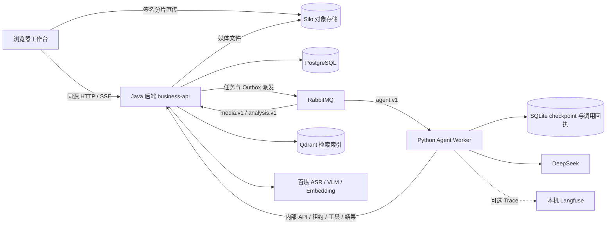

# 叙帧 · 视频工作台

> 面向需要理解素材并制作短视频的用户，通过对话查找视频内容、编排剪辑草稿，再经用户确认生成可播放、下载的成片。

[快速开始](#6-快速开始) · [模块地图](#4-模块地图) · [开发与测试](#10-开发指南) · [文档导航](#14-文档导航)

## 1. 项目简介

叙帧把素材上传、内容理解、对话制作和媒体渲染放在同一个项目工作台中。用户可以先询问视频内容、回看证据，再提出时长、横竖屏、原声和字幕要求，反复修改草稿，确认后正式导出。

- **使用者**：需要从已有视频中查找内容、选段并制作短片的个人用户。
- **开发者**：希望扩展视频分析、受控 Agent、剪辑方案或工作台交互的工程师。
- **部署者**：在本机运行和维护业务服务、模型接入及媒体存储的工程师。
- **当前状态**：持续开发；当前提供 Apple Silicon Mac 上的 Docker Compose 运行路径，尚未提供经过验收的生产部署方案。

当前浏览器已接通问答／讨论、草稿制作与修改、确认前预览、整体确认、正式导出和播放下载。当前能力与操作顺序见[功能说明](docs/current-features.md)开头的“当前浏览器体验”；自动验收与人工体验边界见[对话生命周期验收](docs/verification/conversation-lifecycle-step7.md)和[前端阶段验收](docs/verification/frontend-redesign-stage.md)。历史阶段记录中的能力描述不应直接视为当前入口说明。

## 2. 核心特性

| 能力 | 用户得到什么 | 使用边界 |
| --- | --- | --- |
| 私有项目与可恢复上传 | 多素材分片上传、暂停、续传、取消；刷新后重选原文件补传缺失分片 | SHA-256 校验文件身份；传输完成后还需通过媒体验证 |
| 带时间依据的内容查找 | 查询语音、画面和可见文字，并定位原视频核查 | 画面采用稀疏采样；未命中不证明内容不存在 |
| 对话制作与修改 | 通过自然语言形成单／多输出剪辑草稿，缺少条件时澄清 | 草稿需经 Java 校验；不能满足约束时保留失败原因 |
| 明确确认后的媒体交付 | 先看低清预览，再确认全部输出，单独导出一条 720p／1080p 成片 | 预览不代表接受草稿；正式导出需要另行操作 |
| 状态恢复与用量核查 | 刷新恢复会话及任务，查看存储、模型用量、估算和未知费用 | 费用预警不阻断任务；模型提交结果未知时不自动重付 |

独立 Python CLI 还提供开发、离线脚本场景和受控验收入口，见 [Agent README](agent-service/README.md)。

## 3. 架构总览



跨模块主流程：

1. **导入与分析**：浏览器向 Java 创建上传会话，分片直传 Silo；Java 核对对象后，通过媒体队列在本进程执行探测、音频准备和稀疏抽帧，再执行基础分析和索引构建。
2. **对话与草稿**：Java 接纳消息并固定执行输入，通过 `agent.v1` 调度 Python Worker；Worker 理解当前消息、调用 Java 工具、形成答复或草稿，并提交结果。Java 控制权限、执行资格及业务结果发布。
3. **预览与成片**：用户显式请求预览；接受当前草稿后冻结并确认方案版本，再单独请求正式导出。Java 经媒体队列渲染并发布 Silo 产物，浏览器取得播放／下载授权。

PostgreSQL 是业务状态和证据的权威来源；Qdrant 索引可以重建。Python SQLite 保存 Agent 执行状态和调用回执，不替代 Java 的方案版本及确认记录。当前 Java 媒体处理与分析属于一个 Maven 应用，Python Worker 为单实例。

部署事实以 [Compose](compose.yaml)、[Java 构建入口](pom.xml)、[后端 Dockerfile](backend/Dockerfile)和 [Worker Dockerfile](agent-service/Dockerfile)为准。职责演进见 [ADR-0017](docs/adr/0017-move-baseline-analysis-and-reading-tools-into-java.md)、[ADR-0018](docs/adr/0018-freeze-plan-revisions-after-draft-acceptance.md)、[ADR-0019](docs/adr/0019-schedule-agent-through-a-python-worker.md)；[早期架构设计](docs/architecture.md)保留历史方案，部分部署描述已被这些决定替代。

## 4. 模块地图

| 模块 | 路径 | 职责与入口 | 主要依赖 | 阅读入口 |
| --- | --- | --- | --- | --- |
| 浏览器工作台 | [frontend/](frontend/) | `src/main.ts` 启动 Vue，`App.vue`／`ProjectWorkspace.vue` 组织项目工作台 | Java API、Silo 分片上传 | [前端 README](frontend/README.md) |
| Java 后端 | [backend/](backend/) | `BusinessApiApplication` 启动；管理权限、素材、分析、检索、方案、任务与渲染 | PostgreSQL、RabbitMQ、Silo、Qdrant、百炼、FFmpeg | [后端 README](backend/README.md) |
| Python Agent | [agent-service/](agent-service/) | `agent_service.worker` 消费浏览器任务；`agent_service` 提供 CLI | Java 内部 API、RabbitMQ、DeepSeek、SQLite；可选 Langfuse | [Agent README](agent-service/README.md) |
| 启动与验收脚本 | [scripts/](scripts/) | `start.sh` 初始化本机配置并启动；`test-models.mjs` 执行显式付费验收 | Docker Compose、OpenSSL；验收另需 Maven | [脚本 README](scripts/README.md) |
| 设计与验证资料 | [docs/](docs/) | 需求、设计、ADR、验证证据与历史实施记录 | 对应代码及验证环境 | [文档索引](docs/README.md) |

模块内部接口、流程与回归入口从相应 README 查阅；后端和 Agent 总览继续链接各业务包、运行时及工具模块。历史设计和验收记录按各自阶段边界阅读。

## 5. 技术栈

| 层次 | 当前版本／工具 | 配置依据 |
| --- | --- | --- |
| 后端 | Java 17、Spring Boot 3.5.16、Maven 3.9.9、Spring Security、Flyway、AWS S3 SDK 2.55.14 | [根 POM](pom.xml)、[后端 POM](backend/pom.xml)、[Dockerfile](backend/Dockerfile) |
| 前端 | Node.js 24、Vue 3.5.43、Vite 8.3.4、TypeScript 5.9.3、hash-wasm 4.12.0 | [package.json](frontend/package.json)、[依赖锁](frontend/package-lock.json) |
| Agent | Docker 使用 Python 3.13；LangGraph 1.2.14、SQLite checkpoint、LangChain、aio-pika | [Dockerfile](agent-service/Dockerfile)、[依赖声明](agent-service/requirements.txt)、[依赖锁](agent-service/requirements.lock) |
| 数据与队列 | PostgreSQL 18.6、Qdrant 1.19.2、RabbitMQ 4.3.6 | [Compose](compose.yaml) |
| 对象与媒体 | Silo `RELEASE.2026-09-16T00-00-00Z`、FFmpeg／ffprobe `6.1.1-3ubuntu5`、Noto CJK 字体 | [Compose](compose.yaml)、[后端 Dockerfile](backend/Dockerfile) |
| 测试与部署 | JUnit、Testcontainers、pytest、Playwright 1.64.0／Chrome、Docker Compose | [后端 POM](backend/pom.xml)、[Python 开发依赖](agent-service/requirements-dev.txt)、[前端配置](frontend/playwright.config.ts) |

镜像使用固定 digest，完整依赖以锁文件为准。Python 宿主开发路径目前沿用模块文档已验证的 3.12 环境，与容器的 3.13 分开说明，不将其视为统一的最低版本声明。

## 6. 快速开始

### 前置条件

- Apple Silicon Mac，Docker Desktop 已启动，`docker compose`、Bash、OpenSSL 和 curl 可用。当前 Compose 固定 `linux/arm64`，其它平台的适配与验收待确认。
- 本机 `8080`、`9000`、`9001` 端口可用；可以访问镜像仓库、构建依赖源和模型 API。
- 准备百炼 `DASHSCOPE_API_KEY` 和 DeepSeek `DEEPSEEK_API_KEY`，以体验完整分析与对话链路。
- 通过 Docker 启动无需在宿主安装 Java、Node.js、Python 或 FFmpeg；源码开发与测试另见下文。

从仓库根目录执行以下操作。

### 初始化配置并启动

```bash
./scripts/start.sh
```

脚本首次创建权限为 `600` 的根 `.env`，生成数据库、存储、RabbitMQ 密码和内部 Worker 凭据，并执行 Compose 构建与启动。仓库没有根 `.env.example`，无需复制 Python 模块的样例来代替它。

首次启动后，编辑根 `.env`，补充：

```dotenv
DASHSCOPE_API_KEY=替换为你的百炼凭据
DEEPSEEK_API_KEY=替换为你的DeepSeek凭据
```

保留脚本生成的其它配置，再执行一次应用凭据：

```bash
./scripts/start.sh
```

脚本构建前端静态资源、Java 应用和 Python Worker；Flyway 在后端启动时执行[数据库迁移](backend/src/main/resources/db/migration/)，无需手动建表或导入种子账号。首次构建需要下载依赖，脚本退出后仍应检查服务状态。

**费用边界**：Compose 默认开启基础分析，成功上传视频后可能调用 ASR、VLM 和 Embedding；无音轨视频仍可能产生视觉分析费用。Agent 对话和语义查询也可能调用付费模型。

### 验证启动

```bash
docker compose ps
curl --fail --silent --show-error http://localhost:8080/api/v1/auth/csrf
```

预期六个业务栈服务处于运行状态，`business-api`、`postgres`、`rabbitmq` 显示健康；请求返回包含 `data.csrfToken` 的 JSON。此检查只证明 HTTP 入口可达，不证明模型凭据或完整制作链路可用。

打开 [http://localhost:8080](http://localhost:8080)，注册账号、登录并创建项目。数据库与对象存储不需要在浏览器使用前手工初始化。

Silo 管理界面为 [http://localhost:9001](http://localhost:9001)，用户名 `agentic-storage`，密码为根 `.env` 中的 `STORAGE_SECRET_KEY`；`9000` 是 S3 API 端口。

## 7. 最小使用示例

1. 在“素材”导入一段视频，等待媒体验证及所需分析完成；检查语音、画面和索引各自状态。
2. 在“制作”新建聊天，输入“这段视频讲了哪些步骤？请引用原文”，从回答引用回看原片。
3. 输入制作要求，例如“用这段素材做一条竖屏短片，保留原声和字幕”；根据澄清补充条件，核查草稿并继续修改。模型是否完成取决于素材证据、约束和预算。
4. 点击“预览草稿”；多输出时选择一条。预览不保存方案版本，也不代表确认。
5. 满意后点击“确认全部输出”，形成并确认不可变方案版本；在“作品”中选择输出和 720p／1080p，另行请求正式导出。
6. 播放、下载成片，或明确删除成片文件；下载不删除文件，删除成片不删除原素材。刷新后可恢复会话及任务状态。

当前自然语言预览／确认／导出会引导使用页面按钮，不直接执行媒体操作。独立 CLI 的问答、草稿、显式保存和预览命令见 [Agent README](agent-service/README.md)，其保存流程与浏览器“确认全部输出”分开理解。

## 8. 配置说明

### 根 `.env` 中的常用配置

以下默认值对应当前 [Compose](compose.yaml)与[启动脚本](scripts/start.sh)。密钥只填入本机配置，不提交到仓库。

| 变量 | 作用 | 默认值／生成方式 | 是否需要手工填写 |
| --- | --- | --- | --- |
| `DASHSCOPE_API_KEY` | Java 基础分析及向量调用 | 空 | 完整内容分析需要 |
| `DEEPSEEK_API_KEY` | Python Agent 模型调用 | 空 | 真实 Agent 对话需要 |
| `DATABASE_PASSWORD`、`STORAGE_SECRET_KEY`、`RABBITMQ_PASSWORD`、`INTERNAL_WORKER_TOKEN` | 基础设施及内部执行认证 | 脚本随机生成 | 否；保留已有值 |
| `APP_PORT` | 本机业务 HTTP 端口 | `8080` | 否 |
| `REDIS_HOST` / `REDIS_PORT` | 上传准入 Redis（宿主开发） | `localhost` / `6379` | Compose 固定为 `redis:6379`，不发布宿主端口 |
| `REDIS_CONNECT_TIMEOUT` / `REDIS_COMMAND_TIMEOUT` | 准入 Redis 连接／命令超时 | `300ms` / `300ms` | 正时长；超时拒绝新上传，不自动重放 |
| `UPLOAD_ADMISSION_CAPACITY` | 每用户上传准入桶容量 | `3` | 正整数；跨项目共享 |
| `UPLOAD_ADMISSION_PERIOD_MS` | 每个令牌的补充周期 | `60000` | 正毫秒数；配置重启生效 |
| `APP_ALLOWED_ORIGIN` | 浏览器写请求的可信 Origin | `http://localhost:8080` | 访问 Origin 改变时需同步调整 |
| `DASHSCOPE_BASE_URL`、`DEEPSEEK_BASE_URL` | 模型 API 地址 | `https://dashscope.aliyuncs.com/api/v1`、`https://api.deepseek.com` | 否 |
| `ANALYSIS_EXECUTION_ENABLED` | 开启 Java 分析派发及消费 | Compose 为 `true`；应用单独运行默认 `false` | 否 |
| `ANALYSIS_CONSUMER_CONCURRENCY` | 分析消费者并发 | `2` | 否 |
| `UPLOAD_MAX_FILE_BYTES`、`UPLOAD_MAX_PROJECT_BYTES`、`UPLOAD_MAX_PROJECT_ASSETS` | 单文件、项目原始素材字节数及素材数量上限 | `2147483648`（2 GiB）、`5368709120`（5 GiB）、`10` | 否 |
| `UPLOAD_INACTIVITY_SECONDS` | 未完成上传的无合法活动过期时间 | `86400`（24 小时） | 否 |
| `STORAGE_PART_URL_SECONDS` | 分片上传签名有效期 | `300` 秒 | 否 |
| `CAPACITY_MIN_FREE_BYTES`、`CAPACITY_MAX_RESERVED_BYTES` | 文件系统安全余量、未来写入预留上限 | `536870912`（512 MiB）、`9223372036854775807` | 否 |
| `MODEL_RECORD_REQUEST_MAX_BYTES`、`MODEL_RECORD_RESPONSE_MAX_BYTES` | 内部模型记录 JSON 的 UTF-8 字节上限 | `16777216`（16 MiB）、`4194304`（4 MiB） | 否；不是模型 Token 窗口 |
| `LANGFUSE_PUBLIC_KEY`、`LANGFUSE_SECRET_KEY` | 可选的本机 Trace | 未配置则不开启观测 | 按需；见 [Agent README](agent-service/README.md) |

`APP_ALLOWED_ORIGIN` 必须与浏览器完整 Origin 一致，包括协议、主机和端口；`localhost` 与 `127.0.0.1` 也有区别。更换 `APP_PORT` 时同步调整它。上传取消会先释放素材名额，真实残留清理完成后才释放字节占用；分片签名也不构成存储物理硬配额，见[上传空间验证与残余窗口](docs/verification/issue-8.md)。上传准入使用独立 Redis（32 MiB、noeviction；容器 64 MiB／0.5 CPU），不持久化。Redis 不可用时新上传返回 503，合法幂等重放仍沿用原会话；SQL 回滚及取消不返还已消耗额度。详情见[上传准入规格](docs/upload-admission-rate-limit-spec.md)与[验收记录](docs/verification/upload-admission-rate-limit.md)。两项模型记录字节上限均须为正数，语义见[验证说明](docs/verification/model-record-limits.md)。

### Compose 固定注入与配置生效

数据库地址、存储内外地址、内部服务名、工作区等由 Compose 固定注入：

| 配置 | 当前 Compose 值／行为 |
| --- | --- |
| `DATABASE_URL`、`DATABASE_USER` | `jdbc:postgresql://postgres:5432/agentic_video`、`agentic_video` |
| `STORAGE_ENDPOINT`、`STORAGE_PUBLIC_ENDPOINT`、`STORAGE_ACCESS_KEY` | `http://silo:9000`、`http://localhost:9000`、`agentic-storage` |
| `QDRANT_URL` | 默认 `http://qdrant:6333`，允许通过根 `.env` 覆盖 |
| `TASKS_DISPATCH_ENABLED` | 固定为 `true`；本机消费开关默认跟随它 |
| `MEDIA_WORK_DIRECTORY`、`CAPACITY_PATHS` | `/work`、`/capacity/silo,/work`；容量核算读取实际挂载卷 |
| `JAVA_URL`、`AGENT_DATA_DIRECTORY` | Worker 使用 `http://business-api:8080`、`/state` |
| `LANGFUSE_BASE_URL` | Worker 使用 `http://host.docker.internal:3035`；CLI 默认本机 `http://localhost:3035` |
| `LEGACY_AGENT_ENABLED`、`LEGACY_WORKER_ENABLED` | 固定为 `false`，保持旧执行协议停用 |

固定值不能仅靠在根 `.env` 添加同名变量覆盖。非 Compose 运行需自行提供数据库、对象存储及实际文件系统路径，配置依据为 [application.properties](backend/src/main/resources/application.properties)；当前 Compose 未发布 PostgreSQL 和 RabbitMQ 的宿主端口，不能直接套用其容器内部地址运行宿主 Java。

修改根 `.env` 后重新执行 `./scripts/start.sh` 应用配置；`docker compose restart` 不应用新的容器环境或端口。若存在 `agent-service/.env.langfuse`，启动脚本先加载它，再加载根 `.env`。不要在更新时意外丢失 Worker 观测配置，细节见 [Agent README](agent-service/README.md)。

## 9. 项目结构

```text
.
├── README.md                 # 全局入口与导航
├── AGENTS.md                 # 改动、设计和分层验证约定
├── GLOSSARY.md               # 领域术语
├── pom.xml                   # Maven 聚合，仅包含 backend
├── compose.yaml              # 本机业务栈
├── backend/
│   ├── Dockerfile            # 前端构建、Java 打包及媒体运行环境
│   ├── pom.xml
│   └── src/                  # Java 业务源码、配置、数据库迁移与测试
├── frontend/
│   ├── src/                  # Vue 工作台、API、上传与事件订阅
│   ├── e2e/                  # Playwright 场景及媒体夹具
│   └── package.json
├── agent-service/
│   ├── agent_service/        # Agent、Worker、CLI、runtime 与 tools
│   ├── tests/                # 契约、运行与恢复回归
│   ├── scripts/              # 模型、媒体、恢复与观测验收
│   ├── requirements*.lock    # 运行／开发依赖锁
│   └── compose.langfuse.yaml # 可选本机观测栈
├── scripts/                  # 本机启动与 Java 真实模型验收
└── docs/                     # 需求、设计、ADR 与 verification 记录
```

## 10. 开发指南

宿主开发与回归需要 JDK 17、Maven 3.9.9、Node.js 24／npm、Python 3.12 和 uv，以及 FFmpeg／ffprobe；涉及基础设施测试时保持 Docker Desktop 运行。浏览器测试配置使用已安装的 Google Chrome。

在仓库根目录安装前端依赖；Python 安装命令在模块目录执行：

```bash
npm --prefix frontend ci

cd agent-service
uv venv --python 3.12
uv pip sync requirements-dev.lock
cd ..
```

上述 Python 路径沿用 [Agent README](agent-service/README.md)记录的宿主环境；容器仍使用 [Dockerfile](agent-service/Dockerfile)中的 Python 3.13。Java 的跨进程 Worker 集成测试也使用 `agent-service/.venv/bin/python`，因此完整 Java 回归前需先准备该虚拟环境。

前端热更新可在另一终端从根目录运行：

```bash
npm --prefix frontend run dev -- --host 127.0.0.1 --port 5173 --strictPort
```

[Vite 配置](frontend/vite.config.ts)把 `/api` 代理到 `http://localhost:8080`。若通过 `http://127.0.0.1:5173` 手工调用真实后端，需将后端 `APP_ALLOWED_ORIGIN` 配成该 Origin 并重建；这样会改变原来 `8080` 页面写请求的信任范围。仅运行下述 HTTP 受控前端测试无需改变后端配置。

排查源码可从[模块地图](#4-模块地图)的入口开始；模型与工具执行细节查模块 README。共同约定见 [AGENTS.md](AGENTS.md)：保持修改范围最小，只在系统边界校验，不吞掉错误；领域名称遵循 [GLOSSARY.md](GLOSSARY.md)。

## 11. 测试

以下命令从仓库根目录执行。按 [AGENTS.md](AGENTS.md)选择当前模块及直接受影响模块的回归，不因一次局部修改默认运行全部服务测试；仅文档修改检查内容、链接和差异。

### Java 与 Python 非付费回归

```bash
RUN_LIVE_JAVA_ANALYSIS=0 mvn -B -ntp -Dlifecycle.model=false verify
agent-service/.venv/bin/python -m pytest agent-service/tests -m 'not live' -q
```

Java 包含单元及 Testcontainers 集成测试；`LocalMediaIntegrationTest` 还会启动宿主 FFmpeg／ffprobe。付费 Java 测试由 `RUN_LIVE_JAVA_ANALYSIS=1` 显式开启，上述命令跳过它；跳过不计为验收通过。Python 非付费测试使用脚本模型、Mock 或受控 HTTP 边界。Java 部分历史业务契约测试会显式启用 legacy 配置，不表示旧运行形态受支持。

局部 Java 验证可按真实测试类缩小范围，例如：

```bash
mvn -B -ntp -pl backend -am test -Dtest=ReadToolsIntegrationTest,ToolJsonTest -Dsurefire.failIfNoSpecifiedTests=false
```

### 前端类型、构建与当前有效浏览器入口

```bash
npm --prefix frontend run build
```

`build` 先执行 `vue-tsc --noEmit`，再运行 Vite。保持上一节的 Vite 服务运行，在另一终端执行当前 HTTP 受控清单：

```bash
E2E_BASE_URL=http://127.0.0.1:5173 npm --prefix frontend run test:e2e -- results-usage-workspace.spec.ts production-workspace.spec.ts conversation-lifecycle.spec.ts workspace-navigation.spec.ts frontend-redesign-baseline.spec.ts assets-workflow.spec.ts upload-admission.spec.ts --grep-invert 'real existing'
```

该清单验证浏览器与受控 API 的交互，不等于真实模型或全链路验收。真实媒体浏览器回归可通过 Java 的 `-Dlifecycle.browser=true -Dlifecycle.model=false` 接入，前提是前端已构建、Chrome 和上述开发依赖已就绪。完整操作与证据见[前端阶段验收](docs/verification/frontend-redesign-stage.md)。

不要把 `frontend/e2e/` 全目录当作当前默认门槛：其中包含退役协议、依赖既有数据及显式付费的场景。成功上传到默认分析开启的共享部署也可能触发费用。

### 显式付费验收

以下命令会产生真实模型费用，按对应验收计划单独运行：

```bash
node scripts/test-models.mjs
agent-service/.venv/bin/python agent-service/scripts/verify_java_m1.py --output agent-service/.local/stage5-new
```

第一条使用 Maven 和隔离基础设施，验证四个固定视频的 Java 分析及工具读取，不包含 Python 问答；第二条使用已运行的本机 Compose，创建账号／项目并贯通新上传、分析与 Python／DeepSeek。需要对应模型凭据，完整链路另需内部凭据及 Python 环境；第二条输出目录应选用新的路径。缺凭据会报告未验证，而非通过。

当前仓库未配置统一的覆盖率百分比门槛。自动化、真实模型、媒体文件核验与人工连续观看试听分别报告，不能相互替代。

## 12. 构建与部署

| 目标 | 根目录命令 | 产物／结果 |
| --- | --- | --- |
| 前端生产构建 | `npm --prefix frontend run build` | `frontend/dist/`，包含类型检查 |
| Java 打包 | `mvn -B -ntp -pl backend -am package -DskipTests` | `backend/target/backend-0.1.0-SNAPSHOT.jar`；此命令跳过测试 |
| 完整本机业务栈构建与更新 | `./scripts/start.sh` | 按 Compose 构建并启动 `business-api` 和 `agent-worker` 及依赖 |
| 暂停服务 | `docker compose stop` | 停止业务栈，保留容器和持久卷 |

宿主 Maven 打包本身不会构建或嵌入前端；[后端 Dockerfile](backend/Dockerfile)会先构建 Vue，再将静态资源放入 Spring Boot JAR，同时安装 FFmpeg／ffprobe 和 CJK 字体。因此浏览器完整部署优先使用现有启动脚本。

当前 Compose 的 PostgreSQL、Silo、RabbitMQ、Qdrant 各限制为 512 MiB／1 CPU，Java 为 1280 MiB／2 CPU，Python Worker 为 768 MiB／1 CPU；这些是容器限制，不是宿主最低配置或实际峰值保证，另需预留构建和 Docker 开销。

主要持久卷使用以下 Compose 逻辑名称：

| 卷 | 内容 |
| --- | --- |
| `postgres_data` | 用户、项目、业务任务、证据、方案及调用记录 |
| `silo_data` | 原始素材、派生媒体、预览和成片对象 |
| `qdrant_data` | 检索索引 |
| `rabbitmq_data` | 消息队列数据 |
| `worker_work` | Java 媒体工作区 |
| `agent_state` | Python SQLite checkpoint 与付费调用回执 |

更新时保留 `.env` 和已有卷，尤其不要删除 `agent_state` 或手工清理调用回执；Worker 的文件锁和 exclusive consumer 限定单实例，不能直接扩容。业务服务重启后需要重新登录。

调整 Silo 参数或端口后可执行 `docker compose up -d --no-deps silo` 重建该容器，保留卷；单纯 `restart` 不更新配置。远程部署、TLS、环境分级、自动发布及数据库兼容回滚流程尚未形成仓库标准，均待确认；不能把容器重建等同于数据库回滚。

## 13. 可观测性与运维

```bash
docker compose ps
docker compose logs --tail=100 business-api agent-worker
```

- **健康检查**：Compose 检查 PostgreSQL、RabbitMQ 和 Java HTTP 入口；Silo、Qdrant、Worker 没有同样的 Compose 健康检查，`running` 不表示完整业务已验证。
- **业务状态**：工作台分别显示媒体验证、分析来源、索引、Agent 和媒体任务状态；“用量”展示估算、未知费用和预警，“诊断”提供业务标识与索引维护入口。
- **Trace**：可选本机自托管 Langfuse；安装、启动与 Worker 配置见 [Agent README](agent-service/README.md)。未配置或观测不可用不替代任务数据库，也不构成业务成功证据。
- **指标与告警**：目前有项目用量预警；仓库没有配置统一的 Prometheus／Grafana 或外部通知告警栈。
- **容量与备份**：同时关注宿主、Docker 数据卷及对象／工作区余量。完整备份恢复操作手册仍待完善；已有本机更新证据见[前端阶段验收](docs/verification/frontend-redesign-stage.md)，其中本机私有备份路径不是其它环境可直接使用的备份。

## 14. 文档导航

| 阅读目的 | 文档 | 阅读边界 |
| --- | --- | --- |
| 当前能做什么、推荐如何体验 | [功能说明](docs/current-features.md) | 先读顶部当前浏览器体验，再读历史记录 |
| 查找所有设计与验证资料 | [文档索引](docs/README.md) | 部分章节保留历史阶段状态 |
| 理解统一领域名称 | [术语表](GLOSSARY.md) | 区分素材、草稿、方案版本、成片定义与成片 |
| 开发 Java 后端 | [后端 README](backend/README.md) | 当前应用边界、业务包地图与回归入口 |
| 开发浏览器工作台 | [前端 README](frontend/README.md) | 组件职责、上传／事件恢复和当前测试清单 |
| 使用启动与模型验收入口 | [脚本 README](scripts/README.md) | 配置生成、费用、副作用和退出码 |
| 开发 Agent、CLI 或本机观测 | [Agent README](agent-service/README.md) | 区分 Mock、真实 CLI 与浏览器 Worker |
| 理解当前持续会话与草稿生命周期 | [生命周期设计](docs/conversation-lifecycle-browser-design.md)、[验收记录](docs/verification/conversation-lifecycle-step7.md) | 当前浏览器执行与验收依据 |
| 理解前端设计与当前回归 | [前端设计](docs/frontend-redesign-design.md)、[阶段验收与试用路线](docs/verification/frontend-redesign-stage.md) | 区分受控 HTTP、真实媒体和人工体验 |
| 理解基础分析、读取工具和索引 | [Java 工具 M1 设计](docs/java-tools-m1-design.md)、[综合验收](docs/verification/java-tools-m1-stage5.md) | 单体重构与真实分析／问答证据 |
| 理解草稿校验、CLI 保存与预览 | [M2 设计](docs/java-tools-m2-design.md)、[M2 验收](docs/verification/java-tools-m2-stage5.md)、[M4 预览记录](docs/verification/java-tools-m4.md) | 按各阶段范围阅读，不混同浏览器接受事务 |
| 排查上传、接口和持久化约束 | [上传设计](docs/upload-design.md)、[HTTP 契约](docs/api-contract.md)、[数据库设计](docs/database-design.md) | 原始规格需结合当前代码与后续 ADR |
| 理解需求和决定来源 | [需求](docs/requirements.md)、[ADR](docs/adr/)、[实施状态](docs/implementation-status.md) | 历史状态不替代当前功能与代码 |
| 修改和验证代码 | [工程约定](AGENTS.md) | 按模块影响选择回归；文档修改只做文档检查 |

## 15. 贡献指南

仓库尚无独立 `CONTRIBUTING.md`。参与前先阅读 [AGENTS.md](AGENTS.md)和[术语表](GLOSSARY.md)，按以下流程提交可审查的改动：

1. 提问题时说明目标、当前行为、预期行为、复现条件和相关日志；涉及费用或数据恢复时说明已发生的操作，不提交密钥或有效签名链接。
2. 改动前明确成功标准，定位所属模块及直接依赖；只修改解决当前问题所需的代码和文档。
3. 根据影响范围运行相关测试及类型检查。跨语言契约、迁移或共享基础代码按工程约定扩大回归；付费验收与日常自动化分开安排。
4. PR 描述说明用户可见变化、设计取舍、验证通过／失败／跳过／未运行项，以及迁移或运维影响；审查时核对代码规范和需求覆盖。

当前没有文档化的统一分支模型、提交信息格式或必需覆盖率门槛，不额外宣称存在这些限制。当前也未发现仓库 CI 工作流，提交时应提供本地实际验证证据。

## 16. FAQ / 故障排查

| 现象 | 检查与处理 |
| --- | --- |
| 页面无法打开 | 检查 Docker Desktop、端口占用和 `docker compose ps`；查看 `business-api` 日志及 HTTP 健康请求 |
| 登录或写请求返回 403 | 核对浏览器 Origin 与 `APP_ALLOWED_ORIGIN`，包括 `localhost`／`127.0.0.1` 和端口；修改后重建服务 |
| 重启后登录失效 | 用户数据在 PostgreSQL 保留，浏览器会话需重新登录 |
| 上传完成但素材暂不可用 | 传输与媒体验证分开；检查验证任务及各分析阶段，不把“待验证”当作失败或成功 |
| 续传要求重选文件或显示冲突 | 重选原文件并核对哈希；同名同大小不代表相同文件；另一页面持有写入资格时等待或回原页面操作 |
| 分析失败、只有部分来源可查 | 检查 `DASHSCOPE_API_KEY`、提供方网络和各来源状态；无音轨 ASR 为不适用，视觉失败不等于已有语音失效 |
| 对话不执行或停止在未知提交 | 检查 `agent-worker`、RabbitMQ、DeepSeek 凭据和原执行原因；未知付费提交不会自动重付，不删除 SQLite 来强制重试 |
| 预览／成片链接过期 | 从工作台重新取得访问授权；链接到期不等于产物失效，无需仅为签名过期重新渲染 |
| 上传、预览或导出提示空间不足 | 检查对象卷和工作区余量、现有预留与待清理占用，清理或扩容后重试；取消不代表残留字节已释放 |
| 修改配置后没有生效 | 重新执行启动脚本重建容器；`docker compose restart` 不应用环境或端口变更 |

## 17. 路线图与已知限制

- 当前不支持从已冻结版本派生编辑、恢复历史草稿编辑或批量渲染；确认后可继续问答或明确开始新制作。
- 真实 Agent 读取工具不自动发起付费按需细读；稀疏观察不能保证完整内容覆盖，模型答复和选段需核查原素材。
- 当前运行形态面向本机，Java 本机任务恢复与 Python Worker 均有单实例边界；团队协作、生产扩容和跨平台部署没有在此承诺。
- 已有真实模型与媒体验收不代表所有当前交互都完成人工音画验收。最新前端阶段的连续观看、讲话原声和字幕质量仍待用户体验确认，见[验收记录](docs/verification/frontend-redesign-stage.md)。
- 后续需求与设计通过[文档索引](docs/README.md)及[实施状态](docs/implementation-status.md)追溯；历史票据和阶段清单不是未经核对的交付承诺。

## 18. License 与联系方式

- **License：待确认。** 仓库尚未提供项目级 `LICENSE` 文件，因此不添加许可证徽章或声明具体授权。测试媒体的单独许可见[夹具许可证](frontend/e2e/fixtures/LICENSES.md)，它不代表项目代码许可。
- **问题与贡献入口**：当前 Git 远端对应 [Hou1464851806/AgenticVideoProject](https://github.com/Hou1464851806/AgenticVideoProject)，可通过 [Issues](https://github.com/Hou1464851806/AgenticVideoProject/issues)和 [Pull requests](https://github.com/Hou1464851806/AgenticVideoProject/pulls)提交问题和改动。
- **维护者联系方式：待确认。** 仓库没有公布独立维护者邮箱、社区或讨论区，不从提交记录推断私人联系方式。
