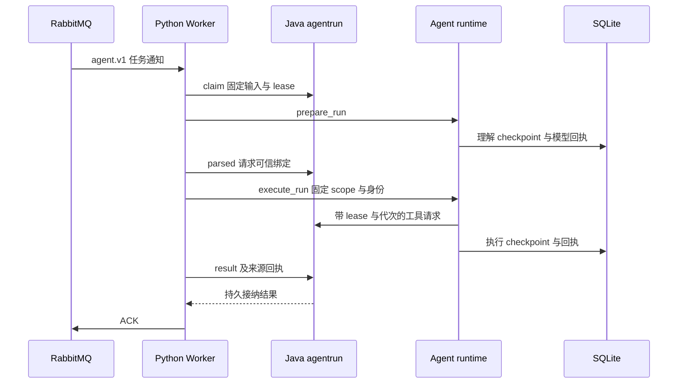

# Python Agent、Worker 与 CLI

> 叙帧的受控 Agent：用 LangGraph 理解消息、读取固定视频证据、形成剪辑草稿；由 Worker 接入 Java 业务执行协议，或由 CLI 独立开发和验收。

[根 README](../README.md) · [目录职责](#3-目录与子模块职责) · [运行模式](#5-公共入口与使用方式) · [测试](#8-测试与验收)

## 1. 模块定位与边界

Java 保存权威项目、素材、证据、任务和方案；Python 保存图执行 checkpoint、模型调用回执和本地执行预算。模型提议必须经过程序与 Java 校验，不能直接提交业务版本或媒体操作。

| 模式 | 使用者／输入 | 输出与职责边界 |
| --- | --- | --- |
| 浏览器 Worker | `agent.v1` 通知；从 Java 领取固定 RunInput | 理解、工具、结果／澄清／草稿；Java 控制租约、发布和用户接受 |
| Java 真实 CLI | 人的消息、项目／素材或原 thread | 固定 scope 问答／制作；显式 save 保存，预览另行请求 |
| Mock 工具 + 真实模型 | 不传 java-url、也不传 script | 模型读取模拟素材；仍调用 DeepSeek、可能收费，结果 mock=true |
| 完全离线脚本 | `--script` 与固定样本 | 确定场景、Mock 工具与恢复测试，不证明真实模型能力 |

Python 不再执行 ASR、VLM、Embedding 或 Qdrant 索引；这些由 Java 完成。真实模型仅开放四个读取工具，草稿由程序强制校验；按需细读只保留 Mock 模拟，保存／确认／预览／导出不在模型工具目录中。

## 2. 快速导航与安装

| 目的 | 入口 |
| --- | --- |
| 浏览器 Worker | [worker.py](agent_service/worker.py)、[run_transport.py](agent_service/run_transport.py) |
| CLI | [__main__.py](agent_service/__main__.py)、[cli.py](agent_service/cli.py) |
| 核心执行／恢复 | [runtime README](agent_service/runtime/README.md) |
| 读取契约与适配 | [tools README](agent_service/tools/README.md) |
| 严格跨语言类型 | [conversation_contracts.py](agent_service/conversation_contracts.py)、[editing.py](agent_service/editing.py)、[preview.py](agent_service/preview.py) |
| 模型与观测 | [model.py](agent_service/model.py)、[tracing.py](agent_service/tracing.py) |

浏览器模式从仓库根目录使用 `./scripts/start.sh`，无需宿主 Python；Compose 将镜像入口覆盖为 `python -m agent_service.worker`。[Dockerfile](Dockerfile) 使用 Python 3.13。

宿主 CLI／测试沿用已验证的 Python 3.12 开发路径，需安装 uv；在 `agent-service/` 执行：

```bash
uv venv --python 3.12
uv pip sync requirements-dev.lock
.venv/bin/python -m agent_service --help
```

运行锁为 [requirements.lock](requirements.lock)，开发锁为 [requirements-dev.lock](requirements-dev.lock)。不需要为运行 CLI 覆盖根 `.env`；CLI 会读取已有本机配置。完整业务启动及模型凭据见[根快速开始](../README.md#6-快速开始)。

## 3. 目录与子模块职责

| 路径 | 职责 |
| --- | --- |
| [agent_service/runtime/](agent_service/runtime/README.md) | 图节点、条件、预算、回执、等待及恢复；公开 Agent 类在 runner.py |
| [agent_service/tools/](agent_service/tools/README.md) | 工具 schema、证据约束、Mock／Java 执行器 |
| [worker.py](agent_service/worker.py) | MQ 单消费者、Java lease 监督、结果投影、ACK／重连 |
| [run_transport.py](agent_service/run_transport.py) | 带内部凭据的 Worker 请求；RunToolExecutor 强制绑定工具传输 |
| [cli.py](agent_service/cli.py) | 参数、配置加载、JSON／stderr 输出及退出码 |
| [model.py](agent_service/model.py)、[prompts.py](agent_service/prompts.py) | DeepSeek 结构化协议、脚本模型与提示组织 |
| [conversation_contracts.py](agent_service/conversation_contracts.py)、[editing.py](agent_service/editing.py) | camelCase 生命周期 wire 与 snake_case 编辑值、严格校验 |
| [preview.py](agent_service/preview.py) | 独立显式预览 HTTP 客户端；不进入 Agent 图 |
| [config.py](agent_service/config.py)、[tracing.py](agent_service/tracing.py) | 运行配置、dotenv 加载和可选本机 Langfuse |
| [tests/](tests/) | pytest 契约、图／预算／恢复、Worker、预览及回归；fixtures 为固定样例 |
| [scripts/](scripts/) | 显式模型、媒体、崩溃恢复与观测验收，不能一概视为无副作用 |
| [compose.langfuse.yaml](compose.langfuse.yaml) | 可选本机观测栈，与业务数据卷分开 |
| `.local/`、`.venv/` | 本地执行数据／依赖，忽略的生成物，不是源码模块 |

## 4. 内部交互流程



1. Worker 核对 schemaVersion／taskType／UUID，领取输入并核对 inputHash；Java 决定可信项目、制作、scope、thread 和编辑代次。
2. Agent 先理解当前消息；Java 确认是独立问答、新制作、继续制作、关联问题或澄清，再交接执行。重投不拼最新聊天，不重置预算。
3. 工具结果累积证据／分页，DRAFT 强制调用 Java validate_edit_draft；校验通过后才形成 DRAFT_READY 核心视图。
4. Worker 用本执行回执投影公开 RunResult，持续心跳；只有 Java 持久接纳结果／等待／失败／取消后才 ACK。
5. 未 ACK 网络断开会重投；Java 撤销过期 lease，旧执行失去发布资格。SQLite 成功模型回执复用，SUBMITTING／UNKNOWN 停止自动重付。

CLI 复用核心图，但不使用 MQ／Worker 租约；用户显式 save 才调用保存。浏览器必须在 Java 中接受当前完整草稿，不能用 CLI save 绕过。

## 5. 公共入口与使用方式

本节 CLI 命令在 `agent-service/` 执行；全局参数放在子命令前。THREAD_ID、PROJECT_UUID、ASSET_UUID、REQUEST_ID 是实际结果中的标识，不是固定夹具值。

### 离线确定场景

```bash
.venv/bin/python -m agent_service --no-trace --script tests/fixtures/query.json run '缓存如何读取？'
.venv/bin/python -m agent_service --no-trace --script tests/fixtures/clarify.json run '缓存草稿'
.venv/bin/python -m agent_service --no-trace --script tests/fixtures/clarify.json reply THREAD_ID '严格30秒'
```

不传 `--script` 会使用真实 DeepSeek，即使工具仍是 Mock，也需要模型凭据；不能把这种情况称作离线免费运行。

### Java 真实问答、制作与保存

先启动 Java／存储／队列，上传并完成所需来源分析：

```bash
.venv/bin/python -m agent_service --java-url http://localhost:8080 --project PROJECT_UUID --asset ASSET_UUID --data-dir .local/java run '视频讲了哪些步骤？请引用原文'
.venv/bin/python -m agent_service --java-url http://localhost:8080 --data-dir .local/java reply THREAD_ID '只查语音步骤'
.venv/bin/python -m agent_service --java-url http://localhost:8080 --data-dir .local/java resume THREAD_ID
.venv/bin/python -m agent_service --java-url http://localhost:8080 --data-dir .local/java run '把当前草稿缩短' --thread THREAD_ID
.venv/bin/python -m agent_service --java-url http://localhost:8080 --data-dir .local/java save THREAD_ID
```

`--asset` 可重复；首次省略固定项目当前素材范围。真实 run 可能产生 DeepSeek／查询向量费用。问答普通后续消息创建新快照；同一制作修改／补答／恢复沿用固定范围。依赖失效时停止，不偷偷换 heads。save 只接受当前通过校验的真实 CLI 草稿，不自动确认或渲染。

| 命令／核心接口 | 结果与限制 |
| --- | --- |
| `run`、`reply`、`resume` | 核心视图含 thread_id、identity、status、outcome、usage 及可用草稿／校验 |
| `status THREAD_ID`、`cancel THREAD_ID` | 查看／取消独立 CLI 执行；不是浏览器任务操作 |
| `run ... --thread THREAD_ID --new` | 明确开始新需求，不把旧预算清零继续原制作 |
| `save THREAD_ID` | 明确保存，响应丢失时核对 Java 同一保存结果 |
| `complete-mock`、`tool-result` | 仅模拟外部等待场景；真实模式拒绝 |
| `Agent.prepare_run/execute_run` | 核心 API 见 runtime README；不是可直接发布的 wire 结果 |

stdout 为协议 JSON，进度和提示在 stderr。FAILED／INCOMPLETE 退出 1，WAITING 正常退出；Ctrl-C 为 130，不能保证远端费用撤回。mock 标记表示工具／素材模式，不能据此判断是否调用真实模型。

### 显式预览已保存 CLI 制作

```bash
.venv/bin/python -m agent_service --java-url http://localhost:8080 --data-dir .local/java preview THREAD_ID --output out-1
.venv/bin/python -m agent_service --java-url http://localhost:8080 --data-dir .local/java preview-list THREAD_ID
.venv/bin/python -m agent_service --java-url http://localhost:8080 preview-status REQUEST_ID
.venv/bin/python -m agent_service --java-url http://localhost:8080 preview-cancel REQUEST_ID
.venv/bin/python -m agent_service --java-url http://localhost:8080 preview-retry REQUEST_ID
```

单输出可省略 `--output`；多输出按 SavedResult 的 output_key 选择。preview／list 读取原 THREAD_ID 的数据目录；status／cancel／retry 仅需 REQUEST_ID，无需模型或 checkpoint。命令提交后立即返回，不自动轮询、下载、播放或重新保存。

网络中断后用列表核对；普通重复提交复用任务／可用产物，失败、取消或失效需显式 retry。重复 retry(A) 核对固定后继 B；B 再失败要 retry(B)。签名到期重新查详情，不重新渲染。取消共享任务影响复用请求，CANCEL_REQUESTED 不等于已停止；任务成功和产物 AVAILABLE 分开判断。访问／协议错误不伪造成 Java 任务失败。

## 6. 依赖与配置

| 配置／对象 | 默认或来源 | 边界 |
| --- | --- | --- |
| `DEEPSEEK_API_KEY`、`DEEPSEEK_BASE_URL` | 人工提供；URL 默认 https://api.deepseek.com | 模型固定 deepseek-flash，thinking 关闭、非流式、SDK max_retries=0，超时 60 秒 |
| `INTERNAL_WORKER_TOKEN` | 根启动脚本生成 | 仅内部传输，不进入模型参数 |
| `JAVA_URL` | Worker 默认 http://business-api:8080 | CLI 使用显式 --java-url，不自动沿用该变量 |
| `RABBITMQ_HOST`、`RABBITMQ_PORT`、`RABBITMQ_USER`、`RABBITMQ_PASSWORD` | Worker 默认 rabbitmq／5672／agentic-worker；密码必需 | agent.v1，prefetch=1，exclusive consumer |
| `AGENT_DATA_DIRECTORY` | Config 从进程环境取，默认 .local；Compose /state | agent.sqlite 及锁文件，持久 agent_state 卷 |
| `Limits` | [policy.py](agent_service/runtime/policy.py) | 模型 12 次、工具 20 次、修正 3 次、活动 300 秒；其它限制见 runtime |
| `LANGFUSE_PUBLIC_KEY`、`LANGFUSE_SECRET_KEY`、`LANGFUSE_BASE_URL` | 可选本机观测；CLI localhost:3035，Worker host.docker.internal:3035 | 观测不是业务状态或付费回执权威 |

CLI 按进程环境优先，随后依次补读根 `.env`、模块 `.env.langfuse`、模块 `.env`；dotenv 不覆盖已存在环境。CLI 默认目录在参数解析时创建 Config，建议用 `--data-dir` 明确指定，而非依赖后加载 dotenv 改变默认。Worker 由 Compose 注入环境，不加载 CLI dotenv。

### 可选本机 Langfuse

在 `agent-service/` 执行；setup 生成本机私有 `.env.langfuse`，已有文件不覆盖：

```bash
.venv/bin/python scripts/setup_langfuse.py
docker compose --env-file .env.langfuse -f compose.langfuse.yaml up -d
curl -f http://localhost:3035/api/public/health
```

管理界面 [http://localhost:3035](http://localhost:3035)，初始化用户信息读取私有配置，不写入 README。根 `scripts/start.sh` 在该配置存在时把公钥／密钥与容器访问地址注入 Worker。Tracer 限定本机自托管地址，缺配置或服务暂不可用会提示且不改变 Agent 业务决策。已发生而未采集的请求不会补回。

## 7. 错误处理、日志与恢复

- 线程／Worker 文件锁与 MQ exclusive consumer 保证当前单实例边界；不能直接扩容或删除 SQLite 来重试。
- 凭据、HTTP 资格或协议错误明确失败；工具传输未知不自动重交，因为查询 Embedding 可能已收费。
- 修正、模型／工具次数、活动时间与无进展均有限。视频事实必须引用已读来源；视觉点不能伪造持续区间；目录分页读完不代表视觉完整覆盖。
- 浏览器只有确有恢复点且没有不确定付费回执的 EXECUTION_INTERRUPTED 可显式重试；UNKNOWN／预算耗尽不提供强制重付入口。
- Worker 使用标准日志、进度只映射公开阶段；Trace 通过 conversationId 分组。不要输出内部 Token、完整签名 URL 或私有配置。

## 8. 测试与验收

以下命令从仓库根目录执行；开发依赖先按上文安装：

```bash
agent-service/.venv/bin/python -m pytest agent-service/tests -m 'not live' -q
```

局部回归按 runtime／tools README 选择。契约、模型协议、预算、保存、预览与 Worker 均有受控测试；Java 跨进程 Worker 测试另见[后端 README](../backend/README.md)。文档修改只检查文档，不运行这些应用测试。

| 验收入口 | 使用什么／影响什么 | 边界 |
| --- | --- | --- |
| [verify_java_m1.py](scripts/verify_java_m1.py) | 新上传、百炼分析、Java 工具与 DeepSeek | 付费，创建账号／项目／素材 |
| [verify_java_agent.py](scripts/verify_java_agent.py)、[verify_java_resume.py](scripts/verify_java_resume.py) | 既有样本范围、脚本／真实问答及恢复 | 真实查询可能产生 Embedding／DeepSeek 费用 |
| [verify_java_m2.py](scripts/verify_java_m2.py) | 既有素材制作、修改、显式保存与失败样本 | 可付费、保存新方案；操作见 M2 验收记录 |
| [verify_java_m4.py](scripts/verify_java_m4.py) | 已保存制作预览、下载及媒体核对 | 不调用模型，但创建媒体任务和文件 |
| [verify_java_m4_faults.py](scripts/verify_java_m4_faults.py)、[verify_java_crash.py](scripts/verify_java_crash.py) | 服务／进程故障恢复实验 | 会中断本机服务，不在共享任务运行中随意执行 |
| [verify_langfuse.py](scripts/verify_langfuse.py)、[verify_worker_langfuse.py](scripts/verify_worker_langfuse.py) | 本机观测采集核对 | 先读脚本及对应记录，不把 Trace 当业务验收 |

当前验收参数、样本来源及证据见下方阶段记录；本机旧 UUID 和忽略目录不可直接作为其它部署的固定输入。真实付费、自动媒体核验和人工观看试听分别报告。

## 9. 扩展与维护

新增工具先维护 tools 的严格契约、Java 白名单、哈希与共享样例；新动作同时维护 runtime 的预算、来源自检和恢复。新增浏览器关系需更新 Java AgentRunContracts 与 Python conversation_contracts，不能只改提示。

模型适配只管协议，不执行工具；模型成功响应先持久保存再解析，未知状态不能吞掉。保持 CLI 人机命令、Worker 租约适配和图核心分离。已有保存版本派生编辑、真实按需细读、批量渲染不因增加 CLI 参数就自动具备。

## 10. 术语与相关文档

thread 是图 checkpoint 的延续身份，execution 是预算／付费回执身份，task／attempt 是 Java 调度与发布资格；scope 是固定证据范围，production 是制作需求。它们不等同于制作会话或方案版本，完整定义见[领域术语](../GLOSSARY.md)。

[根 README](../README.md) · [后端 README](../backend/README.md) · [前端 README](../frontend/README.md) · [运行时](agent_service/runtime/README.md) · [工具模块](agent_service/tools/README.md)

[Agent MVP 设计](../docs/agent-mvp-design.md) · [当前生命周期设计](../docs/conversation-lifecycle-browser-design.md) · [生命周期验收](../docs/verification/conversation-lifecycle-step7.md)

[M1 Python 接入](../docs/verification/java-tools-m1-stage4.md) · [M1 综合验收](../docs/verification/java-tools-m1-stage5.md) · [M2 真实制作验收](../docs/verification/java-tools-m2-stage5.md) · [M4 媒体与故障验收](../docs/verification/java-tools-m4.md)
