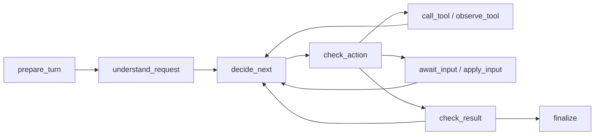

# LangGraph 运行时

> 执行受预算约束的理解、决策、工具读取、草稿校验、澄清和恢复；使用 SQLite 同时保存图 checkpoint 与不可回滚的模型调用回执。

## 1. 模块定位与边界

[CLI](../cli.py) 调用 `Agent.send/resume/save`，浏览器 [Worker](../worker.py) 调用 `Agent.prepare_run/execute_run`。输入为消息或 Java 固定 RunInput 与可信绑定；输出是核心执行视图，不是直接发往浏览器的 RunResult。

本包依赖 LangGraph、SQLite、上层模型／工具适配、可选 Tracer。权限、MQ、租约、Java 编辑代次授权和公开结果发布由 Worker／Java 管理；运行时不自行给浏览器制作创建业务身份。普通问答／讨论不能暗中覆盖制作条件。

## 2. 快速导航与目录职责

| 路径 | 职责／关键符号 |
| --- | --- |
| [runner.py](runner.py) | `Agent` 公共入口、线程锁、执行驱动、CLI 显式保存及核心视图 |
| [conversation.py](conversation.py) | 固定 RunInput 接纳、理解／执行交接、可信绑定及补答预算归集 |
| [graph.py](graph.py) | `build_graph` 连接节点，统一按 next_node 路由 |
| [state.py](state.py) | Requirements、Understanding、Action、State、Context 与条件来源合并 |
| [calls.py](calls.py) | 稳定模型 call_id、输入哈希、调用前登记与响应复用 |
| [persistence.py](persistence.py) | Store：executions、model_calls、conversation_runs、execution_transfers |
| [policy.py](policy.py) | Limits、错误类别、fingerprint、活动时间及取消检查 |
| [nodes/request.py](nodes/request.py) | 准备当前轮次、理解消息及关系 |
| [nodes/decision.py](nodes/decision.py) | 下一步决策、动作准入、有限修正 |
| [nodes/tools.py](nodes/tools.py) | 调用／观察工具、分页覆盖、校验问题与进度判定 |
| [nodes/waiting.py](nodes/waiting.py) | LangGraph interrupt 与原 wait_id 的恢复输入 |
| [nodes/result.py](nodes/result.py) | 引用／范围／草稿自检及终态投影 |
| `__init__.py`、`nodes/__init__.py` | 包标记；不另导出一套公共服务 |

完整安装与命令从[Agent README](../../README.md)进入；本包没有单独进程。

## 3. 架构与内部交互流程



图示为核心分支；实际动态边以 graph.py 的 next_node 为准。

### 生成并修改真实草稿

1. CLI send 固定范围，或浏览器先 prepare_run 产生本地 PARSED，再由 Java 确认关系与 scope／production／编辑代次。
2. execute_run 验证绑定与固定输入一致；独立问答用本轮 thread，继续制作才读取原制作上下文，补答必须恢复原 question／wait。
3. 决策读取工具，累积真实证据与分页范围。DRAFT 动作由程序强制转为 validate_edit_draft，模型不能略过。
4. 校验未通过时保存完整结构化问题，有限修正；相同问题无进展或预算耗尽返回 INCOMPLETE。成功核对当前哈希与引用后返回 DRAFT_READY。
5. CLI 由用户另行 save；浏览器由 Java 接受事务保存和确认，不调用 CLI save。

### 中断与补答

checkpoint 采用同步持久化；Store 在远端提交前保存 SUBMITTING、收到后保存响应。恢复复用成功回执，SUBMITTING／UNKNOWN 停止自动重付。问题等待不计活动耗时；理解到原执行的调用数／活动时间通过 execution_transfers 只归集一次。重投不换最新聊天、不重置预算。

## 4. 公共接口与数据契约

| 符号 | 输入 | 输出／边界 |
| --- | --- | --- |
| `Agent.send` | content、可选 thread_id／new | 独立 CLI 核心视图 |
| `Agent.prepare_run` | RunInput 对象或 camelCase JSON | 本地 PARSED、parsed_input 与 usage；不是公开 RunResult |
| `Agent.execute_run` | RunInput、identity、scope、production、question、edit_generation | 已绑定执行的核心视图 |
| `Agent.inspect/resume/cancel` | thread_id、可选恢复 payload | 状态／原 wait 恢复／取消 |
| `Agent.save` | CLI thread_id | 显式保存结果核对；仅真实 CLI 制作 |
| `build_graph` | checkpointer | 编译后的 StateGraph |
| `Store.reserve/received/unknown` | 稳定调用身份与输入／响应 | 调用回执与预算治理 |

State 保存序列化值；Context 保存活客户端、凭据外的执行依赖和停止回调。核心视图使用 snake_case；wire 的 camelCase／RunResult 转换位于 Worker。Requirements 的 output_key 与永久 outputId 分开，时间为整数毫秒。

## 5. 依赖与配置

[Config](../config.py) 注入目录、Limits、Mock 场景和 trace 开关；目录默认取进程 `AGENT_DATA_DIRECTORY`，否则 `.local`。数据库文件为 `agent.sqlite`；不得删回执来绕过未知提交。配置持久化需要父服务负责挂载。

| Limits 字段 | 当前默认值 | 语义 |
| --- | --- | --- |
| model_calls／tool_calls | 12／20 | 同一执行的模型／工具预算 |
| repairs／attempts／no_progress | 3／2／3 | 修正、安全工具尝试、连续无进展上限 |
| active_seconds | 300 | 活动执行时间，等待不计入 |
| output_tokens | 8192 | 模型输出上限 |
| prompt_bytes／tool_bytes | 1048576／32768 | 输入／工具反馈序列化字节上限 |

以 policy.py 的实际值为准；这些是 Python 值对象默认值，没有一组同名环境变量开关。模型参数与 HTTP 超时在上层 model／tools 中定义。

## 6. 错误处理与观测

取消、预算耗尽、模型格式问题、未知提交分别处理；只有 MODEL_REPAIRABLE 或明确提交未发生的 TemporaryToolError 进入有限修正／安全尝试。工具错误、身份错配或失效 scope 不当空结果。

真实问答只引用已读、同版本、合法时间的记录；视觉问题不能只拿语音充作画面依据。目录读完与分析完整覆盖不同。progress 回调只报告阶段，Tracer 为可选；观测服务不改变路由或执行状态。

## 7. 测试

从仓库根目录执行，先按父 README 安装开发依赖：

```bash
agent-service/.venv/bin/python -m pytest agent-service/tests/test_agent_scenarios.py agent-service/tests/test_resume_and_limits.py agent-service/tests/test_conversation_runtime.py agent-service/tests/test_real_production.py -m 'not live' -q
```

脚本模型、MockExecutor、受控 Java HTTP／保存回执用于验证图与恢复，不证明真实模型能力。跨语言生命周期同时核对 Java AgentRunContractsTest／AgentRunsApiIntegrationTest，详见[后端模块](../../../backend/README.md)。文档修改不运行这些应用测试。

## 8. 扩展与维护

- 新动作先扩展 State／Action，再明确 check_action、错误、预算和结果校验路径；不要让模型返回直接可执行业务命令。
- 新节点更新 graph.py，并验证等待／取消／重启后的恢复点；客户端和凭据不能写入 State。
- 修改条件必须保持来源和草稿失效规则；制作失败后插入独立问答不能重新开放旧稿保存。
- 修改回执表或模型调用身份时保留已有 SQLite 的重放与未知状态，不能依靠 checkpoint 回退撤销远端费用。

## 9. 相关文档

[根 README](../../../README.md) · [领域术语](../../../GLOSSARY.md) · [Agent README](../../README.md) · [工具模块](../tools/README.md)

[运行设计](../../../docs/langgraph-agent-runtime-design.md) · [当前生命周期设计](../../../docs/conversation-lifecycle-browser-design.md) · [生命周期 Python 交接](../../../docs/verification/conversation-lifecycle-step2.md)
