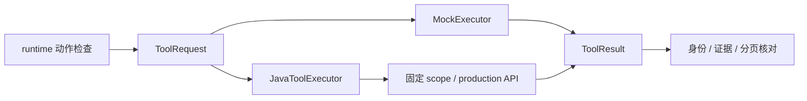

# Agent 工具契约与执行适配

> 定义模型可见能力、严格工具请求／反馈和证据时间语义，并将执行切换到明确标记的 Mock 或固定 Java 范围。

## 1. 模块定位与边界

runtime 决定下一步和持久执行，ToolExecutor 负责一次调用。本包输入 ToolRequest，输出 ToolResult；JavaToolExecutor 接入可信 scope／production，浏览器 RunToolExecutor 在上层改写为带租约的传输。

真实读取只开放 list_assets、get_video_overview、search_evidence、read_video_range；validate_edit_draft 由图强制调用，不供模型跳过或自行触发保存。按需细读只在 Mock 中模拟；确认、保存、预览、导出不在模型工具目录中。真正权限、业务校验和证据权威均在 Java。

## 2. 快速导航与目录职责

| 路径 | 职责 |
| --- | --- |
| [executor.py](executor.py) | `ToolExecutor` Protocol，仅暴露异步 execute |
| [contracts.py](contracts.py) | 参数 Pydantic 模型、ToolRequest／ToolResult、反馈字节上限 |
| [catalog.py](catalog.py) | READ_TOOLS、DESCRIPTIONS、DISABLED 和 model_tools |
| [evidence.py](evidence.py) | valid_evidence 校验版本、来源与 POINT／INTERVAL 时间语义 |
| [java.py](java.py) | JavaToolExecutor：scope 恢复、制作绑定／保存和工具 HTTP |
| [mock.py](mock.py) | MockExecutor、确定样本／场景和模拟校验 |
| [sample.json](sample.json) | 固定 Mock 素材与观察样本 |
| `__init__.py` | 包标记，不持有全局客户端 |

本包不单独启动；公共运行示例见[Agent README](../../README.md)。浏览器传输适配见 [run_transport.py](../run_transport.py)。

## 3. 架构与内部交互流程



1. 图按 PARAMETERS 校验模型参数、补齐规范参数并生成 call_id／request_hash；项目、scope 和凭据由可信适配层提供。
2. JavaToolExecutor.snapshot 首次创建 scope，恢复时 GET 原 scope 并核对完整相等；不能默默换最新分析。
3. 读取走 `/scopes/{scope_id}/tools`，校验走 `/productions/{requirement_id}/tools`；浏览器子类改走 `/internal/v1/agent-runs/{task}/tools` 并携带当前资格。
4. 响应严格核对 call_id、tool_name、request_hash、mock=false 和非 PENDING；运行时再核对证据身份，累积当前范围每一页。
5. 独立 CLI 的 bind／save／saved 是可信人机命令能力，不会通过 model_tools 暴露给模型；浏览器禁止使用 CLI 写路径。

## 4. 公共接口与数据契约

| 名称 | 输入 | 输出／约束 |
| --- | --- | --- |
| `ToolExecutor.execute` | ToolRequest | 异步 ToolResult |
| `ToolRequest` | call_id、tool_name、arguments、request_hash | 不允许额外字段 |
| `ToolResult` | 原调用身份、status、data／coverage／records | READY／PENDING／ERROR；后两者需 dependency／error |
| `JavaToolExecutor.snapshot` | 可选原 scope | 固定 scope 并设置 scope_id |
| `JavaToolExecutor.bind/save/saved` | 制作身份／SaveRequest | 可信绑定／SavedResult 或尚未保存 |
| `model_tools(mock)` | 能力模式 | 模型可见 JSON Schema；不含 validate_edit_draft |
| `valid_evidence` | record、asset、mock | 时间／来源／版本是否合法 |

读取参数：list_assets 只含 cursor；overview 加 asset_id；search 加 query、source_kinds、asset_ids；range 加 asset_id、start_ms、end_ms。cursor 默认 0，source_kinds 默认 SPEECH。新范围从 0 开始；续页保持素材与起止值，用返回 next_cursor，直到 null。

records 在 ToolResult 顶层；分页游标在 data。语音为 `[start_ms,end_ms)`，真实视觉为 `time_kind=POINT`／observed_at_ms，不附造出的 start_ms／end_ms。分页完成只说明已有记录已消费，不说明分析无遗漏。

request_hash 对 `{tool,args}` 的键排序、紧凑 UTF-8 JSON 做 SHA-256；Java 核对原样请求参数，不能在传输后再补默认值。校验／保存的数据类型来自 [editing.py](../editing.py)。

## 5. 依赖与配置

依赖 Pydantic、httpx 和 Python 编辑契约；不依赖 LangGraph 内部对象。JavaToolExecutor 构造时提供 base_url、INTERNAL_WORKER_TOKEN、首次项目／素材范围；凭据只留在实例传输中，不放入模型上下文或 checkpoint。

HTTP 超时 60 秒、不跟随重定向、无自动重交。反馈 bounded 由 runtime 的 Limits.tool_bytes 控制，默认 32768 字节；Mock 样本不是环境配置或真实分析结果。无独立 Feature Flag。

## 6. 错误、重试与观测

Java HTTP 身份失败映射 PERMISSION_DENIED，传输中断为 TOOL_TRANSPORT_UNCERTAIN／EXECUTION_UNCERTAIN；格式错误、mock 响应或身份错配也明确停止。真实工具不接受 PENDING，不把网络失败当无匹配。

runtime 只允许 MODEL_REPAIRABLE 反馈回到模型修正；工具传输可能已提交查询 Embedding，不自动重新支付。工具调用的 Tracer 包装由 runtime 承担，本包不另外建立日志／指标权威。

## 7. 测试

从仓库根目录运行相关非付费回归：

```bash
agent-service/.venv/bin/python -m pytest agent-service/tests/test_tool_contracts.py agent-service/tests/test_java_read_tool_contract.py agent-service/tests/test_java_executor.py agent-service/tests/test_editing_contracts.py -m 'not live' -q
```

Mock 样本和 httpx 受控 transport 分别验证模拟能力与真实 wire 适配；共享样例见 [fixtures](../../tests/fixtures/) 和 [Java contracts](../../../backend/src/test/resources/contracts/)。Java 对应 ReadToolsIntegrationTest／ToolJsonTest／DraftValidationIntegrationTest；变更哈希、分页或契约时双方一起核对。

## 8. 扩展与维护

新增读取工具同时维护 PARAMETERS、catalog、执行适配、Java 白名单与共享样例；必须给出来源和覆盖语义。新增具有副作用的能力先明确业务授权及回执，不只在 catalog 增加名称。

修改 Mock 保留 mock=true，不让其结果用于真实验收。修改证据字段同步检查 runtime 的引用／范围校验。不要将保存、确认或媒体操作包装成模型可自由调用的读取工具。

## 9. 相关文档

[根 README](../../../README.md) · [领域术语](../../../GLOSSARY.md) · [Agent README](../../README.md) · [运行时](../runtime/README.md) · [Java 工具](../../../backend/src/main/java/com/agenticvideo/business/tools/README.md)

[Java 工具设计](../../../docs/java-tools-m1-design.md) · [M2 草稿契约](../../../docs/java-tools-m2-design.md) · [Python 接入记录](../../../docs/verification/java-tools-m1-stage4.md)
