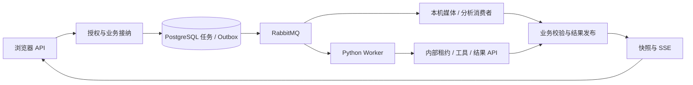

# Java 后端

> 叙帧的权威业务服务：提供浏览器与内部 API，管理项目、素材、证据和方案，并在同一 Java 进程执行媒体与基础分析任务。

[根 README](../README.md) · [模块地图](#3-目录与模块职责) · [配置](#6-依赖与配置) · [测试](#8-测试)

## 1. 模块定位与边界

浏览器只访问本服务的同源业务入口；Python Worker 通过内部 API 领取执行、读取固定证据并提交结果。PostgreSQL 保存权限、上传、证据、会话、方案、确认、任务、回执与 Outbox，Silo 保存媒体对象，Qdrant 保存可重建索引。

根 Maven 仅包含 `backend` 一个子工程。Compose 服务名仍为 `business-api`，媒体／分析消费者与 HTTP 服务在同一进程；Python Agent 是相邻的独立服务。本模块不在 Java 运行 LangGraph，不让浏览器直接调用模型，也不将 MQ 通知或 Python checkpoint 当业务状态权威。

当前入口是持续会话 `/turns`、草稿预览／接受和作品导出；旧 Worker／Agent HTTP 执行路径默认关闭，历史测试开启 legacy 不表示该部署受支持。

## 2. 快速导航

| 目的 | 入口 |
| --- | --- |
| Spring Boot 启动 | [BusinessApiApplication.java](src/main/java/com/agenticvideo/business/BusinessApiApplication.java) |
| 构建与部署 | [pom.xml](pom.xml)、[Dockerfile](Dockerfile)、[根 Compose](../compose.yaml) |
| 应用配置 | [application.properties](src/main/resources/application.properties) |
| 数据库结构 | [Flyway 迁移](src/main/resources/db/migration/) |
| 当前对话接纳／发布 | [agentrun](src/main/java/com/agenticvideo/business/agentrun/README.md) |
| 工具、草稿与媒体 | [tools](src/main/java/com/agenticvideo/business/tools/README.md)、[plan](src/main/java/com/agenticvideo/business/plan/README.md)、[render](src/main/java/com/agenticvideo/business/render/README.md) |
| 调试与验证 | [Java 测试](src/test/java/com/agenticvideo/business/)、[共享契约夹具](src/test/resources/contracts/) |

从仓库根目录启动完整业务栈：

```bash
./scripts/start.sh
```

首次配置、模型凭据和入口验证见[根快速开始](../README.md#6-快速开始)。Dockerfile 同时构建前端、复制静态资源并安装 FFmpeg／ffprobe 和 CJK 字体；宿主 Maven 打包不自动构建前端。

## 3. 目录与模块职责

| 路径／模块 | 负责什么 | 主要协作方 |
| --- | --- | --- |
| [auth](src/main/java/com/agenticvideo/business/auth/README.md) | 注册登录、会话、CSRF、Origin、认证限流 | project、所有浏览器 API |
| [project](src/main/java/com/agenticvideo/business/project/README.md) | 私有项目与 owner 授权 | 认证与业务资源 |
| [upload](src/main/java/com/agenticvideo/business/upload/README.md) | 上传、续传、存储分片与清理 | project、storage、Silo |
| [asset](src/main/java/com/agenticvideo/business/asset/README.md) | 素材详情、证据和原片播放授权 | upload、analysis |
| [storage](src/main/java/com/agenticvideo/business/storage/README.md) | 全局容量及未来写入预算 | upload、render |
| [media](src/main/java/com/agenticvideo/business/media/README.md) | 媒体探测、音频、代表帧与渲染 | task、Silo、FFmpeg |
| [bailian](src/main/java/com/agenticvideo/business/bailian/README.md) | 百炼模型具体协议和有界 HTTP | analysis、search |
| [analysis](src/main/java/com/agenticvideo/business/analysis/README.md) | 原始观察、分析状态及阶段恢复 | media、bailian、search |
| [search](src/main/java/com/agenticvideo/business/search/README.md) | 检索单元、索引代次、混合排名 | PostgreSQL、Qdrant、usage |
| [tools](src/main/java/com/agenticvideo/business/tools/README.md) | 固定 scope、工具身份／分页／回执 | search、plan |
| [conversation](src/main/java/com/agenticvideo/business/conversation/README.md) | 会话、消息、公开事件与快照 | agentrun、project |
| [agentrun](src/main/java/com/agenticvideo/business/agentrun/README.md) | 新版运行、租约、绑定、发布与草稿接受 | tools、plan、Python Worker |
| [plan](src/main/java/com/agenticvideo/business/plan/README.md) | 草稿校验、来源及不可变版本 | tools、analysis、render |
| [render](src/main/java/com/agenticvideo/business/render/README.md) | 预览、确认、导出和产物生命周期 | plan、task、media |
| [task](src/main/java/com/agenticvideo/business/task/README.md) | 原子执行资格、取消、结果与恢复 | 各业务结果发布器 |
| [messaging](src/main/java/com/agenticvideo/business/messaging/README.md) | Outbox 发布、Java MQ 消费及确认 | RabbitMQ、task |
| [usage](src/main/java/com/agenticvideo/business/usage/README.md) | 存储核算、模型用量与非阻断预警 | Silo、回执、project |
| [src/main/resources](src/main/resources/) | 应用属性及数据库迁移 | Spring、Flyway |
| [src/test](src/test/) | 单元／基础设施集成测试与跨语言样例 | Testcontainers、宿主媒体工具、Python |

这些是同一应用内的职责边界，不是独立部署服务；包间通过具体服务协作，不要求每个包增加一层 Repository。

## 4. 架构与内部交互流程



### 上传、分析与读取

1. UploadService 预留容量并建立 multipart；浏览器直传 Silo，完成时核对存储并创建媒体任务。
2. `media.v1` 消费后经 LocalTaskRunner 原子接纳，在本机执行 ffprobe／FFmpeg；当前代次核对通过后发布素材及时间映射。
3. `analysis.v1` 分别推进 ASR、VLM、Embedding／索引，模型原始响应先保存再解析；一种来源失败不抹去另一种已成功来源。
4. QuestionScopes 固定素材、分析、索引及证据可见集合；工具分页读取沿原 scope，不跟随最新 heads。

### 会话、草稿与成片

1. `/turns` 在事务中固定 RunInput、消息、turn、任务与 Outbox；`agent.v1` 调度 Python 理解当前消息。
2. Java 验证 ParsedInput 后绑定 scope、制作、问题关系与编辑代次；工具和结果必须带当前 attempt／lease。
3. 草稿须通过 Java 的范围、证据、切点、时长和字幕校验；低清预览不生成版本。
4. 用户接受当前完整草稿，原子形成并确认不可变 V1；正式导出仍由用户另行选择一条输出发起。

## 5. 公共接口与数据契约

| 调用者 | 接口族 | 身份／响应 |
| --- | --- | --- |
| 浏览器 | `/api/v1/auth`、`/projects`、`/uploads`、`/assets` | 会话 Cookie；写请求 CSRF 与 Origin；通常 data/requestId |
| 浏览器工作台 | conversations、turns、snapshot、events、plans／revisions、previews／export-requests、artifacts、usage | 当前账号归属校验；SSE 有项目序号 |
| Python CLI | `/internal/v1/questions/**` | INTERNAL_WORKER_TOKEN Bearer；snake_case scope／ToolResult／保存响应，无浏览器包装 |
| Python Worker | `/internal/v1/agent-runs/{task}/**` | Bearer + attempt／lease／编辑代次；外层 data |
| 显式 CLI 预览 | `/internal/v1/productions/{requirementId}/previews`、`/internal/v1/previews/{requestId}` 及取消／重试 | 独立 PreviewContracts；只接受已保存制作 |

具体字段以对应包的 Controller／Contracts 为准。[HTTP 设计](../docs/api-contract.md)保留原始规格，新增生命周期契约看 [AgentRunContracts](src/main/java/com/agenticvideo/business/agentrun/AgentRunContracts.java)、[EditDraftContracts](src/main/java/com/agenticvideo/business/plan/EditDraftContracts.java)和 [PreviewContracts](src/main/java/com/agenticvideo/business/render/PreviewContracts.java)。

时间统一按各契约的整数毫秒表达：语音是区间，视觉是实际观察点；source／audio／output 坐标不能混用。`output_key` 是草稿键，`outputId` 是保存后的永久标识。校验成功、用户接受、方案确认和正式导出是独立边界。

## 6. 依赖与配置

外部依赖和版本见 [pom.xml](pom.xml)、[根 POM](../pom.xml)与[Compose](../compose.yaml)。完整环境变量表及固定注入范围见[根配置](../README.md#8-配置说明)。

| 配置组 | 本模块解释 |
| --- | --- |
| `DATABASE_*` | Flyway 与业务数据库；Hibernate 只 validate，不自动建表 |
| `STORAGE_*`、`CAPACITY_*` | 对象内外地址、签名与真实挂载卷余量；原片和工作区都核算 |
| `RABBITMQ_*`、`TASKS_DISPATCH_ENABLED` | 持久通知与恢复，应用默认不派发，Compose 固定开启 |
| `TASKS_CONSUME_ENABLED` | 默认跟随派发；本机消费者同步执行 |
| `ANALYSIS_EXECUTION_ENABLED` | 应用默认 false、Compose 默认 true；上传可能产生模型费用 |
| `DASHSCOPE_API_KEY`、`DASHSCOPE_BASE_URL`、`QDRANT_URL` | 模型分析、查询向量和检索 |
| `INTERNAL_WORKER_TOKEN` | 内部 Bearer；不能放入浏览器或模型参数 |
| `LEGACY_AGENT_ENABLED`、`LEGACY_WORKER_ENABLED`、`LEGACY_INSPECTION_ENABLED` | 默认 false；不是推荐运行模式 |
| `MODEL_RECORD_REQUEST_MAX_BYTES`、`MODEL_RECORD_RESPONSE_MAX_BYTES` | 16 MiB／4 MiB 默认上限，均须为正数；不是模型 Token 窗口 |

Compose 默认没有发布数据库／RabbitMQ 宿主端口，直接 `spring-boot:run` 并不自动获得可用宿主基础设施。当前推荐使用 Docker 完整栈，或在明确提供外部依赖后单独调试。

## 7. 错误处理、恢复与观测

- 浏览器与内部 API 使用不同认证和响应协议；未知资源／越权不以客户端项目 UUID 作为授权。
- Java 本机执行用当前 attempt 与进程 active 集合恢复；Python Worker 用网络租约与心跳。二者不能混用。
- Outbox 持久发布、MQ ACK、业务结果提交分开核对；数据库保留失败原因及下一步意图，死信不自动冒充重试成功。
- 付费提交未知时停止自动重付；已保存响应和成功向量复用。取消撤销后续发布资格，不保证撤销提供方已发生费用。
- 查看 `docker compose logs --tail=100 business-api`、数据库任务／调用回执和工作台诊断。Java 运行状态不由 Langfuse 判断；本机 Trace 主要由 Python 采集。

## 8. 测试

下列命令均在仓库根目录执行。需 Docker Desktop、JDK 17、Maven、宿主 FFmpeg／ffprobe；完整 Java 测试还调用 `agent-service/.venv/bin/python`，先按 [Agent README](../agent-service/README.md)安装 Python 开发环境。

```bash
RUN_LIVE_JAVA_ANALYSIS=0 mvn -B -ntp -Dlifecycle.model=false verify
```

按当前包 README 选择局部回归，例如：

```bash
mvn -B -ntp -pl backend -am test -Dtest=ReadToolsIntegrationTest,ToolJsonTest -Dsurefire.failIfNoSpecifiedTests=false
```

Testcontainers 隔离 PostgreSQL／Silo／RabbitMQ；LocalAnalysis 使用受控模型提供方，LocalMedia 使用真实宿主媒体工具。跨语言契约与样例分别位于 [Java contracts](src/test/resources/contracts/) 和 [Python fixtures](../agent-service/tests/fixtures/)。

真实媒体浏览器验收可在前端已构建、Chrome 与 Python 环境就绪后，加 `-Dlifecycle.browser=true -Dlifecycle.model=false`；当前清单与证据见[前端验收](../docs/verification/frontend-redesign-stage.md)。JavaAnalysisLiveTest 由显式付费[脚本](../scripts/README.md)开启；没有凭据或被跳过不计为成功。文档变更只做链接、命令和差异检查。

## 9. 扩展与维护

新增业务资源先明确 owner、输入契约、事务与恢复边界，再放入对应包；不要将 Controller、MQ 或 FFmpeg 细节混入协议值对象。新增任务同时维护生产事务、路由、执行、结果、恢复与容量释放。

数据库变更新增 Flyway 迁移并验证约束，不能依赖 Hibernate 改表。Java／Python JSON、哈希或工具参数变更要同时核对双方解析与共享样例。新增模型动作先明确回执和未知提交策略，不能在 HTTP 层盲目自动重试。

## 10. 相关文档

[根 README](../README.md) · [领域术语](../GLOSSARY.md) · [工程约定](../AGENTS.md) · [Agent README](../agent-service/README.md) · [前端 README](../frontend/README.md)

- [当前生命周期设计](../docs/conversation-lifecycle-browser-design.md)
- [Java 工具 M1 设计](../docs/java-tools-m1-design.md)、[M2 草稿与保存](../docs/java-tools-m2-design.md)、[M4 预览](../docs/java-tools-m4-design.md)
- [M1 综合验收](../docs/verification/java-tools-m1-stage5.md)、[M2 验收](../docs/verification/java-tools-m2-stage5.md)、[M4 验收](../docs/verification/java-tools-m4.md)
