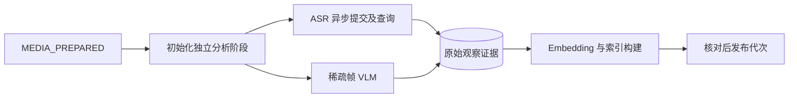

# 基础分析、时间证据与阶段恢复

> 把已验证媒体转为语音、画面和可见文字观察，保留模型回执及时间坐标，并分别发布分析与索引状态。

## 1. 模块定位与边界

媒体准备成功后由 TaskExecution 初始化分析版本；analysis.v1 消费 CONTENT_ANALYZE、VISION_ANALYZE、INDEX_BUILD，经 AnalysisProcessing 执行。依赖 bailian、media、search、task、storage 和 PostgreSQL。分析只提供观察依据，不生成剪辑方案，也不保证逐帧理解；按需视觉补查的 legacy 写入口当前默认关闭。

## 2. 快速导航

入口：[AnalysisProcessing.java](AnalysisProcessing.java)。本包随 Java 应用启动，没有独立进程；运行、配置与开发工具见[后端 README](../../../../../../../README.md)。下文命令均从仓库根目录执行。

## 3. 目录与文件职责

| 路径 | 职责 |
| --- | --- |
| [AnalysisProcessing.java](AnalysisProcessing.java) | ASR 提交／查询、视觉和 Embedding 步骤；远端请求前后通过任务短事务登记回执 |
| [SpeechAnalysis.java](SpeechAnalysis.java) | 语音分析代次、调用状态、原始语音观察与阶段投影 |
| [SpeechTimings.java](SpeechTimings.java) | 字词边界、源音轨偏移、选段原文与安全切点校验 |
| [VisualAnalysis.java](VisualAnalysis.java) | 代表帧出现记录、重复图像回执复用、视觉证据发布 |
| [VisualController.java](VisualController.java) | 视觉分析接纳和证据代表帧授权 |
| [AnalysisRecoveryController.java](AnalysisRecoveryController.java) | 按 MEDIA／ASR／VISION／EMBEDDING／INDEX 恢复受影响阶段 |
| [VisualInspections.java](VisualInspections.java) | 既有有界视觉补查预算、扩展授权及结果记录 |
| [InspectionController.java](InspectionController.java) | 补查读取／提议及受 legacy 开关保护的写入口 |

## 4. 架构与内部交互流程



1. SpeechAnalysis.initialize 保存媒体分析版本和各来源状态，无音轨时 ASR 标为 NOT_APPLICABLE；视觉沿实际代表帧独立推进。
2. AnalysisProcessing 经 TaskExecution.providerLocal 在短事务中登记动作，事务外调用模型。ASR 保存远端任务身份后 defer，下一次通知继续查询，正常等待不计为失败重试。
3. 提供方完整响应先保存再解析；成功回执复用。视觉相同图像可共用调用，但各次出现的 observedAtMs 分开保留。
4. 发布语音／视觉观察后接纳索引任务，SearchIndexBuilder 写可重建索引，再由业务核对发布；一种来源失败不抹去另一种已成功来源。
5. 用户只恢复失败阶段；结果未知的付费提交停止自动重付，不能通过重试按钮清除原回执。

## 5. 公共接口与数据契约

| 入口／符号 | 输入 | 输出／说明 |
| --- | --- | --- |
| `AnalysisProcessing.execute` | type、LocalRun、stopped | 执行或 defer 当前分析步骤 |
| `POST /api/v1/assets/{asset}/vision-analysis` | 素材 UUID | 接纳／复用视觉任务 |
| `POST /api/v1/assets/{asset}/analysis-stages/{stage}/retry` | 素材与阶段 | 202，原阶段恢复身份 |
| `POST /api/v1/evidence/{evidence}/frame-access` | 视觉证据 UUID | 代表帧访问授权 |
| `SpeechAnalysis.stages/evidence` | 素材 UUID | 分阶段状态／语音证据 |
| `SpeechTimings.select/safeBoundary` | 观察、范围、音轨偏移 | 原文选择及切点问题 |

语音为区间证据，视觉／可见文字为观察点；稀疏覆盖 complete=false。InspectionController 中存在补查接口并不表示当前默认启用。

## 6. 依赖与配置

`ANALYSIS_EXECUTION_ENABLED` 应用默认 false、Compose 默认 true；并发 `ANALYSIS_CONSUMER_CONCURRENCY=2`。ASR 查询 Spring 属性 `analysis.asr-query-seconds` 由 `ASR_QUERY_SECONDS` 映射，默认 5 秒，当前 Compose 未单独传入该变量。模型凭据为 DASHSCOPE_API_KEY。当前 ASR／VLM 模型在 SpeechAnalysis／VisualAnalysis 定义；索引模型与维度由 search 管理。`LEGACY_INSPECTION_ENABLED` 默认 false。

配置生效方式及 Compose 可覆盖范围见[根配置说明](../../../../../../../../README.md#8-配置说明)；Spring 配置来源为[application.properties](../../../../../resources/application.properties)。

## 7. 错误处理与可观测性

PaidUncertain 表示提交可能已发生，禁止自动重付；InvalidResult 表示响应已保留但解析／内容不合法。安全模型读取或索引写入按 task 策略有限重试；ASR 查询超过 30 分钟停止自动查询并保留远端身份。阶段 error_json 和提供方回执是诊断依据；日志不替代已发布证据。

## 8. 测试

分析流程的主要受控供应商回归位于 task.LocalAnalysisIntegrationTest；视觉 API 位于 analysis 测试包，工具与切点规则在 tools 测试包验证。真实百炼由 JavaAnalysisLiveTest 显式付费开启。

```bash
mvn -B -ntp -pl backend -am test -Dtest=LocalAnalysisIntegrationTest,VisualApiIntegrationTest,ReadToolsIntegrationTest,DraftValidationIntegrationTest -Dsurefire.failIfNoSpecifiedTests=false
```

测试源码见[后端测试目录](../../../../../../test/java/com/agenticvideo/business)；集成测试需要 Docker，媒体测试另需宿主 FFmpeg／ffprobe。此处是相关回归命令，文档改动不执行应用测试。

## 9. 扩展与维护

新增来源需同时定义原始观察、来源就绪／失败状态、时间语义、快照可见性与检索索引；不要直接把摘要当原始证据。修改 ASR 时间映射同步核对草稿字幕及切点；修改付费动作同步覆盖保存响应、重启恢复和未知提交。按需细读是否重新开放须另行确认，不能把 legacy 夹具当默认能力。

## 10. 相关文档

[根 README](../../../../../../../../README.md) · [后端模块地图](../../../../../../../README.md) · [领域术语](../../../../../../../../GLOSSARY.md) · [media](../media/README.md) · [bailian](../bailian/README.md) · [search](../search/README.md) · [task](../task/README.md)

[java-tools-m1-design.md](../../../../../../../../docs/java-tools-m1-design.md) · [java-tools-m1-stage2.md](../../../../../../../../docs/verification/java-tools-m1-stage2.md)
