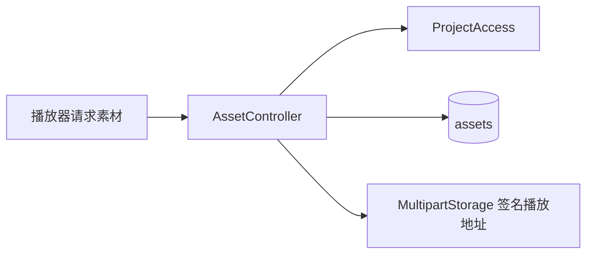

# 素材读取与原片播放授权

> 在项目授权之后提供素材元数据、分阶段分析状态、语音证据和短期原片播放地址。

## 1. 模块定位与边界

使用方是素材库、播放器与制作核查界面。`AssetController` 从 PostgreSQL 读取素材，委托 `project` 授权、`analysis` 组装阶段／证据、`upload.MultipartStorage` 签发地址。不执行上传、媒体探测、模型分析或素材删除。素材列表位于 `upload.UploadController`，不在本包。

## 2. 快速导航

入口：[AssetController.java](AssetController.java)。本包随 Java 应用启动，没有独立进程；运行、配置与开发工具见[后端 README](../../../../../../../README.md)。下文命令均从仓库根目录执行。

## 3. 目录与文件职责

| 路径 | 职责 |
| --- | --- |
| [AssetController.java](AssetController.java) | 三个素材读取／播放端点及所属项目核对；本目录没有下级源码目录 |

## 4. 架构与内部交互流程



1. 通过素材 UUID 查询 `assets`，再核对其 `project_id` 属于当前账号。
2. 详情合并媒体信息、时间映射、失败原因和 `SpeechAnalysis.stages` 返回的分阶段状态。
3. 播放请求仅接受 `validation_status=VALID`，使用对象 key 签发短期地址并返回有效期。证据读取委托 `SpeechAnalysis.evidence`。

## 5. 公共接口与数据契约

| HTTP | 输入 | 输出 |
| --- | --- | --- |
| `GET /api/v1/assets/{id}` | 素材 UUID | filename、validationStatus、byteSize、durationMs、analysis 及可用媒体详情 |
| `POST /api/v1/assets/{id}/playback-access` | 素材 UUID | assetId、filename、durationMs、url、expiresAt |
| `GET /api/v1/assets/{id}/evidence` | 素材 UUID | 语音证据读取结果 |

统一外层为 `data/requestId`。播放地址有效期 300 秒；过期重新授权，不重新渲染。视觉代表帧授权由 `analysis.VisualController` 提供。

## 6. 依赖与配置

无独立开关。对象存储使用 `MultipartStorage` 的 `STORAGE_*` 配置；账号使用浏览器会话。播放签名不是模型工具的素材访问凭据。

配置生效方式及 Compose 可覆盖范围见[根配置说明](../../../../../../../../README.md#8-配置说明)；Spring 配置来源为[application.properties](../../../../../resources/application.properties)。

## 7. 错误处理与可观测性

素材不存在或无权访问返回 404；尚未验证通过时播放返回 409。存储异常沿用对象存储错误映射，不伪造成功 URL。没有独立重试／指标；详情中的 error 是素材已保存的验证结果。

## 8. 测试

本包无独立测试类，HTTP 与真实媒体覆盖分别位于 `upload`、`task` 测试包；前端素材与播放器场景另做集成验证。

```bash
mvn -B -ntp -pl backend -am test -Dtest=UploadApiIntegrationTest,LocalMediaIntegrationTest -Dsurefire.failIfNoSpecifiedTests=false
```

测试源码见[后端测试目录](../../../../../../test/java/com/agenticvideo/business)；集成测试需要 Docker，媒体测试另需宿主 FFmpeg／ffprobe。此处是相关回归命令，文档改动不执行应用测试。

## 9. 扩展与维护

新增详情字段从权威数据库或已有阶段投影取得；所有新增读取端点先执行归属核对。不要把传输完成视作 VALID，也不要把签名到期视作素材失效。涉及时间定位时保留 mediaInfo／timeMapping 原语义。

## 10. 相关文档

[根 README](../../../../../../../../README.md) · [后端模块地图](../../../../../../../README.md) · [领域术语](../../../../../../../../GLOSSARY.md) · [project](../project/README.md) · [upload](../upload/README.md) · [analysis](../analysis/README.md)

[upload-design.md](../../../../../../../../docs/upload-design.md)
