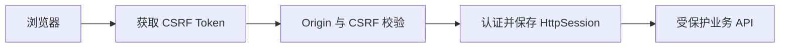

# 账号认证与浏览器请求保护

> 为浏览器提供注册、登录、退出和会话认证，并在写请求入口执行 CSRF、Origin 与认证限流检查。

## 1. 模块定位与边界

使用方是前端工作台及所有受保护浏览器 API。依赖 PostgreSQL `users` 与 Spring Security；认证结果供 `ProjectAccess` 判断项目归属。内部 Worker 使用另一条安全链，本包不签发业务 Token、不管理项目权限或团队共享。

## 2. 快速导航

入口：[AuthenticationController.java](AuthenticationController.java)。本包随 Java 应用启动，没有独立进程；运行、配置与开发工具见[后端 README](../../../../../../../README.md)。下文命令均从仓库根目录执行。

## 3. 目录与文件职责

| 路径 | 职责 |
| --- | --- |
| [AuthenticationController.java](AuthenticationController.java) | 注册、用户名规范化、登录会话建立、退出及当前用户／CSRF 查询 |
| [AuthenticationSecurity.java](AuthenticationSecurity.java) | BCrypt 编码、用户加载、浏览器 SecurityFilterChain 与错误响应 |
| [BrowserRequestProtection.java](BrowserRequestProtection.java) | 写请求 Origin 检查及每来源地址的认证请求限流 |
| [AuthenticationErrors.java](AuthenticationErrors.java) | 参数、账号冲突和认证失败的 HTTP 错误投影 |

## 4. 架构与内部交互流程



1. 浏览器读取 `/api/v1/auth/csrf`；写请求携带 `X-XSRF-TOKEN` 和同源 Cookie。
2. `BrowserRequestProtection` 核对 Origin；注册／登录另按来源地址执行一分钟窗口限流。
3. 注册按 NFKC、去首尾空白、转小写规范化用户名；密码使用 BCrypt，数据库唯一约束拒绝重名。
4. 登录经 `AuthenticationManager` 核验后保存会话上下文；已有会话更换身份标识。退出使原会话失效。

## 5. 公共接口与数据契约

| HTTP | 输入 | 输出／说明 |
| --- | --- | --- |
| `GET /api/v1/auth/csrf` | 无 | `data.csrfToken` |
| `POST /api/v1/auth/register` | `Credentials(username,password)` | 201，用户标识；不自动登录 |
| `POST /api/v1/auth/login` | 同上 | 用户信息与会话 Cookie |
| `GET /api/v1/auth/me` | 已认证 Cookie | 当前用户 |
| `POST /api/v1/auth/logout` | 已认证 Cookie、CSRF | `loggedOut=true` |

用户名字段最多 64 字符；密码校验 8～72 字符，UTF-8 编码还不能超过 72 字节。响应使用 `data/requestId`，错误使用 `error/requestId`。

## 6. 依赖与配置

`APP_ALLOWED_ORIGIN` 默认 `http://localhost:8080`，必须精确匹配协议、主机和端口。`app.auth.max-attempts` 默认 20，是 Spring 属性，当前 Compose 未暴露同名根 `.env` 入口。会话超时 8 小时，Cookie 为 HttpOnly／SameSite=Lax；配置见应用配置。BCrypt cost 为 12，定义在源码。

配置生效方式及 Compose 可覆盖范围见[根配置说明](../../../../../../../../README.md#8-配置说明)；Spring 配置来源为[application.properties](../../../../../resources/application.properties)。

## 7. 错误处理与可观测性

用户名冲突返回 `USERNAME_TAKEN`／409；错误密码为 `INVALID_CREDENTIALS`／401；无会话为 `AUTH_REQUIRED`／401；不可信 Origin 或 CSRF 失败为 `CSRF_REJECTED`／403；限流为 `RATE_LIMITED`／429，附 `Retry-After: 60`。限流状态在进程内，重启后清空。没有单独指标或 Trace 接入；禁止把密码写入日志。

## 8. 测试

测试位于对应 `auth` 测试包，验证真实数据库注册／认证、会话和限流边界；前端另有 `auth.spec.ts`。

```bash
mvn -B -ntp -pl backend -am test -Dtest=AuthenticationApiIntegrationTest,AuthenticationRateLimitIntegrationTest -Dsurefire.failIfNoSpecifiedTests=false
```

测试源码见[后端测试目录](../../../../../../test/java/com/agenticvideo/business)；集成测试需要 Docker，媒体测试另需宿主 FFmpeg／ffprobe。此处是相关回归命令，文档改动不执行应用测试。

## 9. 扩展与维护

新增公开认证端点时同步核对 SecurityFilterChain 的放行范围和 CSRF 行为。修改用户名规则须考虑现有唯一标识；修改密码规则同时维护字符和字节限制。Origin 不是通配 CORS，不能通过放宽内部项目授权解决浏览器 403。

## 10. 相关文档

[根 README](../../../../../../../../README.md) · [后端模块地图](../../../../../../../README.md) · [领域术语](../../../../../../../../GLOSSARY.md) · [project](../project/README.md) · [task](../task/README.md)

[api-contract.md](../../../../../../../../docs/api-contract.md)
