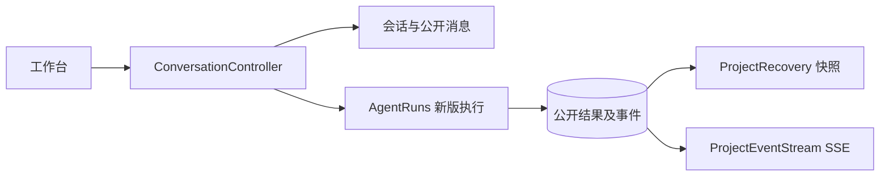

# 制作会话、公开消息与恢复

> 保存项目中的制作会话和公开对话，通过一致快照与项目 SSE 让工作台在刷新和断线后恢复。

## 1. 模块定位与边界

浏览器创建会话、发送原文／引用并订阅项目事件；当前 /turns 委托 agentrun 接纳执行。依赖 project 授权、PostgreSQL 消息／事件、agentrun 当前制作投影及 render 历史请求。本包保留 legacy 对话、问题和模型记录实现供旧契约回归，不代表当前 Worker 仍使用它们；不直接调用模型或 FFmpeg。

## 2. 快速导航

入口：[ConversationController.java](ConversationController.java)。本包随 Java 应用启动，没有独立进程；运行、配置与开发工具见[后端 README](../../../../../../../README.md)。下文命令均从仓库根目录执行。

## 3. 目录与文件职责

| 路径 | 职责 |
| --- | --- |
| [ConversationController.java](ConversationController.java) | 会话／消息／草稿／turns／重试／查看版本 HTTP 入口及当前／legacy 分流 |
| [ConversationSessions.java](ConversationSessions.java) | 幂等新聊天、固定会话素材集合、欢迎消息 |
| [ProjectRecovery.java](ProjectRecovery.java) | 项目／会话权威快照、当前 Agent 和媒体请求恢复投影 |
| [ProjectRecoveryController.java](ProjectRecoveryController.java) | 项目 snapshot 与 SSE events 入口 |
| [ProjectEventStream.java](ProjectEventStream.java) | 鉴权订阅、项目游标、保留边界与会话过期检查 |
| [PublicEventRetention.java](PublicEventRetention.java) | 公开事件和旧 assistant delta 日志的定时回收 |
| [PublicActivities.java](PublicActivities.java) | 业务阶段与公开活动投影 |
| [AssistantDrafts.java](AssistantDrafts.java) | 旧执行尝试的流式文本草稿读取 |
| [ConversationTurns.java](ConversationTurns.java) | 既有轮次、工具、模型记录及版本查看逻辑；legacy 执行主体 |
| [ConversationRequests.java](ConversationRequests.java) | legacy 解析请求及固定执行输入 |
| [ConversationReplies.java](ConversationReplies.java) | legacy 澄清问题及等待关联 |
| [ConversationQuestions.java](ConversationQuestions.java) | 既有问题发布、显式回答和另起需求接口实现 |
| [ConversationRetries.java](ConversationRetries.java) | legacy 关联重试与副作用核对 |
| [ConversationBriefs.java](ConversationBriefs.java) | legacy 制作简报与条件来源 |
| [ConversationErrors.java](ConversationErrors.java) | 会话类异常响应 |
| [ModelRecordTooLarge.java](ModelRecordTooLarge.java) | 模型记录请求／响应字节超限异常 |

## 4. 架构与内部交互流程



1. 新聊天 POST 不传 title，使用 Idempotency-Key；未指定素材时固定当时项目已验证素材，并写入欢迎消息。
2. 当前 /turns 只接纳 content／references；控制器授权后转 AgentRuns，不能由浏览器提交非空执行 context。
3. 前端先读 project snapshot，按返回 cursor 订阅 events；收到事件后读取需要的权威对象。
4. 游标超过保留窗口或订阅恢复失败时重新获取快照；SSE 会核对用户会话，登录失效通知前端退出。
5. 公开事件／临时 delta 可回收，公开消息、制作草稿和业务结果不能因此删除。当前制作／草稿状态来自 agentrun，不由旧 assistant delta 推断。

## 5. 公共接口与数据契约

| HTTP | 输入 | 输出／语义 |
| --- | --- | --- |
| `POST/GET /api/v1/projects/{projectId}/conversations` | POST 的可选 title／assetIds | 会话创建／列表；新聊天需幂等键 |
| `POST /api/v1/conversations/{conversationId}/turns` | content、references；Idempotency-Key | 202，turnId／messageId／taskId |
| `GET /api/v1/conversations/{conversationId}/snapshot` | 会话 UUID | 消息、Agent、草稿、预览等投影 |
| `GET /api/v1/conversations/{conversationId}/messages`、`/drafts` | 可选草稿 before | 已发布消息／旧流式草稿 |
| `GET /api/v1/projects/{projectId}/snapshot`、`/events` | events 的 after 游标 | 一致快照／text/event-stream |
| `POST /api/v1/conversations/{conversationId}/tasks/{taskId}/retry` | 幂等键、请求体 | 当前新版关联恢复，受 agentrun 规则限制 |
| `PATCH /api/v1/conversations/{conversationId}/view` | planId、revisionId、expectedRowVersion | 查看版切换；不创建版本 |

游标以 projectId:eventSeq 表示。旧 questions 回答／new-requirement 写路径受 LEGACY_AGENT_ENABLED 保护，不是当前补答入口；新版补答仍发送普通 /turns，由明确关系绑定问题。

## 6. 依赖与配置

`LEGACY_AGENT_ENABLED` 默认 false；当前 Compose 固定关闭。`PUBLIC_EVENT_RETENTION_SECONDS`、`ASSISTANT_DRAFT_RETENTION_SECONDS` 默认 604800；`PUBLIC_EVENT_CLEANUP_MS=60000`，cleanup-enabled 默认跟随 tasks.dispatch-enabled。这些保留配置由 application.properties 映射，Compose 未逐项暴露。旧模型记录限制 `MODEL_RECORD_REQUEST_MAX_BYTES=16777216`、`MODEL_RECORD_RESPONSE_MAX_BYTES=4194304`，均为正数，非 Token 窗口。

配置生效方式及 Compose 可覆盖范围见[根配置说明](../../../../../../../../README.md#8-配置说明)；Spring 配置来源为[application.properties](../../../../../resources/application.properties)。

## 7. 错误处理与可观测性

重复幂等键改变输入、查看 rowVersion 冲突或非法引用明确返回冲突。过期游标要求重建快照；鉴权过期关闭订阅，不保留假在线状态。SSE／恢复日志与业务结果分开；ModelRecordTooLarge 不通过无限重交解决。

## 8. 测试

conversation 测试包覆盖消息／SSE／保留和历史业务契约；新版接纳与快照同时查 agentrun 测试。前端 conversation-lifecycle、production-workspace 和 workspace-navigation 覆盖当前交互。

```bash
mvn -B -ntp -pl backend -am test -Dtest=ConversationApiIntegrationTest,ConversationRecoveryApiIntegrationTest,ModelRecordLimitApiIntegrationTest,AgentRunsApiIntegrationTest -Dsurefire.failIfNoSpecifiedTests=false
```

测试源码见[后端测试目录](../../../../../../test/java/com/agenticvideo/business)；集成测试需要 Docker，媒体测试另需宿主 FFmpeg／ffprobe。此处是相关回归命令，文档改动不执行应用测试。

## 9. 扩展与维护

新增公开事件先明确项目序号、快照字段和断线恢复方式，再修改前端订阅列表。新增当前对话能力应接入 agentrun，不把 legacy ConversationTurns 接回生产。公开消息不能包含模型推理、密钥或内部租约。变更保留规则区分临时日志与永久结果。

## 10. 相关文档

[根 README](../../../../../../../../README.md) · [后端模块地图](../../../../../../../README.md) · [领域术语](../../../../../../../../GLOSSARY.md) · [agentrun](../agentrun/README.md) · [project](../project/README.md) · [render](../render/README.md)

[conversation-lifecycle-browser-design.md](../../../../../../../../docs/conversation-lifecycle-browser-design.md) · [event-protocol.md](../../../../../../../../docs/event-protocol.md)
