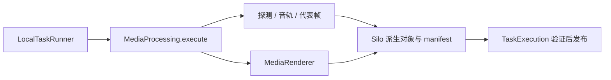

# 媒体操作与工作目录

> 在 Java 进程内使用 ffprobe／FFmpeg 核对原始媒体、准备音轨和代表帧，并按固定输入生成预览或成片。

## 1. 模块定位与边界

LocalTaskRunner 传入 attempt、服务端固定输入、磁盘预算和取消检查函数；本包返回 Result，TaskExecution 决定是否发布业务状态。依赖 S3、FFmpeg／ffprobe、CJK 字体及私有可写工作区；不读取 RabbitMQ，不决定任务重试、方案确认或模型调用。

## 2. 快速导航

入口：[MediaProcessing.java](MediaProcessing.java)。本包随 Java 应用启动，没有独立进程；运行、配置与开发工具见[后端 README](../../../../../../../README.md)。下文命令均从仓库根目录执行。

## 3. 目录与文件职责

| 路径 | 职责 |
| --- | --- |
| [MediaProcessing.java](MediaProcessing.java) | 按 operation 分发探测、音轨、抽帧和渲染；S3 对象读写、媒体身份核对 |
| [MediaInspection.java](MediaInspection.java) | 字节／SHA-256／视频流与真实解码校验、时间映射、音频准备、受控进程 |
| [RepresentativeFrames.java](RepresentativeFrames.java) | 基于真实 PTS 的稀疏／窗口抽帧，返回采样 manifest |
| [MediaRenderer.java](MediaRenderer.java) | 固定规格硬切拼接、原声／静音、字幕和 MP4 产物发布 |
| [WorkDirectories.java](WorkDirectories.java) | attempt 临时目录生命周期及启动残留回收 |

## 4. 架构与内部交互流程



1. 用 attempt 创建工作目录，执行前核对剩余空间；下载源对象时检查停止信号。
2. 普通媒体准备校验字节、哈希、视频可解码性并保存 timeMapping；有音轨则准备 WAV，稀疏抽帧上传 JPEG。
3. PREVIEW／EXPORT 分支使用服务端固定的 sources、output、configuration、rendererVersion；下载源片并编译受控 FFmpeg 参数，保留原声或补静音、映射字幕。
4. 返回产物 key、身份及媒体信息；业务层验收当前代次后发布。finally 清理临时目录，启动时回收前次退出的目录。

## 5. 公共接口与数据契约

| Java 符号 | 输入 | 输出 |
| --- | --- | --- |
| `MediaProcessing.execute` | attempt、input、required、stopped | Result(type,data) |
| `MediaProcessing.transferAudio` | 已保存音轨身份、上传回调 | 提供方临时地址 |
| `MediaProcessing.readFrame` | 帧 manifest、stopped | 身份校验后的 JPEG |
| `MediaInspection.inspect` | 本地源文件与声明身份 | durationMs、mediaInfo、timeMapping |
| `RepresentativeFrames.extract/window` | 源文件、时长和时间映射 | 真实观察点 manifest |
| `MediaRenderer.render` | 固定渲染输入与存储 | 产物元数据 |

Result 包括 MEDIA_PREPARED、VISION_FRAMES_PREPARED、PREVIEW_RENDERED 或 EXPORT_RENDERED。代表帧是观察点，不是编码关键帧；timeMapping 的源／音轨偏移不能丢失。

## 6. 依赖与配置

`MEDIA_WORK_DIRECTORY` 应用默认 `${java.io.tmpdir}/agentic-video-media`，Compose 为 `/work`。使用 `STORAGE_ENDPOINT`、`STORAGE_ACCESS_KEY`、`STORAGE_SECRET_KEY`；Spring `storage.bucket` 默认 originals。FFmpeg／字体版本固定于后端 Dockerfile。支持 LOW_360、HD_720、FULL_HD_1080，具体尺寸、码率、渲染版本由 MediaRenderer 严格核对，没有任意 filter 输入。

配置生效方式及 Compose 可覆盖范围见[根配置说明](../../../../../../../../README.md#8-配置说明)；Spring 配置来源为[application.properties](../../../../../resources/application.properties)。

## 7. 错误处理与可观测性

InvalidMedia 区分无效素材与空间不足；取消以 InterruptedException 向上交还。代表帧提取失败保存 visionFailure，保留已通过的媒体验证和音轨能力；不伪造视觉成功。目录清理失败记录 attempt 警告并留待启动回收。安全重试策略由 task 决定。

## 8. 测试

本包没有独立测试目录；LocalMediaIntegrationTest 使用真实 Silo、RabbitMQ、PostgreSQL 和宿主 FFmpeg，覆盖哈希、时间偏移、VFR、预览／导出、取消、重投和故障。人工连续观看试听另行报告。

```bash
mvn -B -ntp -pl backend -am test -Dtest=LocalMediaIntegrationTest -Dsurefire.failIfNoSpecifiedTests=false
```

测试源码见[后端测试目录](../../../../../../test/java/com/agenticvideo/business)；集成测试需要 Docker，媒体测试另需宿主 FFmpeg／ffprobe。此处是相关回归命令，文档改动不执行应用测试。

## 9. 扩展与维护

新增媒体 operation 同时核对 task 输入／结果分发、预算和产物清理；不能让客户端传可执行命令或任意滤镜。修改渲染规格应升级 rendererVersion 并核对 render 的复用身份。新增时间字段明确属于原片、音轨还是成片坐标。

## 10. 相关文档

[根 README](../../../../../../../../README.md) · [后端模块地图](../../../../../../../README.md) · [领域术语](../../../../../../../../GLOSSARY.md) · [task](../task/README.md) · [render](../render/README.md) · [analysis](../analysis/README.md) · [storage](../storage/README.md)

[edit-plan-contract.md](../../../../../../../../docs/edit-plan-contract.md) · [java-tools-m4.md](../../../../../../../../docs/verification/java-tools-m4.md)
