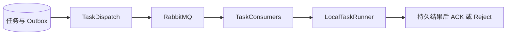

# Outbox 派发与 Java 队列消费

> 将数据库中的任务意图可靠通知 RabbitMQ，并在消费线程执行 Java 媒体／分析任务后确认消息。

## 1. 模块定位与边界

业务事务先保存 tasks 和 outbox_events；TaskDispatch 发布唤醒通知，TaskConsumers 把对应 Java 任务交给 LocalTaskRunner。依赖 Spring AMQP、JdbcTemplate、RabbitMQ 和 task。Python 的 agent.v1 消费位于 agent_service.worker，不在本包；消息确认不等于业务执行权。

## 2. 快速导航

入口：[TaskDispatch.java](TaskDispatch.java)。本包随 Java 应用启动，没有独立进程；运行、配置与开发工具见[后端 README](../../../../../../../README.md)。下文命令均从仓库根目录执行。

## 3. 目录与文件职责

| 路径 | 职责 |
| --- | --- |
| [TaskDispatch.java](TaskDispatch.java) | 声明 durable 队列／死信队列、周期 Outbox 占用、mandatory 发布与 confirm／退回检查 |
| [TaskConsumers.java](TaskConsumers.java) | media.v1／analysis.v1 手工 ACK 消费、类型核对和同步执行 |

## 4. 架构与内部交互流程



1. 发布器短事务占用到期且任务 PENDING 的 Outbox；对长期未接纳的已发布通知允许重新提醒。
2. 持久消息使用默认 exchange、mandatory 路由和 publisher confirm，确认没有退回才标记 PUBLISHED。
3. media.v1 固定 concurrency=1，analysis.v1 使用配置并发；prefetch=1，消费线程直接执行，不先 ACK 再交线程池。
4. LocalTaskRunner 原子接纳任务，重复通知复用状态。执行成功、等待或已记录安全重试后 ACK；持久终态失败 Reject 到对应死信队列。
5. 发布故障保留数据库意图，2～60 秒有界退避；Python Worker 自行处理 agent.v1 的消费与租约。

## 5. 公共接口与数据契约

| 协议入口 | 输入／消息类型 | 下游 |
| --- | --- | --- |
| `TaskDispatch.publish` | 待发布 Outbox | agent.v1、media.v1、analysis.v1 |
| `TaskConsumers.media` | MEDIA_PREPARE、VISION_PREPARE、PREVIEW_RENDER、EXPORT_RENDER | LocalTaskRunner |
| `TaskConsumers.analysis` | CONTENT_ANALYZE、VISION_ANALYZE、INDEX_BUILD | LocalTaskRunner |
| dead queues | agent.dead.v1、media.dead.v1、analysis.dead.v1 | 显式诊断；无自动重放承诺 |

通知含 schemaVersion／taskId／taskType 等身份，不传视频二进制。权威输入与状态从数据库读取。

## 6. 依赖与配置

`TASKS_DISPATCH_ENABLED` 控制发布器，应用默认 false、Compose 固定 true；`TASKS_CONSUME_ENABLED` 默认跟随派发。`ANALYSIS_EXECUTION_ENABLED` 控制分析派发及消费者启动，Compose 默认 true。`ANALYSIS_CONSUMER_CONCURRENCY=2`；RabbitMQ 地址／凭据见根配置。`tasks.pending-renotify-seconds=60`、`tasks.dispatch-interval-ms=1000` 是源码 Spring 属性，当前 Compose 未单独映射根 `.env`。

配置生效方式及 Compose 可覆盖范围见[根配置说明](../../../../../../../../README.md#8-配置说明)；Spring 配置来源为[application.properties](../../../../../resources/application.properties)。

## 7. 错误处理与可观测性

发布未确认标记 BROKER_UNCONFIRMED 并保留意图；没有先删任务后发消息的窗口。格式或类型不符拒绝入死信；数据库异常不伪造执行成功。ACK、publisher confirm、业务结果发布是三个不同边界；无独立业务指标栈。

## 8. 测试

本包无同名测试；task 包的 Outbox、真实媒体／分析测试覆盖确认、路由、故障和重复通知；agentrun 包的 Worker 测试覆盖 Python 队列。

```bash
mvn -B -ntp -pl backend -am test -Dtest=OutboxPublishingIntegrationTest,LocalMediaIntegrationTest,LocalAnalysisIntegrationTest,AgentWorkerIntegrationTest -Dsurefire.failIfNoSpecifiedTests=false
```

测试源码见[后端测试目录](../../../../../../test/java/com/agenticvideo/business)；集成测试需要 Docker，媒体测试另需宿主 FFmpeg／ffprobe。此处是相关回归命令，文档改动不执行应用测试。

## 9. 扩展与维护

增加任务类型时同步修改生产事务、Outbox 类型筛选、路由、消费类型白名单和 task 分发，并覆盖故障恢复。不得只加队列而绕过持久任务。提高并发前重新核对单实例恢复、容量及付费回执边界。

## 10. 相关文档

[根 README](../../../../../../../../README.md) · [后端模块地图](../../../../../../../README.md) · [领域术语](../../../../../../../../GLOSSARY.md) · [task](../task/README.md) · [analysis](../analysis/README.md) · [agentrun](../agentrun/README.md)

[event-protocol.md](../../../../../../../../docs/event-protocol.md) · [0006-transactional-outbox-and-authoritative-task-state.md](../../../../../../../../docs/adr/0006-transactional-outbox-and-authoritative-task-state.md)
