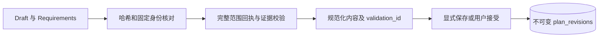

# 剪辑草稿校验与不可变方案版本

> 验证草稿的素材、时间、证据、字幕和制作约束，再将用户接受或 CLI 显式保存的内容发布为不可变方案版本。

## 1. 模块定位与边界

真实 Agent 提议 Draft 与 Requirements，通过 tools 调用 ProductionDrafts 校验；CLI 显式保存或 agentrun 的用户接受事务调用 ProductionSaves。浏览器只读版本接口供 render 消费。依赖固定 QuestionScopes、已成功范围读取回执、SpeechTimings 和 PostgreSQL。不调用模型，不渲染，也不把校验通过视作用户确认。

## 2. 快速导航

入口：[ProductionDrafts.java](ProductionDrafts.java)。本包随 Java 应用启动，没有独立进程；运行、配置与开发工具见[后端 README](../../../../../../../README.md)。下文命令均从仓库根目录执行。

## 3. 目录与文件职责

| 路径 | 职责 |
| --- | --- |
| [EditDraftContracts.java](EditDraftContracts.java) | M2 跨语言草稿、条件、校验与保存严格契约 |
| [DraftEvidence.java](DraftEvidence.java) | 从成功读取回执恢复原始证据和完整分页范围覆盖 |
| [EditDraftValidation.java](EditDraftValidation.java) | 当前草稿的时长／来源／时间／字幕等规则与规范化内容 |
| [ProductionDrafts.java](ProductionDrafts.java) | 固定制作绑定、校验回执及浏览器执行／条件资格 |
| [ProductionSaves.java](ProductionSaves.java) | 幂等整体保存、输出／片段永久 UUID 和引用来源 |
| [EditPlanController.java](EditPlanController.java) | 项目方案、版本历史和版本内容只读 API |
| [EditPlans.java](EditPlans.java) | 既有方案分配、发布、引用与历史任务校验接口 |
| [EditPlanValidation.java](EditPlanValidation.java) | 既有版本内容及素材／证据引用规则 |
| [PlanModifications.java](PlanModifications.java) | legacy 版本派生修改的输入绑定 |
| [PlanModificationValidation.java](PlanModificationValidation.java) | legacy 定向修改的保留与差异规则 |

## 4. 架构与内部交互流程



1. 绑定制作需求与 project／scope，确保固定媒体时间信息齐全；浏览器 production 必须带可信 Execution，不能经 CLI 旁路校验。
2. 检查 draft_hash／requirements_hash；从成功 read_video_range 回执恢复从 cursor=0 到末页的完整范围链，核对片段确已阅读。检索和概览不替代范围阅读。
3. EditDraftValidation 校验输出条件、素材、证据、区间、切词与原文字幕，生成 normalized_content 及结构化 issues／warnings。
4. 保存锁定制作与依赖，要求当前通过校验且哈希一致；按整个草稿生成一份方案 V1，为 output_key 分配 outputId／clipId 并保存引用。
5. CLI save 本身不确认；浏览器 accept 由 agentrun 在外层事务追加确认记录。已有不可变版本从只读 API 查看，不原地覆盖。

## 5. 公共接口与数据契约

| Java／HTTP | 输入 | 输出 |
| --- | --- | --- |
| `ProductionDrafts.bind` | requirement、project、scope | ProductionBinding |
| `ProductionDrafts.validate` | Scope、请求、可选可信 Execution | ToolResult.data 的 ValidationResult |
| `ProductionSaves.save/accept` | production、SaveRequest | SavedResult；accept 仅供可信浏览器事务 |
| `GET /api/v1/projects/{projectId}/plans` | 项目 UUID | 方案列表 |
| `GET /api/v1/plans/{planId}/revisions` | 方案 UUID | 版本历史 |
| `GET /api/v1/revisions/{revisionId}` | 版本 UUID | 规范化内容与来源 |

Draft 含 1～10 输出，每输出 1～100 片段；时间为整数毫秒半开区间。请求最多 65536 UTF-8 字节、结果最多 32768 字节，文本按 Unicode 码点计。ValidationResult 的 READY 不等于 valid=true；valid=false 仍是一次成功执行的规则校验。

## 6. 依赖与配置

无独立环境变量或模型开关。规则版本、限额在 EditDraftContracts／EditDraftValidation，数据库约束在 Flyway 迁移。内部 HTTP 的制作绑定／校验／保存适配位于 tools；浏览器接受位于 agentrun，不新增重复控制器。

配置生效方式及 Compose 可覆盖范围见[根配置说明](../../../../../../../../README.md#8-配置说明)；Spring 配置来源为[application.properties](../../../../../resources/application.properties)。

## 7. 错误处理与可观测性

哈希／身份／scope 失效是停止类错误，不能让模型修补身份；规则问题返回字段路径、output_key、实际值和提示。VALIDATION_STALE／VALIDATION_MISMATCH／PRODUCTION_SAVED 防止保存旧稿。反馈超限明确标记 issues_truncated／警告省略，不隐去校验失败。

## 8. 测试

plan 包覆盖契约、迁移与既有读取；tools.DraftValidationIntegrationTest 覆盖当前规则，agentrun 覆盖浏览器接受。共享 JSON 样例位于 backend/src/test/resources/contracts 与 Python tests/fixtures；跨语言同时检查 Python test_editing_contracts.py、test_real_production.py。

```bash
mvn -B -ntp -pl backend -am test -Dtest=EditDraftContractsTest,ProductionSchemaIntegrationTest,DraftValidationIntegrationTest,AgentRunsApiIntegrationTest,EditPlanApiIntegrationTest -Dsurefire.failIfNoSpecifiedTests=false
```

测试源码见[后端测试目录](../../../../../../test/java/com/agenticvideo/business)；集成测试需要 Docker，媒体测试另需宿主 FFmpeg／ffprobe。此处是相关回归命令，文档改动不执行应用测试。

## 9. 扩展与维护

新增条件先改严格契约、规范化／哈希、来源和校验，再修改 Python 和共享样例；禁止宽松字符串／布尔到整数转换。新增版本内容确保永久标识和资产／证据引用同事务提交。旧 PlanModifications 的存在不代表当前已开放冻结版本派生编辑。

## 10. 相关文档

[根 README](../../../../../../../../README.md) · [后端模块地图](../../../../../../../README.md) · [领域术语](../../../../../../../../GLOSSARY.md) · [tools](../tools/README.md) · [agentrun](../agentrun/README.md) · [analysis](../analysis/README.md) · [render](../render/README.md)

[java-tools-m2-design.md](../../../../../../../../docs/java-tools-m2-design.md) · [edit-plan-contract.md](../../../../../../../../docs/edit-plan-contract.md) · [0018-freeze-plan-revisions-after-draft-acceptance.md](../../../../../../../../docs/adr/0018-freeze-plan-revisions-after-draft-acceptance.md)
