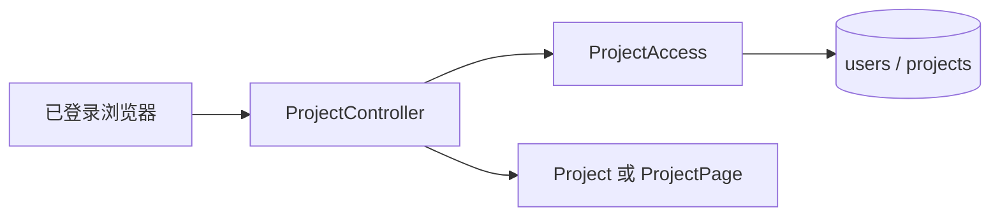

# 私有项目与归属校验

> 创建、分页列出和打开当前账号的项目，并为其它业务包提供统一的项目归属判断。

## 1. 模块定位与边界

由已登录浏览器触发，输入项目名称或 UUID，输出当前账号拥有的项目。依赖 `auth` 提供的 Authentication 与 PostgreSQL `users/projects`；素材、会话、用量等包依赖 `ProjectAccess`。不管理素材内容、删除项目或团队共享。

## 2. 快速导航

入口：[ProjectController.java](ProjectController.java)。本包随 Java 应用启动，没有独立进程；运行、配置与开发工具见[后端 README](../../../../../../../README.md)。下文命令均从仓库根目录执行。

## 3. 目录与文件职责

| 路径 | 职责 |
| --- | --- |
| [ProjectController.java](ProjectController.java) | 项目创建、UUID 游标分页与打开接口 |
| [ProjectAccess.java](ProjectAccess.java) | 当前用户解析及项目 owner 校验，返回 Project 值对象 |
| [ProjectErrors.java](ProjectErrors.java) | 把不存在／无权访问统一投影为 404 |

## 4. 架构与内部交互流程



1. 创建项目先解析当前账号，校验非空且不超过 120 字符的名称，去掉首尾空白后写入 owner。
2. 列表按当前 owner、`id > cursor` 查询至多 101 条，返回最多 100 条及可选 `nextCursor`。
3. 打开项目和相邻模块的资源操作调用 `requireOwned`，同时限定项目 UUID 与当前 owner；不会采信前端声明的 owner。

## 5. 公共接口与数据契约

| 接口／符号 | 输入 | 输出 |
| --- | --- | --- |
| `POST /api/v1/projects` | `CreateProject.name` | 201，`Project(id,name,rowVersion)` |
| `GET /api/v1/projects` | 可选 UUID `cursor` | `ProjectPage(items,nextCursor)` |
| `GET /api/v1/projects/{projectId}` | 项目 UUID | 当前账号的 Project |
| `ProjectAccess.currentUserId` | Authentication | ACTIVE 用户 UUID |
| `ProjectAccess.requireOwned` | 项目 UUID、Authentication | Project 或 ProjectNotFound |

## 6. 依赖与配置

无独立环境变量或 Feature Flag；使用应用统一的 `DATABASE_*` 与浏览器认证配置。项目通过 `JdbcTemplate` 读取，不通过前端缓存作授权。

配置生效方式及 Compose 可覆盖范围见[根配置说明](../../../../../../../../README.md#8-配置说明)；Spring 配置来源为[application.properties](../../../../../resources/application.properties)。

## 7. 错误处理与可观测性

不存在与越权统一返回 `RESOURCE_NOT_FOUND`／404，避免区分他人的项目是否存在。名称参数错误由 Spring Validation 处理。无独立重试、日志采集或指标；浏览器登录失效先走认证安全链。

## 8. 测试

测试覆盖账号隔离、项目创建／打开和列表；前端 `projects.spec.ts` 与 `workspace-navigation.spec.ts` 覆盖导航。

```bash
mvn -B -ntp -pl backend -am test -Dtest=ProjectApiIntegrationTest -Dsurefire.failIfNoSpecifiedTests=false
```

测试源码见[后端测试目录](../../../../../../test/java/com/agenticvideo/business)；集成测试需要 Docker，媒体测试另需宿主 FFmpeg／ffprobe。此处是相关回归命令，文档改动不执行应用测试。

## 9. 扩展与维护

新增项目资源必须在执行前核对归属。分页保持 UUID 稳定排序和 nextCursor 语义；不能把本地显示顺序当作查询契约。若新增团队权限，需要明确替换 owner 模型的范围，而不是仅在控制器增加旁路。

## 10. 相关文档

[根 README](../../../../../../../../README.md) · [后端模块地图](../../../../../../../README.md) · [领域术语](../../../../../../../../GLOSSARY.md) · [auth](../auth/README.md) · [upload](../upload/README.md) · [conversation](../conversation/README.md)

[database-design.md](../../../../../../../../docs/database-design.md)
