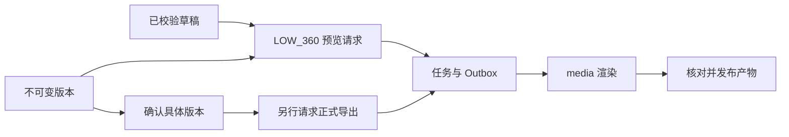

# 草稿预览、版本导出与产物管理

> 把通过校验的草稿或不可变方案版本固定为媒体任务，管理预览复用、明确确认、正式导出及产物访问和删除。

## 1. 模块定位与边界

浏览器从草稿卡／作品发起操作，CLI 从内部预览接口发起已保存制作的预览。依赖 plan 版本、agentrun 草稿资格、storage 预算、MultipartStorage、task 和 PostgreSQL；实际 FFmpeg 操作在 media。自然语言媒体路由的 legacy 实现保留，但当前新版对话引导页面按钮。

## 2. 快速导航

入口：[PreviewRequests.java](PreviewRequests.java)。本包随 Java 应用启动，没有独立进程；运行、配置与开发工具见[后端 README](../../../../../../../README.md)。下文命令均从仓库根目录执行。

## 3. 目录与文件职责

| 路径 | 职责 |
| --- | --- |
| [DraftPreviewController.java](DraftPreviewController.java) | 当前会话草稿预览创建／列表／显式重试 |
| [DraftPreviews.java](DraftPreviews.java) | 核对所见草稿绑定，固定校验内容及 sources 后接纳低清任务 |
| [PreviewController.java](PreviewController.java) | 浏览器版本预览、请求详情、产物播放／下载授权 |
| [PreviewRequests.java](PreviewRequests.java) | 版本预览复用身份、固定后继重试和媒体请求状态 |
| [InternalPreviewController.java](InternalPreviewController.java) | CLI 已保存制作预览的内部 HTTP 契约 |
| [PreviewContracts.java](PreviewContracts.java) | 内部 snake_case 预览请求／任务／产物／播放类型 |
| [ExportController.java](ExportController.java) | 版本确认记录与正式导出请求／历史 |
| [ExportRequests.java](ExportRequests.java) | 确认与导出的幂等事务、固定来源／输出／规格及容量接纳 |
| [RenderArtifacts.java](RenderArtifacts.java) | attempt 产物准备／发布、可用性核对和访问签名、失败产物清理 |
| [ExportArtifactController.java](ExportArtifactController.java) | 浏览器成片状态及显式删除入口 |
| [ExportArtifacts.java](ExportArtifacts.java) | 成片删除请求、真实对象清理和失败重试 |
| [ConversationProduction.java](ConversationProduction.java) | 既有消息执行中的媒体目标绑定与命令适配 |
| [ProductionCommands.java](ProductionCommands.java) | legacy 直接媒体文字命令识别与路由 |

## 4. 架构与内部交互流程



1. 草稿预览核对 DraftBinding 和当前资格，从持久校验恢复规范化内容；固定 outputKey／来源／LOW_360，不创建版本或确认。
2. 版本预览及正式导出固定 revisionId／outputId／配置／rendererVersion。导出还核对 confirmationId 和显式 EXPORT，不把预览或模型意图当确认。
3. 接纳事务预留容量并写 render_requests、task、Outbox；media 执行后 RenderArtifacts 核对当前 attempt 和对象身份再发布。
4. 相同预览复用运行任务或可用产物；失败／取消／文件失效需显式重试，重复 retry(A) 复用固定后继 B。取消共享任务会影响复用请求。
5. 播放签名到期重新授权；确认对象丢失与存储暂不可用分开。成片删除按显式请求清理，下载本身保留文件。

## 5. 公共接口与数据契约

| HTTP | 输入 | 输出／条件 |
| --- | --- | --- |
| `POST/GET /api/v1/conversations/{conversation}/drafts/previews` | POST 的 draft、outputKey、previewProfile=LOW_360、幂等键 | 草稿预览／历史 |
| `POST /api/v1/conversations/{conversation}/drafts/previews/{request}/retry` | 当前草稿原请求 | 固定后继 |
| `POST/GET /api/v1/revisions/{revisionId}/previews` | POST 的 outputId、previewProfile、幂等键 | 版本预览／历史 |
| `POST/GET /api/v1/revisions/{revisionId}/confirmations` | POST 的 explicitIntent=CONFIRM、幂等键 | 确认记录 |
| `POST/GET /api/v1/revisions/{revisionId}/export-requests` | POST 的 outputIds（仅一条）、confirmationId、exportProfile、explicitIntent=EXPORT；Idempotency-Key | 导出／历史；exportProfile 为 HD_720 或 FULL_HD_1080 |
| `GET /api/v1/render-requests/{requestId}` | 请求 UUID | 独立任务及产物状态 |
| `POST /api/v1/artifacts/{artifactId}/playback-access`、`/download-access` | 产物 UUID | 短期访问授权 |
| `GET/DELETE /api/v1/artifacts/{artifactId}` | DELETE 的 explicitIntent=DELETE | 成片状态／删除结果 |
| `POST/GET /internal/v1/productions/{requirementId}/previews` | POST 的可选 output_key | 只接受已保存制作，新建 202／复用 200 |
| `GET /internal/v1/previews/{requestId}`；`POST .../cancel`、`.../retry` | 请求 UUID | 内部 PreviewContracts 结果 |

内部响应 snake_case 与浏览器 data 包装分开。任务成功不保证产物仍可访问；CANCEL_REQUESTED 不等于已取消。LOW_360 预览与 HD_720／FULL_HD_1080 正式规格不能混用。

## 6. 依赖与配置

沿用 STORAGE_*、CAPACITY_*、TASKS_DISPATCH_ENABLED；内部 CLI 使用 INTERNAL_WORKER_TOKEN。rendererVersion 与规格在 PreviewRequests／MediaRenderer 固定，无任意编码配置环境入口。播放签名有效期 300 秒；无新增模型调用。

配置生效方式及 Compose 可覆盖范围见[根配置说明](../../../../../../../../README.md#8-配置说明)；Spring 配置来源为[application.properties](../../../../../resources/application.properties)。

## 7. 错误处理与可观测性

未确认、旧草稿、原素材缺失、重复键改变内容或容量不足明确拒绝。暂时存储故障返回错误，不能改写为永久文件失效。删除失败保持待清理状态；失败 attempt 的 STAGED 对象由任务清理核对。日志和公开状态保留请求／任务／产物身份。

## 8. 测试

render 测试覆盖协议、版本预览／确认／导出、容量与文件访问；草稿相关由 agentrun 及前端生命周期场景覆盖。LocalMediaIntegrationTest 核对真实媒体，M4 故障／观看验收另见记录，不作为日常付费门槛。

```bash
mvn -B -ntp -pl backend -am test -Dtest=PreviewApiIntegrationTest,InternalPreviewApiIntegrationTest,PreviewContractsTest,ExportApiIntegrationTest,RenderCapacityIntegrationTest,AgentRunsApiIntegrationTest,LocalMediaIntegrationTest -Dsurefire.failIfNoSpecifiedTests=false
```

测试源码见[后端测试目录](../../../../../../test/java/com/agenticvideo/business)；集成测试需要 Docker，媒体测试另需宿主 FFmpeg／ffprobe。此处是相关回归命令，文档改动不执行应用测试。

## 9. 扩展与维护

新增规格同步更新固定输入、cache key、rendererVersion、预算及 media 允许列表。新增草稿操作保留所见绑定和当前资格；不得通过历史请求恢复旧稿编辑。新增产物状态同时维护读取、重试、删除和签名续期，不自动重新渲染已过期 URL。

## 10. 相关文档

[根 README](../../../../../../../../README.md) · [后端模块地图](../../../../../../../README.md) · [领域术语](../../../../../../../../GLOSSARY.md) · [plan](../plan/README.md) · [agentrun](../agentrun/README.md) · [task](../task/README.md) · [media](../media/README.md) · [storage](../storage/README.md)

[java-tools-m4-design.md](../../../../../../../../docs/java-tools-m4-design.md) · [java-tools-m4.md](../../../../../../../../docs/verification/java-tools-m4.md) · [conversation-lifecycle-step5.md](../../../../../../../../docs/verification/conversation-lifecycle-step5.md)
