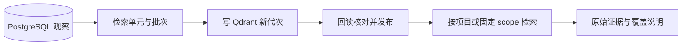

# 证据检索与可重建索引

> 把原始观察组织为检索单元、构建并核对索引代次，再向浏览器和固定问答范围提供有界检索与证据读取。

## 1. 模块定位与边界

浏览器 SearchController 面向项目当前可用来源；Agent 经 tools 使用 QuestionEvidence 的固定快照范围。两者不能混用当前 heads 与历史 scope。依赖 PostgreSQL 权威证据、Qdrant、百炼 Embedding、usage 查询回执和 project 授权。不创建 Agent 权限、问答 scope 或剪辑切点。

## 2. 快速导航

入口：[QuestionEvidence.java](QuestionEvidence.java)。本包随 Java 应用启动，没有独立进程；运行、配置与开发工具见[后端 README](../../../../../../../README.md)。下文命令均从仓库根目录执行。

## 3. 目录与文件职责

| 路径 | 职责 |
| --- | --- |
| [SearchController.java](SearchController.java) | 浏览器项目检索及证据上下文授权接口 |
| [EvidenceSearch.java](EvidenceSearch.java) | 浏览器当前来源的字面／主题检索、排名与通道状态 |
| [QuestionEvidence.java](QuestionEvidence.java) | 只读取 scope 可见记录，固定条件检索与持久排名 |
| [SearchIndexController.java](SearchIndexController.java) | 素材索引状态及显式重建入口 |
| [SearchIndexes.java](SearchIndexes.java) | 检索单元、Embedding 批次、代次校验与原子发布 |
| [SearchIndexBuilder.java](SearchIndexBuilder.java) | 在任务事务外写 Qdrant 点和索引 |
| [SearchVectors.java](SearchVectors.java) | 向量配置、查询 Embedding、Qdrant 请求及项目／代次过滤 |

## 4. 架构与内部交互流程



1. 索引接纳时固定素材来源、模型／维度和 BM25 配置，复用可用证据及成功向量批次。
2. AnalysisProcessing 生成缺失向量后由 SearchIndexBuilder 写 Qdrant；SearchIndexes.verify 回读核对后才切换发布映射，重建期间旧有效代次仍可读。
3. 问答范围由 tools 创建，QuestionEvidence 只查 question_scope_evidence／units，不读取新发布 heads。
4. search 对固定条件保存排名；LITERAL、DENSE、BM25 各自运行与降级，RRF 融合后从 PostgreSQL 回查授权证据。
5. 翻页复用原排名／查询向量，read 直接读取原始记录，无需调用 Qdrant；检索单元范围不直接作为最终剪辑区间。

## 5. 公共接口与数据契约

| 接口／符号 | 输入 | 输出 |
| --- | --- | --- |
| `POST /api/v1/projects/{projectId}/search` | query、literalPhrase、limit、sourceKinds | 命中、通道与来源覆盖 |
| `GET /api/v1/evidence/{evidenceId}/context` | 可选 boundedWindowMs | 授权证据邻近上下文 |
| `GET/POST /api/v1/assets/{asset}/search-index` | 状态读取／重建配置 | 索引状态或任务 |
| `QuestionEvidence.read` | Scope、素材、可选 [start,end)、cursor | 原始观察列表 |
| `QuestionEvidence.search/searchRecords` | 固定 conditions／hash、排名／cursor | 持久排名或记录页 |
| `SearchIndexes.verify/publish` | 当前任务与核对结果 | 可发布代次 |

固定范围每通道最多 50 候选、融合最多 100 单元；反馈报告 candidates_truncated、各通道状态和来源缺口。POINT 不是正长度区间。

## 6. 依赖与配置

`QDRANT_URL` 应用默认 http://localhost:6333，Compose 为 http://qdrant:6333；查询向量需 DASHSCOPE_API_KEY。模型／维度／BM25 平均长度通过 SearchVectors.profile 与重建输入确定，不新增虚构的环境开关。更换模型或维度使用独立 collection／代次，不能混用不兼容向量。

配置生效方式及 Compose 可覆盖范围见[根配置说明](../../../../../../../../README.md#8-配置说明)；Spring 配置来源为[application.properties](../../../../../resources/application.properties)。

## 7. 错误处理与可观测性

Qdrant／Embedding 通道失败时保留可用字面或其它通道，并明确 DEGRADED／UNAVAILABLE／NOT_READY。同条件未完成排名返回 QUERY_UNCONFIRMED，不隐式重付。索引回读不符不发布；数据库 JSON 错误抛出，不当空结果。QueryModelCalls 持久记录查询付费不确定性。

## 8. 测试

search 包覆盖索引重建；tools.ReadToolsIntegrationTest 覆盖固定范围、稳定分页、查询回执与通道降级；task.LocalAnalysisIntegrationTest 覆盖索引写入及恢复。

```bash
mvn -B -ntp -pl backend -am test -Dtest=SearchIndexApiIntegrationTest,ReadToolsIntegrationTest,LocalAnalysisIntegrationTest -Dsurefire.failIfNoSpecifiedTests=false
```

测试源码见[后端测试目录](../../../../../../test/java/com/agenticvideo/business)；集成测试需要 Docker，媒体测试另需宿主 FFmpeg／ffprobe。此处是相关回归命令，文档改动不执行应用测试。

## 9. 扩展与维护

新增检索通道须在召回前施加相同项目／代次／来源过滤，回查 PostgreSQL 并给出独立通道状态。改变排名或规范化条件需维护 question_searches 重放身份；索引是可重建派生物，不能成为权限或事实权威。修改时间字段同时检查 Python 引用。

## 10. 相关文档

[根 README](../../../../../../../../README.md) · [后端模块地图](../../../../../../../README.md) · [领域术语](../../../../../../../../GLOSSARY.md) · [tools](../tools/README.md) · [analysis](../analysis/README.md) · [bailian](../bailian/README.md) · [usage](../usage/README.md)

[video-understanding-retrieval.md](../../../../../../../../docs/video-understanding-retrieval.md) · [java-tools-m1-stage3.md](../../../../../../../../docs/verification/java-tools-m1-stage3.md)
