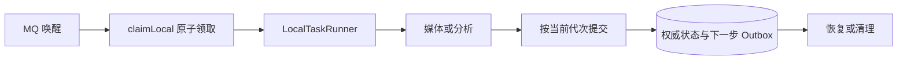

# 持久任务、执行代次与恢复

> 在数据库中控制任务接纳、执行资格、取消、结果提交与恢复，为 Java 本机执行和 Python Worker 提供不同的执行协议。

## 1. 模块定位与边界

业务包创建任务，messaging 唤醒执行；LocalTaskRunner 在本进程执行媒体／分析，Python Agent 通过 agentrun 内部路由领取带租约 attempt。依赖各业务发布器、容量、PostgreSQL 和媒体操作。任务记录是业务状态权威，MQ 通知和进程内 active 集合不能单独决定结果成功。

## 2. 快速导航

入口：[TaskExecution.java](TaskExecution.java)。本包随 Java 应用启动，没有独立进程；运行、配置与开发工具见[后端 README](../../../../../../../README.md)。下文命令均从仓库根目录执行。

## 3. 目录与文件职责

| 路径 | 职责 |
| --- | --- |
| [TaskExecution.java](TaskExecution.java) | 原子领取、本机代次／Worker 租约、空间、取消、回执与结果分发 |
| [LocalTaskRunner.java](LocalTaskRunner.java) | 单实例 active 集合、同步媒体／分析执行和失败分类 |
| [TaskRecovery.java](TaskRecovery.java) | 已退出本机代次、安全分析／媒体恢复和结果未知核对 |
| [TaskController.java](TaskController.java) | 浏览器任务读取／取消及保留的 legacy Worker 控制器／DTO |
| [WorkerSecurity.java](WorkerSecurity.java) | 内部 Bearer 安全链，默认拒绝退役 tasks HTTP 协议 |
| [FailedMediaCleanup.java](FailedMediaCleanup.java) | 无效素材对象及失败／退出产物的周期清理 |

## 4. 架构与内部交互流程



1. claimLocal 仅接纳到执行时间的 PENDING 白名单类型，创建 local_execution attempt 后切换 RUNNING；重复或旧消息无资格则不再执行。
2. LocalTaskRunner 在消费线程执行，将 current_attempt 和取消状态交给停止检查；本机代次不使用网络 lease／heartbeat。
3. completeLocal 按当前代次校验并分发媒体、分析、索引或产物结果；异步 ASR defer 结束本步骤，再持久接纳下次查询。
4. 可安全重试的本机临时失败由 failLocal 保存有限重试意图；取消先标 CANCEL_REQUESTED，执行退出后才确认 CANCELLED。
5. TaskRecovery 区分本机 active 与已退出代次，复用远端身份／已保存响应；新版 Agent 的过期租约由 AgentRunRecovery 收回，不重置 Python execution 或付费预算。

## 5. 公共接口与数据契约

| 入口／符号 | 输入 | 输出 |
| --- | --- | --- |
| `GET /api/v1/tasks/{id}` | 当前账号、任务 UUID | 授权任务状态 |
| `POST /api/v1/tasks/{id}/cancel` | 当前账号 | 取消请求／已有终态 |
| `claimLocal/completeLocal/failLocal/cancelLocal` | LocalRun 等内部值 | 原子代次控制和持久结果 |
| `providerLocal/deferLocal/mediaBudget/stopped` | LocalRun | 模型回执事务／下一次执行／预算／停止信号 |
| `TaskController.Execution/Claim/Stopped` | attemptId／leaseToken 或 executorId／claimRequestId | 新版 agentrun 复用的传输 DTO |

旧 `/internal/v1/tasks/**` 默认为 410，不能作为当前 Worker 文档入口；新版使用相邻 agentrun 的 `/internal/v1/agent-runs/**`。任务状态、attempt 状态、产物状态分别理解。

## 6. 依赖与配置

`TASKS_DISPATCH_ENABLED` 默认 false、Compose true，控制恢复／清理等组件；`TASKS_CONSUME_ENABLED` 默认跟随它。`INTERNAL_WORKER_TOKEN` 内部认证，`LEGACY_WORKER_ENABLED=false`。本机恢复为单实例设计；不要通过增加 Java 实例直接复用进程内 active 判断。

配置生效方式及 Compose 可覆盖范围见[根配置说明](../../../../../../../../README.md#8-配置说明)；Spring 配置来源为[application.properties](../../../../../resources/application.properties)。

## 7. 错误处理与可观测性

MEDIA_EXECUTION_FAILED／ANALYSIS_EXECUTION_FAILED、无效媒体、MODEL_SUBMISSION_UNCERTAIN 和 MODEL_RESULT_INVALID 区分。安全临时失败最多三次；已发生付费且无确认响应不能当安全重试。LocalTaskRunner 日志包含 task、错误 code 和异常类型，不写模型凭据；业务失败原因保存在数据库。

## 8. 测试

task 包覆盖真实基础设施、单体媒体、受控模型、重试／死信／取消／恢复；AgentWorkerIntegrationTest 在 agentrun 包，需要 Python 虚拟环境。JavaAnalysisLiveTest 是显式付费分支，不纳入此命令。

```bash
mvn -B -ntp -pl backend -am test -Dtest=TaskApiIntegrationTest,LocalMediaIntegrationTest,LocalAnalysisIntegrationTest,OutboxPublishingIntegrationTest,AgentWorkerIntegrationTest -Dsurefire.failIfNoSpecifiedTests=false
```

测试源码见[后端测试目录](../../../../../../test/java/com/agenticvideo/business)；集成测试需要 Docker，媒体测试另需宿主 FFmpeg／ffprobe。此处是相关回归命令，文档改动不执行应用测试。

## 9. 扩展与维护

新增任务类型需同步业务事务、Outbox 路由、领取白名单、执行分发、结果校验、取消／恢复和容量释放；不能只加 switch 分支。对共享状态或 MQ 的修改覆盖关联业务模块。保留本机代次与远端租约两个模型，不把旧 HTTP Worker 重新接回生产。

## 10. 相关文档

[根 README](../../../../../../../../README.md) · [后端模块地图](../../../../../../../README.md) · [领域术语](../../../../../../../../GLOSSARY.md) · [messaging](../messaging/README.md) · [media](../media/README.md) · [analysis](../analysis/README.md) · [agentrun](../agentrun/README.md) · [render](../render/README.md)

[task-protocol.md](../../../../../../../../docs/task-protocol.md) · [java-tools-m1-stage1.md](../../../../../../../../docs/verification/java-tools-m1-stage1.md)
