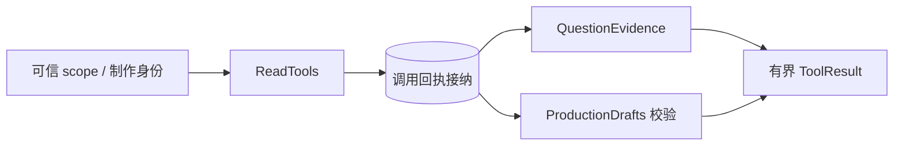

# 问答范围快照与工具网关

> 为 Agent 固定可信素材与分析范围，校验工具调用身份、参数、分页和回执，并将读取或草稿校验交给对应业务模块。

## 1. 模块定位与边界

CLI 通过内部 Bearer API 创建范围和执行；浏览器 Worker 由 agentrun 绑定 scope 并调用同一 ReadTools。依赖 search 的证据读取、plan 的制作校验和 PostgreSQL 持久回执。不让模型选择项目、scope 或凭据，不启动基础分析，也不允许浏览器绕过执行租约使用 CLI 写入口。

## 2. 快速导航

入口：[ReadTools.java](ReadTools.java)。本包随 Java 应用启动，没有独立进程；运行、配置与开发工具见[后端 README](../../../../../../../README.md)。下文命令均从仓库根目录执行。

## 3. 目录与文件职责

| 路径 | 职责 |
| --- | --- |
| [QuestionScopes.java](QuestionScopes.java) | repeatable-read 创建固定素材／分析／索引／证据集合，恢复与依赖核对 |
| [ReadTools.java](ReadTools.java) | 调用身份及严格参数接纳、32 KiB 反馈分页和持久重放 |
| [QuestionToolController.java](QuestionToolController.java) | CLI scope、工具、制作绑定与显式保存的内部 HTTP 适配 |
| [ToolJson.java](ToolJson.java) | 跨语言紧凑排序 JSON 的 SHA-256 |
| [ToolFailure.java](ToolFailure.java) | 携带 code/category 的工具停止或参数错误 |

## 4. 架构与内部交互流程



1. QuestionScopes 在 repeatable-read 短事务固定素材元数据、分析版本、来源就绪情况、索引与证据可见身份；晚发布数据不进入旧 scope。
2. 网关核对 call_id／tool_name／arguments／request_hash 及依赖，再保存调用回执。同身份不同内容拒绝；已完成重放返回原结果，未核对完成不重执行。
3. 四读取工具进入 QuestionEvidence；validate_edit_draft 只能使用可信 production，交给 plan 校验。
4. 反馈按 UTF-8 字节有界分页，调用方按 next_cursor 累积；依赖失效不会自动换成当前 heads。

## 5. 公共接口与数据契约

| 接口／工具 | 输入 | 输出／说明 |
| --- | --- | --- |
| `POST /internal/v1/questions/scopes` | project_id、可选 asset_ids | 创建 scope_id、project_id、assets、mock=false |
| `GET /internal/v1/questions/scopes/{scopeId}` | 原 scope UUID | 核对依赖并返回原范围 |
| `POST /internal/v1/questions/scopes/{scopeId}/tools` | ToolRequest | ToolResult，无 data 外层包装 |
| `list_assets` | cursor | data.assets |
| `get_video_overview` | asset_id、cursor | data.entries，仅导航 |
| `search_evidence` | query、source_kinds、asset_ids、cursor | 顶层 records、通道／覆盖 |
| `read_video_range` | asset_id、start_ms、end_ms、cursor | [start,end) 内顶层 records |
| `PUT /internal/v1/questions/productions/{requirementId}` | project_id、scope_id | 固定制作绑定 |
| `POST /internal/v1/questions/productions/{requirementId}/tools` | validate_edit_draft 请求 | plan 的校验反馈 |
| `POST/GET /internal/v1/questions/productions/{requirementId}/save` | POST 的 SaveRequest／GET 原保存 | SAVED 或明确错误；不属于模型工具 |

ToolRequest 为 call_id/tool_name/arguments/request_hash；哈希是原样 `{tool,args}` 排序紧凑 UTF-8 JSON 的 SHA-256，不能先补默认值。请求上限 65536 字节，反馈上限 32768 字节。source_kinds 默认 SPEECH，cursor 默认 0；同一范围从 0 沿返回游标读至 null，改变范围重新从 0 开始。

## 6. 依赖与配置

内部 HTTP 使用 INTERNAL_WORKER_TOKEN Bearer；browser Cookie 不能替代它。无独立工具 Feature Flag，legacy.worker-enabled 不控制此接口。范围／调用上限写在 ReadTools；真实读取不返回要求自动等待的 PENDING。依赖数据库与 search／plan 配置。

配置生效方式及 Compose 可覆盖范围见[根配置说明](../../../../../../../../README.md#8-配置说明)；Spring 配置来源为[application.properties](../../../../../resources/application.properties)。

## 7. 错误处理与可观测性

MODEL_REPAIRABLE 才可由模型有限修正；SOURCE_NOT_READY、身份冲突、依赖失效、CALL_UNCONFIRMED 与付费结果未知应停止或说明缺口。ToolFailure 保留 code/category；不可把权限或传输失败变成空命中。page_complete／navigation_complete 表示当前集合页尾，不表示视觉完整观察。

## 8. 测试

tools 测试包覆盖 scope、哈希、分页、来源失效、回执重放和校验。跨语言同时检查 Python tests/test_java_read_tool_contract.py、test_tool_contracts.py、test_editing_contracts.py；完整范围见后端和 Agent README。

```bash
mvn -B -ntp -pl backend -am test -Dtest=ReadToolsIntegrationTest,ToolJsonTest,DraftValidationIntegrationTest -Dsurefire.failIfNoSpecifiedTests=false
```

测试源码见[后端测试目录](../../../../../../test/java/com/agenticvideo/business)；集成测试需要 Docker，媒体测试另需宿主 FFmpeg／ffprobe。此处是相关回归命令，文档改动不执行应用测试。

## 9. 扩展与维护

新增工具同时维护 Java 白名单、严格参数、字节限制、Python contracts/catalog 和共享样例；身份必须由可信适配层绑定。新增记录字段说明时间语义。制作写入口必须保留 execution／editGeneration 治理，不能让浏览器 production 使用 CLI 绕过。

## 10. 相关文档

[根 README](../../../../../../../../README.md) · [后端模块地图](../../../../../../../README.md) · [领域术语](../../../../../../../../GLOSSARY.md) · [search](../search/README.md) · [plan](../plan/README.md) · [agentrun](../agentrun/README.md)

[java-tools-m1-stage3.md](../../../../../../../../docs/verification/java-tools-m1-stage3.md) · [java-tools-m2-design.md](../../../../../../../../docs/java-tools-m2-design.md)
