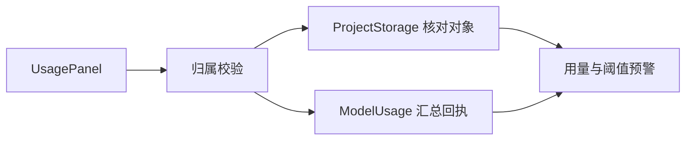

# 项目存储、模型用量与费用预警

> 按项目测量真实对象占用和模型回执，返回费用估算、未知项及用户配置的非阻断累计预警。

## 1. 模块定位与边界

前端 UsagePanel 请求项目用量；控制器先核对归属，再合并存储与模型投影。search 的查询向量提交使用 QueryModelCalls 登记不确定性。依赖 PostgreSQL、MultipartStorage 与 project。估算不是提供方账单；本包不限制 Agent 预算、不停止任务，也不发外部告警消息。

## 2. 快速导航

入口：[ProjectUsageController.java](ProjectUsageController.java)。本包随 Java 应用启动，没有独立进程；运行、配置与开发工具见[后端 README](../../../../../../../README.md)。下文命令均从仓库根目录执行。

## 3. 目录与文件职责

| 路径 | 职责 |
| --- | --- |
| [ProjectUsageController.java](ProjectUsageController.java) | 用量读取、模型记录分页和预警阈值写入 |
| [ProjectStorage.java](ProjectStorage.java) | 真实 multipart／对象、未来预留、待清理占用的分类核算 |
| [ModelUsage.java](ModelUsage.java) | ASR／视觉／Agent／索引与查询向量的持久回执汇总 |
| [ModelPricing.java](ModelPricing.java) | 源码固定价目快照和估算；未知模型返回未定价 |
| [QueryModelCalls.java](QueryModelCalls.java) | 查询 Embedding 的 SUBMITTING／SUCCEEDED／UNCERTAIN 登记 |

## 4. 架构与内部交互流程



1. GET usage 对原始素材、派生媒体、预览、导出逐类核对真实对象与分片，并合计 reservedBytes／pendingCleanupBytes。
2. ModelUsage 从各调用表读取已登记记录，区分 REPORTED 与 ESTIMATED 用量，向量复用批次另计，不当作新付费调用。
3. ModelPricing 按源码日期价目估算已识别模型，未知价格和不确定调用分别计数。
4. 将累计值与项目阈值比较，返回 warnings；PATCH 保存可选正数阈值，null 关闭。预警不改变任务执行。

## 5. 公共接口与数据契约

| HTTP／Java | 输入 | 输出 |
| --- | --- | --- |
| `GET /api/v1/projects/{project}/usage` | offset，默认 0 | storage、models、thresholds、warnings |
| `GET /api/v1/projects/{project}/usage/models` | offset | 模型记录及 nextOffset；末尾 -1 |
| `PATCH /api/v1/projects/{project}/usage/thresholds` | costCny、calls、tokens、audioSeconds，均可 null | 保存后的阈值 |
| `QueryModelCalls.begin/beginQuestion` | project、模型、输入字节、task 或 search | 持久调用 UUID |
| `QueryModelCalls.succeeded/uncertain` | 调用 UUID、响应 | 保存结果或不确定状态 |

存储分类为 ORIGINAL／DERIVED／PREVIEW／EXPORT。模型项保留 provider、purpose、status、usageBasis、costBasis、pricingRef；nextOffset 分页每页最多 100 条。

## 6. 依赖与配置

无专用环境开关；阈值存 PostgreSQL project_usage_thresholds。Silo 访问沿用 STORAGE_*；ModelPricing 价目快照标注 2026-10-12，不声明为当前实时价格，也不包含折扣／额度或账单对账。

配置生效方式及 Compose 可覆盖范围见[根配置说明](../../../../../../../../README.md#8-配置说明)；Spring 配置来源为[application.properties](../../../../../resources/application.properties)。

## 7. 错误处理与可观测性

offset 限制为 0～1000000；归属失败返回 404。存储核对失败会返回错误，不报告虚构零占用；未知用量或价格单列，不算免费。页面可再次读取，模块不为付费提交添加重试。

## 8. 测试

同名测试包覆盖真实对象分类、回执估算、账号隔离、阈值与未知项；前端 results-usage-workspace.spec.ts 覆盖用量 UI，相关存储和模型流程另由上传／分析测试覆盖。

```bash
mvn -B -ntp -pl backend -am test -Dtest=ProjectUsageApiIntegrationTest -Dsurefire.failIfNoSpecifiedTests=false
```

测试源码见[后端测试目录](../../../../../../test/java/com/agenticvideo/business)；集成测试需要 Docker，媒体测试另需宿主 FFmpeg／ffprobe。此处是相关回归命令，文档改动不执行应用测试。

## 9. 扩展与维护

增加新付费来源时补齐持久回执、ModelUsage 的用途投影、已知／未知费用及防重复计数。更新价目同时更新快照来源标识和相关测试，不能把历史估算改写成实际账单。新增存储类别先定义真实对象、预留和待清理的关系。

## 10. 相关文档

[根 README](../../../../../../../../README.md) · [后端模块地图](../../../../../../../README.md) · [领域术语](../../../../../../../../GLOSSARY.md) · [project](../project/README.md) · [upload](../upload/README.md) · [search](../search/README.md)

[issue-31.md](../../../../../../../../docs/verification/issue-31.md) · [current-features.md](../../../../../../../../docs/current-features.md)
