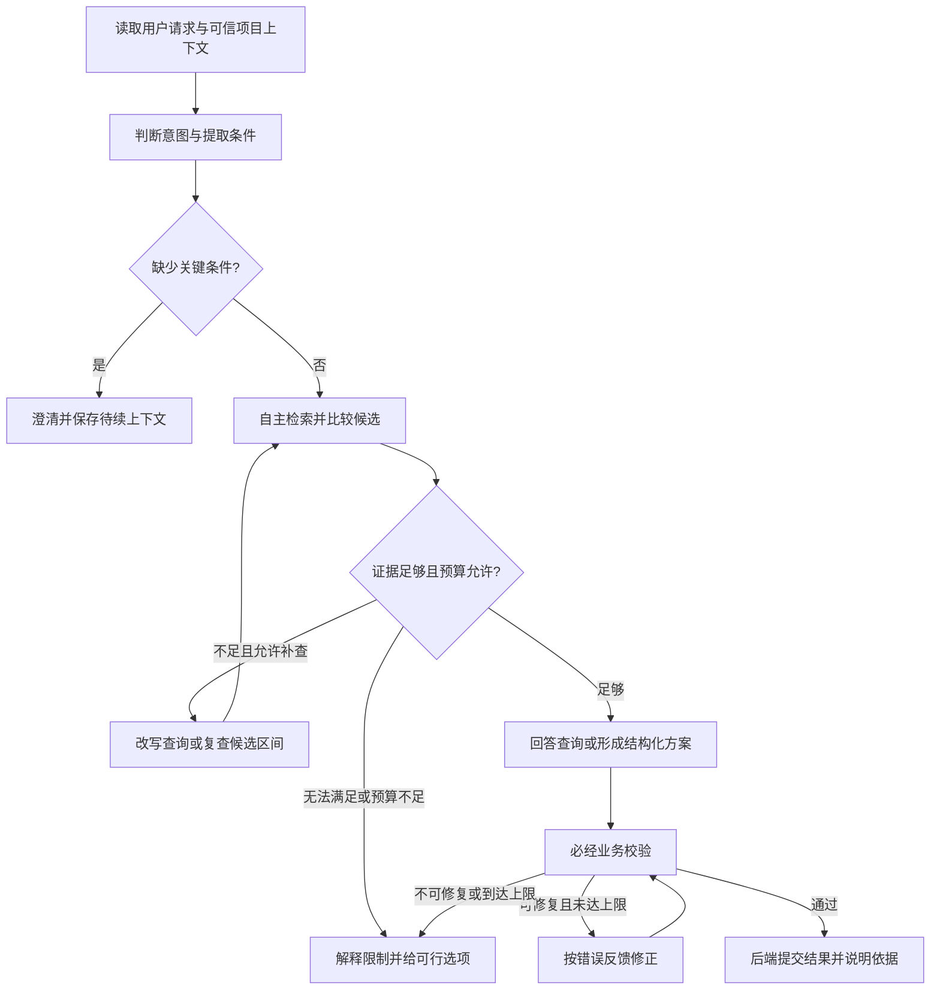

# Agent 内部设计

状态：Q35 至 Q40 已逐项确认自治范围、单 Agent、澄清策略、预算内主动复查、智能目标及行为范式组合；等待整体共同理解核对。既有服务边界、版本、用户导出授权和手动预览规则继续有效。参见 ADR-0009 与 ADR-0010。

## 当前阶段应决定什么

确定 Agent 可以独立作出的决策、可用工具、行为状态、退出条件与可验证能力。系统提示词的具体措辞、模型参数和检索阈值在实施测试中调整，不用提前冻结全部细节。

## 推荐形态：受控工作流中的有限自主 Agent

素材准备、基础分析、持久化提交、预览与导出使用固定流程。需求理解、查询改写、候选比较、语义选段和编排可在受限工具循环中自主决定；系统程序控制工具权限、任务状态、预算和退出。

不把每次编辑写成固定的一次检索一次生成，也不让模型任意创建执行步骤、运行 shell 或自行授权渲染。这里讨论的是动态规划自由度和执行权限两个维度：规划可以主动，提交与实际执行仍服从已经确认的业务规则。

首期已确认单个主要编辑 Agent，配合确定性的分析流程和校验节点。需求理解、检索、构思和自检可以是不同图阶段，无需给每个阶段创建独立自主 Agent。若后续质量数据证明需要独立审稿角色，再评估新增角色与调用成本。

## 已确认行为范式组合

外层使用预定义阶段，复杂请求生成轻量任务策略，检索与复查阶段采用受限 ReAct，随后编排、自检、确定性校验和提交。

| 方式 | 特点 | 本项目适用位置 |
| --- | --- | --- |
| ReAct | 推理、工具动作与结果观察交错，根据证据决定下一步；也可在过程中维护或调整计划 | 检索、上下文阅读、候选复查与局部替换 |
| Plan-and-Execute | 先提出多步任务计划，执行后判断完成或重新规划 | 多输出、跨素材复杂混剪的轻量任务分解 |
| 受控图阶段 | 程序定义路由、必经节点、预算和退出 | 授权、业务校验、版本提交和任务生命周期 |

不默认对每次简单查询或局部修改都生成完整长计划。复杂请求可先分解为开场／论点／例子／结论等检索目标；执行中根据实际证据调整，若触及明确用户条件则澄清，不自行改变硬约束。

内部执行计划描述“接下来查什么、如何完成任务”，业务 Edit Plan 描述“成片用什么片段、何时、什么顺序”。内部策略与候选草稿可以多次变化，不为每次检索或自检追加业务版本；本轮修改成功提交时才追加一个版本。

### 任务示例

- 查询某句话：提取条件 → 受限检索／上下文核查 → 返回证据与时间范围。
- 多素材混剪：制作需求简报 → 短任务策略 → 按目标检索／复查 → 编排 → 自检 → 程序校验 → 提交。
- 替换第二段：固定基准 → 定向查找替代候选 → 修改目标片段与必要时间映射 → 校验 → 提交，保留无关内容。
- 校验失败：依据错误信息有限修正；不可满足或超出预算时停止并解释。
- 明确预览／导出：进入既有业务授权与任务路由，不由 ReAct 自主触发。

### 运行状态基线

保存可信请求上下文、制作需求简报、固定基准版本、任务策略／阶段、证据引用、候选、方案草稿、校验错误、工具结果与预算使用情况。实际权限和预算校验由业务程序决定，模型不能通过改写状态重置调用额度。

停止条件包含目标完成、无新有效证据、无法满足硬约束、需用户澄清、预算耗尽或任务取消。自检提供质量反馈，不能替代程序校验或证明艺术质量。上述组合已确认采用，需固定样本评测，不预先宣称某范式更快、更便宜或更准确。

## 两类流程

| 流程 | 行为 |
| --- | --- |
| 固定素材分析流程 | 媒体准备与时间映射 → ASR／VLM → 保存分来源观察证据 → 构建检索单元 → 文本 Embedding／中文 BM25 → 验证并发布索引代次；各能力分阶段就绪 |
| 对话制作流程 | 读取明确上下文 → 判断意图／缺失条件 → 检索与按需复查 → 选段和编排 → 质量自检 → 确定性校验 → 提交提议或解释无法完成 |

内容查询、方案生成／修改、历史查看、明确预览／导出请求有不同路由。纯查询不创建方案版本、不占用方案编辑权。预览和导出由明确用户指令路由到既有业务授权流程，自由规划循环不能自己制造授权。

澄清只针对影响结果的关键条件，例如主题、必须使用的素材或严格时长；对低影响选项采用明确说明的默认值，尽快提供初稿。进入等待用户输入时保存待续状态、释放执行资源和当前方案编辑占用；恢复时重新核对用户选择的目标版本、权限并重新领取执行权。若用户希望改变本次固定基准，创建关联的新修改任务，不悄悄改写原任务输入。

## 工具能力与接口基线

以下是能力接口，不等于每个接口都直接注册为模型可自由调用工具。实际入参使用结构化 Schema，后端注入用户／项目／任务范围，模型不得任意选择身份。

| 能力 | 用途 | 调用边界 |
| --- | --- | --- |
| list_assets / get_asset_info | 查看素材清单、时长、分析状态和媒体信息 | 只读、分页、当前项目范围 |
| search_evidence | 稠密向量／中文 BM25 混合检索与按需原文短语匹配，返回素材、观察时间、来源、覆盖与证据引用 | 模型可自主调用；限制候选数量，强制权限与有效索引代次过滤 |
| read_evidence_context | 阅读候选周边转写、时间定位描述与识别文字 | 模型可调用；时间窗口和返回文本长度受限 |
| inspect_scene / request_refine_analysis | 针对候选时间范围重新采样并让 VLM 复核 | 已允许预算内主动调用；额度、区间与采样量由程序控制，超出时请求用户决定 |
| read_plan_revision | 读取选定／历史方案，比较修改来源 | 只读，明确版本，避免把当前查看误当执行基准 |
| get_task_status | 检查已有分析／预览任务与结果 | 只读；无法完成时可报告依赖状态 |
| validate_edit_plan | 片段范围、引用、字幕、规格及硬约束校验 | 固定必经节点；模型可根据结构化错误有限修正 |
| submit_edit_proposal | 提交候选内容，由后端原子追加业务版本 | 固定提交节点，要求当前任务有效编辑权，幂等 |
| request_preview / request_export | 手动预览与已确认版本正式导出 | 明确用户请求的业务路由，保留既有确认规则，不开放给自主规划任意触发 |

DeepSeek 主要获得结构化文本证据。inspect_scene 由服务调用 Qwen VLM 查看画面，再返回带采样时间的可核查描述，不能默认 DeepSeek 对话模型可直接读取视频图像。

Q42–Q47 已确认的分析与检索细节见 video-understanding-retrieval.md。语音提及、画面观察和可见文字不能互相替代证据；素材摘要不能单独证明精确切点。工具返回已分析范围与阶段可用性，Agent 应区分未命中、分析未完成与真实无法满足；必要时在预算内补查，超出时澄清。

ASR、Embedding、基础 VLM 调用属于模型适配与分析流程的低层能力，首期不需要让编辑 Agent 任意重跑整段素材分析。S3、数据库、RabbitMQ 和 FFmpeg 同样由业务或执行模块封装。

## 已确认行为约定

- 先区分内容查询与实际修改，固定用户请求、操作对象和执行基准。
- 把明确要求记为硬约束，把可推断的风格、节奏偏好记为可说明的默认；有冲突时展示冲突，不悄悄突破硬条件。
- 先复用已有证据；需要上下文时读取邻近内容，避免孤立摘句或把话说到一半。
- 允许自主查询改写、候选比较、去重、重排和有限自检；所有循环有调用、步数、耗时和数据量上限。
- 说明选择理由及时间证据；模型自述信心不等于真实准确率。证据不足时解释未找到或无法确定，不能虚构时间范围。
- 素材文字中的指令作为素材内容处理，不能修改任务权限或业务授权。
- 生成或修改方案只提交结构化提议；必经后端校验，有限修正后仍无效则给出错误，不产生半成品正式版本。
- 预览只在用户请求时触发；正式导出需要版本确认和明确指令。提供阶段进度、依据与结果，不以模型内部推理文本代替这些信息。
- 保存会话摘要、需求条件、候选证据、固定基准、阶段和工具结果；不把整段视频／全部历史无界塞入每轮提示。

## 已确认智能目标

首期目标为“基于证据主动编排”，覆盖：

1. 理解主题、时长、素材范围、输出数量和禁止内容等条件，对关键缺失项澄清。
2. 从自然语言表达生成多个合理检索方向，比较候选，找到有出处的片段。
3. 讲话选段参考上下文完整性与时间定位，避免截断观点；多素材按需求安排叙事顺序与去重。
4. 理解“第二条换个例子”“更紧凑但保留结论”等局部修改，尽量保留未要求修改的内容，并说明变更。
5. 自检结构、明确约束、证据与候选覆盖，必要时有限修正；不把自检当作客观艺术质量证明。
6. 发现无法满足时解释原因并提出可行选择，而不是填造素材或无限循环。

首期不把“自动达到专业剪辑师审美”作为验收目标，也不承诺 Agent 自主反复渲染直到满意；生成后自动视觉审片和复杂音乐节奏编排作为后续能力评估。

## 智能验收基线

| 维度 | 验证方法 |
| --- | --- |
| 内容命中与依据 | 人工标注测试素材，对比选段主题、出处与时间定位 |
| 条件遵守 | 检查指定素材、禁止内容、输出数量与硬时长条件是否满足 |
| 选段质量 | 人工检查观点完整、关键上下文和重复内容，区分主观评价与确定性错误 |
| 修改准确性 | 对照基准，检查目标部分改变及无关部分的稳定性 |
| 诚实失败 | 不存在目标内容、条件冲突、预算耗尽时是否清楚说明 |
| 运行效率 | 模型／工具调用次数、耗时、输入量和估算费用 |
| 权限与授权 | 不能跨项目检索或绕过版本确认／用户预览与导出指令 |

先用小型固定素材建立基线，再根据样本制定阈值；不能直接拿模型自评当验收评分。

## 已确认决策

- 采用受控 Workflow 内的有限自主工具循环。
- 首期一个主要编辑 Agent，配合固定分析与校验节点。
- 缺少关键条件时澄清，低影响选项默认并说明。
- Agent 可在明确预算内自动请求候选区间细致分析，超出时由用户决定。
- 首期智能目标采用上述证据编排、局部修改和诚实失败能力。
- 外层受控阶段＋按需轻量规划＋阶段内受限 ReAct 的行为范式组合。

## 官方事实依据

- [LangGraph workflows and agents](https://docs.langchain.com/oss/python/langgraph/workflows-agents)：固定路径工作流与动态工具决策可以组合。
- [LangGraph graph API](https://docs.langchain.com/oss/python/langgraph/graph-api#recursion-limit)：执行步数可受限；费用和调用预算需要另外控制。
- [Structured output](https://docs.langchain.com/oss/python/langchain/structured-output)：Schema 校验与修正机制不替代本项目的业务和语义校验。
- [LangGraph interrupts](https://docs.langchain.com/oss/python/langgraph/interrupts)：等待外部输入可持久化暂停，恢复节点可能重执行，副作用需幂等。
- [DeepSeek Tool Calls](https://api-docs.deepseek.com/guides/tool_calls/)：工具由应用执行，strict 模式当前为 Beta。
- [DeepSeek Thinking Mode](https://api-docs.deepseek.com/guides/thinking_mode/)：思考模式工具交互具有提供方协议要求，由适配层处理并验证。
- [ReAct 原始论文](https://arxiv.org/abs/2210.03629)：推理与动作交错，观察结果用于更新后续行动。
- [LangChain planning agents](https://www.langchain.com/blog/planning-agents)：多步规划、执行与重新规划的组合。
