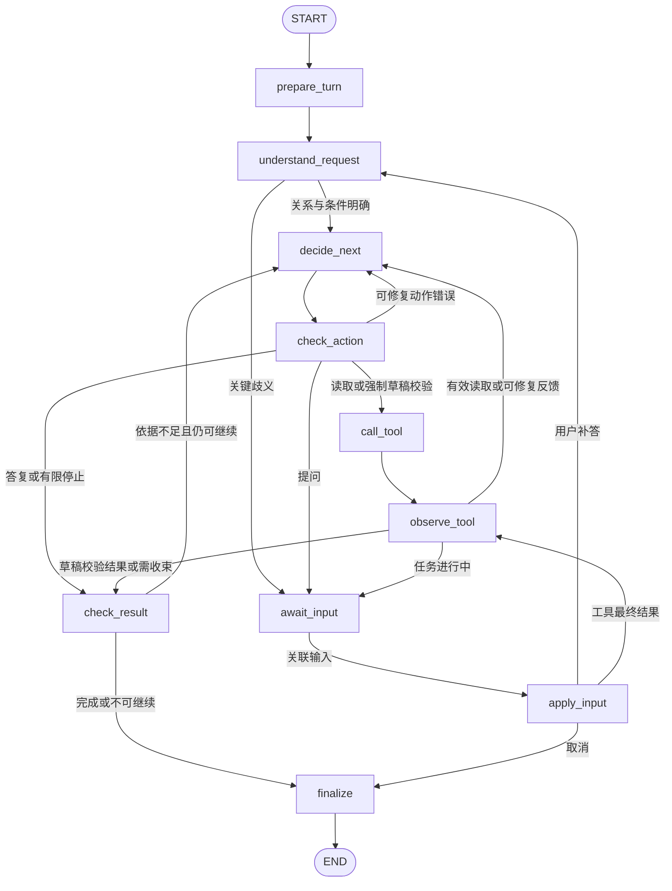

# Python Agent 独立 MVP 设计

日期：2026-10-14。状态：用户已确认最终设计并授权实施；独立 MVP 已实现，验收记录见 [agent-mvp.md](verification/agent-mvp.md)。

本阶段重写 Python Agent 并调整 `agent-service` 文件结构，先完成能够独立运行、调试和观测的 MVP。真实工具执行由 Java 后端承担，后续再接入。本机旧运行记录无需迁移。现有 ASR、VLM、索引实现保留并移入隔离的分析包，不由独立 MVP 入口启动；最终归属在后续工具执行阶段确定。

## 已确认的决定

| 项目 | 决定 |
| --- | --- |
| MVP 闭环（Q1） | 用户输入、理解目标、选择工具、接收反馈、继续决策、基于依据答复或输出剪辑草稿；支持关键歧义补答、工具错误有限修正与预算耗尽收束 |
| 验证场景（Q1） | 视频问答与剪辑草稿生成；预览／导出先定义契约，不实际生成媒体 |
| 运行入口（Q3） | 可直接调用的 Python 核心与命令行调试入口；接入 Java 时再增加 HTTP 服务 |
| 观测部署（Q4） | Langfuse 本机 Docker 自托管，观测数据保留本机 |
| 工具反馈（Q2） | 使用开发用本地 Mock，提供正常结果与可重复的错误／等待场景；模型决策真实运行 |
| 重启恢复（Q5） | 本地 SQLite checkpoint 持久保存暂停状态；关闭 Python 进程后仍能补答并继续 |
| 分析代码（Q6） | 现有 ASR、VLM 和索引代码先保留在隔离的分析包中，不纳入 MVP 入口；最终归属后续确定 |
| 多轮需求（Q7） | 普通后续修改延续当前需求，只更新提及的条件；明确新需求隔离目标和条件，关系有歧义时澄清 |
| 工具顺序（Q8） | 每次只执行一个工具动作，获得反馈后再决策；依赖待就绪时暂停，不并行调用或轮询 |
| 制作完成条件（Q9） | 输出结构化剪辑草稿并通过开发用模拟校验；保存／预览／导出只定义契约，本轮不执行 |
| 工具边界（Q10） | 启用五个内容工具，由图强制调用草稿校验；其它生产能力只保留禁用契约 |
| 状态生命周期（Q11） | 按会话、需求、执行区分身份；补答／恢复延续执行与消耗，普通后续消息建立新执行，新需求隔离条件 |
| 目录（Q12） | 按 runtime、model、tools、tracing、analysis 职责分组；十节点归入五份模块，不增加通用框架 |
| 模型适配（Q13） | ChatDeepSeek、deepseek-flash、显式关闭 thinking、非流式模型输出；结构化输出在本地验证 |
| 预算与回执（Q14） | 采用本文件的初始上限、本地 SQLite 回执与恢复规则；不确定调用停止自动重付 |
| 观测政策（Q15） | Langfuse 关联 graph、节点、真实 generation 与工具；首轮验收必须看到 trace，临时观测故障提示后 Agent 继续 |
| 模型 | DeepSeek Flash 负责文本推理；ASR、VLM 和 Embedding 采用阿里云百炼对应模型；本阶段不要求实际运行视频分析 |
| 设计约束 | 第一性原理、避免过度设计、高内聚低耦合；按可观测与可恢复边界细分节点，不增加独立自主 Agent |

## 本地工具 Mock

本地模拟执行器是实现工具执行接口的开发用 Mock：根据工具名、参数及场景返回固定样本中的记录或预设错误。DeepSeek Flash 仍真实决定下一步动作；Mock 替代未来 Java 执行器提供的反馈。

例如 Agent 请求读取素材 A 的某个时间范围，Mock 返回该范围内预置的转写、时间与引用；模型可以继续阅读其它范围、选择片段或答复。对越界参数、无命中、临时失败和等待，可以设置可重复的反馈场景。本轮不执行保存或渲染，最终输出明确标为草稿，不能被解释为真实项目版本或产物。

开发 Mock 与未来 Java 执行器采用一致的输入／输出契约。Mock 验证 Agent 循环、协议和可控错误处理；真实检索、视频识别、业务保存和媒体质量仍需后续集成验证。

## 已确认的工具设计

工具表示需要外部提供的数据或业务能力，图节点表示 Agent 的执行步骤。请求理解、补答、候选组织、输出答复都是 Agent 自己的行为，不注册成外部业务工具。

| 工具 | 主要输入 | 结果 | 调用方式 |
| --- | --- | --- | --- |
| `list_assets` | 可选 cursor | 素材 ID、名称、时长、来源及分析可用性 | 模型自主选择 |
| `get_video_overview` | assetId、cursor | 时间目录、导航引用、实际覆盖与下一页 | 模型自主选择 |
| `search_evidence` | query、sourceKinds、可选 assetIds/cursor | 有界命中、来源、时间、覆盖与下一页 | 模型自主选择 |
| `read_video_range` | assetId、startMs、endMs、cursor | 范围内原始语音／视觉／文字记录、引用和截断状态 | 模型自主选择 |
| `inspect_video_range` | assetId、范围、检查目标 | Mock 新观察，或等待对象 | 模型自主选择；本阶段不调用百炼 |
| `validate_edit_draft` | draft、固定条件及草稿／条件摘要标识 | valid、字段级问题、实际时长、被检查输入标识 | 图在输出草稿后强制调用，模型不能跳过 |

保存版本、确认版本、请求预览、请求导出、读取任务状态的契约放在未启用能力清单中，不发送给当前模型，避免它承诺本阶段不执行的动作。草稿沿用有序源区间及多输出结构；精确字段在工具与节点边界确定后展开。

`ToolExecutor.execute(request)` 是 Agent 对执行器的单一接口。输入包含稳定 callId、工具名及经校验的 arguments；作用范围由运行上下文提供，不允许模型传身份或凭据。结果为 `READY/PENDING/ERROR` 之一，并提供相同 callId、data、来源／覆盖、可选等待对象或结构化 error。Mock 实现此接口，后续 Java 适配也实现此接口。

`READY` 表示结果可用，不等于存在命中或目标完成。目录和摘要只能导航；具体结论需要原始记录。模拟草稿校验可以检查样本范围、引用、实际时长及明确约束，不能证明语义质量或等价于 Java 正式校验。

## 已确认的状态生命周期

一个制作需求对应稳定 checkpoint thread，同需求的后续消息在该 thread 中继续；新需求建立新 thread。每条普通新消息建立新的执行身份，补答、工具等待恢复及关联重试延续同一执行身份。session 只用于组织对话与观测，不能代替需求或执行身份。

| 状态字段 | 保存什么 | 生命周期 |
| --- | --- | --- |
| `identity` | sessionId、requirementId、executionId、turnId | 恢复沿用，新消息／新需求按上面的规则分配 |
| `request` | 当前原消息、关系 NEW/CONTINUE、被问字段及来源 | 普通新消息更新，补答追加关联输入 |
| `requirements` | 目标、硬条件、偏好、已说明默认值与各自来源 | 延续需求只合并当前提及字段；新需求清空 |
| `messages` | 有界公开历史及本轮模型协议必需消息 | 节点使用时组装提示词；不保存无界历史或私有推理 |
| `observations` | 已读原始记录、有界摘录、合法引用与覆盖／分页位置 | 同需求可复用，按输入素材／分析版本核对 |
| `draft` | 当前多输出草稿、有序源区间及引用 | 同需求可以修改；不是业务方案版本 |
| `validation` | 草稿与条件的输入标识、valid、问题和实际时长 | 草稿或条件改变即失效 |
| `action` | TOOL/ASK/ANSWER/DRAFT 的结构化建议 | 每次决策更新，不保存长计划 |
| `pending_tool` | 稳定 callId、工具名及固定参数 | 提交与恢复沿用，接到最终结果后清理 |
| `feedback` | 最近工具结果或结构化修正问题 | 用于下一次决策，归档到有界记录后可覆盖 |
| `waiting` | kind、waitId、问题字段或待完成 callId | 暂停持久保存，合法恢复后清理 |
| `usage` | 本执行模型／工具／修正消耗、有效执行时间与无进展次数 | 暂停恢复不清零；普通新消息取得新执行额度 |
| `outcome` | ANSWER/DRAFT_READY/INCOMPLETE/CANCELLED、答复与引用／草稿／限制 | 由程序根据结果核对后形成 |

注入自定义 ToolExecutor 时必须显式提供 assets 当前素材元数据，不从执行器读取未声明属性。运行上下文保存客户端、执行器、配置和可调用范围；每次恢复重新注入，不放入 checkpoint。state 中的 usage 是运行快照；真实模型请求的提交前记录与不确定回执另行持久保存，具体最小方案见预算和故障设计。

CLI 区分普通消息、明确新需求、关联补答、关联工具结果和取消。等待用户时普通文本可以成为对当前问题的补答；等待工具时普通文本不能冒充工具结果。恢复输入的 waitId、callId 与当前状态必须匹配。素材中的指令仍只作为内容处理。

## 十节点流程定稿

以下节点针对已确认的独立闭环，不含 Spring 任务领取、业务版本发布或媒体执行。依据 Q10、Q11 和本轮定稿指示，采用十节点流程；节点参数及函数可在实现中调整，职责边界保持明确。

| 节点 | 类型 | 单次职责 |
| --- | --- | --- |
| `prepare_turn` | 数据 | 接收普通新消息，分配／恢复身份，初始化本执行字段与有界上下文 |
| `understand_request` | LLM | 返回请求关系及条件补丁，按明确字段合并；关系有歧义时提出问题 |
| `decide_next` | LLM | 根据需求、已读记录及反馈提出一个 TOOL/ASK/ANSWER/DRAFT 动作 |
| `check_action` | 数据 | 检查动作 Schema、可调用能力、范围和剩余额度；固定下一次工具请求；草稿输出强制转成模拟校验请求 |
| `call_tool` | 外部步骤 | 将固定请求交给注入的执行器，不自行实现检索、VLM 或业务规则 |
| `observe_tool` | 数据 | 核对 callId，吸收结果／读取记录，更新覆盖、错误反馈或等待对象 |
| `check_result` | 数据 | 核对答案引用与来源、草稿校验输入是否匹配，形成完成或缺口判断 |
| `await_input` | 用户／事件输入 | 仅一次 interrupt，暂停并持久保留等待对象 |
| `apply_input` | 数据 | 核对并应用补答、工具结果或取消，决定回请求理解、结果吸收或收束 |
| `finalize` | 数据 | 输出已核对的结构化结果及公开说明；无模型额度时使用确定性模板 |

理解与动作选择共用 DeepSeek Flash。结束说明可以由 ANSWER/DRAFT 动作附带，不强制多一次回复改写；程序只允许表达真实结果阶段。细分 check/call/observe/result 的目的，是分别观察提议、实际调用、反馈及完成依据，而不是增加 LLM 调用。



节点内部的小纯函数不再拆成节点。普通新消息以输入字典进入 START；暂停以同一 thread 的 Command(resume=...) 恢复，不再次执行 prepare_turn 或重置预算。await_input 无提交工具或扣费副作用，因为恢复会从暂停节点开头重执行。[LangGraph 官方暂停语义](https://docs.langchain.com/oss/python/langgraph/interrupts)

工具列表、检查方法和 Mock 都通过相同 Schema 关联，避免在提示词、图路由和执行器中分别维护一份字段规则。Langfuse 观察节点、模型调用和工具请求的输入输出、耗时与错误；具体接入与字段见模型适配及观测设计。

程序强制触发的草稿校验是执行器请求，不伪造为模型生成的 tool call。其反馈进入受控上下文；只有模型实际返回的工具调用才按提供方 tool_call_id 配对。结构化 Action 的解析协议与真正的业务工具执行协议在模型适配器中区分。[DeepSeek 工具调用协议](https://api-docs.deepseek.com/guides/tool_calls/)

### 路由和恢复约束

- `understand_request` 输出条件补丁，确定性合并函数只更改被明确提及的字段；歧义时形成等待问题。继续提问时已确认且合法的补丁仍持久保存，有序补答保存在 request.clarifications；矛盾补丁不写入条件，关系不明时不合并旧需求。明确新需求的 CLI 入口在调用图前选定新 thread。自然语言识别为新需求时，运行器在任何工具执行前将原消息与理解结果交给新 thread，不把旧要求或草稿带过去，也不重复调用模型理解同一消息。
- `prepare_turn` 仅在普通新消息入口执行。重置 action、pending_tool、feedback、waiting 和 outcome 等本执行字段，保留同需求已有要求、已读记录和草稿。草稿校验只在草稿／条件标识及有效来源仍匹配时保留；任何修改使其失效。
- `check_action` 在工具调用前固定 callId 和参数；草稿走同一执行器接口完成强制校验，不再增加一套工具执行路径。
- `observe_tool` 检查 callId、工具名和输入标识；校验结果必须匹配当前草稿及条件，旧响应不能批准新草稿。
- `check_result` 不只检查引用 ID 存在；答案与草稿共享当前素材范围、分析版本和有效时间核对，草稿额外核对片段当前边界；全片要求逐一检查目标素材的当前版本目录覆盖，缺失时继续或明确说明限制；程序检查是必要条件，语义主张支持程度仍需人工样本验收。
- `await_input` 不提交模型或工具。`apply_input` 接收与当前 waitId 关联的补答／工具反馈；取消直接形成 CANCELLED。
- 模型格式／参数错误产生有界反馈，转入修正；未知代码错误上抛。没有模型额度时仍能进入确定性收尾，不靠再请求一次 LLM 解释额度耗尽。
- 已结束的图接收普通输入进入 START；暂停使用 Command(resume=...)；故障未完成节点按 checkpoint 继续。运行器先区分三者，再构建 Runtime context，不能对任何非空 checkpoint 都直接当作成功结果。

## 已确认的目录结构

按职责组织文件，图节点按相近职责放在少量模块，不要求一个节点对应一个文件。模型、工具执行器和观测只有实际需要的接缝，不新增插件框架、依赖注入容器或通用 Agent 基类。

```text
agent-service/
  README.md
  .env.example
  requirements.txt
  requirements.lock
  Dockerfile
  compose.langfuse.yaml
  agent_service/
    __init__.py
    __main__.py                 # python -m agent_service
    cli.py                      # 输入、补答、工具结果、取消、选择需求
    config.py                   # 一次读取配置，组装 runtime
    runtime/
      __init__.py
      graph.py                  # 十节点注册及边
      state.py                  # Graph State 与输入/动作/结果类型
      runner.py                 # 启动、恢复、需求切换及执行资源生命周期
      policy.py                 # 有限预算、错误分类、无进展与允许动作
      persistence.py            # checkpoint 和最小本地调用回执
      nodes/
        __init__.py
        request.py              # prepare_turn、understand_request
        decision.py             # decide_next、check_action
        tools.py                # call_tool、observe_tool
        waiting.py              # await_input、apply_input
        result.py               # check_result、finalize
    model.py                    # DeepSeek Flash 适配及两种结构化输出
    prompts.py                  # 请求理解与动作选择模板
    tools/
      __init__.py
      contracts.py              # 工具参数、请求、反馈 Schema
      catalog.py                # 已启用/禁用能力及描述
      executor.py               # 唯一 ToolExecutor 接口
      mock.py                   # 固定样本与故障场景的执行实现
    tracing.py                  # Langfuse 配置、关联字段、tool observation
    analysis/
      __init__.py
      bailian.py
      vision.py
      search_index.py
  tests/
    test_agent_scenarios.py
    test_resume_and_limits.py
    test_tool_contracts.py
    test_deepseek_live.py
    test_bailian_live.py
    fixtures/
  .local/                       # SQLite、输出等；不入 Git
```

`runtime` 依赖模型和执行器的窄接口，不知道 Java HTTP、RabbitMQ、对象存储或 Qdrant。`tools.contracts` 不导入 graph，避免执行器依赖整个图。`tracing` 不控制路由或返回业务结果；`analysis` 不被 runtime 或 CLI 导入。

依赖注入采用 graph/runner 构造参数与 Runtime context；只有工具执行器需要明确 Protocol，模型可用小适配类或可调用对象。错误类型与预算规则集中在 policy；不要散布在每个节点中重新定义。

现有三份分析文件大多通过传入 execution 使用旧业务能力；保留这种依赖直到后续阶段，不将新 runtime 当作旧 Execution 的替代实现。调整旧 ASR 测试的 import，按独立命令运行分析测试；MVP 默认测试不上传素材或调用百炼。

新 CLI 不继续冒充旧 FastAPI Worker。原 app.py 的消息消费、心跳和 HTTP 控制入口不放进新核心。根 Compose 中旧 agent-service 的自动启动／healthcheck 要明确隔离为后续集成配置，不能宣称整站当前流程仍兼容；MVP 使用独立 CLI 和 Langfuse Compose，不启动业务全栈。

## 已确认的模型适配

首版采用 LangChain 的 `ChatDeepSeek` 作为底层客户端，封装在 model.py；图节点只调用 `understand(...)` 与 `decide(...)`，返回经过本地类型校验的数据。固定 model 为 deepseek-flash，地址、凭据和参数集中配置；工具列表从 catalog 生成，图不维护第二份 Schema。

模型名称与客户端类必须区分。LangChain 集成页仍展示 deepseek-chat 等旧示例，但已核对的 ChatDeepSeek 源码将 model 定义为字符串，并使用 OpenAI SDK 的 chat.completions 客户端，没有将模型限制在旧名称名单中。DeepSeek 官方当前明确采用 deepseek-flash 和 https://api.deepseek.com；实现须显式传入这些值，不复制旧文档的模型示例。[DeepSeek 官方接入](https://api-docs.deepseek.com/zh-cn/)、[ChatDeepSeek 固定版本源码](https://github.com/langchain-ai/langchain/blob/langchain-deepseek%3D%3D1.1.1/libs/partners/deepseek/langchain_deepseek/chat_models.py)

配置示意如下；凭据来自配置，SDK 不隐式重试：

```python
import os
from langchain_deepseek import ChatDeepSeek

llm = ChatDeepSeek(
    model="deepseek-flash",
    base_url="https://api.deepseek.com",
    api_key=os.environ["DEEPSEEK_API_KEY"],
    extra_body={"thinking": {"type": "disabled"}},
    disabled_params={"parallel_tool_calls": None},
    streaming=False,
    max_retries=0,
    max_tokens=2048,
)
```

对 langchain-deepseek==1.1.1 的独立离线验证已确认：请求保持模型名、关闭 thinking、stream=false，结构化调用可通过本地 Pydantic 解析，OpenAI SDK 最终构造的 URL 为 https://api.deepseek.com/chat/completions。测试未发送网络请求，不能代替真实服务联调；临时验证环境也不等同于项目最终依赖锁。完整记录见[Flash 适配核验](research/deepseek-flash-adapter-verification.md)。

首版显式关闭 thinking，延续当前实现的模式。Flash 默认开启 thinking，携带工具的后续请求需要完整回传 reasoning_content；已核对的 LangChain 适配版本不能仅凭保存 AIMessage 保证完整回传。首版非 thinking 路径先验证模型选择和反馈闭环，开启 thinking 时另做协议与质量验证。[DeepSeek 官方协议](https://api-docs.deepseek.com/guides/thinking_mode/)

动作使用一个 Pydantic 外层模型表达 TOOL/ASK/ANSWER/DRAFT，内部类型与提供方可接受 Schema 在适配中转换。明确指定 with_structured_output(..., method="function_calling", include_raw=True)，并进行本地 Pydantic 校验；这不等同于服务端保证符合 Schema。不默认启用 Beta strict，也不声称供应商原生 JSON Schema。SDK 可能自动生成 parallel_tool_calls 参数，而 DeepSeek 当前接口文档未列此参数，因此在客户端配置 disabled_params 屏蔽它。适配器依据 raw.tool_calls 校验恰好一个动作，不依赖提供方并行开关，也不因解析器只读取第一个调用而忽略其它调用。[LangChain DeepSeek 集成](https://docs.langchain.com/oss/python/integrations/chat/deepseek)

结构化输出内部使用的 Schema 函数只是决策表达，不是真实业务工具提交。外部五个内容工具按声明的 Schema 转为 Action；Mock 与未来 Java 使用内部 ToolRequest，不依赖 DeepSeek 原始消息类型。图返回固定步骤的反馈给模型时，不伪造提供方工具调用历史。

首版模型请求不流式展示给终端；节点进度即时可见，完整输出在节点完成后可见。CLI 与图尽量采用 async 调用，搭配 AsyncSqliteSaver；timeout 只加到实际 async 节点，纯 interrupt 节点不设置短 timeout。禁用 SDK 隐式网络重试，自动重试仅在 policy 核准的明确未执行错误上发生。

新增依赖只覆盖 LangGraph/SQLite、LangChain DeepSeek、Pydantic 与 Langfuse 的实际需要，并锁定兼容版本；分析包依赖独立标识。保留 requirements.txt/lock 的现有管理方式，不同时更换包管理体系。

## 已确认的预算和故障设计

### 初始配置

这些是开发上限，随固定场景实测调整，不宣称最优。每个普通新消息对应新执行，补答、暂停恢复及关联重试沿用原执行额度。

| 控制项 | 初始值 | 计数口径 |
| --- | --- | --- |
| 模型请求 | 12 | 包含请求理解、动作选择、格式修正和明确允许的新增重试；复用已保存响应不重计 |
| 工具动作 | 20 | 包含强制草稿校验；恢复同一未完成 callId 不生成新的逻辑动作 |
| 同一草稿任务修正 | 3 | 修改后再校验；重复原草稿及相同错误不算进展 |
| 安全操作尝试 | 最多 2 次 | 包含首次；SDK/图/适配器不叠加各自重试 |
| 连续无进展 | 3 | 未增加有效读取/覆盖、未减少缺口或校验问题 |
| 有效执行耗时 | 300 秒 | 包含节点执行与重试退避，暂停等待不计；恢复不重新获得 300 秒 |
| 单次模型响应 | 2048 输出 token | 若截断，返回明确反馈；不得当作完整合法草稿 |
| 单次模型输入 | 64 KiB | 完整请求的 UTF-8 字节上限，包含 Schema；有界压缩或解释超限 |
| 单次工具反馈 | 32 KiB | 不静默截断 JSON；普通工具调用与恢复回执共用大小核对，恢复超限载荷在写入 Command/checkpoint 前替换为明确错误；采用完整分页结果或明确大小错误 |

额度在模型/工具操作之前检查；结束核对和模板输出有独立收尾路径。金额只展示有依据的估算与实际用量，不将输入字节限制解释为 token 或费用硬上限。Mock inspection 不消费真实新增视觉调用额度；正式需求级视觉授权与累计额度由后续 Java 集成落实。

### 最小持久记录

同一个本地 SQLite 文件保存独立的 checkpoint 表及两个应用表：executions 保存真实模型调用额度、有效执行耗时及运行关联，model_calls 保存稳定调用身份、原请求标识、状态、收到的响应与用量。工具动作、修正和无进展计数在前置检查节点更新并随 checkpoint 落盘，调用开始前必须已有对应检查点；本阶段工具无真实付费副作用。由 persistence.py 统一读写，节点不直接写 SQL。它们只解决本机运行预算和模型恢复，不形成第二套业务任务系统。

每次真实模型请求先原子检查额度并记录调用身份，再发送网络请求。响应保存为 RECEIVED 后才供节点使用；格式不合法的响应也已发生调用，不能退回次数。节点重执行先查询同一输入与调用身份的已保存响应。

请求发出后响应丢失，或进程崩溃时留下未核对提交记录，标为 UNKNOWN 并停止自动重付。首版不提供强制重付 CLI，需人工核查供应商回执后另行处理。后续若增加重提交能力，必须由用户明确接受不确定调用可能已产生费用，并继续在原执行额度内新增调用；不能用换 thread 或重启自动消除原占用。

Mock 请求由稳定 callId 和固定场景产生可重复结果，反馈及场景身份进入 checkpoint，跨恢复不重新随机注入故障。将来真实 Java 动作仍需要 Java 幂等回执，这两张本地表不能替代业务幂等。

runner 对同一需求只允许一个本机进程执行，使用本地互斥，避免两个 CLI 同时恢复同一 checkpoint；不引入分布式租约。checkpoint 采用 sync durability，使前置检查与稳定请求身份先保存再执行下一节点；它仍不是远程模型恰好执行一次的保证。

### 错误路由

| 错误类型 | 路由 |
| --- | --- |
| 明确安全的临时失败 | policy 控制有限重试；耗尽后进入反馈或 INCOMPLETE |
| 模型输出/工具参数/草稿约束问题 | 保留结构化错误，回理解或决策节点，消耗有限修正额度 |
| 用户可消除的关键歧义 | USER_INPUT 等待；不擅自放宽硬条件 |
| 工具结果 PENDING | TOOL_RESULT 等待；不占执行资源或轮询 |
| 付费提交 UNKNOWN | INCOMPLETE，说明不确定状态；显式新提交另行处理 |
| 额度耗尽或无进展 | check_result → finalize，报告已有依据或草稿与缺口 |
| 用户取消 | CANCELLED，停止本地请求与新工具动作；不保证撤回已发出的远程请求 |
| 未知异常/数据不变量破坏 | 上抛给 runner，记录失败并保留恢复信息，不伪装成正常回答 |

## 已确认的 Langfuse 观测设计

### 本机部署

compose.langfuse.yaml 使用 Langfuse 官方自托管部署的 Web/Worker、PostgreSQL、Redis、ClickHouse、对象存储服务，并固定经过验证的镜像版本。使用独立项目名、端口、凭据和数据卷，不复用项目业务数据库及素材存储；运行 CLI 时只需该观测栈与本地 SQLite。具体端口先核对占用再配置，不让用户判断可查询的环境事实。[官方 Docker Compose 部署](https://langfuse.com/self-hosting/deployment/docker-compose)

首次真实闭环验收必须在本机 UI 看到完整 trace。运行中观测服务短暂不可用时，Agent 仍能继续，终端明确提示观测不可用；真实模型回执与预算仍写本地 SQLite。不能把缺失 trace 的运行当作观测验收通过。

### Trace 和字段

| 层次 | 记录内容 |
| --- | --- |
| graph 调用 trace | sessionId、requirementId、executionId、turnId、场景、模型/提示版本、最后状态 |
| 节点 span | 节点名、有界输入/输出或状态摘要、耗时、错误类型与停止原因 |
| LLM generation | 实际模型、请求/响应、真实 token 用量、耗时、调用 ID、缓存或复用标记 |
| tool observation | 工具名、callId、参数、结果/错误、Mock 标识、耗时和等待对象 |

本次验证使用 Langfuse 服务 4.59.0、Python SDK 4.18.0；SDK 4 通过 propagate_attributes 传递会话与执行关联，读取验收使用 Observations API v2。LangGraph 的调用配置传入 Langfuse CallbackHandler，节点中的 ChatDeepSeek 调用继承同一 config，从而关联真实 generation。ToolExecutor 边界只补充工具类型 observation；不另建重复的 LLM generation。[官方 LangGraph 集成](https://langfuse.com/integrations/frameworks/langchain)

每次启动或恢复 graph 形成一个有界 trace，使用同一个 executionId 关联，不能将暂停等待表现为跨天持续运行的单个 span。ToolRequest 的业务 callId 与提供方生成的协议 ID 分别记录。复用已保存模型响应显示为复用操作，不伪造新的提供方调用/token 消耗。

记录有界模型输入输出和工具数据以便调试，不录 API key、认证 header、内部连接凭据或私有思维链。state 在观察中只投影所需字段，避免每个节点重复发送全部历史。模型输出截断、结果超限和观测失败都应明确可见。

CLI 退出或暂停返回前执行有上限的 flush/shutdown；Langfuse 不是 checkpoint、预算或任务状态数据库。不为观测失败增加新 Outbox、持久重传服务或监控 Agent。

## MVP 验收标准

通过可直接调用的 Agent 入口和 CLI 验证行为，不把节点文件名或提示词全文作为断言。默认测试使用脚本模型与工具 Mock，检验状态/协议不变量；显式真实模式使用 DeepSeek Flash 与工具 Mock，人工核对来源和草稿，并验证本机 Langfuse trace。

验收通过标准是以下适用项全部通过，并保留可复现命令、固定样本、运行结果及真实 trace 引用。测试结果按确定性行为与真实模型能力分别报告，未配置凭据或未运行的真实项不能记为通过。

| ID | 场景 | 可观察的通过条件 |
| --- | --- | --- |
| MVP-01 | 独立启动 | 在不启动 Java、RabbitMQ、业务数据库、Qdrant 或素材对象存储时，从 Python 核心或 CLI 启动同一 Agent；仅使用模型 API、SQLite 和本机 Langfuse。启动不自动触发 ASR/VLM/Embedding |
| MVP-02 | 问答闭环 | 根据工具返回的原始记录回答；引用 ID、来源及真实样本时间有效；无命中时说明实际范围，不编造记录或宣称全片不存在 |
| MVP-03 | 全片浏览与来源区别 | 全片问题消费完整目录分页，未完成则说明覆盖；导航摘要不能代替精确证据，语音提及不能当作视觉出现 |
| MVP-04 | 草稿生成 | 返回含多输出结构、有序合法源区间和引用的草稿；对应当前草稿与条件的模拟校验已通过；结果为 DRAFT_READY，明确不是已保存方案或成片 |
| MVP-05 | 校验失败与修正 | 注入范围／引用／时长问题，反馈可定位；有限修正后通过或 INCOMPLETE；旧草稿的校验响应不能批准新草稿 |
| MVP-06 | 关键澄清 | 无法合理确定目标／对象或硬条件冲突时暂停；关联补答恢复原需求，已有条件不丢失，低影响默认不覆盖硬条件 |
| MVP-07 | 工具等待 | Mock 返回 PENDING 后图退出当前执行；通过 CLI 或核心入口注入匹配的最终工具结果后继续；不轮询、不再次提交同一逻辑动作；错误 waitId/callId 被拒绝 |
| MVP-08 | 进程重启 | 在用户等待和工具等待两种状态退出进程，使用原 thread 恢复；原条件、pending callId 和消耗保持；已保存模型响应可以复用，无新增提供方调用 |
| MVP-09 | 多轮与新需求 | 同需求后续修改只更改指定条件；草稿／条件变更使旧校验失效；明确新需求获得新 thread 且不继承旧条件和草稿 |
| MVP-10 | 工具契约与顺序 | 所有调用经过同一执行器接口，参数及反馈经过 Schema 验证；一次仅执行一个工具动作；禁用生产能力不能被执行 |
| MVP-11 | 有限执行 | 配置的小额度下，模型／工具／修正／耗时上限触发 INCOMPLETE；连续无进展有限停止；恢复不清零；没有剩余 LLM 额度仍能完成模板收尾 |
| MVP-12 | 错误分类与不确定费用 | 安全临时失败不超过配置尝试数；参数错误进入修正；未知代码异常记录失败。注入模型回执丢失或提交后崩溃后，恢复不会盲目重付；格式错误的已收到响应仍计入调用数 |
| MVP-13 | 取消 | 等待或运行中取消后不再发新动作，结果为 CANCELLED 或明确失败记录；迟到工具结果不能恢复已取消执行；不宣称撤销远端已发生费用 |
| MVP-14 | Langfuse 完整观测 | 本机 UI 能关联 graph trace、节点、真实 generation/用量、工具/Mock 标识和等待恢复；恢复片段共享 executionId；复用响应不伪造新 token 消耗；记录中不包含凭据 |
| MVP-15 | 观测临时故障 | Langfuse 暂时不可用时 CLI 明确提示，Agent 仍可运行并保存本地回执；这次缺失的 trace 不算观测验收通过；退出 flush 有界，不阻塞无限等待 |
| MVP-16 | 可复现交付 | README 提供安装、独立启动、Langfuse 初始化、场景运行、补答／工具恢复／取消和测试命令；依赖锁定；默认测试不调用付费模型，真实测试通过明确入口运行 |

工具 PENDING 的独立验收使用模拟完成结果驱动恢复；真实 Java 完成事件自动唤醒属于后续集成阶段。真实模型验证至少跑通问答、草稿生成、关联澄清三类场景，使用明确标记的固定样本，并人工核对出处与约束；不要求所有故障都用真实付费请求制造。

不以某次措辞、固定节点遍历顺序、完整提示词或模型自评分数作为通过依据。样本结果不能外推为真实视频识别准确率，也不能代替 Java 业务提交与媒体播放验收。

## 关键问题与实施边界

没有尚待用户决定、会阻塞本阶段职责边界或主流程的关键设计问题。下列项目在实现中查询、验证和调整，不重新作为产品选择访谈：兼容依赖与镜像版本、可用本机端口、供应商 Schema 转换、默认场景数据及输入大小、实际请求/用量回调和有限预算参数的场景适配。

以下已明确推迟：Java 工具执行与业务权限/需求累计视觉预算；真实 ASR/VLM/Embedding 与检索；版本保存、预览和导出；整站 HTTP/MQ 恢复集成；thinking 模式及流式输出。不能因独立 MVP 通过而宣称这些能力已经实现。

实现只改独立 Agent 及其必要启动／测试配置，分析代码保留且隔离。预算数值允许依据样本调整并记录原因；这种调整不扩大任务范围或取消有限执行约束。

本轮最终汇总已获用户确认，并据此完成独立 MVP 代码重写。此前[完整 Agent 运行设计](langgraph-agent-runtime-design.md)继续作为后续集成目标参考，不要求将其业务级节点和状态全部放入独立 MVP。

已确认的核心与工具执行边界见 [ADR-0016](adr/0016-isolate-agent-runtime-from-tool-execution.md)。通用技术概念不加入领域术语表；新增领域概念经访谈明确后再记录。
