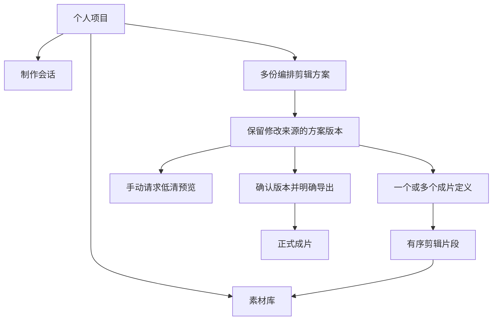
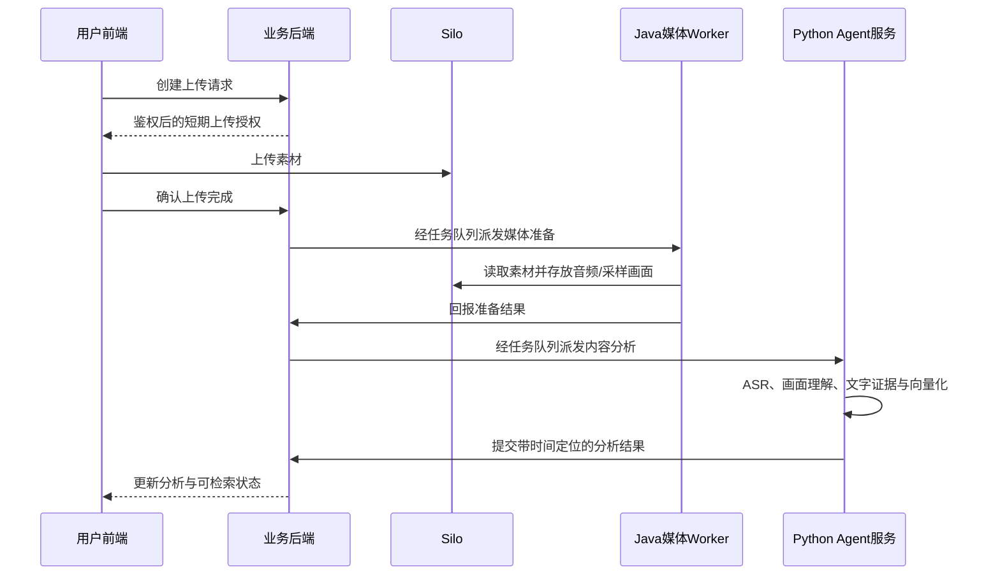
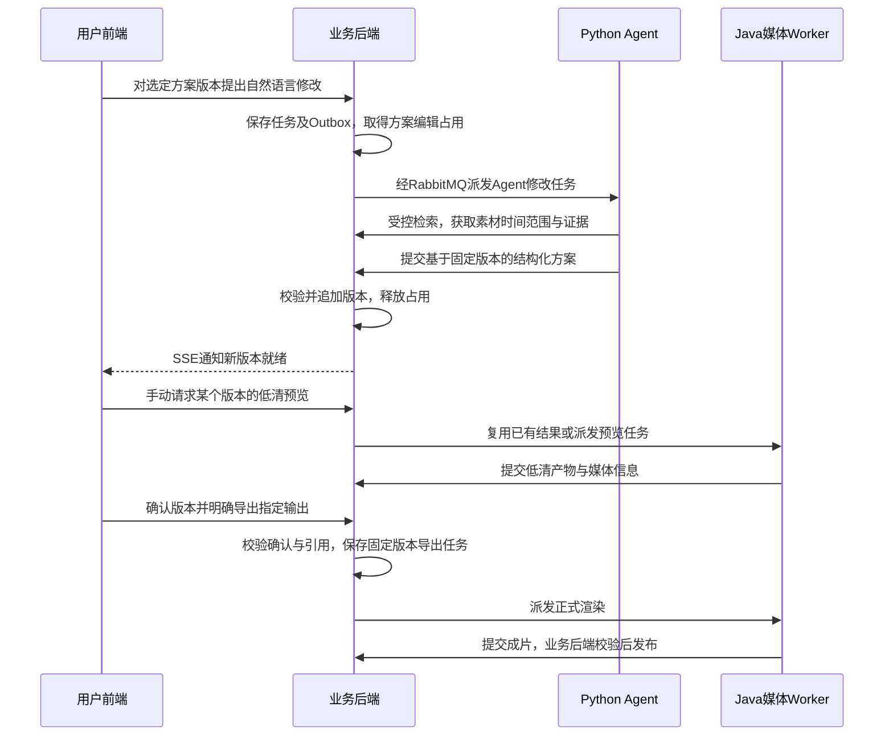

# Agent 视频编排剪辑系统架构

状态：各项架构决策已在访谈中确认，等待整体共同理解核对。未开始功能实现。任务协议详见 task-protocol.md，方案结构详见 edit-plan-contract.md，实施与验收详见 implementation-plan.md。

## 已确认的部署边界

| 应用 | 职责 |
| --- | --- |
| Vue 3 + TypeScript 前端 | 登录、项目素材、对话、片段列表、版本切换、预览与导出 |
| Spring Boot 业务后端 | 用户权限、项目、素材引用、方案历史、确认、任务和业务状态 |
| Spring Boot 媒体 Worker | ffprobe 探测、音频／画面提取、FFmpeg 预览和正式渲染、进程管理 |
| Python FastAPI + LangGraph Agent 服务 | 固定内容分析、模型适配、检索编排、对话和方案修改提议 |

初期在本机 Docker Compose 部署。业务后端和媒体 Worker 可同属 Maven 多模块工程，但独立进程／容器；Worker 保留迁移和扩容能力。模型通过 API 调用，本机媒体处理以 CPU 执行为基线。

## 已确认的领域结构

会话显示当前方案和所选版本；仅检索时可不关联方案。修改版本不覆盖旧记录，切换已有版本不新增记录，基于旧版修改后追加新版本并保留来源。一个输出修改会形成整个方案的新版本。

Agent 修改时以方案为单位锁定编辑，允许查看／切换历史和取消；完成后提示新版本就绪，不覆盖用户正在查看的版本。确认绑定具体版本；已确认旧版可再次明确导出，新版重新确认，导出前校验引用素材。

## 共享能力与产品闭环

两条主线复用素材探测、转写与时间定位、画面理解、检索、片段引用、方案版本和渲染。先以讲话视频完成拆短视频，再完成基础多素材硬切混剪。首期编辑支持选段、起止时间调整、重排、保留原声和自动字幕；横竖屏等比例缩放留边，输出 MP4 H.264/AAC、720p／1080p。

上传后自动做基础分析，深入分析按需执行；视觉检索先定位候选区间，再加密抽帧复查，结果附素材、时间范围与证据。首期不保证识别每帧全部文字。

## 已确认交互协议

1. 普通业务查询与受控工具使用 HTTP API，前端由业务后端统一鉴权；对话内容和任务进度通过 SSE 展示。
2. 耗时媒体任务、内容分析与 Agent 修改采用持久化任务，由 RabbitMQ 派发。消息传任务标识和必要关联信息，不传视频二进制或长期访问密钥。
3. 业务后端在同一 PostgreSQL 事务中保存任务与 Outbox 事件，由发布器可靠送入 RabbitMQ。消息可能重复，消费者领取执行权，回报结果按任务与尝试标识校验。
4. Worker 与 Agent 经内部业务 API 领取任务、报告进度和提交结果；业务后端控制最终业务状态及方案版本提交，Agent 提议通过结构和素材引用校验后才成为新版本。
5. 执行权使用超时占用与心跳，取消确认后停止本地进程；过期占用由恢复检查处理。旧执行者的迟到结果不得覆盖新尝试或已取消任务。
6. 模型异步任务的提供方任务标识需要保存；请求超时不一定代表提供方未执行，应先查询已有任务再决定重试。不能承诺所有外部模型调用恰好执行一次或完全避免重复费用。

上述交互方式已确认。任务状态机、执行权、结果提交与 Outbox 细化为 task-protocol.md 中的实现基线；具体超时和重试次数在实施时配置并验证。

## 已确认基础设施职责

| 组件 | 职责 |
| --- | --- |
| PostgreSQL | 权限与业务元数据、分析证据、方案版本、确认、持久化任务、用量记录与 Outbox |
| Qdrant | 可重建的语义检索索引，查询强制限定用户与项目 |
| Redis | 可失效缓存与短期运行辅助信息，持久化任务／方案／确认的权威状态仍在 PostgreSQL |
| PGSTY Silo | 原始素材、派生媒体、预览与正式成片文件，业务引用由后端管理 |
| RabbitMQ | 异步任务派发，配合数据库任务状态与幂等处理 |
| PostgreSQL 中独立的 Agent 运行数据 | LangGraph checkpoint；Python 管理运行状态，Spring 管理业务状态，权限和数据范围分开 |

## 素材处理链路

首期将转写、画面描述和可识别文字变成带时间范围的文本证据，用文本 Embedding 构建语义索引，配合关键词通道。关键词通道以参数化的精确词／连续短语包含查找作为小规模基线，转义百分号、下划线和转义字符自身，并采用确定性排序规则；不依赖默认中文词级分词。结合真实中文转写与 OCR 验证召回，后续按数据规模优化索引和分词。首期不依赖直接视频／图像向量。匹配语义依据 [PostgreSQL pattern matching](https://www.postgresql.org/docs/current/functions-matching.html)。

Qwen 能力优先使用百炼，DeepSeek 使用官方 API。具体模型、地域和参数配置化；转写需验证时间戳，VLM 抽帧与 Embedding 维度需与模型匹配。记录提供方、模型、分析规则和索引版本；更换 Embedding 模型或维度时构建新索引，不能混用不兼容向量。具体可用模型 ID、SDK、镜像和框架版本在实施阶段从官方文档核验并固定。

## 编排、预览与导出链路

只有一个编辑任务可持有同一方案的修改权；读取历史不受该锁影响。预览与导出绑定不可变版本，用户切换或追加版本不会改变正在执行任务的输入。支持导出选定输出或全部输出；每个输出独立记录渲染结果，批量请求聚合展示成功、失败与部分完成。

## 已确认的保留与成本策略

- 预览手动生成，同版本／输出／规格复用，重复点击合并任务。起步每项目缓存 2 GB、7 天未访问可清理，均可配置；正在生成或播放的文件跳过清理，清理后按需重建。
- 任一历史版本引用的原始素材允许隐藏，彻底删除前必须处理引用并说明影响。
- 正式成片需用户明确删除，下载不删除；展示分类存储用量。
- 记录模型用量与估算费用，设置调用次数上限和可配置预警；分析结果复用，暂无固定月预算。
- 起步单视频 60 分钟、单项目 10 个视频、正式渲染并发 1，限制可配置并保留扩展能力。

原始素材、预览、正式成片与执行临时文件应有独立清理范围；取消和失败清理临时工作区。其他可重建派生文件的具体保留期限在实施时结合重建成本确定，不影响已确认的原始素材保护策略。

## 故障与权限要求

任务状态持久化、有限重试、重复提交和消息幂等、恢复未完成任务、可靠释放编辑锁均已确认。需要对数据库提交、消息发送、外部模型请求、进程退出和结果上传分别识别成功边界。

多个独立用户采用用户名密码登录。浏览器与模型给出的项目标识不能直接成为访问授权，业务后端需校验项目归属并控制素材签名链接、检索范围和任务操作。初期没有团队共享。

## 整体核对与实施边界

产品边界、服务职责、交互协议、基础设施职责、首期检索策略、提供方与验收范围已逐项确认。接口命名和字段、状态机细节为基于这些决定整理的实现基线，整体核对后可用于实施；超时、版本号和抽帧参数属于待实测固定的实施参数。当前不启动代码实现。
