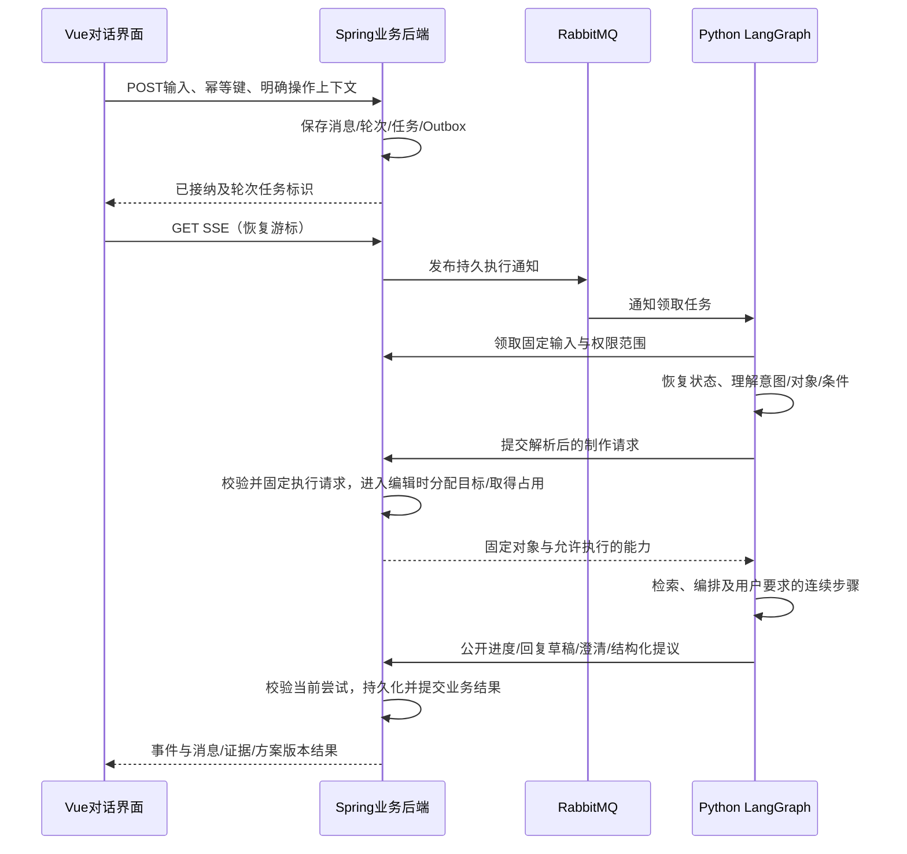

# 多轮对话与前端交互设计

状态：Q53–Q57、Q58 及 2026-10-12 统一自然语言共识已确认。制作会话、受控 Agent、业务权限、任务／Outbox、SSE、方案互斥与不可变版本继续有效。新增目标行为详见 [统一自然语言设计](natural-language-workflow-design.md)，待实施；当前功能及进度见 current-features.md／implementation-status.md。详细字段／接口／事件见 database-design.md、api-contract.md、event-protocol.md；参见 ADR-0014 与 ADR-0015。

## 统一自然语言入口（2026-10-12 补充）

默认只需一个聊天输入框，系统选择需求类型、证据来源和检索方式。明确制作请求条件齐全后直接生成；缺少时长且主题可确定时，说明采用 30–45 秒初稿，不覆盖已有明确时长。仅讨论思路不创建方案。

用户点击“新聊天”立即创建会话，Agent 先发送持久的简短欢迎语，默认包含当前项目已有可用素材并说明范围；用户可通过素材名称收窄范围。欢迎语使用模板，不额外调用模型，刷新不重复追加。新上传素材不悄悄加入正在执行的任务，名称或范围含糊时澄清。

制作需求简报按需求隔离；修改更新指定条件，用户明确开始新的制作需求才建立新记录。澄清回答、取消与开始新需求均通过原输入框表达。用户明确要求的查询、制作和预览连续完成，版本确认及明确导出规则继续有效。下拉框、完整制作表单、独立澄清表单和手动应用简报成为可选工具。

## 消息接纳与 Agent 执行（Q53）

Spring Boot 为唯一前端业务入口，浏览器不直接连接 Python／模型 API。用户消息通过普通 POST 持久接纳，在同一事务保存消息、对话轮次、任务与 Outbox，返回 messageId／turnId／taskId；另用 GET SSE 订阅已授权事件。消息发送携带客户端幂等键，相同键与相同内容重试返回同一结果，相同键不同内容报冲突。

统一持久化对话轮次的调度入口，普通查询也有可恢复运行身份；复用现有编辑执行语义，不把每次消息接纳和模型调用分别暴露成两次用户操作。命名基线使用 AGENT_TURN 覆盖内容查询、方案生成／修改和澄清恢复，取代此前仅列 AGENT_EDIT 的任务示意；编辑阶段仍须取得独立方案编辑权，逻辑轮次、执行尝试和方案锁必须显式关联。

| 对象 | 权威与职责 |
| --- | --- |
| 制作会话 | Spring 管理项目归属、消息顺序、关联方案与查看版本 |
| 消息与对话轮次 | Spring 保存用户原文、公开回复、问题、结果引用与状态 |
| 运行任务与尝试 | Spring 管理接纳、排队、执行、等待、取消、失败与发布资格 |
| LangGraph thread/checkpoint | Python 保存图运行位置与内部状态，稳定映射到业务会话；不代替业务历史 |
| SSE 连接 | 临时展示订阅，断开不代表取消任务 |

消息接纳时保存 conversationId、用户原文、显式引用、素材范围与发送时查看上下文；理解后由业务后端校验并固定实际 planId、baseRevisionId、outputId 和目标片段。明确引用优先，没有明确版本时使用发送时查看版本；尚未打开方案时使用本会话最近生成的方案，存在多个可能对象或冲突时澄清。“删第二段”执行前必须绑定实际输出、版本和片段，不能猜其他会话或改用执行时最新版本。无方案的纯查询可不绑定方案。执行中切换查看不改任务基准，完成提示“基于 V2 生成 V5”，不覆盖用户查看位置。

接纳消息时不因尚未校验的模型判断分配方案或取得编辑占用。理解结果与校验后的执行请求作为关联记录保存，原始已接纳任务输入保持固定；重试复用已有解析、执行请求及结果。一条用户消息贯穿理解与执行接纳，无需用户再次应用简报。连续步骤在前一步成功后绑定其实际结果，如对新提交版本生成用户已请求的预览。

Python 判断内容查询、方案生成／修改、澄清回答等意图，调用已确定的受控工具；真正进入修改前经业务 API 取得方案编辑权，纯查询不占方案锁。未关联方案的新建请求由业务后端分配方案标识并固定目标，模型不能自造业务身份。用户自然语言的预览／确认／导出请求进入独立业务路由，绑定具体版本与输出；“看起来不错”不能自动当作导出。意图不明确时澄清，生成文字草稿不等于版本已提交。

## 流式事件、认证与断线恢复

原生 EventSource 仅支持 URL 与 withCredentials 配置，不提供 POST body 或任意 Authorization header；Last-Event-ID 传递游标，不自动实现服务端历史重放或恰好一次展示。[WHATWG SSE 标准](https://html.spec.whatwg.org/multipage/server-sent-events.html)

实现基线优先同源反向代理、HttpOnly 登录 Cookie、修改接口 CSRF／Origin 校验和原生 EventSource；若选择 Bearer 认证则使用能设头的 fetch SSE 客户端，自行正确解码、解析事件边界、重连，不把长期 token 放入 URL。内部 Python HTTP 与模型流不直接暴露浏览器。具体登录实现仍属于接口实施细节。

公开事件使用白名单类型，如 turn.accepted、run.started、activity.updated、assistant.delta、question.created、plan_revision.created、run.finished、run.failed、run.cancelled；含事件游标、会话／轮次／任务／尝试标识和 schemaVersion。Python 工具调用原始参数、访问凭证、私有路径、供应商 reasoning_content 不直接进入用户事件；显示“正在检索素材／核对片段”等公开活动。

关键结果、问题、任务状态和对应事件事务持久化后推送；用户可见文字增量合批保存，并保留累积草稿快照，避免逐 token 数据库事务。旧尝试增量不得拼接到新尝试；失败的草稿标记未完成，不能成为正式方案或最终成功答复。工具参数流在适配层按索引聚合，完整且验证后的调用才执行；提供方要求的内部消息字段按协议保留，不直接丢弃或公开。[DeepSeek Chat API](https://api-docs.deepseek.com/api/create-chat-completion/)、[思考模式](https://api-docs.deepseek.com/guides/thinking_mode/)

刷新／重连先获取一致快照及其事件高水位游标，再订阅该游标后的事件；事件按 ID 去重，持续订阅可保证快照之后发生的变化不落入空隙。游标需遵循其作用域内的提交顺序，例如在同一会话／项目串行分配并事务发布，不能简单使用并发事务中数据库序列的最大值，以免晚提交的小序号被跳过。事件日志有限保留，游标失效时返回重载信号，重新读取完整消息和活动任务，不无限保存全部 token。关键消息与结果引用长期保留，日志和草稿保留参数实施时配置。

SSE 连接断开只清理订阅者，显式取消接口才终止业务执行；连接需心跳，鉴权到期关闭并提示重新登录。Spring 通常在后续写入时发现远端断开，SseEmitter 不替代业务恢复协议。[Spring 异步请求文档](https://docs.spring.io/spring-framework/reference/web/webmvc/mvc-ann-async.html)

## 同会话并发、停止与澄清（Q54）

首期每个制作会话同一时间只有一个活动对话轮次；执行中可以继续写草稿，但不自动排队新需求，停止后再发送。服务端处理重复发送和多标签页竞争，不能只禁用前端按钮。不同会话可独立使用，资源限额另行控制。

会话串行化保护消息与 checkpoint，方案编辑锁保护版本提交，二者不同。两个会话读同一方案可并行；同一方案再次修改仍遵守已确认互斥规则，冲突明确提示，不等待后悄悄改用最新版本。

WAITING_INPUT 释放执行资源与方案编辑权，逻辑轮次仍等待回答；问题带 questionId。用户在原输入框回答、取消或明确开始新需求，系统理解后保存回答与原问题的明确关联，再进入既有恢复校验；含糊消息先澄清，不直接恢复任务。开始新需求结束原等待关系并创建关联新轮次。恢复前重新核对权限、目标版本和编辑占用，统一入口不能绕过 questionId 关联、活动轮次和幂等校验。LangGraph interrupt 恢复会重新执行暂停节点，问题发布及其他副作用必须幂等。[LangGraph interrupts](https://docs.langchain.com/oss/python/langgraph/interrupts)

关闭页面、离开项目或刷新不自动取消后台运行；返回恢复排队、进行中、待澄清、失败或完成状态。停止与结果提交按现有任务协议原子竞争，已完成结果不能被迟到取消覆盖。

## 前端工作区与结构化结果（Q55）

桌面工作区三部分：左侧项目素材与分析状态，中间制作会话，右侧视频播放器、片段列表、输出与方案版本；窄屏使用页签切换。选择素材／版本和发送时上下文明确显示，进入同一项目的不同会话不会混用正在查看的版本。

| 区域 | 主要内容 |
| --- | --- |
| 素材区 | 上传队列、可播放／语音／视觉状态、范围选择与素材引用 |
| 对话区 | 历史分页、输入与草稿、当前操作对象、公开活动、停止／失败重试、澄清卡片 |
| 结果与播放器 | 点击证据跳转原视频时刻，候选片段与方案结果卡、多个输出、版本来源、手动调整 |
| 版本操作 | 查看／切换版本、生成完成提示、手动低清预览、绑定版本确认和明确导出、任务状态 |

回复类型包括普通文本、证据卡、澄清选项和方案结果卡，不靠解析一段 Markdown 作为业务版本创建依据。@素材、选择输出／片段等显式引用作为输入附件保存，帮助理解“这一条”“第二段”；模型仍可理解自然语言，无需用户填写完整剪辑表单。

前端 UI 保存的是当前查看对象，服务端任务保存的是固定执行基准；SSE 事件只按 ID 更新对应对象，不能将任意新版本自动切到当前视图。点击证据进入原素材播放器，点击预览进入合成效果，清楚显示两者来源。正在 Agent 修改的方案禁用手动调整和再次修改，其他既有阅读／切换／取消权限继续有效。

模型输出按不可信文本渲染并限制 HTML／链接，不执行输出脚本。公开任务活动即可说明进度，不需要展示内部完整推理链。首期可用组件级状态与数据缓存管理，具体 Vue 状态库实施时选择，无需此时增加前端消息中间件。

## 多轮上下文与可纠正需求（Q56）

完整公开聊天历史持久保存，但每次模型输入有上限：系统规则＋结构化制作需求简报＋固定操作对象和权限范围＋最近若干轮＋本轮相关证据／方案片段。较早内容形成带覆盖消息范围的会话摘要，模型上下文裁剪不删除业务聊天记录；工具调用与结果不能裁剪成无效协议。[LangGraph memory](https://docs.langchain.com/oss/python/langgraph/add-memory)

制作需求简报按制作需求区分用户明确约束与已说明默认，显示主题、时长、输出数量、素材范围、禁止内容等关键信息，允许自然语言纠正。修改只替换指定条件；用户明确开始新的制作需求才建立新记录，不自动套用上一需求的条件，旧记录仍保留。新运行任务或执行尝试不等于新制作需求，后续步骤、修改和关联重试共享原需求记录及累计额度。用户原文和显式对象引用保留，新条件替换旧条件时保留来源；语义矛盾需澄清，不让有损摘要覆盖精确时长、禁止素材和当前版本绑定。内部详细工具记录独立于公开聊天，访问、保留与输入预算分别控制。

LangGraph thread 关联累积运行状态，checkpoint 是恢复位置；业务消息与 runtime 消息按确定 messageId 去重，恢复时不重复追加整份历史。自建 FastAPI 服务需要自行实现业务串行与恢复，不能假定使用 checkpointer 就获得完整 Agent Server 管理能力。[LangGraph checkpointers](https://docs.langchain.com/oss/python/langgraph/checkpointers)

## 消息历史与重试范围（Q57）

首期公开消息按追加历史保留，用户更改需求通过新消息表达，不提供编辑旧用户消息后回放整条对话／任意重新生成成功回复的分支功能。需要独立探索时创建已有能力支持的新制作会话；方案版本自由切换与分支修改仍按既有决定执行。

失败重试关联原轮次／输入，保留失败状态与执行尝试，不在界面制造重复用户消息；重新验证权限、素材、任务基准和模型外部状态，再按有限重试规则执行。系统自动重试沿用原任务并新增尝试；终态失败后用户显式重试创建关联新任务，原失败任务不回退，逻辑轮次重新取得会话活动资格。成功结果提交与任务终态在业务事务中协调；若结果已提交但通知丢失，重试返回既有结果而不重新执行。业务幂等不能仅依赖 checkpoint，外部模型响应不明仍按任务协议处理，不能保证完全消除重复费用。[LangGraph checkpointers](https://docs.langchain.com/oss/python/langgraph/checkpointers)

## 验收与进一步实现

验证重复 POST、多标签页并发、发送后刷新、SSE 断开与游标过期、旧尝试迟到、停止／完成竞争、澄清恢复和开始新需求、相邻轮次指代、切换旧版本后修改、不同会话修改同方案、长历史摘要约束保留、模型工具流与业务消息隔离。部署先验证同源代理的 SSE 缓冲／超时和 Silo 的浏览器可达地址，再固定登录与事件客户端实现。
