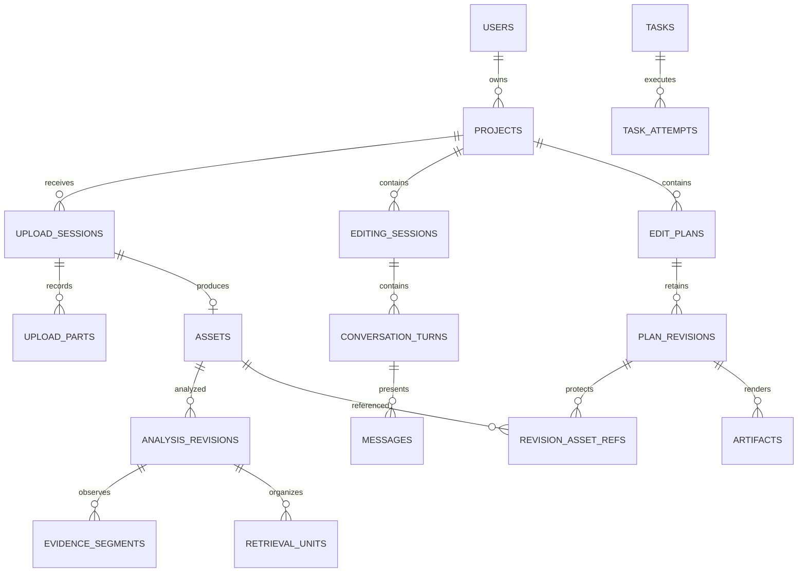

# 数据库结构与事务边界

状态：依据 Q58 已确认设计整理的可实施规格 v1；未执行建库或迁移。表名与字段名为首期默认，迁移脚本需要覆盖下述约束与事务验收。业务数据库由 Spring 管理，LangGraph runtime 位于独立 schema／权限；Qdrant 与 Silo 不参与 PostgreSQL 事务。

## 通用约定

- 业务标识使用后端生成 UUID；数据库及 API 时间使用带时区时间／UTC ISO 8601，媒体位置为整数毫秒，文件量为 bigint 字节。GiB 按 1024³ 字节计算，既有预览 2 GB 按 10⁹ 字节配置，配置字段明确单位。
- 项目内业务表带 `project_id`，创建时由授权项目上下文注入；关系用 `(project_id, id)` 复合引用防止跨项目串接。用户权限仍由业务服务核验，不因 UUID 难猜而省略。
- 必填身份、状态、引用使用 NOT NULL；状态与计数有 CHECK／唯一约束。可选引用必须按任务类型／模式验证，不能利用 NULL 绕过项目关联。
- 普通可变行使用 `row_version` 乐观并发；版本快照、原始观察结果、固定任务输入不原地改写。外键删除默认 RESTRICT，业务明确处理引用后再删除。
- JSONB 保存复杂快照和扩展信息，身份、范围、时间、状态、外键和常查条件使用独立列；不将全部业务数据塞入一个 JSON。临时签名 URL、执行密钥及模型凭证不作为快照内容。

## 主要关系

图只展示主要关联，所有资源归属、索引配置与事件结构以以下表定义为准。

## 用户、项目、对象与容量

| 表 | 主要字段 | 约束／说明 |
| --- | --- | --- |
| users | id, normalized_username, password_hash, status, created_at | 规范化用户名唯一；不保存明文密码 |
| projects | id, owner_user_id, name, settings_json, row_version | owner FK；项目无团队成员表 |
| stored_objects | id, project_id, bucket, object_key, role, size_bytes, sha256, status, last_accessed_at | 对象键唯一；状态 STAGED／AVAILABLE／DELETING／DELETED，原始对象身份固定 |
| storage_accounts | scope_type, scope_id, category, used_bytes, reserved_bytes, row_version | 作用域 GLOBAL／USER／PROJECT；分类 ORIGINAL／DERIVED／PREVIEW／EXPORT／SCRATCH；计数非负 |
| storage_reservations | id, project_id, upload_id 或 task_id, category, bytes, asset_slots, state | 上传或任务的空间预留；RELEASED 只在计费／清理边界已核对后设置 |
| object_use_leases | id, object_id, task_attempt_id 或 playback_session_id, expires_at | 生成／播放中跳过清理；使用期限需续期，不能永久锁文件 |

创建上传需串行核对全局空间预算、用户与项目限额以及项目素材名额；按固定顺序锁容量行，更新预留并创建会话。配额不是磁盘的事务保证，执行前再次检查实际余量。已取消但未清理的对象／分片仍计入容量；计数通过对象与预留记录定期核对。正式成片和原始素材的保护规则优先于缓存清理。

## 上传与素材

| 表 | 主要字段 | 约束／说明 |
| --- | --- | --- |
| upload_sessions | id, project_id, actor_user_id, idempotency_key, request_hash, filename, declared_bytes, declared_sha256, part_size_bytes, expected_parts, object_id, s3_upload_id, status, last_activity_at, expires_at, asset_id | `(actor_user_id, operation, idempotency_key)` 可由统一幂等表保证；对象键按会话唯一生成，不能使用用户路径 |
| upload_parts | upload_id, part_number, etag, size_bytes, verified_at | PK `(upload_id, part_number)`；报告的片与 Silo 核对，ETag 非全文件哈希 |
| assets | id, project_id, upload_id, original_object_id, filename, byte_size, sha256, validation_status, hidden_at, duration_ms, media_info_json, time_mapping_json, row_version | upload_id 唯一，仅发布一份素材；验证 VALIDATING／VALID／INVALID，隐藏是独立字段 |

上传状态基线：CREATING → UPLOADING ↔ PAUSED → COMPLETING → OBJECT_READY；未完成可进入 CANCEL_REQUESTED／EXPIRED，再经清理到 ABORTED；无法恢复的初始化失败记 FAILED。OBJECT_READY 表示对象已完整形成并关联待验证素材，不代表媒体有效。COMPLETING 禁止新签发与普通取消竞争，通过恢复协调确定唯一结果。

S3 初始化、完成和清理在数据库事务外执行：先记录意图，外部操作后核对并 CAS 更新状态。`s3_upload_id` 未知时可按会话唯一对象键恢复／清理；不盲目重建上传。对象完成后同事务写待验证 asset、MEDIA_PREPARE task 与 Outbox；重复完成返回同一资产／任务。

## 分析、证据与索引

| 表 | 主要字段 | 约束／说明 |
| --- | --- | --- |
| asset_analysis_revisions | id, project_id, asset_id, source_sha256, analysis_profile_hash, parent_analysis_id, scope_json, created_at | 每次分析固定源与规则，深入复查关联来源；不覆盖旧证据 |
| analysis_stages | analysis_id, stage_key, status, task_id, result_ref, error_code | 媒体／ASR／VISION／UNITS／EMBEDDING／INDEX 分别就绪，状态含 NOT_APPLICABLE |
| evidence_segments | id, project_id, asset_id, analysis_id, source_kind, text, start_ms, end_ms, observed_at_ms, temporal_precision, source_refs_json, model_info_json, observation_json | SPEECH 用有效区间，VISUAL／VISIBLE_TEXT 保留实际帧时刻；至少一种时间定位有效，不由大窗口伪造持续出现 |
| retrieval_units | id, project_id, asset_id, analysis_id, source_kind, text, start_ms, end_ms, rules_hash | 有序原始证据引用在 unit_evidence_refs；不是剪辑片段 |
| unit_evidence_refs | project_id, unit_id, evidence_id, ordinal | 同项目、同素材关系需核对；保留原观察来源 |
| evidence_object_refs | project_id, evidence_id, object_id, role, reconstruction_recipe_json | 佐证媒体引用；无可靠复现规则的文件受保护，可重建缓存删除只改对象可用状态并保留复现身份 |
| asset_summaries | id, project_id, asset_id, analysis_id, summary_json, evidence_refs_json | 摘要是导航，不是精确剪辑证据 |
| index_profiles | id, profile_hash, dense_model, dimensions, distance, chunk_rules_hash, bm25_config_json, collection_name | 不兼容向量分开保存；模型／分词配置固定 |
| asset_index_generations | id, project_id, asset_id, analysis_id, profile_id, source_kind, status, point_count, checksum, producing_task_id | BUILDING／VERIFIED／RETIRED／FAILED；未验证不发布 |
| asset_index_heads | project_id, asset_id, profile_id, source_kind, generation_id | PK 为前四列；指向 VERIFIED 代次，有效范围由此生成 |
| derived_vector_batches | id, project_id, generation_id, manifest_object_id, encoding_info_json | 保存可重放的向量／单元映射批次，INDEX_SYNC 故障不重复调用 Embedding |

不同内容类型分阶段发布，视觉尚未完成不影响语音索引。新代次 Qdrant 写入与验证完成后，短业务事务核对任务执行权并更新 heads；查询固定该次读取的 heads 并在各通道召回前过滤，同时校验返回证据范围。读取中的旧代次清理需使用短期读占用或充分延迟，防止查询窗口内被删。历史方案保留证据引用，不要求永久保留所有旧 Qdrant 代次。

首期不跨用户共享分析／哈希去重。原始响应中必要结果可 JSONB／对象归档，删除凭证与临时授权；归档数据与业务证据的引用一并受保护。

## 制作会话、消息与运行

| 表 | 主要字段 | 约束／说明 |
| --- | --- | --- |
| editing_sessions | id, project_id, title, bound_plan_id, viewed_revision_id, brief_json, brief_version, summary_json, summary_through_message_seq, graph_thread_id, row_version | 查看偏好与执行基准分开；graph_thread_id 后端分配、稳定关联且仅内部可见 |
| conversation_turns | id, project_id, session_id, input_message_id, request_key, request_hash, status, current_task_id, fixed_context_json, result_refs_json | 同会话一个活动轮次；失败可关联新任务恢复轮次，失败任务不回退 |
| messages | id, project_id, session_id, turn_id, message_seq, role, content_json, status, active_attempt_id, content_version | `(session_id,message_seq)` 唯一；用户原文追加保留，公开助手草稿可以版本更新后完成 |
| clarification_questions | id, project_id, turn_id, question_seq, body_json, status, answered_message_id, checkpoint_ref | OPEN／ANSWERED／CANCELLED；回答消息仍归原轮次，问题发布去重 |

活动轮次状态集合固定为 ACCEPTED、RUNNING、RETRY_WAIT、WAITING_INPUT、CANCEL_REQUESTED；终态 COMPLETED、FAILED、CANCELLED。以 session_id 的部分唯一索引覆盖活动集合，数据库拒绝两个活动轮次；变更状态、current_task_id、消息和任务以同事务协调。等待澄清释放执行和方案锁但仍为活动轮次，普通新需求返回忙碌；开始新需求是显式结束等待再创建轮次。

用户重试消息接纳与用户失败重试是不同操作：前者同幂等键返回原轮次；后者建立新 task 关联原 turn／input，不复制用户原文。message_seq 在会话行锁下递增；最终公开助手答复关联当前合法任务／尝试。

## 方案、版本、确认与产物

| 表 | 主要字段 | 约束／说明 |
| --- | --- | --- |
| edit_plans | id, project_id, title, next_revision_number, editing_task_id, editing_attempt_id, row_version | 编辑占用跟随有效尝试；可存在尚无成功版本的新建目标 |
| plan_revisions | id, project_id, plan_id, revision_number, parent_revision_id, source_task_id, source_manual_request_id, schema_version, content_json, content_hash, created_at | `(plan_id,revision_number)` 唯一，来源提交唯一；parent 必须属于同一 plan，创建顺序与来源分开 |
| revision_outputs | project_id, revision_id, output_id, ordinal, title, duration_ms | 快照输出投影；`(revision_id,output_id)` 唯一，供渲染与结果引用 |
| revision_asset_refs | project_id, revision_id, asset_id | 与 JSON 快照同事务生成，阻止历史引用素材被硬删除 |
| revision_evidence_refs | project_id, revision_id, evidence_id, clip_id | Agent 选段依据投影，保留历史证据；手动新片段可以没有模型证据 |
| plan_confirmations | id, project_id, revision_id, actor_user_id, source_message_id, confirmed_at | `(revision_id,actor_user_id)` 唯一，确认不跨版本继承 |
| render_requests | id, project_id, revision_id, kind, confirmation_id, config_json, request_key, intent_source_json | PREVIEW／EXPORT；EXPORT 绑定确认及本次用户意图，预览不需要确认 |
| render_request_items | id, request_id, revision_id, output_id, task_id, artifact_id, status | 输出独立结果；聚合展示部分成功，不把整批合并为一份视频 |
| artifacts | id, project_id, object_id, revision_id, output_id, kind, config_hash, renderer_version, cache_key, available_at, last_accessed_at, state | PREVIEW／EXPORT 等；对象存在且 AVAILABLE 才能下载，预览删除后可重建 |

`plan_revisions.content_json` 是不可变完整方案的权威内容，outputs／asset_refs／evidence_refs 是同事务校验生成的投影，禁止作为独立写入口。版本提交事务：核对任务尝试和方案编辑占用 → 校验基准与素材 → 分配 plan 内递增序号 → 写快照和引用 → 完成任务／轮次及消息 → 释放占用 → 写公开事件。V4 的 parent 可以 V1，不强行指向 V3。

预览按 `(revision_id, output_id, config_hash, renderer_version)` 复用成功对象或活动任务；同规格并发接纳通过唯一渲染输入锁行或规范化 key 的活动约束保证，不能仅靠“先查再建”。正式导出每次明确接纳用户意图，用请求幂等键避免重复点击重放；初期不把每次独立导出自动合并为同一个用户请求。

## 任务、Outbox、事件与模型调用

| 表 | 主要字段 | 约束／说明 |
| --- | --- | --- |
| tasks | id, project_id, type, status, input_json, input_hash, turn_id, parent_task_id, retry_of_task_id, current_attempt_id, cancel_requested_at, next_retry_at, result_json | 输入固定；外部通知不是终态依据 |
| task_attempts | id, task_id, attempt_number, executor_id, claim_request_id, lease_token_hash, lease_expires_at, heartbeat_at, status, error_json | `(task_id,attempt_number)` 唯一；心跳／提交核对当前尝试及凭证 |
| execution_reports | task_id, attempt_id, report_kind, producer_key, payload_hash, outcome_ref | 唯一 `(attempt_id,report_kind,producer_key)`；活动、问题与结果回报先去重，再验证新增副作用的当前执行资格 |
| outbox_events | id, task_id, type, payload_json, status, available_at, publisher_claim_id, lease_expires_at, published_at | 数据库先记任务及事件，外部发布不持长事务 |
| project_event_counters | project_id, committed_seq, retained_from_seq | 序号在项目行锁下分配，与业务变更／事件同事务提交 |
| public_events | project_id, event_seq, event_id, session_id, turn_id, task_id, attempt_id, type, payload_json, created_at | PK `(project_id,event_seq)`；event_id UUID 唯一；重放按项目顺序 |
| idempotency_records | actor_scope, operation, request_key, canonical_request_hash, response_ref, status | 同键不同输入报冲突；关键操作持久关联结果，不只 Redis 缓存 |
| model_calls | id, project_id, task_id, attempt_id, purpose, provider, model, request_fingerprint, provider_task_id, status, response_ref | 记录异步外部任务和响应不明，checkpoint 重放前先检查 |
| model_usage | id, model_call_id, usage_json, reported_cost, estimated_cost, currency, pricing_ref | 区分提供方计费与估算，不承诺外部费用恰好一次 |

公开事件序号使用事务内项目计数器，不能直接将 identity／bigserial 当作提交顺序；事件与消息提交后推送，订阅失败仍可重放。SSE 草稿合批写入，任务失权后不能写消息／事件，旧尝试不能污染新回复。

重复报告若身份／内容与已经持久保存的 receipt 完全一致，可返回既有结果，即使该次成功提交已经释放执行权；任何未提交的新报告仍需当前执行权。不能为支持幂等而让旧尝试产生新的问题、消息或产物。

对象清理先在业务事务核对引用与使用占用、标记 DELETING，阻止新播放／任务使用，再外部删除并标记 DELETED；失败恢复继续清理或恢复可用状态。可靠可重建的佐证文件可保留对象身份和规则后回收文件，但原始素材／不可复现佐证／正式成片保护规则不能由缓存清理绕过。

## 领取与跨系统边界

| 操作 | 同一短数据库事务 | 事务外／恢复 |
| --- | --- | --- |
| 消息接纳 | 幂等、会话活动约束、消息、轮次、任务、Outbox、公开事件 | MQ 发布后确认；重复通知领取幂等 |
| 任务领取 | 条件更新任务、分配尝试／执行凭证与租约 | 提交成功才执行；持久领取后 ACK，数据库恢复扫描负责失联任务 |
| 模型分析 | 核对尝试、保存阶段结果及下一任务／Outbox | 模型请求与响应存档协调，超时查询已有外部任务 |
| 方案提交 | 编辑权、版本快照／引用、结果、终态、释放占用与事件 | 通知丢失读取既有结果，不重复生成版本 |
| 渲染提交 | 合法尝试、产物 manifest、结果／终态与事件 | 文件先上传再发布引用，未发布对象独立清理 |
| Outbox 领取 | 锁待发队列行、持久发布占用 | 提交后发送，confirm 后条件标记；发送成功而标记失败允许重复 |

使用条件 UPDATE／RETURNING 判断是否取得执行权；失权检查不能停止已经运行的外部进程，所以还需执行器管理、取消收敛和独立工作目录。租约使用数据库时钟，短事务中明确采用语句时间，避免长事务的起始时间误当实时钟。

## 索引与迁移验收

为项目素材列表、上传过期扫描、会话消息分页、活动任务、租约／重试扫描、待发 Outbox、项目事件游标、历史引用和预览 LRU 建立相应索引；外键引用侧显式索引，JSONB 仅为实际查询建立索引。迁移按基础资源 → 任务 → 上传 → 分析／索引 → 会话 → 方案／产物推进；循环关系分步创建约束，同事务初始化，不用永久关闭外键解决。

数据库集成验收必须并发验证超额预留、双活动轮次、重复领取、旧尝试提交、同 plan 版本序号、跨项目引用、公开事件提交顺序、Outbox 重复发布和取消／完成竞争。业务服务继续校验所有 JSON 内引用和用户权限，数据库约束不是替代。

## 官方机制依据

- [PostgreSQL constraints](https://www.postgresql.org/docs/18/ddl-constraints.html)：复合外键需有唯一目标；必填引用不能依赖可空外键。
- [Partial indexes](https://www.postgresql.org/docs/18/indexes-partial.html)：部分唯一索引约束活动集合，跨表协调仍需事务。
- [Transaction isolation](https://www.postgresql.org/docs/18/transaction-iso.html)：Read Committed 条件更新在竞争后检查更新行。
- [Sequence functions](https://www.postgresql.org/docs/18/functions-sequence.html)：序列分配不等同事务提交顺序。
- [SELECT locking](https://www.postgresql.org/docs/18/sql-select.html)：SKIP LOCKED 适用于队列领取，不保证严格 FIFO 或恰好一次。
- [Date/time functions](https://www.postgresql.org/docs/18/functions-datetime.html)：事务、语句与实际时钟需区分。
