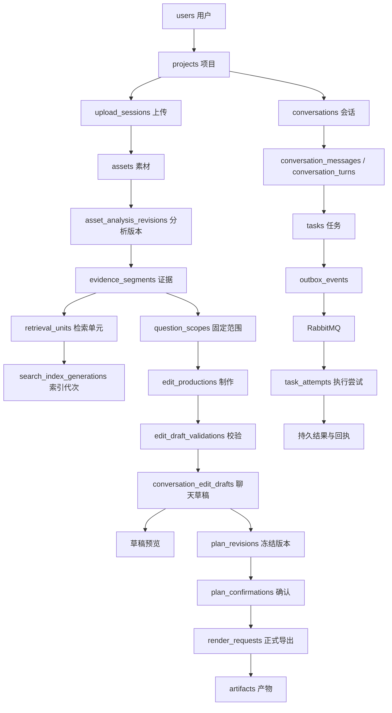
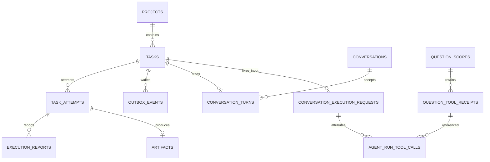
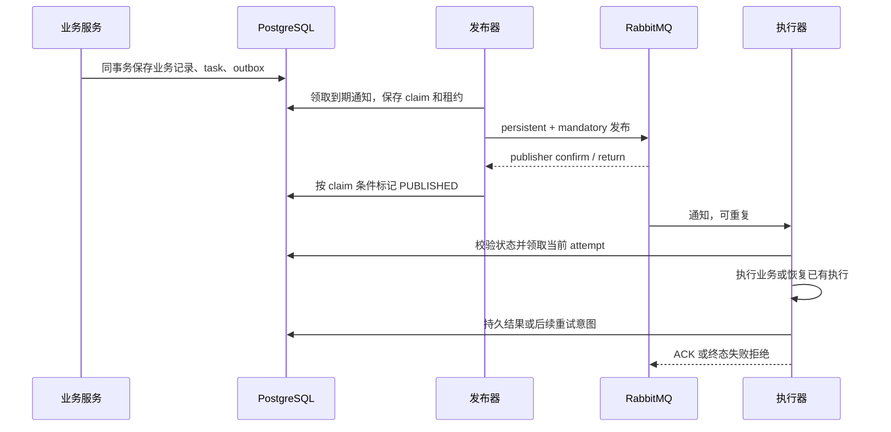

# 当前数据库模型与一致性设计

基线：2026-10-28，PostgreSQL 迁移 V1～V57 与当前 Java、Python 实现。本文记录已实现的数据模型；[早期数据库规格](database-design.md) 保留设计历史，不能用其中的拟议表名和旧执行协议替代当前代码。

系统采用“业务意图先持久化，消息负责唤醒，数据库裁定执行资格”的设计。消息可以重复投递；业务幂等记录、执行代次和结果回执控制重复副作用。跨对象存储、向量库与模型服务的一致性依靠发布边界、结果核对和恢复流程，不是跨系统原子事务。

## 阅读导航

- [存储边界与身份](#存储边界与身份)
- [主要关系图](#主要关系图)
- [PostgreSQL 全部业务表](#postgresql-全部业务表)
- [Python SQLite 表](#python-sqlite-表)
- [幂等请求与回执重放](#幂等请求与回执重放)
- [状态条件更新与并发控制](#状态条件更新与并发控制)
- [可靠消息与任务恢复](#可靠消息与任务恢复)
- [模型调用与付费不确定性](#模型调用与付费不确定性)
- [跨系统数据一致性](#跨系统数据一致性)
- [公开事件与浏览器恢复](#公开事件与浏览器恢复)
- [实现边界与维护检查](#实现边界与维护检查)

## 存储边界与身份

| 存储 | 内容与职责 |
| --- | --- |
| PostgreSQL | 63 张业务表；保存用户意图、业务事实、执行资格、发布结果、Java 模型回执和公开事件。表结构以[迁移目录](../backend/src/main/resources/db/migration/)为准 |
| Python `agent.sqlite` | 4 张自建表、2 张 LangGraph 表；保存核心执行预算、模型调用回执、固定运行输入和 checkpoint |
| Flyway | 框架另行维护迁移历史表 `flyway_schema_history`，不计入 63 张业务表 |
| 对象存储 | 原视频、抽帧、预览与正式产物的文件；数据库保存对象身份和业务状态 |
| Qdrant | 可重建的检索索引；PostgreSQL 中的版本和 scope 决定可读范围 |
| Redis | 上传准入等辅助控制；不是业务幂等结果和任务终态的权威存储 |
| 独立 Langfuse 服务 | 观测服务自有数据库，不计入项目业务关系表清单 |

业务标识主要使用 UUID，媒体位置使用整数毫秒，文件大小使用字节，复杂输入、结果与快照使用 JSONB。下文 PK 表示主键，UQ 表示唯一约束；重点列出语义字段，不重复罗列通用创建时间。

| 身份字段 | 含义 |
| --- | --- |
| `task_id` | 一项业务任务；消息重投通常仍指向原任务 |
| `attempt_id` | 某次实际执行资格，恢复后可以变化 |
| `thread_id` | Python 图执行线程身份 |
| `execution_id` | 核心执行与预算归属；续答、恢复不应随意重置 |
| `production_id` | 一次视频制作上下文 |
| `edit_generation` | 制作的编辑代次，拒绝旧需求产生的迟到结果 |
| `revision_id` | 已冻结的方案版本 |
| `render_request_id` | 一次渲染请求 |
| `artifact_id` | 某次执行尝试生成的具体文件记录 |

## 主要关系图

下图展示领域关系与处理方向，跨服务箭头不表示数据库外键；具体约束见表清单。



任务、执行和回执的关系如下。一个任务允许多次尝试、多条 Outbox 通知；它们并不意味着多个最终业务结果。



## PostgreSQL 全部业务表

### 账号与项目 3 张

| 表 | 数据模型与用途 | 关键约束与字段说明 |
| --- | --- | --- |
| `users` | 账号：`id/normalized_username/password_hash/status` | 用户名 UQ；状态限定 ACTIVE、DISABLED；归一化用户名防止重复注册同一身份 |
| `projects` | 私有项目：`owner_user_id/name/settings_json/row_version` | 所有者外键；名称非空；版本号非负。所有者鉴权在服务层完成 |
| `project_usage_thresholds` | 项目用量阈值 `thresholds_json` | `project_id` PK，每项目一份配置；不是逐笔计费账本 |

`projects.row_version` 存在不代表所有项目更新都使用乐观锁；当前代码未显示它被普遍用于条件更新。

结构依据：[V1](../backend/src/main/resources/db/migration/V1__accounts.sql)、[V2](../backend/src/main/resources/db/migration/V2__private_projects.sql)、[V38](../backend/src/main/resources/db/migration/V38__project_usage_thresholds.sql)。

### 上传与空间管理 6 张

| 表 | 数据模型与用途 | 关键约束与字段说明 |
| --- | --- | --- |
| `upload_sessions` | 分片上传：文件名、声明大小/SHA256、分片配置、S3 upload ID、状态 | UQ `(actor_user_id,idempotency_key)`，`object_key` UQ；`writer_owner/writer_token/writer_lease_expires_at` 控制写者，`operation_token/operation_expires_at` 控制初始化、完成操作；关联生成的素材及验证任务 |
| `upload_parts` | 已核对分片：序号、`etag/size_bytes/verified_at` | PK `(upload_id,part_number)`；重复核对更新同一行；ETag 不等于全文件 SHA256 |
| `storage_reservations` | 空间预留：`bytes/future_bytes/asset_slots/state` | `upload_id` UQ；字节数非负；记录当前占用及未来处理预留，释放须与清理状态协调 |
| `assets` | 原素材：项目、上传、对象键、大小/SHA256、验证状态、时长、媒体信息 | `upload_id/object_key` 各自 UQ；一次上传最多发布一个素材；`time_mapping_json` 保存时间映射，`error_json` 保存错误，`row_version` 记录变更 |
| `upload_cleanup_jobs` | 取消、过期上传的清理 | `upload_id` PK；`not_before` 限制最早完成时间；`lease_token/lease_expires_at` 控制清理资格；`next_attempt_at` 控制重试；状态 PENDING、CLEANED |
| `object_cleanup_jobs` | 无效素材对象清理 | `asset_id` UQ；`claim_id/lease_expires_at` 控制清理者；`available_at/completed_at` 记录执行安排与完成 |

`last_signed_url_expires_at` 记录已签发上传 URL 的有效期。数据库取消上传不能立即撤销这些 URL，因此清理要考虑迟到写入，不能取消后立即认为物理占用已释放。

结构依据：[V3](../backend/src/main/resources/db/migration/V3__upload_sessions.sql)、[V4](../backend/src/main/resources/db/migration/V4__pending_assets_and_tasks.sql)、[V6](../backend/src/main/resources/db/migration/V6__media_validation_results.sql)、[V7](../backend/src/main/resources/db/migration/V7__failed_media_cleanup.sql)、[V8](../backend/src/main/resources/db/migration/V8__upload_writer_leases.sql)、[V28](../backend/src/main/resources/db/migration/V28__upload_cancellation_cleanup.sql)、[V29](../backend/src/main/resources/db/migration/V29__storage_future_reservations.sql)。

### 任务与可靠消息 4 张

| 表 | 数据模型与用途 | 关键约束与字段说明 |
| --- | --- | --- |
| `tasks` | 任务权威记录：`type/status/input_json/result_json/current_attempt_id` | 当前 attempt 外键；`next_execution_at` 控制再执行时间；`local_failure_count` 记录本机失败次数；`disk_budget_bytes` 是磁盘预算；`public_phase` 是展示阶段而非执行资格 |
| `task_attempts` | 执行尝试：任务、序号、执行器、领取请求、状态 | UQ `(task_id,attempt_number)`、`(executor_id,claim_request_id)`；`lease_token_hash` 保存凭证摘要，`lease_expires_at/heartbeat_at` 用于 Worker；`local_execution` 区分本机代次 |
| `outbox_events` | 待发送任务通知：类型、payload、状态 | `available_at` 控制到期；`publisher_claim_id/lease_expires_at` 控制发布资格；`publish_attempts/last_error_code` 记录失败与退避；`published_at` 只证明通知已发布 |
| `execution_reports` | 完成、失败或 Agent 结果上报的回执 | PK `(attempt_id,report_kind,producer_key)`；`payload_json` 是原上报，`outcome_json` 是响应，`result_type` 区分结果类型 |

`outbox_events.task_id` 不唯一：延迟查询、恢复及再次提醒可以各有通知。业务防重在任务和结果层完成。

结构依据：[V4](../backend/src/main/resources/db/migration/V4__pending_assets_and_tasks.sql)、[V5](../backend/src/main/resources/db/migration/V5__task_execution_attempts.sql)、[V6](../backend/src/main/resources/db/migration/V6__media_validation_results.sql)、[V20](../backend/src/main/resources/db/migration/V20__execution_result_type.sql)、[V41](../backend/src/main/resources/db/migration/V41__conversation_public_phase.sql)、[V49](../backend/src/main/resources/db/migration/V49__local_task_execution.sql)、[V50](../backend/src/main/resources/db/migration/V50__local_analysis_steps.sql)。

### 分析与原始证据 12 张

| 表 | 数据模型与用途 | 关键约束与字段说明 |
| --- | --- | --- |
| `asset_analysis_revisions` | 固定素材来源与配置的分析版本 | UQ `(asset_id,source_sha256,profile_hash)`；`audio_json/vision_profile_json` 保存音频信息及视觉配置 |
| `asset_analysis_heads` | 素材当前分析版本指针 | `asset_id` PK；`analysis_id` 外键；当前指针与历史版本分离 |
| `analysis_stages` | 分析版本的各阶段进度 | 当前 PK `(analysis_id,stage_key)`；`status/task_id/error_json` 对应 ASR、VISION、EMBEDDING 等阶段 |
| `model_calls` | Java ASR 模型调用 | 当前 UQ `(analysis_id,retry_number)`，`provider_task_id` UQ；`owner_attempt_id` 标识归属；保存模型、参数、状态、原响应、解析结果及用量 |
| `evidence_segments` | 语音、画面、可见文字的可追溯证据 | UQ `(analysis_id,source_kind,ordinal)`；语音要求非负起点且 `end_ms>start_ms`，视觉要求 `end_ms=start_ms`；关联 ASR 调用或视觉帧/调用；`observation_json` 保存原始观察 |
| `retrieval_units` | 面向检索组织的文本单元 | 关联项目、素材、分析版本；`text/start_ms/end_ms/rules_hash` 描述文本与组织规则；不是最终剪辑区间 |
| `unit_evidence_refs` | 检索单元到原始证据的有序关系 | PK `(unit_id,ordinal)`，UQ `(unit_id,evidence_id)`；位置和引用均防重 |
| `asset_summaries` | 分析版本的摘要 | `analysis_id` PK；`summary_json/evidence_refs_json` 保存摘要与依据 |
| `vision_frames` | 抽帧出现记录 | UQ `(analysis_id,ordinal)`；`observed_at_ms/source_pts` 保留时间位置；对象键、SHA256、大小标识图片；可关联补查 |
| `vision_model_calls` | 视觉模型调用及回执 | UQ `(analysis_id,frame_sha256,model)`；相同分析内相同图像和模型可复用回执；保存执行归属、状态、响应、结果、用量 |
| `visual_inspections` | 有界视觉补查 | UQ `(project_id,request_key)`；查询、时间范围、来源类型、采样方式、当前任务、预算、帧/调用/步骤/输入字节消耗及截止时间 |
| `visual_inspection_proposals` | 扩大补查的提案 | `inspection_id` UQ；状态 PROPOSED、DECLINED、APPROVED；预算、费用说明、决策人及子补查身份 |

`analysis_stages` 从素材级主键演进为分析版本级主键；`model_calls` 从 `analysis_id` 唯一演进为 `(analysis_id,retry_number)` 唯一。显式 ASR 重试保留旧回执，不覆盖旧费用记录。视觉补查旧写入口的默认关闭状态不影响历史表存在。

结构依据：[V9](../backend/src/main/resources/db/migration/V9__analysis_stages.sql)、[V10](../backend/src/main/resources/db/migration/V10__speech_evidence.sql)、[V32](../backend/src/main/resources/db/migration/V32__frame_observations.sql)、[V33](../backend/src/main/resources/db/migration/V33__bounded_visual_inspections.sql)、[V34](../backend/src/main/resources/db/migration/V34__inspection_expansion_proposals.sql)、[V35](../backend/src/main/resources/db/migration/V35__embedding_analysis_stage.sql)、[V37](../backend/src/main/resources/db/migration/V37__preserve_explicit_asr_retry_receipts.sql)、[V50](../backend/src/main/resources/db/migration/V50__local_analysis_steps.sql)。

### 索引与查询调用 4 张

| 表 | 数据模型与用途 | 关键约束与字段说明 |
| --- | --- | --- |
| `search_index_generations` | 一次索引构建代次 | `task_id` UQ；固定分析版本、模型、维度、`collection_name/profile_json/units_json`；状态和发布时间区分构建与发布 |
| `search_index_heads` | 素材当前可读索引代次 | `asset_id` PK，关联 `generation_id`；构建新代次不直接替换旧指针 |
| `embedding_batches` | 索引代次的向量生成批次 | PK `(generation_id,ordinal)`；保存单元、状态、执行归属、向量、原响应、请求 ID、用量 |
| `query_model_calls` | 查询侧模型调用记录 | 项目、模型、输入字节、状态、请求 ID、响应及用量；可关联 task 和 question_search；状态 SUBMITTING、SUCCEEDED、UNCERTAIN；本表不承担同查询唯一性 |

结构依据：[V30](../backend/src/main/resources/db/migration/V30__search_index_generations.sql)、[V36](../backend/src/main/resources/db/migration/V36__index_collection_identity.sql)、[V39](../backend/src/main/resources/db/migration/V39__query_model_receipts.sql)、[V43](../backend/src/main/resources/db/migration/V43__link_query_calls_to_execution.sql)、[V50](../backend/src/main/resources/db/migration/V50__local_analysis_steps.sql)、[V51](../backend/src/main/resources/db/migration/V51__question_scopes_and_read_tools.sql)。

### 会话与执行上下文 10 张

| 表 | 数据模型与用途 | 关键约束与字段说明 |
| --- | --- | --- |
| `conversations` | 会话：项目、标题、素材、当前制作及历史视图 | 非空 `(project_id,creation_key)` 部分唯一索引；`creation_request_json` 核对创建重放；`current_production_id` 指向当前制作；`view_plan_id/view_revision_id/view_row_version` 管理视图 |
| `conversation_messages` | 用户和助手消息：顺序、文本、引用 | UQ `(conversation_id,message_seq)`，`source_task_id` UQ；角色 USER、ASSISTANT；同任务最多发布一条关联消息，NULL 来源的消息不受该唯一性限制 |
| `conversation_message_scopes` | 消息接纳时的素材选择 | `message_id` PK；`asset_ids_json` 避免会话后来改素材影响旧消息含义 |
| `conversation_turns` | 请求到消息、任务的关联 | UQ `(conversation_id,request_key)`、`task_id`；保存原请求；`retry_of_task_id` UQ，限制直接重试后继；`resumes_task_id` 标识续答 |
| `conversation_execution_requests` | 固定输入、解析结果和执行绑定 | `task_id` PK；`input_json/input_hash` 固定输入；`schema_version` 区分新旧上下文；绑定项目、会话、turn、消息、thread、execution、production、scope、编辑代次；`result_json` 保存结果，`core_task_id` 保留重试核心来源 |
| `conversation_questions` | 澄清问题与回答 | `task_id` UQ；非空 execution 下 `(execution_id,wait_id)` 部分唯一；保存问题、OPEN/ANSWERED/CANCELLED、回答键/内容/回执/消息和 `successor_task_id` |
| `conversation_brief_revisions` | 旧需求流的会话摘要历史 | UQ `(conversation_id,revision_number)`；来源消息、任务及 `fields_json` |
| `conversation_tool_receipts` | 旧会话工具调用回执 | PK `(task_id,producer_key)`；保存 attempt、请求、状态、结果；结果允许为空，表示调用未完成 |
| `conversation_model_calls` | 旧会话模型调用回执 | UQ `(task_id,call_number)`，调用编号 CHECK 为 1～6；保存请求、响应、用量及 attempt |
| `assistant_drafts` | 流式助手文本临时投影 | `message_id` PK，UQ `(task_id,attempt_id)`；`content/content_version/status` 保存文本进度；状态 INCOMPLETE、COMPLETE |

`assistant_drafts` 是可清理的流式文本；`conversation_edit_drafts` 是绑定持久校验的结构化剪辑草稿，两者不同。当前 Python Agent 付费回执在 SQLite，旧 `conversation_model_calls` 不是当前所有 Agent 调用的账本。`requirement_id` 等旧字段保留兼容历史行，新上下文由 V54 的 CHECK 和复合外键约束。

结构依据：[V11](../backend/src/main/resources/db/migration/V11__conversation_sessions.sql)、[V12](../backend/src/main/resources/db/migration/V12__conversation_turns.sql)、[V13](../backend/src/main/resources/db/migration/V13__conversation_answers.sql)、[V14](../backend/src/main/resources/db/migration/V14__conversation_tool_receipts.sql)、[V15](../backend/src/main/resources/db/migration/V15__conversation_model_receipts.sql)、[V19](../backend/src/main/resources/db/migration/V19__conversation_plan_view.sql)、[V31](../backend/src/main/resources/db/migration/V31__inflight_tool_receipts.sql)、[V40](../backend/src/main/resources/db/migration/V40__project_public_events.sql)、[V42](../backend/src/main/resources/db/migration/V42__linked_conversation_retries.sql)、[V44](../backend/src/main/resources/db/migration/V44__conversation_briefs.sql)、[V45](../backend/src/main/resources/db/migration/V45__conversation_clarifications.sql)、[V46](../backend/src/main/resources/db/migration/V46__conversation_creation_receipts.sql)、[V47](../backend/src/main/resources/db/migration/V47__conversation_message_scopes.sql)、[V48](../backend/src/main/resources/db/migration/V48__conversation_execution_requests.sql)、[V54](../backend/src/main/resources/db/migration/V54__conversation_production_lifecycle.sql)、[V56](../backend/src/main/resources/db/migration/V56__agent_run_retry_lineage.sql)。

### 公开事件 3 张

| 表 | 数据模型与用途 | 关键约束与字段说明 |
| --- | --- | --- |
| `project_event_counters` | 项目事件序号与保留边界 | `project_id` PK；`event_seq` 是最新序号，`retained_after` 标记已清理边界 |
| `public_events` | 可重放公开事件 | PK `(project_id,event_seq)`；保存 `event_id/type/body/occurred_at`；`event_id` 不是这里的唯一约束 |
| `public_event_reports` | Worker 活动事件上报回执 | PK `(task_id,attempt_id,producer_seq)`；保存原请求和回执，防止重复上报追加相同副作用 |

结构依据：[V40](../backend/src/main/resources/db/migration/V40__project_public_events.sql)、[V41](../backend/src/main/resources/db/migration/V41__conversation_public_phase.sql)。

### 固定问答范围与工具 6 张

| 表 | 数据模型与用途 | 关键约束与字段说明 |
| --- | --- | --- |
| `question_scopes` | 一次问答的范围快照 | 项目与 `assets_json` 固定素材和来源状态 |
| `question_scope_evidence` | scope 允许读取的证据集合 | PK `(scope_id,evidence_id)`；证据 ID 刻意没有外键，依赖删除后仍保留原身份并明确报错 |
| `question_scope_units` | scope 允许读取的检索单元集合 | PK `(scope_id,unit_id)`；单元 ID 同样刻意没有外键 |
| `question_tool_receipts` | 当前工具请求与结果 | PK `(scope_id,call_id)`；同身份改参数报冲突；`result_json=NULL` 表示结果未确认 |
| `question_searches` | 固定条件下的检索排名 | UQ `(scope_id,conditions_hash)`；保存规范化条件和排名；分页复用结果，不重新发起付费查询 |
| `agent_run_tool_calls` | 工具回执的可信执行归属 | PK `(task_id,call_id)`；复合外键将 task 的 scope 与回执 scope 对齐，防止借用其他执行的结果 |

结构依据：[V51](../backend/src/main/resources/db/migration/V51__question_scopes_and_read_tools.sql)、[V55](../backend/src/main/resources/db/migration/V55__agent_run_operations.sql)。

### 制作与方案版本 9 张

| 表 | 数据模型与用途 | 关键约束与字段说明 |
| --- | --- | --- |
| `edit_productions` | 一次制作：项目、scope、会话、线程、需求、当前草稿 | `thread_id` UQ；`edit_generation` 非负；`requirements_json` 保存条件，`requirements_sources_json` 保存来源；复合外键绑定项目/会话/scope |
| `edit_draft_validations` | 草稿校验事实 | UQ `(scope_id,call_id)`；保存草稿/需求 hash、规则版本、原草稿/需求/来源、结果及规范化内容；绑定 source task/attempt/编辑代次 |
| `conversation_edit_drafts` | 聊天中的结构化草稿投影 | `message_id` PK；复合外键绑定消息、制作、校验、两个 hash、代次及来源任务；重试发布消息与原校验来源可不同 |
| `conversation_draft_acceptances` | 用户接受草稿的幂等回执 | PK `(conversation_id,request_key)`；保存用户、原请求、响应、草稿、冻结版本和确认记录 |
| `edit_plans` | 方案容器 | `next_revision_number` 分配版本号；`editing_task_id/editing_attempt_id` 保存旧编辑链路写入归属 |
| `plan_revisions` | 冻结方案版本 | UQ `(plan_id,revision_number)`、`source_task_id`、`source_production_id`；父版本、内容及来源；CHECK 要求旧任务来源或新制作校验来源二选一 |
| `revision_asset_refs` | 版本使用的素材 | PK `(revision_id,asset_id)`；外键保留依赖 |
| `revision_evidence_refs` | 版本引用的证据 | PK `(revision_id,evidence_id)`；外键保留依据 |
| `edit_validation_receipts` | 旧编辑工具校验回执 | PK `(task_id,producer_key)`；保存 proposal 和 result，服务旧协议重放 |

`production_save_result_json` 与版本同事务保存，其中含 `output_key → outputId` 映射；保存响应丢失后可以返回相同输出身份。`production_requirements_sources_json` 保留需求来源。冻结的业务不可变性依赖写入口和事务规则，不能仅凭表存在就认为任意 SQL UPDATE 都会被数据库禁止。

结构依据：[V16](../backend/src/main/resources/db/migration/V16__edit_plans.sql)、[V17](../backend/src/main/resources/db/migration/V17__plan_revision_references.sql)、[V18](../backend/src/main/resources/db/migration/V18__edit_validation_receipts.sql)、[V52](../backend/src/main/resources/db/migration/V52__edit_production_context.sql)、[V53](../backend/src/main/resources/db/migration/V53__production_requirements_sources.sql)、[V54](../backend/src/main/resources/db/migration/V54__conversation_production_lifecycle.sql)、[V55](../backend/src/main/resources/db/migration/V55__agent_run_operations.sql)、[V56](../backend/src/main/resources/db/migration/V56__agent_run_retry_lineage.sql)。

### 渲染与产物 6 张

| 表 | 数据模型与用途 | 关键约束与字段说明 |
| --- | --- | --- |
| `render_requests` | 固定输入的预览/导出请求 | 配置、渲染器版本、缓存键、task、artifact；来源是“版本+output_id”或“已校验草稿+output_key”，仅 PREVIEW 可用草稿；EXPORT 必须绑定确认、用户及意图；`retry_of` UQ |
| `artifacts` | 某次尝试产生的物理文件 | `attempt_id/object_key` 各自 UQ；大小、SHA256、时长、媒体信息；状态 STAGED、AVAILABLE、UNAVAILABLE、DELETE_PENDING、REMOVED；AVAILABLE 要求关键元数据齐全 |
| `preview_intents` | 预览请求幂等记录 | PK `(project_id,idempotency_key)`；原请求、渲染请求及响应；版本来源与草稿来源互斥 |
| `plan_confirmations` | 用户明确确认版本 | UQ `(revision_id,actor_user_id)`；确认来源、用户、时间；导出必须引用匹配项目和版本的确认 |
| `production_intents` | 确认和正式导出的幂等记录 | PK `(project_id,operation,idempotency_key)`；operation 为 CONFIRM/EXPORT；CHECK 要求 EXPORT 有渲染请求、CONFIRM 无渲染请求 |
| `artifact_deletion_requests` | 正式产物删除意图及结果 | `artifact_id` PK；请求人、请求/移除时间、`observed_bytes`；支持删除重试和实际删除字节统计 |

`render_requests.cache_key` 在 V21 最初唯一，V23 已取消唯一约束并改为普通索引。缓存复用与用户请求幂等独立：缓存键相同可以有多次合法请求，幂等键相同则必须重放同一请求。

V57 的 `source_id/source_output` 是生成列，统一版本和草稿的来源身份。复合外键要求产物与请求的项目、来源、输出、任务、类型匹配；发布指针也必须指向同请求、同任务的产物。`retry_of` 还约束重试来源一致。

结构依据：[V21](../backend/src/main/resources/db/migration/V21__render_requests.sql)、[V22](../backend/src/main/resources/db/migration/V22__render_artifacts.sql)、[V23](../backend/src/main/resources/db/migration/V23__render_constraints_and_intents.sql)、[V24](../backend/src/main/resources/db/migration/V24__render_reference_indexes.sql)、[V25](../backend/src/main/resources/db/migration/V25__version_confirmations_and_export_intents.sql)、[V26](../backend/src/main/resources/db/migration/V26__explicit_export_deletion.sql)、[V27](../backend/src/main/resources/db/migration/V27__actual_deleted_export_bytes.sql)、[V57](../backend/src/main/resources/db/migration/V57__draft_preview_sources.sql)。

## Python SQLite 表

PostgreSQL 和 SQLite 都有 `model_calls`，但职责不同：前者记录 Java ASR，后者记录 Python Agent 的模型请求。

| 表 | 主要字段和主键 | 用途 |
| --- | --- | --- |
| `executions` | PK `id`；`calls/seconds/status` | 核心执行的调用次数、活动耗时和状态；恢复继续累计 |
| `model_calls` | PK `id`；`execution_id/input_hash/status/response` | 付费调用回执；同调用 ID 必须对应同输入 hash；SUBMITTING、RECEIVED、UNKNOWN 区分提交与结果 |
| `conversation_runs` | PK `task_id`；`input_json/binding_json/state_json/prepared_json/result_json` | 固定接纳输入、理解结果、执行绑定和最终结果，支持重放 |
| `execution_transfers` | PK `source_id`；`target_id` | 理解阶段预算归入目标执行，每个来源只归集一次 |
| `checkpoints` | PK `(thread_id,checkpoint_ns,checkpoint_id)`；父 checkpoint、type、checkpoint/metadata BLOB | LangGraph 图状态快照 |
| `writes` | PK `(thread_id,checkpoint_ns,checkpoint_id,task_id,idx)`；channel、type、value BLOB | LangGraph 节点与通道写入，支持中断恢复；这里的 task_id 是框架内部任务身份 |

自建表没有复制 PostgreSQL 的完整外键体系，依靠主键、事务和运行时身份比较约束数据。SQLite 启用 WAL；模型请求预留和预算归集使用 `BEGIN IMMEDIATE`。

代码依据：[Store 的建表与回执实现](../agent-service/agent_service/runtime/persistence.py#L10)、[图执行与 SQLite saver 接入](../agent-service/agent_service/runtime/runner.py)、[图编译](../agent-service/agent_service/runtime/graph.py#L11)。框架表结构对应锁定的 [langgraph-checkpoint-sqlite 3.1.1](../agent-service/requirements.lock#L92)，由依赖初始化，不在 Java Flyway 中创建。

## 幂等请求与回执重放

完整幂等由四部分组成：唯一身份、原请求、内容比较、持久结果。唯一约束只阻止重复行，不能单独识别“正常重试”与“换内容复用旧键”。

| 层级 | 防重身份 | 防止的问题 |
| --- | --- | --- |
| 上传创建 | 用户 + idempotency_key | 重复创建上传、重复预留空间 |
| 会话创建 | 项目 + 非空 creation_key | 重复创建会话 |
| 发消息 | 会话 + request_key | 双击或网络重试产生多条消息与任务 |
| 领取任务 | 执行器 + claim_request_id | 同次领取重试创建多份 attempt |
| 执行上报 | attempt + report_kind + producer_key | 已提交但响应丢失后的重复提交 |
| 工具调用 | scope + call_id | 重复执行同一工具；同 ID 改参数冲突 |
| 检索 | scope + conditions_hash | 翻页重新生成排名和重复查询付费 |
| 接受草稿 | 会话 + request_key | 重复冻结版本和确认 |
| 确认/导出 | 项目 + operation + idempotency_key | 重复接纳相同用户意图 |
| 显式重试 | retry_of_task_id / retry_of | 换客户端 key 产生多个直接重试后继 |

以接受草稿为例：锁会话 → 查回执 → 相同用户、相同请求则重放响应；不同内容则冲突 → 无回执时检查当前草稿 → 保存版本、确认和接受回执 → 同事务提交。响应丢失后用原 key 重试，可以得到原版本和输出身份。接受草稿不自动正式导出。

[DraftAcceptances.accept](../backend/src/main/java/com/agenticvideo/business/agentrun/DraftAcceptances.java#L26) 实现该事务；[AgentRuns.accept](../backend/src/main/java/com/agenticvideo/business/agentrun/AgentRuns.java#L32) 实现固定消息输入与请求比较；[UploadService.create](../backend/src/main/java/com/agenticvideo/business/upload/UploadService.java#L36) 比较上传项目、文件名、大小、SHA256 及写者资格。

[ReadTools.execute](../backend/src/main/java/com/agenticvideo/business/tools/ReadTools.java) 通过 INSERT ON CONFLICT 接纳回执，再比较完整请求；已接纳但结果为空时返回 CALL_UNCONFIRMED，不把重复请求当作新的执行。`request_hash` 由服务端重新计算核验，不能只相信模型提供的摘要。重放前还会核验 scope 依赖，避免旧回执掩盖失效来源。

## 状态条件更新与并发控制

### SQL 条件更新

以下为从实际更新抽取的关键条件，省略的 SET 字段以链接源码为准。

```sql
-- 发布器只能提交自己持有的发布操作
UPDATE outbox_events
SET status='PUBLISHED', published_at=now()
WHERE id=? AND publisher_claim_id=?;

-- 旧页面不能覆盖已更新的会话视图
UPDATE conversations
SET view_plan_id=?, view_revision_id=?, view_row_version=view_row_version+1
WHERE id=? AND view_row_version=?;

-- 只有正在验证的素材可以按此路径发布为有效
UPDATE assets
SET validation_status='VALID', row_version=row_version+1
WHERE id=? AND validation_status='VALIDATING';
```

| 条件字段 | 保护的行为 | 代码 |
| --- | --- | --- |
| status、operation_token、operation_expires_at | 初始化与完成资格；阻止旧操作越过取消或接管发布素材 | [UploadService](../backend/src/main/java/com/agenticvideo/business/upload/UploadService.java) |
| publisher_claim_id | 旧发布者不能覆盖新发布者的结果 | [TaskDispatch.publish](../backend/src/main/java/com/agenticvideo/business/messaging/TaskDispatch.java#L41) |
| validation_status='VALIDATING' | 限制验证结果状态迁移 | [TaskExecution](../backend/src/main/java/com/agenticvideo/business/task/TaskExecution.java) |
| state='STAGED' | 只有暂存产物可沿发布路径进入 AVAILABLE | [RenderArtifacts.publish](../backend/src/main/java/com/agenticvideo/business/render/RenderArtifacts.java#L40) |
| state='DELETE_PENDING' | 删除确认仅推进已接纳的删除流程 | [ExportArtifacts](../backend/src/main/java/com/agenticvideo/business/render/ExportArtifacts.java) |
| view_row_version | 拒绝过期视图更新 | [ConversationTurns](../backend/src/main/java/com/agenticvideo/business/conversation/ConversationTurns.java) |
| status='SUBMITTING' | 模型回执仅推进当前提交状态 | [Store.received / unknown](../agent-service/agent_service/runtime/persistence.py) |
| lease_token / claim_id | 清理结果属于当前领取者 | [UploadCleanup](../backend/src/main/java/com/agenticvideo/business/upload/UploadCleanup.java)、[FailedMediaCleanup](../backend/src/main/java/com/agenticvideo/business/task/FailedMediaCleanup.java) |

### 行锁与事务内校验

另一类保护先 `SELECT ... FOR UPDATE`，再检查状态与身份，最后更新。例如本机任务领取：锁 tasks → 确认 PENDING 且到执行时间 → 插入 attempt → 切换 RUNNING/current_attempt_id → 提交。

这种情况下，后续 UPDATE 即使只有 `WHERE id=?`，也可能由同一事务中的锁和校验保护；不能脱离调用上下文判断。普通查询和另一个事务中的更新不具备同样保证。

依据：[TaskExecution.claimLocal](../backend/src/main/java/com/agenticvideo/business/task/TaskExecution.java#L50)、[任务锁入口](../backend/src/main/java/com/agenticvideo/business/task/TaskExecution.java#L146)、[AgentRunLocks](../backend/src/main/java/com/agenticvideo/business/agentrun/AgentRunLocks.java)。

### 当前执行与编辑代次

新增副作用要检查三层资格：attempt 等于 tasks.current_attempt_id；远程 Worker 凭证和租约有效；制作任务还属于当前 production/edit_generation，且未冻结。已有结果的相同内容重放可以不要求租约仍存活，但不能据此赋予旧执行新增副作用的资格。

例如 A 失联 → 租约过期 → A 标记 EXPIRED → 原任务重新 PENDING → B 领取 → A 迟到提交。A 的 attempt 已非当前值，提交被拒绝。用户更新需求后，旧编辑代次即使仍持有租约，也不能发布当前草稿。

依据：[AgentRuns.requireAttempt / requireCurrent](../backend/src/main/java/com/agenticvideo/business/agentrun/AgentRuns.java#L215)、[AgentRunResults.publish](../backend/src/main/java/com/agenticvideo/business/agentrun/AgentRunResults.java#L39)。

## 可靠消息与任务恢复

### Outbox 发布

上传完成的业务事务同时保存 assets、tasks、outbox_events、空间分配状态和上传完成关联，避免数据库已有素材但没有处理任务或发送意图。

发布流程：短 SQL 原子领取到期 Outbox，使用 `FOR UPDATE SKIP LOCKED` 跳过其他发布者持有的行 → 保存发布 claim 与租约 → 事务外发送持久消息 → mandatory 路由检查和 publisher confirm → 无退回且确认成功才标记 PUBLISHED。失败保留意图并按 2～60 秒退避。已 PUBLISHED 但任务长期仍 PENDING 时重新通知。

代码依据：[UploadService 完成事务](../backend/src/main/java/com/agenticvideo/business/upload/UploadService.java#L261)、[TaskDispatch.publish](../backend/src/main/java/com/agenticvideo/business/messaging/TaskDispatch.java#L41)。



### 故障窗口

| 故障窗口 | 处理方式 |
| --- | --- |
| 业务事务提交前崩溃 | 业务记录与 Outbox 一起回滚 |
| 提交后、发 MQ 前崩溃 | Outbox 保留，之后发送 |
| MQ 已接收、标记 PUBLISHED 前崩溃 | 可能重复发送；任务领取和结果层防重 |
| 已发布但一直未接纳 | 周期重新通知 PENDING 任务 |
| 执行中崩溃 | 本机恢复或 Worker 租约恢复重新安排 |
| 结果已提交、ACK 前崩溃 | 重投读到终态或已有回执，不再次发布结果 |
| 外部模型请求已发出但没有回执 | 进入付费不确定性处理，不盲目重发 |

MQ 是唤醒渠道；通知 payload 不替代数据库的权威输入。没有独立通用 Inbox 表，tasks/task_attempts 和各类回执承担相应消费防重职责；RabbitMQ messageId 本身不自动实现业务去重。

Java 消费线程执行完成、保存等待安排或安全重试意图后 ACK；终态失败可拒绝进入死信。数据库异常不能伪造成成功。Publisher confirm、消费者 ACK、业务结果发布是三个边界。

依据：[TaskConsumers](../backend/src/main/java/com/agenticvideo/business/messaging/TaskConsumers.java)、[LocalTaskRunner](../backend/src/main/java/com/agenticvideo/business/task/LocalTaskRunner.java)、[Python Worker](../agent-service/agent_service/worker.py#L103)。

### 本机任务与 Python Worker 的区别

| 执行形态 | 资格与恢复 |
| --- | --- |
| Java 本机媒体/分析 | `local_execution=true`；当前 attempt、取消状态、本进程 active 集合控制执行；本机代次不使用网络 token、心跳租约。退出代次由 TaskRecovery 判断并安排有限恢复 |
| Python Worker | claim 返回 attempt/token/租约；心跳续期；租约过期撤销 attempt，重新通知原任务，不重置 Python execution 和付费预算 |

异步 ASR 的等待不需要长期占用一次本机执行：`deferLocal` 完成当前步骤，将任务回到 PENDING，设置 next_execution_at，并同事务写入下一次查询通知。成功查询步骤与失败次数分开计数。

显式 Agent retry 通过 core_task_id 复用核心输入与 checkpoint，但使用新的任务发布资格；conversation_turns.retry_of_task_id 限制直接重试后继。相关校验来源和消息来源在 V56 中允许按可信重试谱系分离。

依据：[TaskExecution.deferLocal](../backend/src/main/java/com/agenticvideo/business/task/TaskExecution.java#L74)、[TaskRecovery.recover](../backend/src/main/java/com/agenticvideo/business/task/TaskRecovery.java#L22)、[AgentRunRecovery.recover](../backend/src/main/java/com/agenticvideo/business/agentrun/AgentRunRecovery.java#L18)、[重试谱系迁移](../backend/src/main/resources/db/migration/V56__agent_run_retry_lineage.sql)。

## 模型调用与付费不确定性

数据库事务不能覆盖远端模型服务。如果远端已接收并计费，但响应丢失，本地不能确定是否执行成功。项目用持久调用意图和响应控制重试：先登记，再请求，回执未知时停止自动重付。

Python 的执行顺序：事务检查 call_id/input_hash → 写 SUBMITTING → 增加 executions.calls → 提交 → 调用远端 → 收到响应后保存 response 并改为 RECEIVED。

| 恢复时调用状态 | 行为 |
| --- | --- |
| RECEIVED | 复用持久响应，不再次调用模型 |
| 同 call_id 不同 input_hash | 冲突报错 |
| SUBMITTING 或 UNKNOWN | 停止自动重付；本地无权判断远端一定未执行 |
| 执行预算已耗尽 | 不通过换 task 或恢复 checkpoint 重置预算 |

Java ASR、视觉、Embedding 同样保存提交状态、原响应与用量。本机崩溃恢复会将 SUBMITTING 且无原响应的记录标为 UNCERTAIN；已有远端 ASR 身份时可继续查询原任务。原响应先落盘再解释，解析失败不应抹掉调用和费用事实。

execution_transfers 通过 source_id 主键和事务将理解阶段的调用次数、活动时间只归集一次。core_task_id、固定 execution 身份和保存的回执使续答/重试沿用原预算与核心执行。

这提供“不确定时不盲目自动重付”，不提供外部模型的全局 exactly-once，也不保证每次不确定调用最终自动成功。

代码依据：[Store.reserve](../agent-service/agent_service/runtime/persistence.py#L112)、[Store.transfer_usage](../agent-service/agent_service/runtime/persistence.py#L66)、[AnalysisProcessing](../backend/src/main/java/com/agenticvideo/business/analysis/AnalysisProcessing.java)、[TaskRecovery](../backend/src/main/java/com/agenticvideo/business/task/TaskRecovery.java)、[Worker 的核心执行和预算检查](../agent-service/agent_service/worker.py#L103)。

## 跨系统数据一致性

### PostgreSQL 内的原子边界

| 操作 | 同一事务内协调的内容 |
| --- | --- |
| 上传完成 | 素材、验证任务、Outbox、空间分配、上传完成关联 |
| 接纳消息 | 用户消息、轮次、任务、固定 RunInput/hash、Outbox |
| 发布 Agent 结果 | 校验执行及回执归属，追加助手消息/问题/草稿，更新任务、attempt、执行结果和报告 |
| 接受草稿 | 核验用户所见草稿身份，冻结版本与输出映射，确认、接受回执及提示消息 |
| 任务恢复 | 撤销旧 attempt，修改任务状态，必要时新增 Outbox |
| 索引发布 | 核验当前来源与执行资格，发布 generation/head 及对应业务状态 |

实现入口：[AgentRuns](../backend/src/main/java/com/agenticvideo/business/agentrun/AgentRuns.java)、[AgentRunResults](../backend/src/main/java/com/agenticvideo/business/agentrun/AgentRunResults.java#L39)、[DraftAcceptances](../backend/src/main/java/com/agenticvideo/business/agentrun/DraftAcceptances.java#L26)、[ProductionSaves](../backend/src/main/java/com/agenticvideo/business/plan/ProductionSaves.java)。

### 引用与快照一致性

复合外键不仅保证引用 ID 存在，还保证组合归属匹配。例如，产物不能挂到不匹配的项目/请求/任务/来源输出；正式导出不能借用另一版本的确认；聊天草稿不能绑定与其 hash、需求 hash、代次不匹配的校验。

普通单列外键只保证存在。旧表并非全部具有同项目复合约束，JSON 内的引用仍须服务层验证；用户权限也不能由 UUID 或外键代替。部分循环引用使用 DEFERRABLE INITIALLY DEFERRED，允许同事务先后插入相关行，在提交时核验。

question_scopes 固定一次执行的证据集合和素材状态；读工具不因 head 更新而自动扩大旧 scope。question_searches 固定条件与排名，分页复用结果。引用依赖失效时明确失败，而不是悄悄替换成新证据。

依据：[V23 复合关系](../backend/src/main/resources/db/migration/V23__render_constraints_and_intents.sql)、[V54 制作关系](../backend/src/main/resources/db/migration/V54__conversation_production_lifecycle.sql)、[V57 来源与发布关系](../backend/src/main/resources/db/migration/V57__draft_preview_sources.sql)、[QuestionScopes](../backend/src/main/java/com/agenticvideo/business/tools/QuestionScopes.java)、[QuestionEvidence](../backend/src/main/java/com/agenticvideo/business/search/QuestionEvidence.java)。

### 对象存储与清理

渲染先为当前 attempt 建 STAGED 产物，对象键含 request 和 attempt，避免不同尝试覆盖同一文件。上传后核对对象大小和报告的媒体规格，再通过当前执行资格发布 AVAILABLE 与请求产物指针。失败/退出尝试的暂存文件由独立扫描清理；已发布文件后来缺失，读取时可标记 UNAVAILABLE。

对象大小和媒体元数据核对不等同于服务端重新下载整个文件计算内容 hash。对象写入与数据库提交不是分布式原子事务，允许暂时存在未发布文件，由记录和清理流程收敛。

正式产物删除先持久化 artifact_deletion_requests 和 DELETE_PENDING，再执行物理删除并记 REMOVED。observed_bytes 保留删除前观察到的大小，支持重试后的实际删除量统计。上传取消清理还需等待签名 URL 窗口并核对对象，之后才能释放相应预留。

依据：[RenderArtifacts.prepare / publish / cleanupTask](../backend/src/main/java/com/agenticvideo/business/render/RenderArtifacts.java)、[ExportArtifacts](../backend/src/main/java/com/agenticvideo/business/render/ExportArtifacts.java)、[UploadCleanup](../backend/src/main/java/com/agenticvideo/business/upload/UploadCleanup.java)、[StorageCapacity](../backend/src/main/java/com/agenticvideo/business/storage/StorageCapacity.java)。

### Qdrant 与 PostgreSQL

索引按新 generation 构建，先写 Qdrant，再回读验证，最后在 PostgreSQL 发布 head。未完成的新代次不会直接成为可用索引，重建期间旧有效代次仍可读取。模型、维度、collection 和单元集合固定在 generation，避免不兼容配置混用。

查询按项目/代次/scope 限定来源，并回查 PostgreSQL 原始证据。索引是派生物，不承担权限或原始事实权威。

依据：[SearchIndexBuilder](../backend/src/main/java/com/agenticvideo/business/search/SearchIndexBuilder.java)、[SearchIndexes.verify](../backend/src/main/java/com/agenticvideo/business/search/SearchIndexes.java#L146)、[SearchIndexes.publish](../backend/src/main/java/com/agenticvideo/business/search/SearchIndexes.java#L179)。

### Java 与 Python

两边没有跨库事务。Java 保存固定 input/hash 和可信绑定；Python conversation_runs 保存接纳输入、理解结果、绑定和结果，重投时核验身份并重放；Java 接收结果时重新核验当前 attempt、租约、代次、工具回执和校验记录。Python checkpoint 不是业务授权凭证。

依据：[Store.accept_run / bind_run](../agent-service/agent_service/runtime/persistence.py#L37)、[Worker.execute_delivery](../agent-service/agent_service/worker.py#L103)、[AgentRunTools](../backend/src/main/java/com/agenticvideo/business/agentrun/AgentRunTools.java)、[AgentRunResults.publish](../backend/src/main/java/com/agenticvideo/business/agentrun/AgentRunResults.java#L39)。

## 公开事件与浏览器恢复

正式消息保存在 conversation_messages，任务终态保存在 tasks，浏览器通知保存在 public_events。消息和任务状态通过延迟约束触发器在业务事务内追加事件。

append_public_event 更新项目计数器并取得行锁，序号与事件一起提交。延迟触发器在业务锁取得后分配序号，避免使用普通序列时“较大序号先提交，客户端推进游标后漏读较小序号”的窗口。

SSE 按项目事件游标读取持久事件；断线只释放订阅，不取消任务。清理事件时更新 retained_after；游标超出保留边界返回过期或 stream.reset，客户端重读快照。临时 assistant_drafts 可以清理，正式消息和任务结果仍保留。

代码依据：[V40 事件计数器及触发器](../backend/src/main/resources/db/migration/V40__project_public_events.sql)、[V57 消息事件关联修订](../backend/src/main/resources/db/migration/V57__draft_preview_sources.sql)、[ProjectEventStream](../backend/src/main/java/com/agenticvideo/business/conversation/ProjectEventStream.java)、[PublicEventRetention](../backend/src/main/java/com/agenticvideo/business/conversation/PublicEventRetention.java)、[ProjectRecovery](../backend/src/main/java/com/agenticvideo/business/conversation/ProjectRecovery.java)。

## 实现边界与维护检查

- 可靠消息提供可恢复的至少一次通知，业务层抑制重复副作用；不是消息物理上只投递一次。
- Java 本机 active 集合及恢复判断按单实例设计，不能直接扩成多实例接管协议。
- 派发、消费和相关恢复组件需要相应配置启用；死信队列没有自动重放承诺。
- PostgreSQL、SQLite、对象存储持久卷丢失不在幂等键和 Outbox 的修复能力内；跨库无原子提交。
- 不确定模型请求可能需要核查；停止重付是安全边界，不等于自动完成所有任务。
- 状态列并非全部有 CHECK，版本字段也并非全部参与 CAS；需连同服务方法、事务和迁移最终状态理解。
- 新增迁移后应核对全部表、约束演进与新旧执行链路，尤其避免重新描述 cache_key 为唯一、所有任务都有租约，或将早期拟议表当作现存表。

修改文档时检查表清单与 CREATE TABLE 集合一致、相对链接有效、代码引用与最终迁移一致。修改运行行为时，按受影响范围验证同键重放/改参数冲突、并发领取、迟到提交、发布确认窗口、结果提交后重投、未知模型回执、跨项目/来源约束和前端游标恢复；这些检查不能由文档或链接校验代替。
