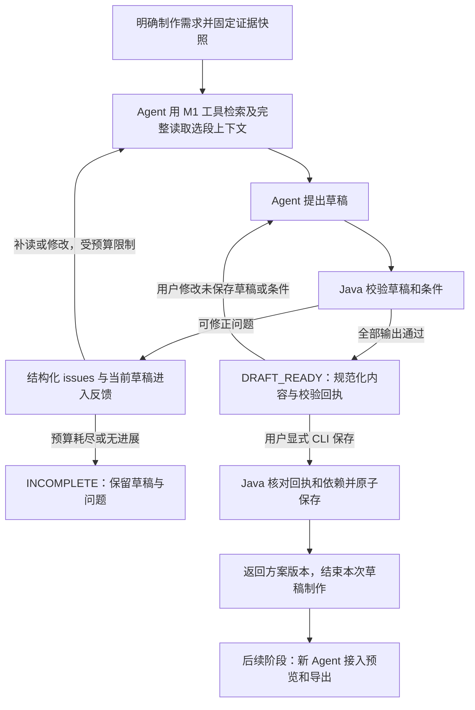

# Java 工具 M2 最终设计与实施计划

日期：2026-10-15。状态：用户已确认 M2-Q1 至 M2-Q14，以及草稿、制作条件、方案内容和校验反馈契约。本文件汇总最终设计、模块范围、实施计划与验收标准；用户明确要求本轮不开始实现。以下计划和标准均为待执行事项，不代表功能已实现或验收已通过。

> 实施更新（2026-10-15）：后续会话已获用户明确授权实施阶段 1，进度与验证见 [阶段 1 记录](verification/java-tools-m2-stage1.md)。本文“本轮未执行”“尚未实现”等表述记录设计会话时点；阶段 2～5 仍待实施。

## M1 已交付的基础

依据：[M1 最终设计](java-tools-m1-design.md)、[第五阶段综合验收](verification/java-tools-m1-stage5.md)、[收尾审查](verification/java-tools-m1-closeout.md)。本次仅核对文档与代码，没有重新运行 M1 验收。

- Java 已合并为单个 Spring Boot 应用，保留 RabbitMQ、数据库任务及 Outbox。
- 真实上传后由 Java 执行媒体准备、百炼 ASR、稀疏 VLM、Embedding 和索引发布。
- Python CLI 通过四个真实读取工具完成问答，沿用固定问答范围快照和持久回执。
- 原始语音区间与视觉观察时刻分别表达；目录用于导航，不能替代原始证据。
- 既有版本的预览和导出执行保留，但新 Agent 的草稿尚未接入方案保存与成片链路。
- 真实模式不支持按需细读、草稿生成、真实草稿校验；旧浏览器 Agent 制作入口不可用。

## M2 已确认位置与结果

完整链路：上传真实视频 → Java 基础分析 → Python 读取／检索 → 生成剪辑草稿 → Java 真实校验 → 保存方案版本 → 按明确请求预览／导出。

按需细读是读取／检索过程中按目标补充新证据的分支，它不是所有草稿生成的必经步骤。用户已确认本次 M2 不纳入按需细读及新 Agent 的预览／导出接入。

M2 完成“使用 M1 的真实证据生成草稿、Java 真实校验、保存可供既有制作模块消费的方案版本”。保存方案版本与渲染视频是不同结果。既有渲染的保留不代表新 Agent 到成片已经贯通。操作入口继续使用 Python CLI 和 Java HTTP，不恢复浏览器对话，不增加 Python FastAPI。

## 代码事实与确定改动

| 范围 | 当前事实 | M2 改动 |
| --- | --- | --- |
| Python Agent | 真实模式仅开放四读取工具和问答；Mock 保留草稿循环 | 开放真实草稿生成，接入 Java 校验，复用有限修正与恢复 |
| Java 工具 | M1 提供范围、读取及回执入口 | 增加真实草稿校验工具，复用已有身份、范围和回执机制 |
| Java 方案校验 | 旧校验接收单输出 proposal，引用旧上下文工具回执 | 按新草稿多输出契约及 M1 真实证据／回执校验 |
| Java 方案保存 | 旧 publish 依赖旧 Agent 任务编辑权和校验回执 | 建立适配新 Agent 的保存入口，复用方案版本和引用关系 |
| Java 渲染 | 已保留既有版本的预览／导出 | 核对新保存版本满足既有制作输入；新 Agent 的预览／导出接入不在 M2 范围内 |

上传、基础分析、检索和 MQ 沿用 M1。复用已有范围快照机制，为制作需求固定其生命周期；无需为本阶段统一重命名既有问答接口或表。

旧保存路径不仅有方法调用耦合：`plan_revisions.source_task_id` 和旧校验回执还依赖任务表。新 CLI 来源如何记录需要随保存入口一起整理，不能为满足旧约束伪造正在运行的 `AGENT_TURN`。Python 草稿与已保存方案有不同用途：Java 在校验通过后生成含输出规格和字幕的规范化待保存内容，在显式保存时分配永久业务标识并原子落库。模型只提出编排。

## 第一轮已确认决定

| ID | 决策 | 推荐 | 状态 |
| --- | --- | --- | --- |
| M2-Q1 | M2 的交付范围 | 真实草稿生成、Java 校验及方案保存；按需细读和新 Agent 渲染接入另行规划 | 用户已确认 |
| M2-Q2 | 新能力的主要操作入口 | 延续 Python CLI 和 Java HTTP，暂不恢复浏览器对话或增加 Python FastAPI | 用户已确认 |

## 第二轮已确认决定

代码依据：Python 当前草稿已表达多个输出及各输出的有序素材区间；已有多轮条件合并和草稿修正机制。Java 已保存方案属于独立的不可变版本，修改已有版本涉及基准版本、条件及来源恢复，不能视为修改内存草稿的同一操作。

| ID | 决策 | 推荐 | 状态 |
| --- | --- | --- | --- |
| M2-Q3 | 新建草稿支持哪些制作形式 | 支持单素材精剪、多素材硬切编排、单输出和多输出；不新增转场、配乐、变速等编辑能力 | 用户已确认 |
| M2-Q4 | 多轮修改做到哪一步 | 支持当前需求内尚未保存草稿的调整并重新校验；从 Java 已保存版本载入并派生修改留待后续 | 用户已确认 |
| M2-Q5 | 谁触发方案保存 | 草稿通过校验后先返回 DRAFT_READY，用户用显式 CLI 保存命令提交当前校验通过的草稿；生成和校验不自动保存 | 用户已确认 |

## 第三轮已确认决定

代码依据：M1 的检索和范围读取均返回原始记录，但检索不等于选段区间的上下文已经读取；工具回执保存请求及实际反馈页。旧 Java 校验已拒绝截断语音词和同一输出中的素材区间重叠。M1 普通新消息新建快照，并清空真实模式草稿及校验，因此 Q4 已确认的连续草稿调整需要明确区别于纯问答的新消息行为。

| ID | 决策 | 推荐 | 状态 |
| --- | --- | --- | --- |
| M2-Q6 | 选段证据和上下文要求 | 每个片段有同素材、同分析版本的已读原始证据，并已完整读取覆盖选段的范围分页；Java 依据持久回执核验，不只信客户端声明。视觉点只支持该时刻的观察；不依赖语音的视觉选段不因缺少 ASR 文本一律拒绝，但缺少文本不证明音轨没有讲话 | 用户已确认 |
| M2-Q7 | 剪切边界与时长冲突 | 原声语音片段不截断已有词；缺词级时间时只选完整语句；同一输出不重用重叠素材区间凑时长，不同输出可复用素材。硬时长无法满足时有限修正后返回未完成，不自动放宽、变速或循环。校验时长指草稿区间求和，实际渲染精度属于后续阶段 | 用户已确认 |
| M2-Q8 | Java 校验的保证范围 | 程序校验结构、范围、版本、引用、上下文读取、数量及时间等可判定条件；明确禁用原文词句按入选转写文本匹配。主题、叙事和广义内容排除由 Agent 判断，证据不足则说明缺口，不新增语义裁判模型，也不宣称程序保证语义正确 | 用户已确认 |
| M2-Q9 | 连续草稿制作使用何种证据快照 | 进入草稿制作后，同需求未保存草稿的调整、补答及恢复沿用制作时固定快照；明确新需求建立新快照；依赖失效明确停止。纯问答继续 M1 普通新消息取得新快照的行为 | 用户已确认 |

## 第四轮已确认决定

代码依据：Java 既有方案与渲染支持横屏／竖屏、原声、无音轨补静音及字幕开关；旧方案校验却强制启用字幕。Python 制作条件尚无画幅和字幕字段，提示词目前建议未指定时默认 30～45 秒，但该时长不是已确认的 M2 产品规则。

| ID | 决策 | 推荐 | 状态 |
| --- | --- | --- | --- |
| M2-Q10 | 方案画幅和输出规格 | 每次需求统一选择横屏 16:9 或竖屏 9:16，默认横屏；保存 720p、30fps、等比例留边的既有规格，不做每输出不同画幅或自定义编码参数。保留原声，无音轨由既有媒体能力补静音；默认值明确展示 | 用户已确认 |
| M2-Q11 | 字幕来源和缺失处理 | 默认启用，可按用户要求关闭，整个需求统一设置。Java 从已读且在固定快照中的原始 ASR 生成并映射字幕，不让模型编写字幕。没有转写的区间保留字幕缺口并披露，不补跑 ASR、不伪造字幕；用户明确要求完整字幕而证据不足时不能宣称完成 | 用户已确认 |
| M2-Q12 | 保存成功后的制作生命周期 | 保存结束当前草稿制作，已保存版本只读；重复保存返回原版本。M2 不继续修改该已保存草稿，新制作明确启动新需求并创建新方案，不暗中派生版本或复制成新方案 | 用户已确认 |
| M2-Q13 | 未指定输出数量和时长时的默认 | 默认一个输出；未指定时长则不人为增加硬时长，由 Agent 按内容选段并展示实际时长。用户指定时长时严格执行；关键歧义才澄清，低影响默认明确展示 | 用户已确认 |

## 第五轮已确认决定

| ID | 决策 | 推荐 | 状态 |
| --- | --- | --- | --- |
| M2-Q14 | 多输出草稿的保存单位 | 所有输出共同构成一份方案；全部满足当前条件并通过校验后整体保存。部分输出失败时保留完整草稿与定位问题，不自动只保存成功部分。用户明确减少输出数量后，可按新条件重新校验再保存 | 用户已确认 |

## 必要实现约束（依照已确认行为细化）

- 用户原文、补答和默认值形成可查看的结构化制作条件，Python 将其与草稿交给 Java；Java 不新增模型重复理解用户原文。校验结果绑定范围快照、草稿和条件；条件变更或草稿变更必须重新校验。默认值不得覆盖用户明确条件。
- Q4 已接受“第二条缩短到 20 秒”的调整示例。Python 当前只有全局时长字段，需要支持针对单个输出的时长条件，不能误改其他输出。画幅和字幕仍按 Q10/Q11 在整个需求统一设置；按下文已确认契约使用 output_key 绑定每个输出的条件。
- 保存命令使用当前校验通过的草稿与条件；Java 匹配持久校验回执，在短数据库事务内核对相关依赖并保存方案版本、素材／证据引用及保存结果。内容或条件不匹配则要求重新校验，依赖失效则明确停止，不擅自更新快照或重新分析。
- 保存请求的重放返回已保存业务结果；响应丢失不代表保存失败。Python 恢复时核对原保存结果，不能再次创建方案。保存与回执同步提交，失败不留下半份方案。
- 成功保存的不可变版本保留来源条件、快照关联及证据引用，避免将新来源强塞回旧 AGENT_TURN 执行协议。

具体数据契约已确认，见下节；实施顺序和验收标准见文末。类名、路由名称和 SQL 文件组织属于实施选择，遵循下述边界，不扩展产品范围。

## M2 具体数据契约（用户已确认，尚未实现）

本节细化用户要求的草稿、制作条件、Java 方案、校验规则和修正反馈。示例中的 asset-a、e-a1、scope-1 及 UUID 占位符都是简写，实际业务标识使用 UUID，哈希使用完整 SHA256。本节数据结构与校验反馈方案已获用户确认。

### 草稿与制作条件

模型提出的草稿只描述编排；范围身份、用户条件、调用身份和哈希由 Python 程序从当前上下文携带，不由决策模型自由覆盖。

```json
{
  "title": "上传流程剪辑",
  "outputs": [
    {
      "output_key": "out-1",
      "title": "上传与核查",
      "clips": [
        {"asset_id": "asset-a", "source_in_ms": 10000, "source_out_ms": 14000, "evidence_ids": ["e-a1"], "reason": "介绍上传素材"},
        {"asset_id": "asset-b", "source_in_ms": 30000, "source_out_ms": 36000, "evidence_ids": ["e-b1"], "reason": "说明核查内容"}
      ]
    },
    {
      "output_key": "out-2",
      "title": "确认导出",
      "clips": [
        {"asset_id": "asset-a", "source_in_ms": 40000, "source_out_ms": 48000, "evidence_ids": ["e-a2"], "reason": "说明确认与导出"}
      ]
    }
  ]
}
```

- `outputs` 数组决定输出顺序，各 `clips` 数组决定该输出的片段顺序；时间为原素材毫秒半开区间。
- `output_key` 是草稿内的稳定定位键，由程序建立并在后续上下文提供给模型沿用，修改标题或顺序不改变它。它不是 Java 保存后的业务 `outputId`。现有 Python 没有此字段，需要补齐，以实现对单个输出的持续修改及条件绑定。
- 暂不增加草稿片段身份；本次草稿哈希与字段路径足以定位错误。
- 不接受草稿中的总时长、字幕、业务版本标识、对象路径、FFmpeg 命令或任意滤镜；这些不属于模型的编排输入。

Java 同时收到规范化制作条件。将时长条件展开到每个输出，数量由条件中的输出项数确定，避免全局时长与单输出覆盖规则相互冲突。Python 理解步骤仍可从用户的“生成两条”“每条 10～12 秒”“第二条改为 8 秒”形成增量更新，再由程序合并为这一完整条件快照。

```json
{
  "topic": "上传流程",
  "asset_ids": ["asset-a", "asset-b"],
  "outputs": [
    {"output_key": "out-1", "duration_min_ms": 10000, "duration_max_ms": 12000},
    {"output_key": "out-2", "duration_min_ms": 8000, "duration_max_ms": 8000}
  ],
  "profile": "LANDSCAPE_720",
  "subtitles_enabled": true,
  "require_complete_subtitles": false,
  "forbidden_content": []
}
```

未指定的时长上下限为 null，不补默认硬时长。制作条件及其原始消息／补答／默认值来源单独持久保存并可查看；它们不是让决策模型每次重写的一部分。Java 核验结构化条件与本次回执的一致性，不声称能用程序证明自然语言已被正确理解。

程序继续构造 `ToolRequest`：工具名为 `validate_edit_draft`，参数包括 `draft`、完整 `requirements`、`draft_hash` 和 `requirements_hash`，范围与制作需求身份由可信调用上下文携带。Java 重新计算哈希。真实校验依据数据库证据和成功读取回执，不依赖客户端上传的 `read_ids/read_records` 证明读取行为；现有 Mock 参数需要随最终契约一起对齐。

### Java 方案内容与业务保存结果

所有输出通过后，Java 生成规范化的待保存方案内容，并将其与通过的校验回执关联。校验回执本身不是已保存方案版本。下例完整展示两输出，沿用现有 Java 渲染消费的 camelCase 内容形状；其中 configVersion 为 M2 设计的规则版本，不代表当前代码已有此配置。

```json
{
  "schemaVersion": "1.0",
  "outputs": [
    {
      "outputId": "output-uuid-1",
      "title": "上传与核查",
      "durationMs": 10000,
      "render": {
        "container": "mp4", "videoCodec": "h264", "audioCodec": "aac",
        "width": 1280, "height": 720, "fit": "contain",
        "framesPerSecond": 30, "profile": "LANDSCAPE_720", "configVersion": "hardcut-m2-v1"
      },
      "clips": [
        {"clipId": "clip-uuid-1", "assetId": "asset-a", "sourceInMs": 10000, "sourceOutMs": 14000, "audio": "original", "evidenceIds": ["e-a1"], "reason": "介绍上传素材"},
        {"clipId": "clip-uuid-2", "assetId": "asset-b", "sourceInMs": 30000, "sourceOutMs": 36000, "audio": "original", "evidenceIds": ["e-b1"], "reason": "说明核查内容"}
      ],
      "subtitles": {
        "enabled": true,
        "cues": [
          {"startMs": 0, "endMs": 4000, "text": "第一步，上传素材。", "evidenceId": "e-a1"},
          {"startMs": 4000, "endMs": 10000, "text": "第二步，核查内容。", "evidenceId": "e-b1"}
        ]
      }
    },
    {
      "outputId": "output-uuid-2",
      "title": "确认导出",
      "durationMs": 8000,
      "render": {
        "container": "mp4", "videoCodec": "h264", "audioCodec": "aac",
        "width": 1280, "height": 720, "fit": "contain",
        "framesPerSecond": 30, "profile": "LANDSCAPE_720", "configVersion": "hardcut-m2-v1"
      },
      "clips": [
        {"clipId": "clip-uuid-3", "assetId": "asset-a", "sourceInMs": 40000, "sourceOutMs": 48000, "audio": "original", "evidenceIds": ["e-a2"], "reason": "说明确认与导出"}
      ],
      "subtitles": {
        "enabled": true,
        "cues": [{"startMs": 0, "endMs": 8000, "text": "最后，确认导出。", "evidenceId": "e-a2"}]
      }
    }
  ]
}
```

示例假定三个语音证据的原区间恰好等于对应片段，字幕文本来自这些数据库记录；实际只能使用真实转写。视频内语音时间先从音频坐标映射到素材坐标，再映射到输出坐标。

`output_key → outputId` 的对应关系保存在制作来源记录中，不需要渲染器理解草稿定位键。业务标题、项目、快照、原草稿、完整条件、校验身份和引用保存在方案及来源记录中，不要求渲染器读取它们。

显式保存才分配 `plan_id/revision_id` 并提交版本；M2 新方案首次版本号为 1。校验时无需分配永久业务标识，内部可以保留规范化内容，在保存时一次分配 outputId/clipId 并持久化映射，重复保存复用同一结果。

```json
{
  "status": "SAVED",
  "plan_id": "plan-uuid",
  "revision_id": "revision-uuid",
  "revision_number": 1,
  "outputs": [
    {"output_key": "out-1", "output_id": "output-uuid-1", "duration_ms": 10000},
    {"output_key": "out-2", "output_id": "output-uuid-2", "duration_ms": 8000}
  ]
}
```

正式方案内容由已有版本读取入口取得；校验工具反馈只返回有界摘要、问题及校验身份，不将完整字幕和方案重复塞入模型上下文。

### 校验数据与转换顺序

| 校验对象 | 权威数据 | 规则 |
| --- | --- | --- |
| 调用身份及范围 | 认证传输上下文、固定 scope、工具回执 | 项目／需求／scope 关联有效；调用身份重放一致；草稿与条件哈希由 Java 核对 |
| 结构与输出条件 | 网络请求及已合并条件 | 输出定位键唯一且与条件一一对应，数量符合；标题、片段列表、字段类型和大小合法；沿用 Python 当前 1～10 输出、每输出 1～100 片段上限，统一旧 Java 的不一致限制 |
| 素材与区间 | scope 中的素材、探测及源文件身份 | 素材在许可范围，依赖有效；0 ≤ in < out ≤ duration；同输出同素材区间不重叠，跨输出允许复用 |
| 引用 | scope 中的原始证据、成功读取回执 | 每片段有真实同素材同版本依据；引用确实已读；语音区间与片段相交，视觉观察时刻落入片段，不将点扩成区间 |
| 上下文 | read_video_range 请求及完整分页回执 | 已完成读取的范围覆盖选段；不能以 search 或目录结果替代。只证明已有分析记录被读取，不证明全视频逐帧完整理解 |
| 语音边界 | 固定 scope 的全部相交语音及词级时间 | 检查入选片段实际碰到的语音，不只检查被引用的一条；不截断词，缺词级时间时不切入句内；词时间统一映射到素材毫秒 |
| 时长 | 合法片段区间、每输出条件 | 按 end-in 求和，逐输出检查上下限；不通过重复片段、放宽条件或变速填补 |
| 内容排除 | 实际入选的转写文本、明确禁用词句 | 检查实际入选部分而非只看引用；关闭字幕仍检查。主题、叙事和语义排除不伪装为确定性保证 |
| 字幕与规格 | 固定 scope 的 ASR、用户条件、Java 固定配置 | 按原文生成并重新映射字幕，缺口披露；完整字幕要求证据充分；采用已确认规格，字幕不得越过输出时长 |

独立问题可以一次返回；某片段结构或素材身份已经无效时，不继续对它执行依赖该前提的计算，也不额外产生误导性的字幕／时长错误。数据库异常及程序错误上抛，不吞掉或伪装成模型可修正问题。

合法片段按草稿顺序原样保留，Java 不暗中调整边界、重排或删除片段。每输出累计前序时长为 C，则原始字幕／词区间 [s,e) 映射为 [C+s-in,C+e-in)。句内剪切时采用已经核对的完整词及实际入选原文，不能把未入选的整句字幕搬进成片。全部输出通过后生成规范化内容；关闭字幕时 cues 为空，语音边界及禁词检查不受影响。

“完整字幕”的程序检查基于 ASR 处理覆盖和已识别语音；不要求静音每一毫秒都有文字，也不承诺 ASR 没有漏识别。ASR 未就绪或覆盖不足时不能声称字幕完整。无音轨素材无需生成语音字幕，有轨但缺少转写不能被断言为无语音。

保存时匹配通过回执及当前草稿／条件，核对相关依赖，在事务内同时落版本、来源、引用和保存结果；不调用新模型，也不再次取最新分析替换原快照。

### 可定位失败与 Agent 修正

工具成功完成校验但草稿不合规时，返回 `READY + data.valid=false`，不是把业务不合规伪装成 HTTP／执行故障。以下示例对应将 out-2 的结束点从 48000 错改为 47900，且末词区间为 [47600,48000)。

```json
{
  "call_id": "execution-1:tool:6",
  "tool_name": "validate_edit_draft",
  "request_hash": "request-sha256",
  "status": "READY",
  "mock": false,
  "data": {
    "validation_id": "validation-uuid",
    "valid": false,
    "draft_hash": "invalid-draft-sha256",
    "requirements_hash": "requirements-sha256",
    "durations_ms": [10000, 7900],
    "issues": [
      {
        "code": "CUT_INSIDE_WORD",
        "field": "outputs[1].clips[0].source_out_ms",
        "output_key": "out-2",
        "message": "结束点截断原词",
        "actual": 47900,
        "expected": {"nearby_safe_boundaries_ms": [47600, 48000]},
        "hint": "按原始词边界调整，并重新核对该输出的硬时长"
      },
      {
        "code": "OUTPUT_DURATION",
        "field": "outputs[1]",
        "output_key": "out-2",
        "message": "输出时长不满足条件",
        "actual": 7900,
        "expected": {"min_ms": 8000, "max_ms": 8000}
      }
    ],
    "issues_truncated": false,
    "warnings": []
  }
}
```

核心问题字段为 `code/field/message`，按需附实际值、期望、输出定位键及已验证的修正提示，不另造修正 DSL。字段路径只对应本次 draft_hash；数组顺序改变后必须重新校验。独立问题聚合返回，受现有 32KiB 工具反馈上限约束；过多问题明确标记 issues_truncated，不能静默截断 JSON 或把未展示问题当作不存在。

按错误类型路由：

- 未读完整范围、合法区间／词边界、引用关联或时长不符：提供结构化问题，让 Agent 读取缺少的上下文或重新提出完整草稿；不引入 JSON Patch 执行框架。
- 条件冲突或关键用户信息不足：关联原需求补答，不自动放宽条件。
- 身份冲突、权限或快照依赖失效、执行结果不确定：明确停止本次尝试，不要求模型反复修改合法草稿解决基础设施问题。
- 内部异常：保留失败信息并上抛。

成功反馈仍是 READY，data 包含 valid=true、validation_id、当前两种哈希、durations_ms、空 issues 及必要 warnings；不自动保存。模型产出 DRAFT 后由图强制调用校验，决策模型不能跳过该步骤直接批准草稿。

当前代码的真实缺口：repair 将校验 JSON 编成 message 并截至 1000 字符，模型上下文不直接包含 state.validation，可能丢失定位信息。M2 必须将有界结构化 issues 和当前草稿／条件直接放入反馈上下文，不能沿用该截断路径。现有模型输入字节上限继续适用，超限明确失败，不静默丢失问题。

修正生成新草稿、新哈希和新调用身份，旧校验不能批准新草稿；请求同身份重放则读取原回执。沿用当前修正上限 3 次及模型／工具／耗时预算，耗尽返回 INCOMPLETE，保留最新草稿及可定位问题。修正前后的问题集和草稿指纹用于核对无进展；不能依赖当前已被清空的 validation 计算历史进展，也不能只凭问题数量减少判定实质修正。

## 模块边界与最小重构范围

保持单个 Spring Boot 模块化单体。模块首先体现为业务职责和包边界，不新拆 Maven 服务，不引入通用工具治理平台、独立编排服务或新的消息链路。工具入口管理调用，方案模块管理规则和保存，媒体模块消费已保存版本；工具入口不承载剪辑规则。

| 模块／现有位置 | M2 必须承担的职责 | 边界与复用 |
| --- | --- | --- |
| Python 条件与草稿：`runtime/state.py`、`prompts.py` | 每输出条件、稳定 output_key、统一画幅／字幕、默认值来源；生成和修改当前未保存草稿 | 模型负责选段与叙事，程序合并条件；不生成字幕、业务 ID 或 FFmpeg 参数 |
| Python 执行与反馈：`runtime/runner.py`、`nodes/decision.py`、`nodes/tools.py`、`calls.py` | 制作需求固定快照；强制真实校验；结构化修正反馈；有限修正、无进展判定和恢复 | 复用现有图和预算；纯问答保持 M1 快照语义 |
| Python 传输与 CLI：`tools/contracts.py`、`tools/java.py`、现有 CLI 入口 | 接入 validate_edit_draft，展示草稿、条件、警告及保存结果；显式保存和结果恢复 | 四个读取工具沿用；保存是 CLI 用户命令，不暴露给决策模型 |
| Java 工具接入与调用治理：`business/tools` | 接纳校验调用，复用项目身份、固定 scope、哈希、调用回执和反馈大小限制 | 固定工具分派即可；业务不合规与执行故障分开；不引入插件注册、动态发现或新调度框架 |
| Java 方案规则与内容生成：`business/plan/EditPlanValidation.java` 及相关代码 | 多输出校验，读取服务端证据／回执，检查边界和硬条件，生成字幕及待保存内容 | 可将稳定规则从旧任务上下文中提取；同一规则只保留一处权威实现，不整体重写旧任务系统 |
| Java 方案保存与来源：`business/plan/EditPlans.java`、控制器和相关数据库定义 | 显式保存，原子持久化方案版本、引用、制作来源和保存结果；同需求重复保存返回原版本 | 复用方案／版本读取和引用关系；解除新制作路径对旧 source_task_id／AGENT_TURN 的强制依赖 |
| Java 证据读取：`business/search/QuestionEvidence.java`、`analysis/SpeechTimings.java` | 为校验提供固定版本语音、词时间、覆盖和完整读取依据 | 只补足必要数据访问与坐标转换；不重跑基础分析、不读取最新 head 替换固定版本 |
| 既有媒体制作：`business/render`、`media/MediaRenderer.java` | 验证新方案内容与既有消费者兼容 | 保留 FFmpeg、预览／导出、任务与 MQ；不加入新 Agent 的预览／导出指令 |

数据库只为制作来源、校验回执和幂等保存补足必要结构与约束，复用已有方案、版本、引用和范围。校验回执绑定项目、制作需求、scope、草稿哈希、条件哈希、规则版本及规范化内容；制作来源保留条件来源、草稿、校验关联及 output_key 映射；保存结果必须与版本同事务提交。它们是必须持久化的信息，不要求逐项新建独立表或服务。

本机环境允许重建数据库，不需要双写、旧数据转换或历史状态兼容层。保留现有媒体行为所依赖的业务结构与接口，不能将免迁移误解为可以破坏保留功能。

## 制作生命周期与职责衔接

### 显式保存的交互约定（用户已确认）

“显式保存”指用户对当前已通过校验的草稿发起保存操作。M2 通过 CLI 保存命令触发，不通过对话中的自然语言确认触发；具体命令语法在实现时落实。

后续前端在 Agent 返回的草稿卡片下提供“保存方案”按钮，复用同一 Java 保存接口。CLI 和前端客户端均直接提交制作需求、校验身份及当前草稿／条件的绑定信息，无需模型再次决策，也不向模型开放保存工具。

只有当前草稿全部输出校验通过、处于 DRAFT_READY 时才可发起保存；Java 仍核对回执绑定和依赖。草稿或条件修改后，旧卡片对应的校验结果失效，须重新校验。重复执行命令或点击按钮返回同一已保存版本，响应丢失后也按原保存结果恢复。

按钮名称为“保存方案”，保存只创建方案版本并结束本次草稿制作，不等同于方案确认，不触发渲染、预览或导出。自然语言保存不属于 M2，也不是接入按钮的前置条件；如后续需要支持，再明确意图识别和保存对象的绑定规则。

### 制作流程



图中是业务过程，不要求新增一套工作流状态机。条件冲突或关键信息不足进入现有补答流程；scope 依赖失效和执行不确定停止当前尝试；程序错误直接暴露。上述分支不混入反复修改草稿的循环。

- 同一需求未保存时，多轮修改、补答和进程恢复沿用原快照；草稿或条件改变立即使旧的通过结果失效。
- 通过结果是待保存资格。Java 从固定证据生成确定的方案内容，保存时只核对绑定和依赖、分配业务标识并提交，不重新让模型决策。
- 一份草稿的所有输出作为同一保存单位。任何输出失败均不能保存子集；用户改变输出条件后需重新校验。
- 保存成功后重复命令或响应丢失后的恢复取得同一版本；即使客户端使用新的命令调用身份，也不能为同一已保存制作需求再建版本。
- M2 对已保存结果只读。新的制作需求创建新方案；既有系统的历史版本能力不意味着 M2 已开放历史版本编辑。

## 分阶段实施计划

依赖顺序为 1 → 2 → 3 → 4 → 5。每阶段先通过其退出标准再推进；阶段性测试使用真实数据库证据夹具和受控模型响应，最终再完成真实 Agent 联调。以下是未来实施计划，本轮未执行。

### 阶段 1：落实跨语言契约与制作上下文

工作：在 Python／Java 定义已确认的草稿、规范化条件、校验问题和保存结果；补齐 output_key 及条件来源；明确制作需求、scope、校验和保存的关联。整理必要数据库约束，保留既有版本消费结构；对齐 Mock 契约和真实工具契约。

退出标准：同一组跨语言样例可被双方解析并产生一致哈希；类型、输出键对应、每输出时长和大小边界有确定行为；“第二条改为 20 秒”只改变目标条件，默认值不覆盖明确要求；不再强制套用旧 AGENT_TURN 来源。

### 阶段 2：实现 Java 校验与规范化内容生成

工作：接入 validate_edit_draft，按固定 scope 查询服务端证据和完整读取回执；实现本文校验矩阵、字幕坐标转换、输出规格和结构化 issues；绑定并持久化校验结果。校验不调用 ASR/VLM、不发布方案版本。

退出标准：受控合法多输出草稿通过；越界、未读分页、错版本、切词、重复区间、硬时长及禁词等错误准确定位；读取新 head 不改变旧 scope 的校验依据；字幕映射和关闭字幕行为正确；独立问题聚合与明确截断可验证。

### 阶段 3：实现显式保存和版本消费兼容

工作：建立新制作来源的保存入口；将校验通过内容转为永久方案版本，分配 outputId/clipId 并保存映射、引用和来源；实现事务及保存结果查询／重放；通过已有版本读取接口读取新版本。

退出标准：全部输出原子保存；不合规、旧哈希或失效依赖不能保存；相同制作需求重复保存以及提交成功但响应丢失后的恢复都返回同一版本；事务失败不遗留部分版本。新版本能被已有制作请求组装逻辑完整消费。

### 阶段 4：接通 Python 真实制作与修正闭环

工作：真实模式开放 DRAFT，图内强制 Java 校验；结构化 issues 直接进入模型上下文，修复 1000 字符截断及历史校验被清空导致的进展判断问题；接通补读、有限修正、当前草稿多轮编辑、固定快照恢复和显式 CLI 保存。展示实际时长、默认值、字幕缺口和保存身份。

退出标准：用受控模型驱动真实 Java，跑通“错误草稿 → 定位问题 → 补读／修正 → DRAFT_READY → 用户保存”；模型没有保存工具；不通过即不保存；修改草稿／条件必须重新校验；无法满足需求时返回 INCOMPLETE 并保留可检查信息。

### 阶段 5：真实素材验收与收尾回归

工作：在 M1 已完成真实分析的素材上，用真实 Agent 执行单素材／多素材、单输出／多输出制作及多轮修改，保存方案；用确定性用例覆盖故障与约束边界；检查既有制作消费者兼容、M1 问答、快照和媒体回归。更新操作文档、当前能力清单与验收记录。

退出标准：下表关键验收项逐项有运行证据；区分受控模型、真实模型、静态检查、实际媒体回归以及未运行项。不以 Mock 成功或旧 M1 记录替代本次新增链路验收。

## 最终验收标准

| ID | 场景与操作 | 必须得到的结果 |
| --- | --- | --- |
| A1 | 真实 Agent 使用 M1 分析好的单素材和多素材，分别生成单输出／多输出 | Java 真工具读取及校验；草稿选段引用实际证据；不回退 Mock，不触发重新基础分析 |
| A2 | 用户只说生成剪辑，随后修改第二条时长／输出顺序或标题 | 默认单输出、横屏、字幕开启，无默认硬时长；多输出场景按稳定 output_key 更新目标条件，其他条件保留；草稿／条件变更后重新校验 |
| A3 | 非法时间、超出素材时长、错误素材／版本引用、只有 search 命中或未完成范围分页 | 拒绝通过，issues 指明对应字段与原因；不能仅凭客户端 read_ids 绕过读取依据 |
| A4 | 选段依赖视觉观察点、无 ASR、缺少词级时间，或片段碰到未显式引用的语音 | POINT 不冒充区间证据；合法视觉选段不因缺 ASR 一律拒绝；实际相交语音均检查，不能切词，无词时间不能截断句子 |
| A5 | 同输出重复重叠区间、跨输出复用、单输出硬时长不可满足 | 前者拒绝、跨输出复用允许；逐输出计算区间总时长；不可满足时有限修正后未完成，不放宽条件或改变播放速度 |
| A6 | 禁用明确原文词句，分别启用／关闭字幕 | 检查实际入选转写；字幕关闭不绕过禁词和语音边界；语义排除不宣称已获确定性保证 |
| A7 | 跨素材拼接、音频时间偏移、句内完整词剪切、字幕关闭／缺失／明确要求完整字幕 | 字幕原文和输出时间正确，不包含未入选词；关闭时 cues 为空；缺口披露，证据不足时不能通过完整字幕要求；无音轨不要求语音字幕 |
| A8 | 多个独立问题、问题超过反馈上限、连续不改善、不可实现需求 | 完整有界结构化反馈并标记截断；字段路径绑定草稿哈希；有限修正，耗尽返回 INCOMPLETE，保留最新草稿和问题；内部异常不伪装成可修正问题 |
| A9 | 同需求修改、补答、进程重启；素材新分析发布；纯问答普通新消息 | 制作继续用原 scope；新版分析不混入；依赖真正失效则停止；明确新制作取新 scope；纯问答保留 M1 行为 |
| A10 | 合法草稿校验通过，随后修改草稿／条件或直接尝试保存非法草稿 | 通过只返回 DRAFT_READY，不自动保存；保存仅接受匹配当前草稿、条件、scope 和有效依赖的通过回执 |
| A11 | 多输出之一失败；保存事务失败；保存已提交但响应丢失；重复保存 | 无部分发布；失败无半份方案；恢复与重复保存返回相同 plan_id/revision_id/outputId，不新增版本；用户显式减少输出后需重新校验 |
| A12 | 获取已保存版本及其制作来源 | 版本含完整 clips/render/subtitles、正确 durationMs；可追溯原草稿、条件来源、scope、校验和证据；保存结束当前草稿制作，M2 不继续编辑已保存版本 |
| A13 | 已保存 M2 版本交给既有制作请求组装逻辑，运行相关媒体回归 | 不缺消费者所需字段，能生成既有渲染输入；字幕开关和既有输出规格回归通过；不据此宣称新 Agent 已接通预览／导出 |
| A14 | M1 问答、四工具、分页回执、快照及保留媒体功能回归 | 原能力保持；按改动范围运行针对性测试及收尾完整 Java／Python 检查，记录通过、失败、跳过和未运行，不重复执行无关付费分析 |

验收证据至少关联制作需求／scope、原始条件及草稿、工具调用与校验回执、修正前后差异、方案／版本身份和测试结果。真实模型成功记录与受控错误用例分开报告；硬时长验收针对源区间求和，编码后的帧精度不纳入 M2 承诺。

## 后续阶段衔接与本轮交付

M1 提供真实素材及可检索、可读取的固定证据；M2 将这些证据变为经过校验并保存的方案版本。后续分别接入按需细读 inspect_video_range，以及用户明确请求驱动的预览／确认／导出链路。按需细读会新增证据，届时再设计它与固定范围的关系；M2 不预造相关状态或通用扩展框架。

术语沿用 [GLOSSARY.md](../GLOSSARY.md) 中的剪辑草稿、方案版本和成片定义。术语表描述项目整体领域，M2 的可操作范围以本文为准；无需为阶段性能力限制修改通用术语，也不为普通实现选择新增 ADR。

本轮交付为这份最终设计和实施验收计划；只做文档一致性检查，未修改业务代码、数据库或运行配置，未运行应用测试或调用付费模型。
