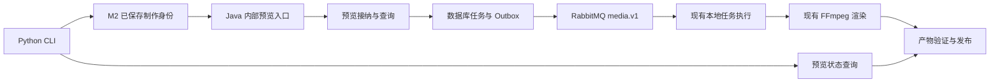

# Java 工具 M4 最终设计与实施计划

设计基线日期：2026-10-15。M4-Q1 至 M4-Q13 已由用户确认。本文保留实施前的接口契约、文件范围、实施计划与验收标准；下文“当前代码事实”“尚未实现”“暂不开始实现”等表述属于设计时基线。

实施状态（2026-10-15）：步骤 1～5 已完成，真实媒体及用户完整观看试听、阶段审查、Java/Python 完整非付费回归和后端打包均已通过。最终范围、逐项验收与限制见 [M4 实施记录](verification/java-tools-m4.md)。

## 已确认的范围

用户决定优先接通真实视频产出，将 M3 按需细读后移，作为后续视频理解能力增强。保留原里程碑编号，当前设计转向 M4。

| ID | 决定 | 状态 |
| --- | --- | --- |
| M4-Q1 | 通过现有 Python CLI 显式请求预览，跑通真实视频产出；正式导出后续接入 | 用户已确认 |
| M4-Q2 | 每次预览一条输出；只有一条时自动选择，多条时显式指定保存结果中的 output_key；不新增批量预览 | 用户已确认 |
| M4-Q3 | 提交后立即返回任务身份；通过 CLI 状态命令显式查询，不增加命令自动等待或常驻 Python | 用户已确认 |
| M4-Q4 | 沿用 LOW_360，方向继承已保存方案；横屏 640×360、竖屏 360×640，30fps、MP4、H.264/AAC、等比例留边；片段、原声和字幕来自保存方案 | 用户已确认 |
| M4-Q5 | 查询成功后返回有期限播放链接，不自动下载或打开播放器；再次查询可取得有效链接，不重新渲染 | 用户已确认 |
| M4-Q6 | 同版本同输出复用运行任务或可用产物；失败、取消或产物失效后由用户显式重试；提交通信中断先核对原请求，不自动创建新渲染任务 | 用户已确认 |
| M4-Q7 | 提供独立预览取消命令；排队可取消，执行中请求停止 FFmpeg，不影响已保存方案、不删除已完成预览；取消实际任务会影响所有复用它的请求 | 用户已确认 |
| M4-Q8 | preview／preview-list 用 THREAD 定位保存版本；preview-status／preview-cancel／preview-retry 用 REQUEST_ID 定位一次预览；未保存草稿不可预览，支持列表找回服务端已接纳请求 | 用户已确认 |
| M4-Q9 | 预览独立于 Agent 图，只使用保存内容和有效原始素材；不运行模型、不重新取分析或生成草稿、不改变 SAVED 终态，不需要 DeepSeek 凭据或推理额度 | 用户已确认 |
| M4-Q10 | 复用 M2 素材与方案，完成 CLI→Java→MQ→真实 FFmpeg→播放链接验收；覆盖横屏字幕、竖屏无字幕、多素材、多输出逐条、重放、重试、取消、丢响应找回和 Java 重启恢复；时长容差 100ms，完成阶段回归与打包 | 用户已确认 |
| M4-Q11 | 每个原请求只关联一次后继重试：retry(A)→B，重放仍为 B，B 再失败需 retry(B)→C；运行中、取消未完成或产物可用时不强制重渲染 | 用户已确认 |
| M4-Q12 | 分别显示任务执行结果与产物可用性；文件失效不改写历史成功任务，存储访问异常不当作文件丢失 | 用户已确认 |
| M4-Q13 | Java 中断恢复沿用原请求／原任务，最多 3 次执行尝试；取消中的任务恢复取消，明确失败或恢复耗尽后等待显式重试 | 用户已确认 |

目标链路：M1 真实上传与基础分析 → Python 读取／检索 → M2 草稿、Java 校验及显式保存 → CLI 显式请求预览 → Java 执行 FFmpeg → 获得可播放预览。

M3 的按需细读不是本链路的前置条件。预览是按已保存方案版本生成的低清视频，不等于方案确认或正式导出。M4 不因接通预览而自动保存草稿。

## 已交付的基础

- [M1 设计](java-tools-m1-design.md)及[综合验收](verification/java-tools-m1-stage5.md)：Java 单体的媒体执行、基础分析、真实读取工具和 Python CLI 接入；保留数据库任务、Outbox 与 RabbitMQ。
- [M2 设计](java-tools-m2-design.md)及[阶段 5 验收](verification/java-tools-m2-stage5.md)：真实草稿、Java 校验、显式保存及不可变方案版本；保存结果包含 revision_id 及 output_key 到 output_id 的对应关系。
- 已有预览模块可以根据方案版本和输出创建 PREVIEW_RENDER 任务，冻结渲染输入，复用运行任务及可用产物，提供状态和播放访问能力。

## 当前代码事实

| 模块及文件 | 当前行为 | M4 接入关注点 |
| --- | --- | --- |
| [CLI](../agent-service/agent_service/cli.py)、[Agent 入口](../agent-service/agent_service/runtime/runner.py) | 支持制作、状态、恢复和显式保存，没有预览命令 | 从保存结果定位预览对象，不让模型生成渲染参数 |
| [Java 传输适配](../agent-service/agent_service/tools/java.py) | 使用内部凭据访问 Java 问答与制作接口 | 为预览增加必要传输调用；不重启模型推理来提交预览 |
| [保存结果](../backend/src/main/java/com/agenticvideo/business/plan/ProductionSaves.java) | Java 持久保存版本及输出身份映射，重复查询取得同一结果 | 复用权威保存结果，避免重新保存或猜测输出身份 |
| [预览 HTTP 入口](../backend/src/main/java/com/agenticvideo/business/render/PreviewController.java) | 当前公开接口使用浏览器登录及项目归属校验 | CLI 沿用内部凭据，需设计相应接入，不能直接假定浏览器会话可复用 |
| [预览请求](../backend/src/main/java/com/agenticvideo/business/render/PreviewRequests.java) | 一次接纳一个输出，支持 LOW_360；保存请求身份、任务、渲染输入和缓存复用记录 | 复用业务入口，落实已确认的单输出选择、异步提交和 LOW_360 规格 |
| [产物管理](../backend/src/main/java/com/agenticvideo/business/render/RenderArtifacts.java) | 验证并发布产物，提供有期限播放与下载地址 | 明确 CLI 如何查询产物并重新获取有效播放地址 |
| [媒体执行](../backend/src/main/java/com/agenticvideo/business/media/MediaProcessing.java)、[渲染器](../backend/src/main/java/com/agenticvideo/business/media/MediaRenderer.java) | 已执行真实 PREVIEW 操作 | 按 M2 保存版本做实际视频验收，仅修改接入暴露的问题 |

LOW_360 规格已按 M4-Q4 确认。CLI 不再选择画幅或传入编码参数，方向由保存方案的画幅决定。

现有预览请求还提供以下行为，后续接入需要明确呈现：

- 同一幂等键重放返回原接纳回执，其中状态可能仍为 PENDING；最新状态应按 requestId 查询。
- 不同请求身份但相同版本、输出和规格，可以复用运行中的任务或可用产物；失败或取消后的新请求可以创建新任务。
- 播放及下载访问地址有效 300 秒，应保存产物身份，在需要访问时重新获取地址；签名地址不是永久产物身份。
- 取消作用于实际渲染任务，可能影响复用该任务的请求；当前 Agent cancel 仅取消 Agent 执行，不会自动取消保存后的预览。

现有新请求在发现失败、取消或不可用产物时会直接创建任务，与 M4-Q6 的“显式重试”要求不同。M4 需要在 Java 接纳处落实该规则，不能仅依赖 CLI 提交前查询；预览引擎可复用不等于现有接纳行为完全无需修改。

Java 已能按方案版本列出已有预览，M2 保存结果已保留版本及输出映射。M4 使用这些权威记录恢复请求，不新增 Python 预览任务表；重试唯一后继复用 preview_intents 保存。

## 已确认的预览操作语义

预览是保存后的独立操作。提交不自动等待；查询和播放访问不创建新的渲染任务。CLI 退出不取消 Java 任务。Agent 执行取消与预览取消是两个不同操作。

普通重复操作复用原任务或可用产物；已失败、已取消或产物失效时，显示状态并要求显式重试。通信中断表示提交结果尚待核对，而不是任务已失败。执行中取消先进入取消请求状态，不能将“已请求停止”显示为“进程已退出”。

播放地址按访问时生成，现有有效期为 300 秒。请求／产物身份可以用于重新查询，地址本身不作为永久身份保存。

## 已确认的命令与制作生命周期

以下为本阶段命令形式，尚未实现；运行时继续使用现有 Java URL、内部凭据及 data-dir 配置：

```text
preview THREAD --output out-1
preview-list THREAD
preview-status REQUEST_ID
preview-cancel REQUEST_ID
preview-retry REQUEST_ID
```

只有一个输出时 preview 可省略 --output；多输出必须明确指定 output_key。THREAD 只用于查找 M2 保存的版本和输出身份，不能直接把未保存草稿传给渲染器。REQUEST_ID 用于精确查询、取消或重试一条渲染记录，避免多输出和多次重试的歧义。

CLI 预览命令不进入 Agent 图，不改变 SAVED、waiting 或模型预算。Java 数据库管理任务和产物；本地 checkpoint 继续保存制作结果。基础分析更新不阻止已保存方案预览，不重新获取当前分析代替保存内容；原始素材失效时明确失败。

## 已确认的阶段验收

- 优先复用 M2 已分析素材及已保存真实方案，覆盖横屏带字幕、竖屏关闭字幕、多素材硬切、多输出逐条预览。
- 从当前 CLI 进入内部 Java 接口，经真实 Outbox、RabbitMQ 和本地 FFmpeg 执行，取得可播放链接。不能仅用直接插入数据库的测试方案代替 M2 保存结果接入验收。
- 程序核对视频规格和实际时长，沿用 100ms 容差；实际观看检查选段、顺序、音画、字幕和画幅。
- 验证重复提交、显式重试、独立取消、提交响应丢失后的请求找回、Java 重启恢复。
- 按根 AGENTS.md 完成阶段审查、Java/Python 完整非付费回归及后端打包，自动化与真实媒体验收分别报告。前端没有改动时不扩大到退役浏览器 Agent 链路。

## 最小架构和职责



- Python CLI 负责操作输入、读取本地制作身份和展示反馈；具体预览客户端负责网络传输及结果解析。
- Java 内部入口负责传输校验和权威制作结果映射；预览模块负责接纳、复用、重试及查询规则。
- 现有任务模块负责有界执行、取消和中断恢复；媒体模块负责受控参数编译和 FFmpeg 执行；产物模块负责文件验证与播放访问。
- 预览操作不进入模型工具目录，不消费模型额度；不新增 Python FastAPI、常驻协调器、任务数据库或通用工具平台。
- 上传、ASR、VLM、Embedding、向量检索、草稿生成／校验／保存继续沿用 M1/M2。M3、正式确认／导出、浏览器对话、批量预览、自定义编码和强制重渲染不在本阶段范围。

## 制作绑定和只读恢复

### THREAD 命令

preview 和 preview-list 通过现有 Agent.inspect 只读取得 production.requirement_id 及保存信息。Java 根据 ProductionSaves.result(requirementId) 解析权威 revision_id 和 output_key→output_id，不信任客户端另传的版本、输出 UUID 或渲染内容。

本地已有 saved_result 时直接使用其制作关联。本地只有已提交 save_request、但保存响应尚未写回时，可查询 Java 的现有保存结果接口；找到已保存版本则继续本次预览操作，查不到则明确提示先完成显式保存。不得自动调用 Agent.save、提交草稿或重跑模型，也无需回写 Agent checkpoint。

Mock thread、没有真实制作身份的 thread、尚无已保存版本的制作不能提交预览。多输出未指定 output_key 时返回选项及明确错误，不猜测用户想看哪一条。

### REQUEST_ID 命令

preview-status、preview-cancel、preview-retry 直接访问 Java，不创建 Agent，不依赖本地 thread、SQLite 或 DeepSeek 凭据。继续使用现有 --java-url 和 INTERNAL_WORKER_TOKEN。

提交响应丢失时，不自动换身份再次渲染；preview-list 可找回 Java 已提交请求，重复普通 preview 也由 Java 的串行接纳规则避免创建重复任务。重试响应丢失时重复相同 preview-retry 原请求即可找回固定后继。

## HTTP 接口契约

新接口沿用 /internal/** 的 Bearer 认证；不恢复已退役的 /internal/v1/tasks/** Worker 协议。本机内部凭据属于现有可信调用身份，不新增浏览器登录、用户委托或认证体系。新接口仅处理 PREVIEW，不能凭请求 ID 操作 EXPORT 或任意其他任务。

字段采用 snake_case，UUID 为标准字符串，时间单位为毫秒，created_at 为 UTC ISO 8601。仅新内部传输做显式转换，不改变公共接口的 camelCase 或全局 Jackson 配置。

| 方法和路径 | 输入 | 行为及响应 |
| --- | --- | --- |
| POST /internal/v1/productions/{requirement_id}/previews | JSON 对象，可选 output_key | 从权威保存结果选择输出；首次创建或复用已有记录，返回 PreviewResult；新建为 202，复用为 200 |
| GET /internal/v1/productions/{requirement_id}/previews | 无请求体 | 返回该保存版本的预览列表，不创建任务、不逐条生成播放链接 |
| GET /internal/v1/previews/{request_id} | 无请求体 | 查询 PreviewResult；成功时检查产物可用性并生成新播放链接 |
| POST /internal/v1/previews/{request_id}/cancel | 无业务请求体 | 取消该 PREVIEW_RENDER 任务，返回当前 PreviewResult；重复或终态取消不产生新任务、不删除产物 |
| POST /internal/v1/previews/{request_id}/retry | 无业务请求体 | 首次显式重试新建或复用后继；相同来源请求始终重放同一后继；新建为 202，复用／重放为 200 |

单输出允许请求体 {}；多输出必须传入对应 output_key。模型不能填写任何文件路径、存储对象键、FFmpeg 参数或字幕替代保存内容。

### 提交示例

以下 ID 为占位符，实际均为 UUID：

```http
POST /internal/v1/productions/requirement-uuid/previews
Authorization: Bearer <INTERNAL_WORKER_TOKEN>
Content-Type: application/json

{"output_key":"out-1"}
```

### PreviewResult

```json
{
  "request_id": "request-uuid",
  "project_id": "project-uuid",
  "revision_id": "revision-uuid",
  "output_id": "output-uuid",
  "task_id": "task-uuid",
  "task_status": "PENDING",
  "created_at": "2026-10-15T08:00:00Z",
  "artifact": null,
  "playback": null,
  "retry_allowed": false,
  "error": null
}
```

task_status 沿用 PENDING、RUNNING、CANCEL_REQUESTED、SUCCEEDED、FAILED、CANCELLED。它描述执行结果，不代表视频文件永远可用。不引入第二套持久化预览状态机。

产物发布后 artifact 包含 artifact_id、state、duration_ms；新接口只暴露已发布到请求的产物，不展示内部每次尝试的 STAGED 文件。state 使用已有 AVAILABLE、UNAVAILABLE、REMOVED。未发布时 artifact 为 null。

成功详情示例中的附加字段：

```json
{
  "task_status": "SUCCEEDED",
  "artifact": {
    "artifact_id": "artifact-uuid",
    "state": "AVAILABLE",
    "duration_ms": 4000
  },
  "playback": {
    "url": "https://storage.example/temporary-preview-url",
    "expires_in_seconds": 300
  },
  "retry_allowed": false,
  "error": null
}
```

该 URL 仅为结构示意。真实 URL 由现有存储签名能力生成，限时有效，不写入长期请求回执或 Agent checkpoint。POST 和列表不保证附带可用播放地址；CLI 提示用 preview-status 获取。

task_status=SUCCEEDED 且文件确认缺失或大小不符时：保留 SUCCEEDED，artifact.state=UNAVAILABLE，playback=null，retry_allowed=true，并返回 PREVIEW_ARTIFACT_UNAVAILABLE 说明。已移除产物使用 REMOVED。任务失败时 error 携带已持久保存的 code 和 message。

访问存储超时、权限错误或服务异常时，接口返回明确依赖访问错误，不把它写成 UNAVAILABLE，不改写任务状态。retry_allowed 只有在状态和可用性已确定时才作为有效判断。

### 列表结果

```json
{
  "requirement_id": "requirement-uuid",
  "revision_id": "revision-uuid",
  "items": [
    {
      "request_id": "request-uuid",
      "output_key": "out-1",
      "output_id": "output-uuid",
      "task_id": "task-uuid",
      "task_status": "RUNNING",
      "created_at": "2026-10-15T08:00:00Z"
    }
  ]
}
```

列表按创建时间及 ID 稳定排序，保留该版本所有输出及历次重试记录；尚无请求时 items=[]。它用于找回请求及查看执行历史，产物当前可用性通过详情查询确认。首版本机范围不增加分页产品能力。

### 错误与 CLI 退出码

HTTP 边界错误格式为 {"error":{"code":"...","message":"..."}}，不返回 Token、内部凭据或堆栈。程序异常不伪装为正常任务结果，保留服务端日志；未知错误继续失败。

| 情况 | HTTP／业务行为 |
| --- | --- |
| 缺失或错误内部凭据 | 401，沿用现有认证错误 |
| 无效 UUID、未知输入字段 | 400，INVALID_REQUEST |
| 多输出缺选择 | 400，OUTPUT_SELECTION_REQUIRED；明确提示合法 output_key |
| 制作／输出／预览不存在，或请求不是 PREVIEW | 404；分别使用 PRODUCTION_NOT_FOUND、OUTPUT_NOT_FOUND、PREVIEW_NOT_FOUND |
| 制作尚未保存 | 409，PRODUCTION_NOT_SAVED |
| 新建所需原素材不可用 | 409，PREVIEW_SOURCE_UNAVAILABLE |
| 原请求当前不允许重试 | 409，PREVIEW_NOT_RETRYABLE |
| 已有失败／取消／失效记录，普通 preview 再次提交 | 200 返回原有记录及 retry_allowed=true，不新建任务 |
| 存储访问异常 | 503，PREVIEW_STORAGE_UNAVAILABLE；不当作文件丢失 |

CLI 成功提交、运行中查询、列表和合法取消返回 0，表示命令成功，不表示渲染完成。提交／详情／重试取得 FAILED、CANCELLED 或不可用产物时返回 1；preview-cancel 对已取消任务返回 0。参数、认证、HTTP、网络及协议错误返回非零，输出原因；原有 run/status/resume/cancel/save 的退出码保持不变。

通信中断提示“提交结果尚未确定，请通过列表／请求身份核对”，不输出假造的 Java 任务失败。客户端不自动重试创建或重试 POST，不自动打开播放器或下载文件。

## Java 接纳、重试与恢复规则

### 普通 preview

Java 在现有项目锁和短事务内完成决定，不能由 CLI 的先查再提交承担并发治理：

1. 使用权威已保存版本与输出，查找相同预览输入的运行任务或可用产物并复用。比较版本、输出、规格、渲染规则和必要源文件指纹；不跨规格或内容复用。
2. 有取消中的同输入任务时返回 CANCEL_REQUESTED，等待其终态，不并行创建另一个任务。
3. 没有可复用记录，但已有该预览目标的失败、取消或失效记录时返回最近记录，要求显式重试。
4. 没有任何既有记录时，确认原始素材与空间条件，原子提交 render_request、task 及 Outbox。任务在媒体消费者中异步执行。

查询和复用不重新理解需求、不重新校验语义、不更新保存方案。新建渲染使用保存的片段、字幕及规格，不能取最新分析替代它们。

### 显式 retry(A)

1. 校验 A 是合法预览请求，在相同项目锁内首先查询服务端确定的重试回执，例如 preview_intents 中的 retry:A 键。该键由程序构造，不要求用户传入。
2. 已关联 B 时直接返回 B 的当前结果，即使 B 后来失败，也不能创建 C。
3. 尚无后继时，A 必须是 FAILED、CANCELLED，或 SUCCEEDED 但产物已确认失效；PENDING、RUNNING、CANCEL_REQUESTED 及产物仍可用的请求不允许强制重渲染。
4. 当前已有同输入可复用的运行任务或产物时关联该 B；否则创建新的请求／任务 B。关联回执与新任务接纳在同一数据库事务提交。
5. B 再失败时用户 retry(B) 创建或关联下一条 C。并发重试 A 及响应丢失后的重复命令都必须得到同一 B。

复用现有 preview_intents，无需新增任务表、Python 预览日志或分布式幂等设施。普通提交、状态查询、重试后继三种语义保持明确；已有接纳回执不能当成最新执行状态。

### 取消和进程中断

- 排队任务取消后为 CANCELLED；运行任务先为 CANCEL_REQUESTED，FFmpeg 停止并清理后才为 CANCELLED。
- 取消前限定 render_request.kind=PREVIEW 且关联 task.type=PREVIEW_RENDER，不能直接把客户端任意 task ID 交给通用取消入口。
- 终态取消是幂等无操作；成功产物保持可用，不因取消命令而删除。多个请求复用同一实际任务时，取消影响该实际任务。
- Java 非正常退出后，原请求／任务按既有 TaskRecovery 恢复，最多 3 次执行尝试，包含首次；次数耗尽则 FAILED。已捕获的明确执行失败直接进入 FAILED，不借中断恢复自动重新制作。
- CANCEL_REQUESTED 的中断任务恢复取消，不能重新启动 FFmpeg。重复 MQ 投递沿用现有任务及执行身份检查；CLI 退出不发送取消。

## 涉及模块和文件

下表区分确定改动、直接复用和仅在必要时修改，避免把整个后端纳入重构。

### 确定新增或修改

| 文件 | 类型 | 职责 |
| --- | --- | --- |
| backend/src/main/java/com/agenticvideo/business/render/InternalPreviewController.java | 新增 | 五个内部端点、输入及输出转换、制作保存身份映射；复用现有内部认证 |
| [PreviewRequests.java](../backend/src/main/java/com/agenticvideo/business/render/PreviewRequests.java) | 修改 | 新内部普通提交与显式重试规则、列表／详情和受限取消接入；共享已有渲染输入冻结及任务创建实现 |
| agent-service/agent_service/preview.py | 新增 | 具体 PreviewClient 和需要的传输模型；直接使用现有 httpx，不增加通用客户端接口 |
| [cli.py](../agent-service/agent_service/cli.py) | 修改 | 五个命令、只读 THREAD 绑定、参数处理、预览输出及退出码 |
| backend/src/test/java/com/agenticvideo/business/render/InternalPreviewApiIntegrationTest.java | 新增 | 内部认证、制作映射、PREVIEW 隔离、接纳、重试、取消、列表和状态契约 |
| agent-service/tests/test_preview_client.py | 新增 | 传输格式、认证、HTTP／网络／协议错误、结果解析 |
| agent-service/tests/test_preview_cli.py | 新增 | 命令分派、选择输出、只读保存结果恢复、退出码、无模型／无图修改 |
| [LocalMediaIntegrationTest.java](../backend/src/test/java/com/agenticvideo/business/task/LocalMediaIntegrationTest.java) | 扩展或同目录拆分专门测试 | 从 M2 保存与新内部入口进入真实 MQ／FFmpeg／产物读取，复用已有真实基础设施夹具 |
| agent-service/scripts/verify_java_m4.py | 新增 | 使用已有真实 M2 保存方案，经 CLI 逐条预览并收集视频和故障验收证据；不启动新模型分析 |
| 运行说明和验证记录 | 修改／新增 | 更新 agent-service/README.md、backend/README.md、根 README、实施状态、功能说明；新增 docs/verification/java-tools-m4.md |

新文件名是实施安排，链接仅指向当前已有文件。Java 新内部请求与 Python 解析应使用同一组 JSON 契约样例验证，样例放入现有 backend/src/test/resources/contracts/ 目录。

### 直接复用及条件修改

- [ProductionSaves.java](../backend/src/main/java/com/agenticvideo/business/plan/ProductionSaves.java)：使用现有保存结果查询，不改保存、引用或校验契约。
- [WorkerSecurity.java](../backend/src/main/java/com/agenticvideo/business/task/WorkerSecurity.java)：沿用 /internal/** 认证，无需修改认证体系。
- [RenderArtifacts.java](../backend/src/main/java/com/agenticvideo/business/render/RenderArtifacts.java)：优先复用 row／available／playback；若状态与链接组合需要一次检查，可在此收敛已有业务读取，避免重复 HEAD。存储异常与确认缺失的区别保持不变。
- [PreviewController.java](../backend/src/main/java/com/agenticvideo/business/render/PreviewController.java)：保留既有公共路由、登录规则和旧接纳语义。新 CLI 的显式重试规则通过预览模块的新入口落实，不顺带改变旧公共请求行为。
- [TaskExecution.java](../backend/src/main/java/com/agenticvideo/business/task/TaskExecution.java)、[TaskRecovery.java](../backend/src/main/java/com/agenticvideo/business/task/TaskRecovery.java)、[LocalTaskRunner.java](../backend/src/main/java/com/agenticvideo/business/task/LocalTaskRunner.java)：复用现有执行、取消和恢复，仅在验收暴露具体问题时修正。
- [TaskDispatch.java](../backend/src/main/java/com/agenticvideo/business/messaging/TaskDispatch.java)、[TaskConsumers.java](../backend/src/main/java/com/agenticvideo/business/messaging/TaskConsumers.java)：PREVIEW_RENDER 已在真实 Outbox／MQ 路径中，直接复用。
- [MediaProcessing.java](../backend/src/main/java/com/agenticvideo/business/media/MediaProcessing.java)、[MediaRenderer.java](../backend/src/main/java/com/agenticvideo/business/media/MediaRenderer.java)：复用已有预览编译与执行，禁止无依据重写。
- [runner.py](../agent-service/agent_service/runtime/runner.py)：只调用既有 inspect，不需改图执行、保存或恢复；[tools/java.py](../agent-service/agent_service/tools/java.py) 保持工具执行职责，渲染传输留在 preview.py。
- 数据库沿用 plan_revisions、render_requests、tasks、task_attempts、outbox_events、artifacts、preview_intents。当前方案不需要新迁移，不修改历史 SQL；若实施发现真实约束缺口，记录原因后只做必要增量迁移并验证完整迁移链。
- 不修改工具 Schema、哈希规则、Mock 执行器、提示词、模型预算或现有 policy.py 改动；预览结果不写入 Agent 状态。前端不在计划改动范围。

## 实施顺序与退出条件

以下为完整 M4 内部的实施步骤，不把每一步都视为需执行全量回归的独立阶段。

| 步骤 | 工作 | 退出条件与验证范围 |
| --- | --- | --- |
| 1. 内部接口与制作绑定 | 定义新传输契约，接通权威保存结果、单输出选择和预览限定入口 | Java／Python 共同解析契约样例；认证、未保存、多输出选择、EXPORT 隔离测试通过 |
| 2. 预览业务规则 | 原子普通接纳、固定后继重试、详情／产物状态、取消 | 单条行为测试后运行 render 模块及直接受影响任务／产物测试；重放与并发无重复任务，旧公共接口回归通过 |
| 3. Python CLI | 实现具体客户端、五命令及只读身份恢复 | 客户端与 CLI 测试通过；REQUEST_ID 命令不依赖本地 thread；不需要模型凭据、不改 SAVED；原 CLI／M2 制作相关回归通过 |
| 4. 真实视频与故障联调 | 复用 M2 保存方案经新 CLI 产生预览；运行响应丢失、取消、产物失效及重启恢复验证 | 下述全部适用验收项通过，视频与权威回执可复查；未完成项单独列出，不能以单元测试替代真实媒体结果 |
| 5. 审查与收尾 | 对照 Q1～Q13、协议和根规范审查，修正问题，完成一次阶段全量检查及文档 | Java／Python 完整非付费回归和后端打包通过，最终代码检查记录完整，真实媒体验收单独报告 |

## 验收矩阵

| ID | 验收对象 | 通过标准 |
| --- | --- | --- |
| M4-A01 | 已保存版本与输出选择 | 单输出省略选择，多输出必须指定正确 output_key；Java 使用 M2 权威映射；未保存不能预览，不自动保存 |
| M4-A02 | 异步提交和历史找回 | 提交后返回 request／task 身份且不等待；退出 CLI 后继续执行；列表可找回丢失响应的请求 |
| M4-A03 | 真实媒体链路 | CLI→内部 HTTP→真实数据库／Outbox／RabbitMQ→本机 FFmpeg→对象存储→签名播放地址，取得可播放视频 |
| M4-A04 | 内容与规格 | 横屏带字幕、竖屏无字幕、多素材硬切、多输出逐条均符合保存内容；实测规格及时间误差不超过 100ms；人工核对选段、顺序、音画和字幕 |
| M4-A05 | 任务复用 | 普通重复及并发提交不创建重复任务；运行中复用，成功且产物可用时复用；失败／取消／失效不自动再渲染 |
| M4-A06 | 显式重试 | retry(A) 首次得到 B，响应丢失／并发／重复仍是 B；B 失败后必须 retry(B)；运行中、取消未完成、产物可用时拒绝强制重渲染 |
| M4-A07 | 取消 | 排队取消不执行；执行中先请求停止后确认取消；终态取消不删文件；共享任务影响如实显示；不改变已保存方案 |
| M4-A08 | 状态与访问 | 详情返回真实 task_status 和独立产物状态；每次成功访问取得有效 300 秒地址；地址失效只刷新访问，文件缺失／大小不符才标为不可用 |
| M4-A09 | 边界错误 | 无效身份／输出、错误凭据、EXPORT 请求、存储不可访问均明确失败；网络异常不伪造任务失败或文件缺失；不吞程序错误 |
| M4-A10 | 进程恢复 | Java 中断恢复保持原 request／task，沿用最多 3 次尝试；取消中断恢复取消；明确终态失败不自动复活；验证原任务与新重试任务的区别 |
| M4-A11 | Agent 独立性 | 预览命令不调用 DeepSeek／百炼、不重分析、不写 Agent 图、不改变 SAVED、制作条件、快照或预算；REQUEST_ID 操作无需本地 thread |
| M4-A12 | 兼容及收尾 | M1/M2 工具／制作与旧公共预览行为保持；阶段审查、最终非付费全量回归及后端打包通过，结果分类报告 |

无音轨补静音、字幕边界、依赖原素材失效等媒体约束通过直接相关集成回归验证；真实素材缺某个边界时使用受控媒体样本补充，并与真实 Agent 方案验收分开标记。

### 测试与证据记录

开发过程先运行当前行为测试，再运行所在模块和直接受影响模块。跨语言契约变动检查双方解析；修改共享任务、认证或 MQ 时，按根 AGENTS.md 扩大到相关模块，影响不明则相应服务全量。默认方案不改这些共享基础实现。

阶段收尾在仓库根目录执行以下现有入口，不在本次设计会话运行：

```sh
RUN_LIVE_JAVA_ANALYSIS=0 mvn -B -ntp verify
agent-service/.venv/bin/python -m pytest agent-service/tests -q
```

Java verify 同时编译、运行非付费回归并打包后端。Python 使用现有项目依赖；Java 编译随 verify，Python 语法编译沿用现有检查，不为本阶段引入新的类型检查体系。后续若前端确有必要改动，另补类型检查、构建与当前有效浏览器入口回归。

真实媒体验收使用已保存方案，不默认再次调用付费模型。需要补充付费场景时单独列明并按阶段安排执行；未配置、跳过或未运行不能算通过。重启与故障实验保留请求／任务／尝试及数据库回执证据，不能只记录 CLI 文案。

docs/verification/java-tools-m4.md 记录代码基准、测试范围依据、通过／失败／跳过／未运行、素材与保存来源、命令、请求／任务／产物身份、视频检查、故障证据及限制。收尾全量之后如有修正，记录改动及补跑范围，不能把旧结果当作最终代码验证。

## 文档及实施约束

本次只汇总最终设计，不开始功能实现。没有尚待用户决定且阻塞当前范围的产品问题。不为调整实施优先级或薄传输入口单独新增 ADR；现有术语表已定义效果预览、方案版本和成片，无需新增同义术语。

实施时遵循根 [AGENTS.md](../AGENTS.md) 的分层回归要求：开发中运行直接相关测试；完整阶段验收及审查修正后执行 Java、Python 完整非付费回归和后端打包；真实模型及媒体端到端验收单列。仅修改本设计文档时检查内容、链接和差异。
