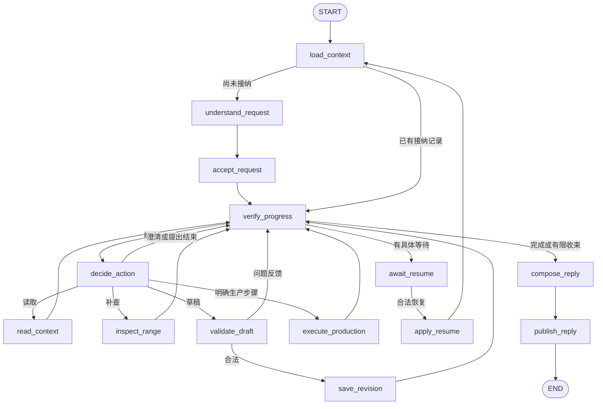

# 基于 LangGraph 的视频 Agent 运行设计

日期：2026-10-14。状态：可评审设计，尚未实施。代码基准：`e65954da804b5ceab66e0d7e0be3493000847b30`。本文细化[改进规格](video-understanding-agent-improvement-spec.md)的 I-17～I-22，并衔接 I-07、I-13、I-16、I-28～I-32；不改变既有授权、版本和多输出规则。

## 1. 从必须解决的问题出发

用户给出一个目标，系统需要反复完成三件事：取得缺少的信息、执行已授权的动作、判断实际结果是否满足目标。模型适合决定内容与下一步；程序适合保证权限、时间范围、费用、身份和提交一致性；分析与渲染需要由各自模块实际执行。

因此采用**一个主 Agent、一个显式状态图、既有业务任务系统**。模型可以改变查找与选段策略，业务程序决定动作是否能够执行。LangGraph 负责节点调度与运行恢复，Spring 继续负责业务事实和发布资格。基础 ASR、VLM、索引构建、FFmpeg 都沿用已有任务流程，不改造成自主 Agent。

细节点有价值，但新增节点必须回答至少一个问题：

1. 是否值得单独看到它的输入、结果和耗时？
2. 它失败后，是否应单独重试而保留前面的工作？
3. 它是否有独立的副作用、等待方式或错误恢复策略？

这使“理解／接纳”“检查／保存”“启动／核对”“生成回复／发布回复”分别成为节点。参数组装、提示词格式化、排序、时长求和、去重等纯函数留在所属模块内部。一页概览或一次范围阅读是一个有界操作，不把每句话、每帧、每次数据库查询变成图节点。该粒度取舍与官方[Thinking in LangGraph](https://docs.langchain.com/oss/python/langgraph/thinking-in-langgraph#advanced-considerations)一致。

## 2. 现有实现提供了什么，真正要改什么

| 已核对的代码 | 当前行为 | 本设计的增量 |
| --- | --- | --- |
| `agent-service/agent_service/conversation.py` | `model/tools/self_check/validate` 图；多个工具在一个节点内串行；校验成功进入结束路径 | 拆开有独立恢复价值的业务动作；动作结果回到主循环；统一核对完成依据 |
| 同上 | SQLite checkpoint，`conversationId:turnId`；6 次模型、12 次业务工具、3 次候选检查，`recursion_limit=32` | 稳定关联逻辑执行；恢复不重置累计预算；框架步数与业务额度分开 |
| `agent-service/agent_service/app.py` | 单执行槽，已有租约、取消检查和 provider 回执；401/409 大多统一为 `LostAttempt` | 等待时退出执行；按业务错误码区分失去执行权、参数错误、授权及版本冲突 |
| `TaskExecution.complete`、`EditPlans.publish` | 保存方案、发布答复与结束 `AGENT_TURN` 协调提交 | 增加可在本轮中间执行的幂等保存能力，返回实际版本后继续；终态发布单独保留 |
| `ConversationQuestions`、`ConversationRetries` | 澄清和显式重试可以创建关联的新 task/turn | 保留关联记录；增加稳定逻辑执行身份，恢复到原 checkpoint 与账本 |
| `VisualInspections` | inspection 级预算；按描述是否包含查询词判断 `NO_NEW_EVIDENCE` | 需求级共享新增视觉调用额度；调用成功、观察新增与问题是否可判断分别返回 |
| `ConversationProduction` | 预览／导出固定对象，启动后回报接纳事实 | 返回规范化任务／产物回执；进行中持久等待，完成后核对有效产物 |

文本推理选用 DeepSeek Flash，沿用现有 DeepSeek 对话适配；ASR、VLM 和 Embedding 使用阿里云百炼的对应模型。请求理解、动作决策、回复生成及按需导航概要都使用 DeepSeek Flash；提供方协议集中在各自适配中。旧文档页首的“待实施”不作为判断当前代码能力的唯一依据。

## 3. 模块边界：图组织动作，模块封装实现

| 模块（沿用现有部署） | 对 Agent 提供的能力 | 内部负责的事情 |
| --- | --- | --- |
| 对话／Agent，Python | 理解请求、下一步动作、草稿与公开说明 | LangGraph、提示词、有界上下文、轻量待办、错误反馈和停止判断 |
| 视频理解，Python 与 Spring 现有分析／检索模块 | `list_assets`、`get_video_overview`、`search_evidence`、`read_video_range`、`inspect_video_range` | 时间组织、混合检索、分页、覆盖、采样、缓存、观察与读取证明 |
| 模型适配，Python | DeepSeek Flash 文本推理，以及百炼 ASR、视觉、Embedding 的规范化响应 | 各提供方请求／解析、模型配置、用量与不确定回执处理 |
| 业务控制，Spring | 接纳请求、动作回执、暂停／恢复、取消 | 身份与范围、授权、累计预算、幂等、租约、串行、Outbox 和发布资格 |
| 方案与产物，Spring + Java Worker | 检查草稿、保存版本、确认／请求预览／请求导出、读取产物 | 局部合并、原文字幕、不可变版本、媒体执行、有效性和清理 |

Agent 不处理 SQL、物理路径、向量库配置、FFmpeg 参数和采样模型选择。视频理解不解释用户是否授权导出；方案模块不检索并替 Agent 决定主题。上述能力可由现有类和小函数封装，不新增服务或通用工作流框架。

工具可被模型选择与底层操作可以执行是两回事。浏览／检索／阅读／补查／提出草稿是模型动作；保存必须经过图中的检查和保存节点；预览、确认、导出必须匹配业务接纳的明确指令。

## 4. 节点和步骤的具体粒度

首版采用以下 14 个节点。数量来自恢复边界，不作为必须保持的指标；这些都是同一 Agent 的步骤，两个决策阶段和回复生成使用同一模型适配器。

| 节点 | 类型 | 一次执行做什么 | 持久输出／主要失败 |
| --- | --- | --- | --- |
| `load_context` | 数据 | 加载原消息、发送时对象、已接纳请求、简报及既有结果 | 固定上下文；读取瞬时故障／对象失效 |
| `understand_request` | LLM | 首次理解目标、条件来源、指代和明确要求的步骤 | 结构化请求建议；解析错误，不产生方案 |
| `accept_request` | 外部动作 | Spring 校验建议，保存不可变执行请求、关联需求及固定对象 | 接纳回执／需澄清字段；歧义、条件冲突、拒绝 |
| `decide_action` | LLM | 根据已有观察、待办、反馈决定一个下一步动作 | 有界 `Action`；参数错误／模型调用不确定 |
| `read_context` | 数据 | 执行一次被批准的列表、概览、检索、范围阅读或历史方案读取 | 引用、覆盖、分页、读取回执；瞬时故障／范围错误 |
| `inspect_range` | 外部动作 | 查复用结果；必要时按业务授权与预算创建定向补查任务 | 可用观察、依赖任务或具体授权提议；额度／回执不确定 |
| `validate_draft` | 数据 | 接收模型草稿，程序补齐局部修改的保留部分，并检查约束 | 规范化草稿、草稿哈希、实际时长、字段级问题；可修复／硬冲突 |
| `save_revision` | 外部动作 | 再校验并原子保存一次有效方案版本 | 实际方案／版本／输出回执；版本／编辑权冲突／提交回执丢失 |
| `execute_production` | 外部动作 | 对固定对象确认，或复用／启动明确请求的预览或导出 | 确认、实际任务或有效产物回执；缺授权／容量／素材失效 |
| `verify_progress` | 数据 | 用业务回执核对各目标，决定继续、等待或收束 | 分步结果、缺口、等待对象、完成／停止原因；实际结果不完整 |
| `await_resume` | 用户或事件输入 | 仅调用一次 `interrupt`，等待关联输入 | 暂停 payload，恢复回执标识；输入关联不合法 |
| `apply_resume` | 数据 | 从业务读取合法回答／授权／依赖结果，应用接纳后的更新 | 条件修订或实际结果；过期等待／原基准失效 |
| `compose_reply` | LLM | 将已核对的结果和限制写成公开答复 | 答复草稿；可退回确定性结果模板 |
| `publish_reply` | 外部动作 | Spring 核对发布资格，幂等发布公开消息和终态 | 公开消息／终态回执；迟到、取消、提交回执丢失 |

三个补充约束：

- 请求已接纳后不再重新猜用户意图或操作对象；故障恢复可以跳过 `understand_request`。
- `read_context` 是同类读取能力的一个执行节点，不是无界批量工具节点；一次通常执行一个工具请求。工具名与参数仍单独记录，能观察某次概览或阅读的结果。
- 不增加强制规划或独立审稿 Agent。复杂任务的待办及语义检查由同一模型在 `decide_action` 按需完成；程序校验必经。是否保留单独的 LLM 草稿复核节点，后续依据质量样本判断。

细分节点增加 checkpoint 开销和图步数，不必增加 LLM 调用：从同一次模型输出取得草稿，随后检查、保存、核对都是程序步骤。初始理解和最终回复各有一次明确的模型职责，均计入同一逻辑执行的调用预算；简单请求实测后也可复用已生成的答复草稿，避免多一次改写。

## 5. 状态：运行快照、业务事实、执行上下文分开

### 5.1 先确定身份关系

| 身份 | 生命周期／用途 |
| --- | --- |
| `requirementId` | 一个制作需求的持续身份，跨查询、选段、修改、补答；默认 4 次新增视觉调用累计在此 |
| `logicalExecutionId` | 一次已接纳目标及其连续步骤；跨故障重试、补答、等待恢复，累计模型／工具／修正预算 |
| `executionRequestId` | 某次业务已接纳的固定输入；补答通过关联的接纳记录／条件修订表达，不原地改写原输入 |
| `turnId` / `messageId` | 用户可见轮次与消息；关联重试或补答可以有新 turn，但不能因此重置原执行额度 |
| `taskId` / `attemptId` | 业务调度任务与本次租约身份；副作用资格按当前 attempt 检查 |
| `actionId` / `waitId` | 一次动作与一次等待的稳定身份，用于幂等、回执及恢复关联 |

明确的新制作或修改消息可建立新的 `logicalExecutionId`，按轮次策略分配额度；同一需求的视觉累计额度仍共享。不要把整段会话共用一个 Agent checkpoint，也不要让每次重试任务获得完全独立的执行记忆。

新增执行使用业务生成并持久关联的短 `thread_id`（可直接用逻辑执行 UUID），恢复始终复用。它是 checkpoint 定位键，不是访问授权。跨项目和用户的访问仍由 Spring 核对。

### 5.2 建议的 Graph State

下面是结构示意；嵌套对象在接口边界用明确 Schema 校验，非任意键值记忆库：

```python
from typing import Any, TypedDict

class AgentState(TypedDict):
    schema_version: int
    graph_version: str
    identity: dict[str, str]          # requirement/execution/request/message IDs
    request: dict[str, Any]          # 原消息、固定引用、接纳回执
    goal: dict[str, Any]             # 目标与被接纳的明确步骤
    brief: dict[str, Any]            # 硬条件、偏好、默认值及来源/修订号
    evidence: dict[str, Any]         # 已读记录/证明的引用与有界摘录
    coverage: dict[str, Any]         # 来源、分析版本、实际覆盖、分页状态
    work: dict[str, Any]             # 信息缺口、可选轻量待办、简短选择理由
    draft: dict[str, Any] | None     # 完整草稿或局部补丁、固定基准、hash
    action: dict[str, Any] | None    # 稳定 actionId、动作种类、结构化参数
    feedback: dict[str, Any] | None  # 规范化结果或结构化错误
    results: dict[str, Any]          # 保存版本、确认、任务、产物的真实回执
    waiting: dict[str, Any] | None   # kind、waitId、关联对象、恢复条件
    progress: dict[str, Any]         # 已核对目标、停止原因、无进展次数
    reply: dict[str, Any] | None     # 待发布公开答复及合法引用
```

其中几个对象需要明确到字段：

| 对象 | 必需内容 |
| --- | --- |
| `goal` | 用户希望取得的结果；步骤列表；每步 `kind`、授权消息来源及对象绑定。后续预览可引用本次保存动作的实际结果，不能预填猜测的未来版本 |
| `brief` | `hardConstraints`、`preferences`、`defaults`，各项附用户消息／补答来源和条件修订号；新需求隔离 |
| `evidence` | `evidenceId`、`readReceiptId`、素材／来源、真实时刻或范围、分析版本、关联逻辑执行；导航摘要与原始证据区分 |
| `coverage` | 实际来源和采样范围、尚未完成阶段、分页 cursor／截断。完整 ASR、完整目录和完整视觉观看是不同覆盖 |
| `draft` | 固定 `baseRevisionId`，初始完整编排或局部 patch，引用的保留 `clipId`、草稿哈希、检查结果；输出和片段身份由业务分配 |
| `results` | 动作回执与实际 `revisionId/outputId/taskId/artifactId`；文件有效性由业务重新检查，不长期保存签名 URL |
| `waiting` | `USER_INPUT/DEPENDENCY/AUTHORIZATION`、稳定 `waitId`、question／proposal／task 引用、固定对象、等待代次 |
| `progress` | 每步 `PENDING/RUNNING/SUCCEEDED/FAILED/BLOCKED` 的核对快照、具体停止原因、无进展计数；它不能作为发布授权 |

状态只保存恢复所需的原始值、结果和引用。完整视频、全片转写、无限聊天历史、模型客户端、密钥、租约 token、SQL 和私有思维链不进入 state；提示词按需组装。模型只看到当前动作所需的投影，不能自由读取或改写全部字段。

首版图内动作串行，默认字段覆盖即可。引用集合由节点按稳定 ID 合并、去重；同 ID 的不可变内容冲突应报错。暂不引入通用 reducer 或并行写入状态的复杂规则。如果以后并行只读检索，再为实际共享字段定义合并规则。不要直接对证据列表做无界 append。

### 5.3 可信 Runtime context 与业务数据库

使用 `StateGraph(..., context_schema=ExecutionContext)`，每次调用注入当前业务客户端、模型适配器、执行资格与取消检查。恢复时重新领取租约、重新建立客户端，不从 checkpoint 取回旧执行权。[Runtime 事实与兼容性](research/langgraph-runtime-semantics.md#2-节点边界状态与上下文)

权限、授权、累计费用和额度保存在 Spring 管理的 PostgreSQL 记录中。context 携带访问这些事实的当前执行能力；它自己的旧快照也不是永久授权。state 可保存预算记录身份和用户所需摘要，但消费与预留必须查业务账本。读取证明、版本、产物、确认也以业务记录为准。

业务记录与 checkpoint 不需要复制同一套完整数据。恢复时对业务回执重新核对，然后刷新运行快照。无需新增通用长期记忆库、另一套任务表或事件溯源引擎。

## 6. 一个小的动作协议和统一反馈

`decide_action` 每次输出一种动作：

```text
READ(tool, arguments)         浏览、检索、阅读、查看固定方案
INSPECT(asset, range, goal)   定向补充必要视觉信息
DRAFT(content_or_patch)      形成或修改内部草稿
PRODUCE(command)             执行已接纳的预览/确认/导出步骤
ASK(question, missing)       关键歧义，绑定原需求
FINISH                       提出收束，仍须核对实际结果
```

初始 `understand_request` 输出请求建议，由 `accept_request` 保存。动作协议通过 DeepSeek Flash 的工具调用或经验证的结构化输出实现；由模型适配器转换为同一个 Schema，图不依赖提供方原始 tool-call 格式。不要同时维护两套业务工具协议。

模型提出动作，程序生成／关联稳定 `actionId` 并核对其允许范围。禁止模型填用户身份、租约、预算余额、任务成功状态或下载地址。保存发生在有效 `DRAFT` 通过检查之后，不需要额外确认制作；预览／导出按已接纳的授权步骤执行。

工具反馈至少包含：

```json
{
  "status": "READY | PENDING | BLOCKED | ERROR",
  "receiptId": "业务回执标识",
  "data": {},
  "coverage": {},
  "readReceiptIds": [],
  "dependency": null,
  "error": null
}
```

这是新增能力的规范化返回约定，旧接口通过薄适配逐步接入。`READY` 仅表示本次操作结果可用。检索零命中仍是合法读取结果；补查生成了新观察也可能无法判断所问问题，二者不能写成工具执行失败。

## 7. 错误按谁能修复来分类

错误结构包含 `code/category`、字段或对象定位、实际值／允许值、已产生副作用及关联回执；模型只收到可以帮助修正的安全信息。

| 类别／例子 | 修复者 | 图的处理 |
| --- | --- | --- |
| 已知瞬时故障：只读 API 连接失败、短暂 503 | 程序 | 有限退避；耗尽后返回读取不可用反馈，允许收束或其它合法来源 |
| 模型可修复：JSON／参数错误、切点越界、缺引用、草稿硬时长不符 | 同一模型 | 把字段级问题放入 `feedback`，回 `decide_action` 有限修正；不重复提交原错误 |
| 用户可修复：素材重名、目标版本不唯一、硬条件冲突 | 用户 | 保存具体问题，进入 `USER_INPUT` 等待；条件变化由业务接纳 |
| 需要授权：首次付费补查、扩大分析 | 用户与业务 | 返回具体范围、用途、限额及估算，进入 `AUTHORIZATION` 等待；不把超时视为批准 |
| 依赖尚未完成：ASR／补查／渲染 | 执行模块 | 正常 `PENDING`，持久等待；不作为失败反复重试 |
| 付费提交不确定：请求已发出，响应丢失 | 适配器与业务 | 保留 call 身份与占用，先核对既有执行；不可查询时停止自动重付，并说明限制 |
| 执行失效：取消、过期租约、旧 attempt | 业务 | 当前执行立即停止，拒绝新副作用与迟到发布；不能转给模型“修复” |
| 对象／版本冲突：编辑权被占用、固定基准失效 | 业务／用户 | 保持原对象；可等待已知编辑任务或解释冲突；不自动切最新版本 |
| 额度耗尽、连续无进展、能力不支持 | 程序 | 有限收束、保留已完成成果；若用户可批准具体分析扩展才等待授权 |
| 未知异常：数据不变量被破坏、代码 bug | 开发者 | 上抛并由执行器记录任务失败；保留 checkpoint，不包装成内容不可满足 |

首次草稿校验失败不等于目标不可满足；只有明确冲突或有限修正耗尽才收束。HTTP 状态只是传输信息，409 必须进一步区分 `LEASE_LOST/BASE_CONFLICT/BUDGET_EXHAUSTED` 等业务码。现有 `business()` 将大部分 409 当作 `LostAttempt` 的处理需要调整。

对只读和明确可幂等核对的业务调用，按适配器异常白名单配置 `RetryPolicy`。每次实际重试仍受时间与账本额度约束。给整个模型调用或付费补查套默认重试会把“回执丢失”误当成“没有执行”，因此这些节点必须先查 provider ledger。节点 retry 不回滚外部费用。[官方故障处理](https://docs.langchain.com/oss/python/langgraph/fault-tolerance)、[固定版本核对](research/langgraph-runtime-semantics.md#5-重试超时与错误处理)

检索虽是业务读取，内部仍可能调用付费 Embedding，不能仅按节点名称认为重试无费用。`read_context` 的重试白名单只接受已核对为安全的异常；原动作回执及内部模型调用记录复用，`SUBMISSION_UNCERTAIN` 不进入自动重试。

`error_handler` 只处理预先定义的重试耗尽场景，例如读取暂时不可用；取消和未知异常继续上抛。`interrupt` 是控制流，暂停节点周围不包宽泛异常捕获。

## 8. 预算和无进展：业务限制独立于图节点数量

### 8.1 最小预算分层

| 范围 | 控制内容 | 是否随恢复重置 |
| --- | --- | --- |
| 项目授权 | 自动付费补查是否允许、可撤回授权、扩展提议 | 不重置；提交前检查最新授权 |
| 制作需求 | 默认累计 4 次新增视觉请求，及用户明确批准的扩展 | 不重置；跨消息、修改、恢复、重试共享 |
| 逻辑执行 | LLM 调用、工具执行、候选修正、输入量、token 上限、有效执行耗时 | 不重置；实际新目标按轮次政策另配 |
| 单操作 | 帧数、时间范围、返回量、客户端 deadline／单次 timeout | 独立受限；不替代累计预算 |
| 本次 graph 调用 | `recursion_limit` | 框架级兜底，不作为累计预算 |

优先扩展已有需求、`conversation_model_calls`、工具／校验回执和 `visual_inspections` 的关联及约束；预算门禁由这些模块共用的小业务函数提供。无需为此设计通用多维账本框架。

现有 6／12／3 可作为回归基线配置，但不能直接承诺足够支持全片浏览和连续预览。细节点会增加 superstep，未必增加 LLM／工具调用；需按场景重新配置框架步数并预留收尾空间。`recursion_limit` 统计一次调用的 superstep，恢复会取得新的本次步数容量，因此累计预算必须另行持久化。[Recursion limit 核对](research/langgraph-runtime-semantics.md#6-recursion_limit-与业务预算)

### 8.2 付费调用的最小生命周期

```text
查询相同输入的有效既有结果
  → 可复用：核对权限/版本，返回，不扣新增模型次数
  → 无结果：核对授权，原子预留额度并保存稳定 callId/输入身份
  → 提交提供方
  → 成功：保存观察/用量/回执，结算占用
  → 明确未提交：按提供方契约释放预留
  → 是否提交未知：保留占用，核对该 call，禁止盲目重付
```

一次多图请求按一个新增视觉调用计数，同时记录实际帧数、输入和输出用量。工具内部如果实际发了三次模型请求，就必须记录三次，不能外层一次工具只扣一次额度。目录摘要和检索 Embedding 也需分别记录实际模型开销。

“相同输入”由视频理解模块核对素材哈希、有效分析版本、实际帧／采样、模型参数、提示版本；定向观察另核对检查目标。合法观察可以复用，换了问题的结论不能直接复用。

授权检查与额度预留在业务事务内完成；远程请求在事务外执行；结果再次核对当前资格后入库。撤回阻止后续新提交，不能保证撤回已经发往提供方的调用。费用估算和预警不充当授权或金额硬上限。

### 8.3 简单而可解释的无进展判断

记录规范化动作签名：工具＋范围／问题＋输入分析版本。比较合法新增证据、实际覆盖、解决的缺口、草稿检查问题及目标回执是否变化。

相同签名且版本未变时优先复用已有结果；依赖进行中就等待。连续动作没有增加信息或减少缺口、重复同一失败草稿、反复错误提出结束，都消耗有限额度并最终收束。阈值配置并用样本固定，不引入复杂的“进展评分 Agent”。查询改写获得新有效记录可以算进展；仅改写文字不算。

## 9. 等待与恢复：checkpoint 后登记，事件驱动

三类等待共用一个暂停节点，业务对象仍分别沿用问题、分析／渲染任务和授权提议，不混淆输入语义：

| 等待类型 | 绑定对象 | 合法恢复来源 |
| --- | --- | --- |
| `USER_INPUT` | 原需求、questionId、缺失字段、固定对象 | 业务已关联并接纳的补答 |
| `DEPENDENCY` | 实际任务／inspection／产物请求及所需就绪阶段 | 业务已提交的完成或失败结果 |
| `AUTHORIZATION` | 具体未授权动作、范围、提议及估算 | 用户对该提议的明确决定 |

`await_resume` 只暂停；它不创建问题、不创建任务、不扣额度、不保存方案。恢复会从该节点开头重执行，保持单次 interrupt 和稳定 payload。[官方 Interrupts](https://docs.langchain.com/oss/python/langgraph/interrupts)

```python
from langgraph.types import interrupt

def await_resume(state: AgentState):
    # waiting 已由前面的节点形成；此处没有外部副作用。
    receipt = interrupt(state["waiting"])
    return {"feedback": {"status": "RESUMED", "resumeReceipt": receipt}}
```

最小落地流程：

1. 信息工具／产物节点返回真实任务或授权提议；`verify_progress` 形成含稳定 `waitId` 的等待数据。
2. 图运行到 interrupt，保存 checkpoint 并返回调用方。执行器把该 checkpoint 关联、等待对象和当前 attempt 提交到 Spring 的暂停能力。
3. Spring 在一个事务里校验执行资格，保存等待／问题，转为相应等待状态，结束当前租约并按规则释放编辑占用。如果依赖已经达到所需阶段，**该事务直接生成恢复 Outbox**。
4. 尚未就绪的依赖在结果事务中查找相关等待，并生成恢复 Outbox。事件重复按 `waitId` 和等待代次去重；发布恢复不是仅依赖一次 SSE 或 RabbitMQ 消息。
5. Python 执行器退出当前任务并释放单执行槽。补查分析任务可获得执行机会。
6. 恢复任务重新领取执行权、建立 Runtime context，检查同一逻辑执行的 checkpoint，通过 `Command(resume=业务恢复回执)` 继续。
7. `apply_resume` 根据回执读取权威记录，重新核对权限、授权、原基准、预算、取消与编辑资格，然后回 `load_context` 刷新结果。

此处无需增加 PREPARED／ACK 两阶段等待协议。先有 checkpoint，再登记业务等待；登记时读取依赖当前状态，解决“完成事件早于登记”的竞态。依赖结果提交与等待登记需使用一致的事务锁／条件更新约定，使并发发生时至少一方生成恢复 Outbox；不能双方各读一次旧状态后都认为无需唤醒。

两个存储系统仍有崩溃窗口，需要沿用任务恢复做核对：

- checkpoint 已暂停、业务尚未登记：租约过期后重新调度；执行器识别已有 interrupt，补做幂等暂停登记，不再调用模型。
- 业务已登记、响应丢失：重复暂停请求返回已有等待；已就绪的恢复 Outbox 保留。
- 恢复通知重复或取消后迟到：Spring 检查等待代次及资格，不启动另一个有效恢复执行。

暂停后的 `task` 状态建议在现有状态机中增加 `WAITING_DEPENDENCY/WAITING_AUTHORIZATION`，保留 `WAITING_INPUT`。同步调整会话串行判定、取消、领取、恢复、前端快照与清理；这些不是任务失败或成功。现有不可变 task 输入不修改，新关联恢复 task 可以使用同一逻辑执行与 checkpoint 身份。

等待时间与有效执行时间分别记录，租约在暂停时结束。依赖有自身 timeout／失败恢复；用户等待可以取消，不能静默当作批准。补查已保存合法观察时可恢复本轮，不必等其增量索引全部发布；语音就绪可以先用，不必等视觉阶段。

## 10. 边与最终执行流程



`verify_progress` 是小的确定性节点，检查业务事实和引用结构；它不负责重新评价所有内容质量。完成条件按目标区别：

| 用户目标 | 允许声明完成的依据 |
| --- | --- |
| 视频问答 | 合法已读来源、可核查时间及实际覆盖；语义支持质量另用人工样本验收 |
| 推荐片段 | 可定位的真实区间、已读依据与理由 |
| 制作／修改方案 | 实际保存版本及合法完整输出；仅检查通过不够 |
| 预览 | 固定版本／输出的实际任务成功，且可用预览产物 |
| 导出 | 具体版本确认、另行明确导出指令、固定任务成功、有效成片 |

全片目标还需检查是否完成所需导航浏览；摘要不替代精确信息阅读，覆盖不充分就报告范围。合法引用只是必要条件，不证明模型所说的每句话都正确。

模型提出 `FINISH` 但还有已授权步骤未完成时，反馈缺少的实际结果并继续。无授权的下一步不由模型创造授权；例如只保存方案后应说明可请求预览。用户明确要求预览则持续推进到实际产物或可解释失败。导出缺少具体版本确认时报告该前置条件，不能在原请求里自动补成“确认并导出”。

取消／失去租约由执行器立即终止当前执行，只有仍有效的业务路径可以发布停止事实；不强行经过 LLM 收尾。其它预算耗尽、无进展、能力冲突或部分失败可进入 `compose_reply`，模型额度不足则使用实际回执的确定性模板。

下面是 wiring 示意，函数体分别调用上述已有模块；未实现功能的接口不是当前可调用 API：

```python
from langgraph.graph import StateGraph, START, END
from langgraph.errors import NodeError
from langgraph.types import Command, RetryPolicy

def read_failure_handler(state: AgentState, error: NodeError):
    if not is_known_retryable_read_error(error.error):
        raise error.error
    return Command(
        update={"feedback": {"status": "ERROR", "error": {"code": "READ_UNAVAILABLE"}}},
        goto="verify_progress",
    )

builder = StateGraph(AgentState, context_schema=ExecutionContext)
for name, fn in nodes.items():
    options = {}
    if name in {"load_context", "read_context"}:
        options["retry_policy"] = RetryPolicy(
            max_attempts=3, retry_on=is_known_retryable_read_error
        )
    if name == "read_context":
        # handler 有自己的出口，显式返回到核对节点；未知异常重新抛出。
        options["error_handler"] = read_failure_handler
    builder.add_node(name, fn, **options)

builder.add_edge(START, "load_context")
builder.add_conditional_edges("load_context", route_loaded)
builder.add_edge("understand_request", "accept_request")
builder.add_edge("accept_request", "verify_progress")
builder.add_conditional_edges("decide_action", route_action)
for name in ("read_context", "inspect_range", "save_revision",
             "execute_production"):
    builder.add_edge(name, "verify_progress")
builder.add_conditional_edges("validate_draft", route_validation)
builder.add_conditional_edges("verify_progress", route_progress)
builder.add_edge("await_resume", "apply_resume")
builder.add_edge("apply_resume", "load_context")
builder.add_edge("compose_reply", "publish_reply")
builder.add_edge("publish_reply", END)
graph = builder.compile(checkpointer=checkpointer)
```

路由函数只读取结构化结果，并限制到图中的固定目标。已知参数／业务问题可作为反馈返回，未知异常上抛。普通节点以静态边和条件边组织路径，不在同一来源再返回带 `goto` 的 `Command`。读取 error handler 是框架注册的独立恢复节点，需要用自己的 `Command` 显式回到 `verify_progress`，不假设它沿失败节点的正常边继续。初始上下文读取耗尽则交给执行器记录失败，不用不完整上下文继续执行。

### 10.1 执行器是恢复入口，不靠 START 自动重验一切

LangGraph 故障恢复和 interrupt 恢复可能跳过 `START/load_context`，所以每次 graph 调用前必须由执行器重新核对当前业务任务、attempt、取消与逻辑执行关联；所有副作用接口也再次检查。不能假设图前面有一个门禁就保护整个恢复过程。

恢复入口按 checkpoint 状态区分：

```text
无 checkpoint                 → 输入初始化 state
有 interrupt 且无合法回答      → 幂等登记/核对等待，退出当前执行
有 interrupt 且有合法回答      → Command(resume=业务恢复回执)
有未完成节点、无 interrupt     → 以 None 恢复，节点优先复用业务回执
图已结束                      → 返回既有发布回执，不再次调用模型
```

外部调用的 `actionId` 在上游节点输出中固定；重执行查相同动作回执，不在保存／提交节点内随机再分配业务身份。付费模型调用同样先从业务取得稳定 call 身份及原请求。新 attempt 只改变当前执行资格，不改变已提交动作的逻辑身份。

当前锁定 `langgraph==1.2.14` 已具备本设计使用的 API。执行用持久 checkpointer 并优先 `durability="sync"`；这控制 checkpoint 写入时机，不能替代业务幂等。当前 SQLite 可在改造期间保留；落实既有 PostgreSQL checkpoint 目标时需新增 saver／驱动、独立表范围与迁移验证，不是升级 LangGraph 核心。

若使用节点 `timeout`，仅给实际 async 节点配置，并配套 async 客户端、saver 和 `ainvoke`；当前同步节点不能直接挂 timeout。单次 HTTP timeout 与有效执行预算仍保留。不要为了获得 timeout 给所有函数套线程再假定远程请求已取消。[兼容性与源码核对](research/langgraph-runtime-semantics.md)

## 11. 用四条具体路径检查设计是否够用

1. **查询某句话**：加载 → 理解 → 接纳 QUERY → 决策检索 → 核对 → 决策范围阅读 → 核对 → 提出结束 → 生成／发布有引用答复。不产生方案或编辑占用。
2. **找亮点并制作、明确预览**：接纳目标与连续步骤 → 浏览完整目录、比较并阅读候选 → 必要补查及等待恢复 → 草稿检查 → 保存真实版本 → 回主循环 → 该版本预览 → 等待 → 核对有效产物 → 回复。保存成功只完成其中一项。
3. **替换第二段**：接纳并固定历史基准／允许改动范围 → 阅读目标与替代 → 提出局部 patch → 程序复制保留片段、检查整份输出 → 保存新版本 → 回复。后续查看切换不影响基准，新版不继承旧确认。
4. **已有方案但预览失败**：保存回执保留 → 预览任务失败事件恢复 → 程序判断可否在原资格内有限重试 → 仍失败则分步回复，给已保存版本和剩余限制。不回滚方案，也不把原请求整体标为完成。

## 12. 最小实施顺序与验证

| 增量 | 要完成的内容 | 外部可验证结果 |
| --- | --- | --- |
| 1. 明确结果与错误 | 规范化反馈、固定目标和分步结果；细分检查／保存／核对／回复；新增中间保存能力 | 保存后能继续明确请求的步骤；启动任务不宣称已有视频；旧查询／修改／授权能力不回退 |
| 2. 统一执行关联与预算 | 需求／逻辑执行关联、动作幂等、失败回执核对、共享累计预算 | 重试和补答不重置额度，不重复保存版本或自动重付 |
| 3. 持久等待 | 单 interrupt 节点、业务暂停能力、依赖 Outbox 恢复、前后竞态核对 | 单槽补查可运行并自动恢复；取消、重复事件、崩溃窗口正确 |
| 4. 扩展内容获取与能力 | 概览／范围阅读／定向观察，按样本配置输入量和阈值；容量按各模块同步扩展 | 全片及视觉目标可解释覆盖；局部修改稳定；长时间线需字幕／媒体真实验证 |

这里只新增或扩展必须的业务关系：既有需求和执行请求关联逻辑执行；调用／工具回执关联同一预算及动作身份；既有 tasks 增加所需等待数据和状态；沿用问题、授权提议、观察、版本与产物记录。读取证明的继承必须明确关联且仍有效，不能接受任意历史曾读过的记录。

已有 SQLite checkpoint 中的旧节点名不能直接迁进新图。新执行记录 `graphVersion/schemaVersion`，旧运行沿用旧图直到结束，或按明确迁移规则恢复为新执行快照；不能默认重新 START 并重付。更换 thread 身份及 PostgreSQL saver 同样须迁移或保留旧执行恢复入口。

验证复用公共业务 HTTP、公开事件和浏览器，重点覆盖规格 AC-14～AC-18、AC-23、AC-25～AC-32：

- 每个副作用在“远程成功、checkpoint 尚未写入”处崩溃，恢复仍返回原回执。
- checkpoint 已暂停但业务尚未登记、依赖完成早于登记／并发于登记、恢复重复通知，都能最终恢复且无重复结果。
- 项目授权撤回、共享第 5 次视觉调用、模型响应不明、取消与发布竞争、旧 attempt 迟到都受业务限制。
- 方案检查通过后保存发生冲突、保存后预览失败、产物被清理，都报告实际分步结果。
- 有完整导航却只读了部分原始内容时，不宣称精确全片事实；语音不能替代视觉依据。

观测沿用现有 progress／日志／用量记录：`logicalExecutionId/actionId/node/toolName`、耗时、回执、错误分类、预算消费与停止原因。无需建立另一套公开事件系统，也不把完整 graph state 或私有模型输出直接广播给前端。

本次交付是设计与官方语义核对，未改运行代码、运行真实模型或执行业务验收。官方事实出处与版本边界见[研究笔记](research/langgraph-runtime-semantics.md)；以上模块和接口取舍是基于项目约束的设计建议。
