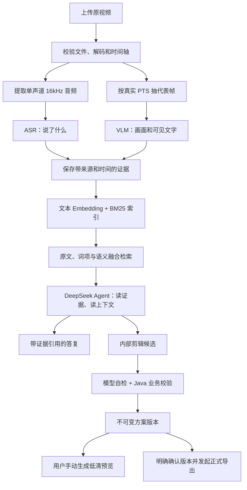
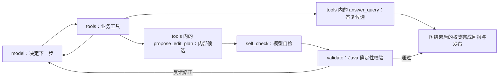

# 当前项目是怎样工作的（截至 #14）

这份说明对应当前已实现代码。你提到的“ase”，这里按 **ASR（语音识别）** 解释。

## 1. 先用一句话理解整个项目

**先把视频转成带出处和时间的证据，再检索证据，让受控 Agent 据此回答问题或提出剪辑方案，最后由确定性媒体程序生成预览和成片。**

“上传成功”“分析完成”“索引就绪”“方案已发布”“成片导出成功”是不同的状态。一个阶段完成不会把其他阶段自动标成成功。

## 2. 已经能做哪些事情

- 账号、私有项目、多视频分片上传；断网续传、暂停、取消、过期清理；文件／项目限额及实际磁盘空间核对。
- 校验和播放原视频；自动识别有音轨视频的语音，按原文或主题检索，查看上下文并跳转原素材。
- 手动分析画面，查询场景描述和可见文字，查看佐证帧；预算内加密复查或覆盖补查，明确接受后扩大投入。
- 创建相互独立的制作会话，让 Agent 查询本会话固定素材范围。
- 从一份讲话素材生成一条有硬时长条件的短视频方案；查看历史方案，核查源片段。
- 手动生成 360p 预览；明确确认某个方案版本，正式导出 720p／1080p MP4，播放、下载和管理成功成片。

完整用户功能清单见 [当前可用功能](/Users/nonbeing/AgenticVideoProject/docs/current-features.md)。

## 3. 各个程序负责什么

| 部分 | 当前职责 |
| --- | --- |
| Vue 前端 | 上传、播放、查询、制作会话、结果卡和明确的用户选择 |
| Spring 业务 API | 登录与项目权限、任务权威状态、证据和版本、预算与幂等、校验及发布 |
| Java Media Worker | FFmpeg / ffprobe 校验、提取音频和帧、确定性渲染 |
| Python Agent Service | 调用 ASR / VLM / Embedding；用 LangGraph 驱动 DeepSeek Agent |
| PostgreSQL | 保存项目、任务、观察证据、调用回执、会话和方案等业务事实 |
| Silo 对象存储 | 保存原视频、派生音频、观察帧、预览和成片 |
| Qdrant | 保存用于召回的 Dense 与原生 BM25 派生索引 |
| RabbitMQ | 把已持久接纳的任务交给相应执行器 |

业务 API 通过任务 + outbox 持久记录调度意图；执行器不能凭一条消息就直接发布业务结果。

## 4. 视频理解：三类输入、三类职责

| 模型 | 实际输入 | 实际输出 | 用途 |
| --- | --- | --- | --- |
| `qwen3-asr-flash-filetrans` | 派生音频 | 语句原文、词级时间和用量 | 确认“说了什么” |
| `qwen3-vl-plus` | 单张代表帧与固定观察提示 | 中文画面描述、逐条可见文字 | 确认“这一帧看见什么” |
| `text-embedding-v4` | 语音原文、画面描述或文字转写 | 1024 维文本向量 | 找主题与近义表达 |
| `deepseek-flash` | 当前需求、有限历史、工具返回的证据 | 工具请求、答复或剪辑候选 | 编排核查与制作流程 |

### ASR 怎样处理

Media Worker 提取单声道 16kHz PCM 音频，保存 SHA、字节数与相对原视频的时间偏移。Python 校验派生音频身份后上传给百炼，提交异步识别任务，保存 providerTaskId，随后查询同一个提供方任务。

Java 将音频时间映射回原视频。例如音轨从原视频 1.436 秒开始，ASR 的 2 秒观察对应原素材 3.436 秒。原始句子、词级观察和提供方回执保留；素材摘要只用于导航。当前语音检索单元基本对应 ASR 的一句／一个段落，并关联原证据。

入口：[MediaExecutor](/Users/nonbeing/AgenticVideoProject/backend/media-worker/src/main/java/com/agenticvideo/media/MediaExecutor.java:97)、[ASR 执行流程](/Users/nonbeing/AgenticVideoProject/agent-service/agent_service/app.py:140)、[语音发布与时间映射](/Users/nonbeing/AgenticVideoProject/backend/business-api/src/main/java/com/agenticvideo/business/analysis/SpeechAnalysis.java:95)。

### VLM 怎样处理

基础分析最多抽取 25 帧，采样间隔随视频长度增加。每一帧记录实际解码 PTS、原视频观察时刻、SHA 和存储身份。用户点击“分析画面”后才安排真实视觉调用。

Python 给 VLM 单张图片及固定 JSON 提示，分别得到 `description` 和 `visibleText`，不向它输入 ASR 原文。相同图像可以复用成功调用，但各个出现时刻仍保存独立观察。

证据来源明确分为 `SPEECH`、`VISUAL`、`VISIBLE_TEXT`。语音证据有区间；视觉证据有 `observedAtMs`，表示该帧观察点。例如在 1.00 秒看见文字，并不据此证明它在前后几秒一直出现。

入口：[实际 PTS 抽帧](/Users/nonbeing/AgenticVideoProject/backend/media-worker/src/main/java/com/agenticvideo/media/RepresentativeFrames.java:14)、[图像模型调用](/Users/nonbeing/AgenticVideoProject/agent-service/agent_service/vision.py:11)、[视觉证据发布](/Users/nonbeing/AgenticVideoProject/backend/business-api/src/main/java/com/agenticvideo/business/analysis/VisualAnalysis.java:97)。

### #13 的补查怎样处理

用户可以在候选附近加密采样，或在没有候选时对指定素材做覆盖采样。首轮固定限制为 4 帧、4 次新视觉调用、8 步、180 秒、4 MiB 图片输入；计数和共同截止时间持久保存。

已有成功的图像调用可复用。得到匹配或没有新匹配后结束一轮，追加证据并保留历史。若还想扩大范围，先展示素材／范围和开销，明确接受后才创建独立子轮次；拒绝保留首轮结果。

当前补查由 **独立 HTTP 接口和检索结果卡** 驱动。LangGraph 的模型工具名单中尚未加入自主补查工具。

入口：[补查服务](/Users/nonbeing/AgenticVideoProject/backend/business-api/src/main/java/com/agenticvideo/business/analysis/VisualInspections.java:13)、[浏览器结果卡](/Users/nonbeing/AgenticVideoProject/frontend/src/InspectionPanel.vue:1)。

## 5. 视频检索：实际检索的是带出处的文字证据

当前向量输入是文字：ASR 原文、VLM 场景描述、可见文字转写。画面检索的效果因此也依赖 VLM 描述和抽帧覆盖。

### 三个召回通道

1. **LITERAL 原文**：直接匹配人名、数字或指定原句。适合核对“有没有说过这句话”。
2. **BM25 词项**：Qdrant 原生多语言 BM25。适合词语重合、专有词和数字检索。
3. **Dense 语义**：把查询转成 Qwen 文本向量，与证据向量做相似检索。适合“预算很紧怎么处理”和“优先保证关键部分”这类近义表达。

主题查询用 RRF 将通道排名合并：每个通道贡献 `1 / (60 + 名次)`。这个分数用于排序，不能当作事实正确率。

在召回前限定项目、有效索引代次、会话固定素材范围和证据来源；Agent 不会先检索全库再用提示词要求它忘掉其他项目。

### 为什么证据和索引分开保存

`evidence_segments` 保存原始观察与出处；`retrieval_units` 保存检索单元并关联原证据；`embedding_batches` 保存实际向量及调用回执；Qdrant 保存派生检索索引。

索引先写入新代次，业务 API 核对数量、身份、向量和可查询性，再切换 `search_index_heads`。构建期间保留旧有效代次；成功向量批次可复用。素材状态页分别展示媒体、语音、视觉、Embedding 与索引状态，可以只恢复失败阶段。索引配置可选择 text-embedding-v4 / v3、受支持维度与 BM25 平均长度；不同模型、维度和配置使用独立 collection。只改 BM25 配置复用成功向量；主题查询按各 collection 的独立通道排名融合。取消或迟到尝试不能切换有效映射。临时媒体验证故障保留原文件并支持恢复，确定无效或已进入清理的文件需重新上传。

入口：[融合检索](/Users/nonbeing/AgenticVideoProject/backend/business-api/src/main/java/com/agenticvideo/business/search/EvidenceSearch.java:16)、[向量与 BM25 适配](/Users/nonbeing/AgenticVideoProject/backend/business-api/src/main/java/com/agenticvideo/business/search/SearchVectors.java:21)、[索引恢复和发布](/Users/nonbeing/AgenticVideoProject/backend/business-api/src/main/java/com/agenticvideo/business/search/SearchIndexes.java:34)。

## 6. Agent 流程：一个模型，受控状态图

当前使用一个 DeepSeek Agent，LangGraph 的实际节点是 `model`、`tools`、`self_check`、`validate`。下图同时展示节点内处理的工具动作，以及图结束后的业务发布，并非所有方框都是图节点。

查询时，模型可以查看素材、检索证据、读取上下文，然后提交答复。制作方案时，先形成内部候选，再自检观点完整性与硬条件，最后由 Java 检查实际素材、已读证据、片段边界、顺序与总时长；最多 3 次候选校验。

每轮最多 6 次模型请求、12 次业务工具调用。模型生成文字不等于正式发布；只有当前有效任务完成回报通过业务校验，才写入公开助手消息或不可变方案版本。

方案生成当前聚焦一份讲话素材、一条短视频。预览与正式导出由用户另行发起，FFmpeg 根据已校验的方案渲染。

入口：[LangGraph 节点与转移](/Users/nonbeing/AgenticVideoProject/agent-service/agent_service/conversation.py:183)、[候选自检和校验](/Users/nonbeing/AgenticVideoProject/agent-service/agent_service/conversation.py:157)、[方案业务校验](/Users/nonbeing/AgenticVideoProject/backend/business-api/src/main/java/com/agenticvideo/business/plan/EditPlans.java:105)。

## 7. 工具调用治理：程序落实权限与结果可信性

模型声明中包含三个读取工具，以及 `answer_query`／编辑时的 `propose_edit_plan`。后两者由 Python 图处理为结束答复或内部候选；Java 通用业务工具接口只允许以下三个读取操作：

| 工具 | 能做什么 |
| --- | --- |
| `list_assets` | 读取本次固定范围内的有效素材与语音状态 |
| `search_evidence` | 读取该范围内指定来源的检索证据 |
| `read_evidence_context` | 读取该证据附近原文，语音附词级时间 |

治理有几道程序检查：

- 工具名字与参数字段白名单；模型不能通过参数覆盖 projectId 或扩大素材范围。
- 服务端项目权限、固定 assetIds、当前分析／索引代次过滤。
- 每轮工具和模型调用预算；重复 producerKey 必须是同一请求，成功回执复用。
- task / attempt / lease 校验。停止、旧尝试和过期租约不能继续写入有效结果。
- 答复中的 evidenceId 必须确实出现在本轮业务工具回执中，并属于固定素材范围。
- 模型请求、响应和用量私下持久记录；公开历史只发布答复与业务引用，隐藏私有推理和执行凭证。
- 已成功付费调用可复用；回执未知时停止自动重复提交。提供方任务编号明确时继续查询原任务。

提示词也把素材中的“指令”视为证据数据，但权限保护还依赖这些实际代码校验。当前模型没有任意 Shell、数据库写入、FFmpeg 脚本或对象存储访问工具。

入口：[业务工具白名单与预算](/Users/nonbeing/AgenticVideoProject/backend/business-api/src/main/java/com/agenticvideo/business/conversation/ConversationTurns.java:187)、[答复引用校验](/Users/nonbeing/AgenticVideoProject/backend/business-api/src/main/java/com/agenticvideo/business/conversation/ConversationTurns.java:130)、[执行尝试与租约](/Users/nonbeing/AgenticVideoProject/backend/business-api/src/main/java/com/agenticvideo/business/task/TaskExecution.java:73)。

## 8. 上下文管理：三层东西分别保存

### 公开会话历史

用户消息、已发布助手消息和引用保存在 PostgreSQL，每个制作会话独立。界面能读取持久历史。

### 每轮模型输入

接纳任务时，Spring 固定本轮需求、素材范围、明确引用、编辑硬条件和最近 **12 条消息**，保存进 task.input_json。Python 再按最近历史裁剪，历史正文最多 **24000 字符**，随后加入系统规则和固定范围。

这是字符限制，不是 Token 计数；也不是完整长会话记忆。当前没有已实现的长期摘要记忆、历史向量检索或跨会话记忆。#18 / #19 的简报与长历史能力仍待实施。

### Agent 执行状态

LangGraph 把本轮 messages、模型调用计数、工具计数、候选及自检状态写入 SQLite checkpoint，键为 `conversationId:turnId`。新 task attempt 可以恢复同一个逻辑轮次，模型调用和工具回执再由 Spring 防重。

checkpoint 解决的是“执行到哪一步”，PostgreSQL 历史保存的是“用户看到哪些正式消息”。两者职责分开。

工具返回的检索命中和邻近原文逐步进入本轮模型上下文；语音上下文最多取目标 ordinal 前后 5 段，总计最多 11 条。当前 Token 级裁剪和长工具轨迹压缩仍有提升空间。

入口：[固定任务输入与 12 条历史](/Users/nonbeing/AgenticVideoProject/backend/business-api/src/main/java/com/agenticvideo/business/conversation/ConversationTurns.java:71)、[字符预算与 checkpoint](/Users/nonbeing/AgenticVideoProject/agent-service/agent_service/conversation.py:193)、[邻近证据读取](/Users/nonbeing/AgenticVideoProject/backend/business-api/src/main/java/com/agenticvideo/business/conversation/ConversationTurns.java:255)。

## 9. 一个实际使用路径

上传一段讲话视频，询问“讲话者如何安排有限预算”：自动 ASR 产生原文与时间；主题检索用 Dense / BM25 / 原文找到候选；Agent 读取邻近语句，给出带引用的答复；你点击引用核查原视频。

然后切到“生成讲话方案”，输入主题与硬时长，让 Agent 选完整观点。模型自检和 Java 校验通过后得到方案版本；你核查源片段、生成预览，明确确认该版本后再正式导出。

如果问的是屏幕上的短暂文字，先进行画面分析，选择“可见文字”查询。稀疏采样没有命中时，可以在结果卡做预算内补查。真实验证样本中，16 像素“瞬时83”仅出现半秒；500–1500 ms 加密采样在 1000 和 1250 ms 发现文字。结果仍保留采样遗漏说明。

## 10. 当前能力边界

- 基础视觉分析是稀疏单帧观察；连续动作、镜头关系和未采到的画面还不能完整覆盖。
- 文字检索效果受到 ASR / VLM 识别准确性及检索单元质量影响；排名需要回看验证。
- #13 补查由用户结果卡启动，尚未成为 Agent 的自主工具。
- 已完成分阶段恢复及不兼容索引配置隔离；回执未知的付费调用仍须核查，程序不会盲目重提。
- 当前方案是一份讲话素材、一条短视频；多条成片、定向修改和跨素材混剪仍是后续票。
- 当前会话有持久历史和有限输入窗口，完整长历史治理尚未实现。

阅读代码时建议依次看：`MediaExecutor → SpeechAnalysis / VisualAnalysis → EvidenceSearch → conversation.py → ConversationTurns → EditPlans`。先沿一条真实用户操作走完，再深入任务、存储与恢复细节。
