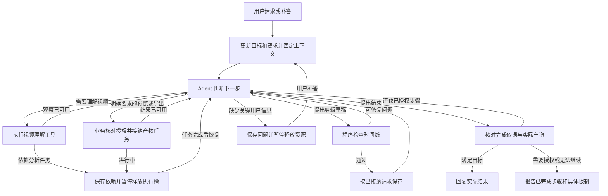

# 面向用户目标的视频 Agent 与统一剪辑时间线设计草案

日期：2026-10-14。状态：讨论用设计，尚未实施本草案的改造，不替换现有已确认需求或 ADR。代码审查提交：`e65954da804b5ceab66e0d7e0be3493000847b30`。本次仅整理设计并核对代码，未运行模型或业务验收。

本草案将此前关于视频理解、通用时间线、Agent 工具与完成判断的讨论落为可评审设计。视频理解的具体实现与评测见 [百炼视频理解设计草案](bailian-video-understanding-design.md)；已有产品规则见 [统一自然语言流程](../natural-language-workflow-design.md)、[Agent 设计](../agent-design.md)和 [剪辑方案契约](../edit-plan-contract.md)。

视频理解阶段如何围绕信息缺口调用工具，以及与当前读取回执的适配，另见 [VideoAgent 研究与设计](videoagent-evaluation.md)。该补充沿用单主 Agent 和现有业务控制，不改变本草案的时间线与授权范围。

## 1. 产品目标与设计范围

**用户用自然语言说明想了解什么、想做出什么视频；Agent 利用视频内容记录选择和编排片段，程序把选择变成可验证、可播放的结果。**

交互围绕用户目标推进：理解需求 → 获取内容 → 选择行动 → 根据反馈调整 → 核对实际结果。关键意图无法确定时追问，依赖任务执行时自动等待，达到授权范围内的完成条件后回复。无需每次先生成长计划，也不要求用户选择“讲话／混剪”模式或理解内部协议。

保留 LangGraph、单个主要 Agent、Spring 业务模块、Python 分析模块和 Java 媒体 Worker。文本推理选用 DeepSeek Flash，沿用现有 DeepSeek 对话适配；ASR、VLM 和文本 Embedding 使用阿里云百炼的对应模型。媒体提取与渲染使用本地确定性程序，各提供方协议由模型适配层处理。

首轮改善接口和执行循环；通用长时间线、任意素材交错或回放等能力分阶段扩展。文档中的结构支持表达某种任务，不代表当前校验器、渲染器和容量已经支持该任务。

## 2. 当前实现与问题定位

| 方面 | 已有基础 | 本草案建议的改造 |
| --- | --- | --- |
| 自然语言入口 | 已有制作请求接纳、澄清、讲话生成、混剪及生产命令工具；实施记录包含 #34–#38 | 围绕统一目标组织工具反馈，减少由模式决定的分散交互 |
| 视频理解 | 混合检索、邻近证据读取、语音词时间、稀疏画面观察及独立复查模块 | 增加全片浏览、时间范围阅读与对话内定向补查 |
| 时间线 | 已有不可变版本、结构化片段、原文字幕映射和 FFmpeg 渲染 | 统一模型可见的草稿接口，分离任务策略与通用正确性约束 |
| 局部修改 | 已有 REPLACE/COMPACT，目标外片段由程序复制 | 保留实现，减少模型重新描述未改内容 |
| Agent 图 | 已有 model/tools/self_check/validate 和持久 checkpoint | 保存或任务启动后返回主循环，核对用户目标，按需等待依赖 |
| 控制与恢复 | 已有范围、租约、回执、取消、失败恢复及版本授权 | 保持业务强制执行，避免分支或子任务重置预算 |

当前 `conversation.py` 在候选自检、校验通过后进入结束路径；这适合“生成方案”，但不足以作为所有任务的完成判断。不能通过增加更多结束工具解决，需要明确本轮目标产物与各步骤结果。

当前 `EditPlanValidation` 和 `PlanModificationValidation` 仍包含最多 10 段、讲话单素材、混剪顺序不能交错、原素材区间不能重叠以及硬时长等规则。生成校验还含每片段证据数量、字幕观察数量等上限；长视频能力不能只修改片段数上限。

来源：[conversation.py](../../agent-service/agent_service/conversation.py)、[EditPlanValidation.java](../../backend/business-api/src/main/java/com/agenticvideo/business/plan/EditPlanValidation.java)、[PlanModificationValidation.java](../../backend/business-api/src/main/java/com/agenticvideo/business/plan/PlanModificationValidation.java)、[实施状态](../implementation-status.md)。部分设计文档页首仍写“待实施”，应结合后续实施记录与代码判断，不能据页首认定全部能力不存在。

## 3. 对用户和 Agent 使用直观术语

| 当前术语 | 实际含义 | 建议展示名称 |
| --- | --- | --- |
| 制作简报 | 记住用户的主题、时长、素材、画幅等要求 | 剪辑要求 |
| 候选方案 | 尚未核查或保存的片段编排 | 剪辑草稿 |
| 编辑方案 | 用于执行的片段顺序及各段范围 | 剪辑时间线 |
| 方案版本 | 一次已保存的完整编排 | 时间线版本 |
| 证据 | 带时间和来源的转写、画面观察或可见文字 | 视频内容记录；开发层可继续称证据 |

这些是展示与模型接口的建议用词，暂不迁移数据库名称或修改 [领域术语](../../GLOSSARY.md)。业务中的方案仍可包含多个输出；“时间线”指一个输出的片段编排，不能因改名丢失已设计的多输出结构。

用户回复应表达实际动作与结果，例如：“选了三段，共 42 秒，依次是问题介绍、操作和结论。时间线已保存，可请求预览。”有预览产物时展示播放入口；仅保存时间线时不宣称视频已经生成。

## 4. 集中职责，缩小 Agent 的 Interface

| 模块 | 负责的决定与实现 | Agent 需要知道什么 |
| --- | --- | --- |
| 对话与目标 | 理解目标、指代、硬要求、偏好、默认值和必要澄清 | 用户要什么、当前还缺什么 |
| 视频理解 | 浏览、混合检索、范围阅读、定向观察、来源和覆盖 | 去哪里找、读到了什么、哪些信息缺失 |
| 时间线 | 计算时长、范围与字幕校验、局部合并、版本追加 | 当前编排、草稿的问题、保存结果 |
| 产物执行 | 预览/导出、固定版本绑定、任务状态、可播放产物 | 请求是否已接纳、是否完成、实际结果 |
| 业务控制 | 项目权限、范围、预算、对象身份、编辑占用、授权、取消和发布资格 | 当前允许做什么、停止原因 |

保持既有部署，不为上述职责新建五个部署单元。方案分配、版本身份生成、回执身份、字幕映射及提供方协议集中在工具实现中。Agent 可以选择和修正内容，但不能自行创造权限或任务状态。

## 5. 用户目标、要求与执行状态

业务保存的需求记录是可信来源；LangGraph 状态只是运行快照，两者职责继续分开。建议用下列对象替代散布在多个布尔开关中的业务含义，实际字段在实施时校准：

```text
goal              用户要了解或得到的结果、原消息与需求身份
requirements      硬要求、偏好、已说明默认值及各自来源
observations      已取得记录的引用、读取回执与覆盖，不存无界全片内容
timeline          当前草稿、固定修改基准及已保存版本引用
next_actions      复杂任务的简短待办，允许调整
waiting           用户补答、依赖任务或授权等待；绑定实际对象
artifacts         保存版本、预览/导出任务及有效产物引用
execution         业务注入的素材范围、租约、预算和取消状态
```

要求处理：

- “必须 60 秒”是硬要求；“大约一分钟”是偏好。近似要求如何转换为校验范围应显式定义，不把它静默改成精确 60 秒。现有已保存硬范围继续有效。
- 新消息只修改提到的条件；明确新需求不继承旧主题或禁用内容，沿用既有需求隔离规则。
- 可使用素材范围、必须参与素材、禁止素材和顺序条件分别表达。“可用 A/B/C”不意味着三份都必须使用。
- 目标解析采用用户明确引用、发送时查看对象及既有回退规则。名称或版本存在歧义时追问，执行后查看切换不改变对象。
- 用户修改硬条件后，业务建立新的条件修订并校验后续草稿；模型不能自己降低要求以通过检查。

执行待办只描述接下来要做的事，不是业务时间线，不为每次检索或待办调整追加版本。保存简短动作与结果说明，不要求输出或保存模型私有思维链。

## 6. 视频理解 Interface

| 建议接口 | 用途 | 必须保留的信息 |
| --- | --- | --- |
| `list_assets()` | 了解当前固定范围内素材 | 实际身份、时长、音轨、分析状态 |
| `get_video_overview(assetId, cursor)` | 浏览全片内容分布 | 可展开目录、原始引用、分页与覆盖 |
| `search_evidence(query, sourceKinds, ...)` | 定位主题、原句、画面或文字 | 命中来源、素材、时间、索引状态 |
| `read_video_range(assetId, startMs, endMs, cursor)` | 核查连续上下文与选择范围 | 转写、词时间、帧时刻、来源、缺失与截断状态 |
| `inspect_video_range(assetId, startMs, endMs, question)` | 针对问题补充视觉观察 | 新观察或依赖任务、输入帧引用、采样覆盖、用量 |

复用现有 `list_assets/search_evidence`，旧 `read_evidence_context` 可作为兼容入口。目录用于导航；原始观察用于支持结论。语音提及不证明画面出现，单帧不证明持续区间，检索未命中不证明全片不存在。

全片亮点任务必须浏览足够完整的内容分布，不能只取第一个关键词命中。没有候选时检查分析状态、改写或浏览；纯视觉目标可能需要预算内更广采样，不假装局部补查解决了全片发现。具体数据表示、百炼调用、缓存和消融评测见 [视频理解草案](bailian-video-understanding-design.md)。

## 7. 用统一时间线表达剪辑

长视频选段、多素材编排、完整拼接和替换片段，都可表示为同一输出的有序源区间。以下是目标结构示意，不代表当前已经支持 A→B→A：

```text
输出时间线
  1. 视频 A：00:15–00:32
  2. 视频 B：02:10–02:45
  3. 视频 A：04:00–04:20
```

初版生成草稿提交完整有序列表，只包含模型需要决定的内容：

```json
{
  "title": "示例教程",
  "clips": [
    {
      "assetId": "工具返回的实际素材身份",
      "sourceInMs": 15000,
      "sourceOutMs": 32000,
      "evidenceIds": ["已读取的视频内容记录身份"],
      "reason": "保留完整的问题介绍"
    }
  ]
}
```

字段中的身份仅为示意；正式输入使用实际业务标识。程序生成输出/片段身份、计算总时长、映射字幕与渲染配置。首期仍为硬切和已有画幅规格，不因统一时间线就开放自定义 FFmpeg 脚本或任意转场。

局部修改保留现有做法：按完整成片顺序引用未改片段的 `clipId`，只提交目标范围的新内容；程序复制目标外片段，重新映射后续字幕，追加完整新版本。不得将已实现的局部修改回退为要求模型重写所有内容。

### 正确性约束与任务策略分开

| 始终由程序校验 | 根据用户要求或已说明策略决定 |
| --- | --- |
| 素材属于有效项目与固定范围 | 必须使用哪些素材、是否必须按 A/B/C 顺序 |
| 原视频时间范围合法且单位明确 | 是否允许交错素材、回到 A、重复片段 |
| 固定基准、编辑占用与发布资格有效 | 短视频或长视频、叙事与去重策略 |
| 字幕原文及时间映射、输出规格正确 | 严格时长或近似偏好 |
| 标识与数据量合法、资源容量可承担 | 是否要求语义选段、完整原片拼接 |

片段上限、字幕数量和输入大小仍需受控，但按容量定义，不能视为视频编辑的通用语义。用户明确要求回放时重复是内容策略，默认去重不应在未来通用实现中永久禁止它；当前校验仍禁止重叠，须改造和验收后才能开放。

### 内容依据与操作依据匹配

“选出表达某观点的片段”需要原始内容依据；“把 A 完整接到 B 后”主要需要用户指令、素材身份和合法范围。后者不必先为每一秒检索语义证据。

当前所有生成片段要求非空已读证据，不能简单让模型提交空引用绕过。完整拼接需新增由业务确认的操作依据，结合已接纳请求判定适用性；语义理由仍要求内容记录。若用户要求字幕，保留原文来源与时间映射规则，长字幕需有界处理；无字幕需求不应被迫运行全片语义选择。对应协议在实施时细化。

## 8. 剪辑与产物工具的具体契约

以下是目标 Interface，不是新增工具已可用：

| 接口 | 返回结果 | 实现要求 |
| --- | --- | --- |
| `get_timeline()` | 固定基准、成片、片段、要求和能力限制 | 默认对象来自已接纳请求；不随查看状态变化 |
| `check_timeline(draft)` | `valid`、问题列表、计算时长和受影响范围 | 校验反馈用于修正，不追加正式版本 |
| `save_timeline(draft, expected_revision)` | 已保存版本、成片身份、时长及变更说明 | 再次校验，检查编辑权，幂等追加版本 |
| `request_preview()` | 绑定实际版本的任务或可复用产物 | 必须已有用户明确预览请求；对象由业务固定 |
| `get_task_status(taskId)` | 实际任务状态、有效产物及失败原因 | 限于已授权任务；检查产物是否仍可用 |
| `confirm_revision()` / `request_export()` | 具体版本确认记录或正式渲染任务 | 保留明确确认与另行导出指令；模型不能代替用户确认 |

模型提出草稿即可；草稿登记、必经校验和保存可由图节点组织，不要求模型为每一步都学习一个新的协议工具。工具实际暴露集按需求及授权动态限定。`propose_candidate_window` 可以保留在内部作为完整语句范围辅助，逐步减少其模型可见的特殊规则。

校验问题建议包含 `code/clipIndex/field/message` 及必要实际值，例如总时长 42 秒、要求至少 60 秒；不可仅返回“失败”。具体错误包括来源范围不符、证据未读取、截词、顺序冲突、目标外变化、资源上限与基准冲突。语义质量反馈与确定性错误分开，不让程序宣称已经证明观点完整或审美优秀。

`check_timeline` 通过不形成保存凭证。`save_timeline` 在当前任务与版本上下文中重新校验，并以业务事务提交。时间线版本不可原地覆盖；同一个保存动作重试复用结果，不重复追加版本。

`expected_revision` 指请求固定的修改基准，不强制等于最新历史版本。允许从 V1 创建后来的 V4；实际竞争检查另由业务占用及可信执行基准控制。若基准、编辑权或对象发生冲突，报告冲突，不自动换成最新版本重新生成。新建时间线的业务身份也由后端分配。

## 9. LangGraph 的主循环与等待

保留一个主要 Agent。模型决定下一步内容动作，程序执行分析、校验、保存和渲染的固定步骤。检索、阅读和反馈修正构成受限 ReAct；复杂需求可维护轻量待办。一次校验成功只完成某一步，应返回主循环判断后续明确步骤。



所有路由受到预算、取消、租约和调用上限约束。无新有效信息或重复同一失败不能无限循环；硬条件无法同时满足时停止并说明冲突。

三种等待分别保存：

- **用户补答**：绑定问题、需求和原消息；恢复沿用原条件，明确新需求按既有规则另建记录。
- **依赖任务**：绑定分析/渲染任务与固定版本，完成事件恢复，无需用户再发送一句“继续”。当前单执行槽在对话活跃时不领取分析任务，不能原地轮询等待同槽补查。
- **用户授权**：记录已经完成和未授权步骤，按现有产品流程取得授权；不能把超时当成批准。

暂停释放执行资源；重新取得编辑权或恢复发布时再次核对基准、取消和任务有效性。不要为等待长渲染一直持有同一执行槽，也不通过增加无界轮询次数实现主循环。

## 10. 复杂任务的选择策略

### 长视频选亮点

1. 浏览完整内容结构，并说明实际语音/视觉覆盖。
2. 根据主题寻找多个可能片段，阅读各自铺垫、观点和结论。
3. 比较主题相关性、独立完整性、信息量、重复内容与时长适配。
4. 选择并编排；有明确视觉条件时核查画面，信息不足才补查。
5. 自检语义，再做程序校验、有限修正和保存；需要预览时继续。

用户未说明标准时可声明按“观点完整、信息集中、重复较少”选择；标准差异明显影响结果且无法推断时追问。不以模型打出的分数作为客观亮点证明，也不称“全片最精彩”而没有全片浏览依据。

### 多视频组合成教程

浏览各素材结构 → 按用户目标安排步骤 → 识别重复与缺口 → 核查连接处上下文 → 构建时间线 → 校验与保存。用户指定顺序就遵守；未指定时可提出并解释内容顺序，不把旧混剪模式的固定顺序限制误当用户意图。

完整拼接使用用户指定素材和顺序直接建立区间；语义整理任务才主动删重复或重排。不得将“完整拼接”擅自变成内容摘要。

### 替换或精简

固定基准和允许修改片段 → 阅读目标及衔接上下文 → 寻找替代或删除重复 → 由程序复制目标外内容 → 检查完整输出时长与字幕 → 追加版本。保留既有 REPLACE/COMPACT 正确性规则；无法满足原硬条件时解释，不改用初始生成覆盖整份结果。

## 11. 完成声明对应真实结果

| 用户目标 | 完成依据 | 不足时的表达 |
| --- | --- | --- |
| 回答内容问题 | 已访问的正确来源支持答案，时间与覆盖明确 | 无依据或覆盖不足不能编造 |
| 找亮点/推荐片段 | 给出可定位、可播放的源片段和理由 | 不把推荐称为已渲染成片 |
| 只生成或修改剪辑方案 | 保存有效不可变版本，要求已校验 | 校验通过但未保存不称完成 |
| 生成预览 | 实际版本绑定的任务成功且预览产物有效 | 已接纳或运行中仅报告进度 |
| 导出最终视频 | 具体版本已确认、导出指令有效、渲染成功且产物可用 | 失败、待确认或待导出都未完成 |
| “帮我剪成一个视频” | 用户最终目标需要可播放结果 | 当前授权只到时间线时报告阶段结果及后续步骤，不称整项已完成 |

完成核对使用业务事实：保存回执、版本/输出身份、任务终态、产物有效性及已检查要求。模型不能自行填写 `SUCCEEDED` 或制造下载地址。文件存在不等于内容符合主题；语义检查、程序检查与播放验收分别保留。

**当前已确认授权规则继续执行：仅制作不自动预览，预览须明确请求；正式导出需要具体版本确认及另行明确导出指令，新版本不继承旧确认。** “做完就导出”不能自动确认尚不存在的未来版本。

目标主循环改善步骤衔接与诚实回复，不改变上述授权。若未来希望明确制作请求默认生成预览，需要另行决定产品行为并修改业务规则；本草案仅记录这一选择，不实施或视为已经授权。

## 12. 必须保留的治理与恢复

- 权限与来源：后端注入项目/用户/固定范围，模型只能引用工具返回的合法对象；素材内容中的指令不能扩大执行权限。
- 预算：模型、工具、候选修正、输入量和耗时有界；补查额度关联需求，跨消息/任务/恢复累计，不以创建子任务绕过。金额估算与实际计费区分。
- 副作用：保存、预览、确认和导出关联实际请求及幂等身份；恢复优先读取结果，不重新生成身份和再提交。提供方回执不明确时沿用停止自动重付的规则。
- 并发与版本：保留同会话串行、编辑占用、固定修改基准和发布资格；当前查看只影响下次请求，不能影响已经接纳的动作。
- 取消：取消后禁止新提交和迟到发布；恢复先检查任务有效性。旧确认不授权新版本。
- 数据量：长视频仍使用分页、有界返回与短上下文，不能把全片转写、全部帧和全部历史塞入每轮提示。
- 状态分工：业务记录负责事实与版本，checkpoint 负责运行恢复；公开状态由业务发布，不把私有推理或模型自评当完成记录。

## 13. 分阶段改造与验收

| 阶段 | 交付内容 | 验收依据 |
| --- | --- | --- |
| 1. 统一概念与状态 | 对用户使用直观名称；目标、要求、时间线、产物、等待明确分开；统一工具错误与完成检查 | 查询不创建版本；制作、预览和导出的回复与实际状态一致；新需求不混用旧条件 |
| 2. 补齐信息访问与接口 | 概览、范围阅读、定向补查；统一草稿检查/保存；保留已有局部修改 | 亮点不止选择第一个命中；未改片段由程序保留；补查预算与暂停恢复有效 |
| 3. 改善选择及任务衔接 | 亮点比较、全片步骤浏览、连接处检查；明确连续步骤由实际回执推进 | 同一输入完成用户明确请求的生成→预览；等待自动恢复；失败不称完成 |
| 后续能力扩展 | 根据样本与容量逐步开放长时间线、素材交错、回放、完整拼接、多输出 | 字幕、重复区间策略、渲染、内存/数据量及授权均有实际验收，不只修改模式字段 |

验证复用已有真实 HTTP/数据库/媒体/浏览器验收，按变更增加有意义的检查，不以模拟模型回包证明语义效果。固定人工标注素材对比改造前后：主题命中、观点完整、重复率、全片遗漏、修改目标外稳定性、成本和延迟。

最小验收场景：

1. 内容查询返回依据，不创建时间线或占用编辑权。
2. 亮点任务浏览全片并比较多个片段，选取理由能回到原视频核查。
3. “按 A/B/C 完整拼接”不擅自删内容；未支持时明确限制。
4. 定向替换或精简只改变允许范围，其他片段和输出保留。
5. 明确生成→预览绑定实际新版本；生成成功但预览失败报告分步状态。
6. 补查、渲染依赖释放执行槽并恢复；没有依赖任务完成就不伪造产物。
7. 取消、回执不明确、超预算、版本竞争和重试不产生重复或迟到结果。
8. 未确认版本不能导出；确认后生成的新版本不继承确认。
9. 长时间线扩展时验证范围、字幕映射、输出实际时长和可播放性；数据量超限可解释停止。

## 14. 后续需要决定的产品问题

以下不阻塞本设计落盘，但实施对应能力前须确定；未决定期间沿用现有规则：

| 问题 | 草案建议 | 当前处理 |
| --- | --- | --- |
| 通用制作请求是否默认生成可播放预览 | 可作为后续体验选择；明确告知用户结果级别 | 仍只在明确预览请求下执行 |
| 长时间线容量与支持范围 | 用真实字幕/媒体样本确定配置；保留有界请求 | 当前 10 段等上限不因本文取消 |
| 素材交错、重复或回放 | 作为用户要求或明确默认策略，而非永久模式限制 | 当前校验器规则继续有效 |
| 完整拼接的操作依据与字幕 | 引用已接纳用户请求；字幕按明确要求与能力生成 | 新契约尚未实施，不绕过现有证据要求 |
| 近似时长的允许范围 | 区分偏好、默认与硬要求，显示实际偏差 | 已保存硬条件不静默放宽 |

本草案的核心改造是：让 Agent 学习“看视频、选片段、排时间线、检查结果”，由工具实现集中处理业务身份、校验、授权、预算和恢复。结果以真实保存版本和可用产物判定，而不是以某个工具已调用或模型说“完成”判定。
