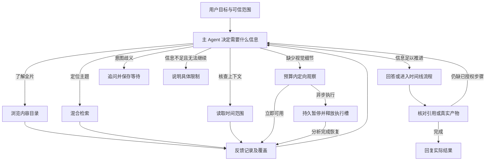

# VideoAgent 上游实现研究与本项目设计评估

研究日期：2026-10-14（Asia/Shanghai）。研究对象为 Yue Fan 等的 [VideoAgent: A Memory-augmented Multimodal Agent for Video Understanding，arXiv:2403.11481v2](https://arxiv.org/abs/2403.11481v2)，ECCV 2024；官方仓库为 [YueFan1014/VideoAgent](https://github.com/YueFan1014/VideoAgent)。它不是同名的其他 VideoAgent 研究。

审查提交：[42e1b70d947d4ae6ee627a3e9dda4898844e97b1](https://github.com/YueFan1014/VideoAgent/tree/42e1b70d947d4ae6ee627a3e9dda4898844e97b1)，提交日期 2024-12-05。仅阅读论文、官方代码与锁定依赖的官方源码；未安装依赖、下载权重、调用付费模型或运行基准。下文标明论文陈述、源码观察、工作量推算及设计判断。

本项目代码基准：`e65954da804b5ceab66e0d7e0be3493000847b30`。第 1–8 节记录上游研究，第 9–16 节为使用 DeepSeek Flash 文本推理、百炼 ASR/VLM/Embedding 和 LangGraph 的借鉴设计，尚未实施或验证实际效果，不替换现有已确认需求及 ADR。

## 1. 研究结论

**借鉴“统一的时间内容记忆＋少量领域工具＋根据缺失信息主动观察”的结构，不照搬对象追踪、SQL 子 Agent 或固定两秒全片分析。** 它与当前项目的目标驱动 Agent 和视频内容访问接口相容，主要启发是如何组织信息、让 Agent 主动获得信息，不要求自行部署论文模型。

VideoAgent 论文的设计原则本身是工具集合尽量少、能够覆盖任务。其四类能力分别为读取时间范围内的描述、根据文本定位片段、针对片段做视觉问答、查询对象出现信息。LLM 根据工具反馈选择下一步，而不是执行一条每问必走的检索流水线。[论文 §2.4](https://arxiv.org/html/2403.11481v2#S2.SS4)

对本项目的判断：优先完善时间记录、完整内容浏览、范围阅读和定向补查；对象是否出现可以从带来源的画面观察中检索，但这不等于已经实现同一对象的跨时间追踪与去重计数。对象实例记忆需要另行验证实际需求和身份识别能力。

## 2. 记忆如何构建

### 2.1 时间记忆：事件描述与两类向量

**论文陈述／源码观察：** 全片按约两秒分段。LaViLa 每段读取四帧生成事件描述；ViCLIP 每段读取十帧生成视觉向量；事件描述由 text-embedding-3-large 编码。源码按顺序保存 `captions.json`、`segment2id.json` 及两个 embedding pickle 文件，没有独立的证据引用、分析代次或可重建索引协议。[captioning.py](https://github.com/YueFan1014/VideoAgent/blob/42e1b70d947d4ae6ee627a3e9dda4898844e97b1/captioning.py#L21)、[segment_feature.py](https://github.com/YueFan1014/VideoAgent/blob/42e1b70d947d4ae6ee627a3e9dda4898844e97b1/segment_feature.py#L18)

源码生成五个候选 caption，选择字符串最长者；这不是程序对准确性的判断。caption 主要描述可见动作和主要对象，没有 ASR、可见文字的独立输入通道。因此它可以启发本项目的时间组织方式，不能直接替代项目已有的语音与文字记录。[captioning.py:103–125](https://github.com/YueFan1014/VideoAgent/blob/42e1b70d947d4ae6ee627a3e9dda4898844e97b1/captioning.py#L103)

时间映射按 `round(fps)` 和整数帧编号计算；段数向下取整，末尾不足两秒的帧不生成时间 caption。VQA 按 `segment_id * 2` 推时间，没有保存实际 PTS。它适合粗粒度定位，不能据此承诺帧准确切点或可变帧率素材的精确映射。[captioning.py:68–75](https://github.com/YueFan1014/VideoAgent/blob/42e1b70d947d4ae6ee627a3e9dda4898844e97b1/captioning.py#L68)、[tools.py:102–118](https://github.com/YueFan1014/VideoAgent/blob/42e1b70d947d4ae6ee627a3e9dda4898844e97b1/tools.py#L102)

### 2.2 对象记忆：稳定实例身份与出现关系

**源码观察：** RT-DETR 检测＋ByteTrack 追踪产生 tracking ID、类别和 bounding box。对每个 tracking ID 的出现帧采样裁剪，用 CLIP 与 DINOv2 编码，再按相似性和不能在同一帧共存的约束合并 tracking ID 为 object ID。出现关系进入 SQLite 三张表：

```text
Objects(object_id, category)
Segments(segment_id)
Objects_Segments(object_id, segment_id)
```

对象的 CLIP 平均向量另存在 pickle 中，用于“红杯子”等开放词汇描述匹配已发现的对象。[tracking.py](https://github.com/YueFan1014/VideoAgent/blob/42e1b70d947d4ae6ee627a3e9dda4898844e97b1/tracking.py#L105)、[reid.py](https://github.com/YueFan1014/VideoAgent/blob/42e1b70d947d4ae6ee627a3e9dda4898844e97b1/reid.py#L23)、[database.py](https://github.com/YueFan1014/VideoAgent/blob/42e1b70d947d4ae6ee627a3e9dda4898844e97b1/database.py#L47)

开放词汇检索不会让检测器发现任何类别：当前检测类别表固定为 80 类；检索只是与已有 track/object 的向量比较，阈值为 0.26。物体漏检、追踪断裂、相似外观误合并仍会影响存在判断与计数。SQL 可以精确数出表中的 ID，但不能证明表中的 ID 就是真实世界正确去重后的数量。[固定类别表](https://github.com/YueFan1014/VideoAgent/blob/42e1b70d947d4ae6ee627a3e9dda4898844e97b1/tracking.py#L21)、[开放词汇匹配](https://github.com/YueFan1014/VideoAgent/blob/42e1b70d947d4ae6ee627a3e9dda4898844e97b1/database.py#L106)

**设计判断：** 两次观察都写“红杯子”，不足以证明是同一个杯子；文字标签不能冒充对象身份。当前课程、访谈、屏幕演示的主需求，优先使用时间和来源关联观察；暂不增加常驻追踪系统。将来若“同一人何时再次出现”“不同物体总数”成为稳定需求，再为身份确认增加明确的能力边界及评测。

## 3. 实际工具契约

主 Agent 通过文本 ReAct 调用四个工具，返回自然语言／字典字符串。两参数工具解析一个 tuple 字符串；不是原生结构化 function calling。[main.py:24–100](https://github.com/YueFan1014/VideoAgent/blob/42e1b70d947d4ae6ee627a3e9dda4898844e97b1/main.py#L24)

| 主工具 | 实际参数与行为 | 对本项目的启发与限制 |
|---|---|---|
| `caption_retrieval(input_tuple)` | `(start_segment_ID, end_segment_ID)`，两端包含；裁剪到合法段号，返回描述字典与总段数 | 对应范围阅读；“最多 15 段”仅在说明中，代码未执行数量限制 |
| `segment_localization(description)` | 原描述编码，`18 × visual_similarity + 11 × caption_similarity`，返回 top-5 段号及 caption | 对应内容定位；权重源自特定数据调优，不应移植到新的模型空间 |
| `visual_question_answering(input_tuple)` | `(question, segment_ID)`，检查目标及相邻各一段，通常约六秒 | 对应问题导向补查；输出描述与答案，没有可验证的逐项来源标注 |
| `object_memory_querying(question)` | 内部重新建立两工具 SQL ReAct Agent，回答对象相关问题 | 对象记录的关系查询有用；内部多轮推理与任意 SQL 不是本项目必需 |

工具实现见 [tools.py](https://github.com/YueFan1014/VideoAgent/blob/42e1b70d947d4ae6ee627a3e9dda4898844e97b1/tools.py#L67)。SQL 子 Agent 的工具实际名为：

- `database_querying(program)`：直接运行 SQL，返回行或 SQLite 错误。
- `open_vocabulary_object_retrieval(description)`：返回与描述匹配的候选 object ID。

论文附录称后者为 `open_vocabulary_retrieval`，提示词还引用了另一个拼写不一致的工具名；设计时应以执行注册名和参数 schema 为契约。[main.py:26–45](https://github.com/YueFan1014/VideoAgent/blob/42e1b70d947d4ae6ee627a3e9dda4898844e97b1/main.py#L26)、[database_query_prompt.txt](https://github.com/YueFan1014/VideoAgent/blob/42e1b70d947d4ae6ee627a3e9dda4898844e97b1/prompts/database_query_prompt.txt)

### VQA 两条路径与新观察的生命周期

`videollava` 路径：按目标±1 段裁剪 MP4，通过 UNIX socket 交给另一个本地模型进程。该进程分别生成通用描述和当前问题的回答，即一次工具调用有两次模型生成。`gpt-4v` 路径：取四张顺序帧，一次云模型请求同时要求描述和回答。[tools.py:102–217](https://github.com/YueFan1014/VideoAgent/blob/42e1b70d947d4ae6ee627a3e9dda4898844e97b1/tools.py#L102)、[video-llava.py:39–76](https://github.com/YueFan1014/VideoAgent/blob/42e1b70d947d4ae6ee627a3e9dda4898844e97b1/video-llava.py#L39)

**源码观察：VQA 新回答没有写回长期 memory。** 它进入当前 Agent 的 intermediate steps；临时视频、图片和传输 pickle 可能留存，但不更新 caption、向量或对象库，也没有按问题缓存 VQA 结果。下文若建议“补查结果保存、可重复检索及复用”，这是本项目的增强设计，不是论文既有实现。

源码缓存片段依赖段号文件名；帧位置依赖四舍五入 fps；同一问题再次调用仍会运行 VQA。多帧只证明输入观察点，不保证看到了帧间所有动作。项目应使用实际时间和输入清单，并返回“无法确认”与未观察范围。

## 4. Agent 循环、停止与治理

**论文陈述：** 历史从问题开始；LLM 选择工具和参数；执行结果加入历史；直到 LLM stop 或 MAX_STEP；然后产生回答。这个模式与 ReAct 的工具反馈循环一致。[论文 Algorithm 2](https://arxiv.org/html/2403.11481v2#S2.SS3)

**源码观察：** 主和 SQL 子 Agent 均使用 LangChain `create_react_agent`＋`AgentExecutor`；提示格式为动作、输入、观察及最终答案。工具集合固定，没有任意 Python 或 shell 工具。`ast.literal_eval` 用于 tuple 字符串解析，不是执行 Python 代码。[main.py](https://github.com/YueFan1014/VideoAgent/blob/42e1b70d947d4ae6ee627a3e9dda4898844e97b1/main.py#L68)、[prompt.txt](https://github.com/YueFan1014/VideoAgent/blob/42e1b70d947d4ae6ee627a3e9dda4898844e97b1/prompts/prompt.txt)

两个入口均未向 AgentExecutor 传入 `max_iterations`、`max_execution_time`。锁定依赖 LangChain 0.1.2 默认 `max_iterations=15`、`max_execution_time=None`、`early_stopping_method="force"`；正常由模型 final answer 终止，达到上限返回固定停止信息，未必还有论文 Algorithm 2 所描述的独立最终回答调用。主循环与每次 SQL 子循环各自计数，没有一个跨两层的总调用预算。[依赖锁定](https://github.com/YueFan1014/VideoAgent/blob/42e1b70d947d4ae6ee627a3e9dda4898844e97b1/environment.yaml#L78)、[该版本 AgentExecutor 默认值](https://github.com/langchain-ai/langchain/blob/v0.1.2/libs/langchain/langchain/agents/agent.py#L829)

SQL 连接是普通 `sqlite3.connect('database.db')`，`cursor.execute(program)` 无 SELECT 白名单、只读权限、行数限制或查询超时。Python SQLite 的 execute 只接收单条语句，不等于任意代码执行；但单条 DDL/PRAGMA 等仍不能按只读查询治理。函数没有显式 commit/close，也不能因此把它视为可靠的只读接口。每次 DataBase 构造还会删除、重建当前工作目录下同一个 `database.db`，不具备多素材／多会话隔离。[database.py:43–45](https://github.com/YueFan1014/VideoAgent/blob/42e1b70d947d4ae6ee627a3e9dda4898844e97b1/database.py#L43)、[query_database](https://github.com/YueFan1014/VideoAgent/blob/42e1b70d947d4ae6ee627a3e9dda4898844e97b1/database.py#L116)

代码从捕获 stdout 中解析 final answer，而不直接消费 AgentExecutor 的结构化结果；示例的 socket、`tmp/content.pkl` 也是共享单槽。没有用户身份、权限范围、租约、取消、持久化恢复和跨重试费用累计协议。它是研究演示的取舍，不能替代当前项目已有治理。[main.py:99–123](https://github.com/YueFan1014/VideoAgent/blob/42e1b70d947d4ae6ee627a3e9dda4898844e97b1/main.py#L99)、[video-llava.py](https://github.com/YueFan1014/VideoAgent/blob/42e1b70d947d4ae6ee627a3e9dda4898844e97b1/video-llava.py#L21)

提示词在信息不足时要求尽力猜测，并提醒 VQA 可能幻觉；这适合必须选择一个选项的研究评测，不适合将所有猜测当作视频事实。当前产品应允许依据不足、观察失败和需要用户补充，并由业务程序检查引用身份／产物状态；这些程序检查仍不能自动证明语义正确。[自由问答提示](https://github.com/YueFan1014/VideoAgent/blob/42e1b70d947d4ae6ee627a3e9dda4898844e97b1/prompts/prompt.txt)、[选择题提示](https://github.com/YueFan1014/VideoAgent/blob/42e1b70d947d4ae6ee627a3e9dda4898844e97b1/prompts/multiple_choice_prompt.txt)

## 5. 实验结果及能支持的结论

以下是作者报告的数据，不是本项目复测；相关基准多为英文、第一人称活动或通用动作理解，不涵盖中文 ASR/OCR、剪辑时间线和导出成功率。

| 任务 | 作者报告 | 应如何理解 |
|---|---|---|
| EgoSchema | 全部 5,031 问准确率 60.2%；500 问子集 62.8% | 支持长时活动问答；全量 Gemini 1.5 Pro 为 63.2%，不能概括为全面超越 |
| NExT-QA | 为控制费用抽取 600 问，准确率 70.8%；同子集 SeViLA 64.2% | 6.6 是百分点差；不能与不同 full-set 行直接比较 |
| WorldQA | 开放回答 32.53；选择题 39.28；GPT-4V 分别35.37/32.83 | 不同任务上优劣不同，不是所有问答都改善 |
| Ego4D NLQ | LaViLa＋ViCLIP 的 R1@IoU0.3 为11.13，R1@IoU0.5 为4.76 | 可以定位候选，尚不意味着具有可靠精确边界 |

来源：[论文 §3，Tables 1–5](https://arxiv.org/html/2403.11481v2#S3)。Ego4D 使用人工真实 narration 的分支有更高结果，但这不是自动 caption 可直接达到的效果。

### 消融对当前设计更有指导意义

作者从 NExT-QA 再取 150 问作消融，每种题型各50问：[论文 Table 6](https://arxiv.org/html/2403.11481v2#S3.SS4)。

| 组件 | 平均准确率 |
|---|---:|
| 仅时间 caption 阅读 | 40.7% |
| caption＋定位＋Video-LLaVA VQA，无对象库 | 62.7% |
| caption＋有 re-ID 对象库，无定位/VQA | 56.0% |
| caption＋无 re-ID 对象库，无定位/VQA | 48.7% |
| 全部组件，Video-LLaVA VQA | 71.3% |
| 全部组件，换 GPT-4V VQA | 74.7% |

**设计判断：** 这些结果支持“读取上下文、定位和补充视觉观察”是值得优先试验的组合，也表明对象身份识别对该基准有价值。它们没有分别隔离定位与 VQA 的贡献，不能宣称 VQA 单独提升22个百分点；也不能把全部差值搬成中文项目预期收益。百炼版本需要本项目的分项对照评测。

## 6. 离线与在线工作量

### 离线：不照搬两秒全量分析

**源码工作量推算：** 设视频长度为 D 秒，段数 N 约为 `floor(D / 2)`。每段一次 LaViLa caption（四帧，实际生成五个候选），一次 ViCLIP 编码（十帧），一个文本 embedding。所有 caption 一起交给 embedding API，并非 N 次 API 请求。对象追踪目标为 15 fps，实际使用 `ceil(video_fps / 15)` 间隔；每 track 采样最多五帧做 CLIP/DINOv2 编码，并做 re-ID 和回放编码。[captioning.py](https://github.com/YueFan1014/VideoAgent/blob/42e1b70d947d4ae6ee627a3e9dda4898844e97b1/captioning.py)、[segment_feature.py](https://github.com/YueFan1014/VideoAgent/blob/42e1b70d947d4ae6ee627a3e9dda4898844e97b1/segment_feature.py)、[主预处理参数](https://github.com/YueFan1014/VideoAgent/blob/42e1b70d947d4ae6ee627a3e9dda4898844e97b1/main.py#L153)

一小时视频约1,800个时间段、7,200张 caption 输入帧、18,000张视觉编码输入帧，追踪处理帧目标最多约54,000张（正常帧率下）。这些是不同模型阶段工作量，不能简单相加视为唯一图片数量或美元价格。即使 API 支持批处理，把这一粒度照搬为百炼全量多模态分析，也需要为大量输入和输出计费；本项目应先用已有 ASR＋基础视觉覆盖，再按具体问题增加观察。

本地 README 只声明在 Ubuntu 20.04＋RTX 4090 24 GB 测试；模型包含 LaViLa、ViCLIP、RT-DETR、CLIP、DINOv2 和独立 Video-LLaVA 进程，多处 `.cuda()`。不能原样视为纯云 API 方案。[README](https://github.com/YueFan1014/VideoAgent/blob/42e1b70d947d4ae6ee627a3e9dda4898844e97b1/README.md#prerequisites)

### 在线：按需调用，嵌套成本需要展开

若正常完成前主 Agent 执行 A 次动作，需要大致 A＋1 次主模型调用；每次对象查询额外运行独立 SQL Agent；每次定位增加查询 embedding＋本地 ViCLIP 文本编码；每次 VQA 增加两次本地生成或一次 GPT-4V 请求。上下文会随工具记录增长。这个结构能减少不必要的视觉观察，但不是一次主模型请求完成一问。

源码没有持久化 VQA 结果缓存；Toolkit 为每问构造并载入 ViCLIP、重建 SQLite；对象开放词汇匹配还会调用 CLIP 加载逻辑。论文、README 未提供可复核的每小时费用、每问 p50/p95 或上线容量数据；批评测代码打印每问墙钟时间，但本次没有运行，也没有从日志推导稳定 SLA。[Toolkit 构造](https://github.com/YueFan1014/VideoAgent/blob/42e1b70d947d4ae6ee627a3e9dda4898844e97b1/tools.py#L30)、[对象文本编码](https://github.com/YueFan1014/VideoAgent/blob/42e1b70d947d4ae6ee627a3e9dda4898844e97b1/encoder.py#L30)、[计时代码](https://github.com/YueFan1014/VideoAgent/blob/42e1b70d947d4ae6ee627a3e9dda4898844e97b1/inference.py#L185)

## 7. 论文与代码应区分的细节

| 项目 | 论文／接口说明 | 审查源码 |
|---|---|---|
| 主模型 | GPT-4 | demo.py→main.py 仍为 GPT-4；另一个 inference.py 为硬编码 Azure GPT-4o＋选择题提示 |
| 读 caption 上限 | 最多15段 | 文本说明存在，执行函数未限制数量 |
| 推理步数 | MAX_STEP | 依赖 LangChain 默认每个循环15轮，无跨主/子Agent共享预算 |
| DINOv2 相似性 | sigmoid 变换后加权 | reid.py 注释掉 sigmoid，使用原始余弦 |
| 每 track 特征采样 | 论文十帧 | Tracking 类默认十帧，但实际预处理传 sample_num=5 |
| SQL 方言 | 工具说明／prompt称MySQL | 实际SQLite |
| VQA补充记忆 | 算法将结果加入历史 | 没有写回长期caption/向量/对象记忆 |

来源：[入口差异](https://github.com/YueFan1014/VideoAgent/blob/42e1b70d947d4ae6ee627a3e9dda4898844e97b1/inference.py)、[demo.py](https://github.com/YueFan1014/VideoAgent/blob/42e1b70d947d4ae6ee627a3e9dda4898844e97b1/demo.py#L3)、[reid.py:53–67](https://github.com/YueFan1014/VideoAgent/blob/42e1b70d947d4ae6ee627a3e9dda4898844e97b1/reid.py#L53)、[main.py:160–167](https://github.com/YueFan1014/VideoAgent/blob/42e1b70d947d4ae6ee627a3e9dda4898844e97b1/main.py#L160)。不能声称当前默认源码与论文结果已经精确等价复现。

## 8. 可借鉴与应暂缓的内容

| 思路 | 判断 | 本项目落实方式 |
|---|---|---|
| 统一时间记忆 | 采用 | 以素材、真实时间、来源和分析版本关联转写／画面／文字 |
| 时间范围阅读与内容定位分开 | 采用 | 搜索定位候选，再读取连续上下文；全片任务浏览目录 |
| 按问题重新观察原视频 | 优先采用 | 百炼 VLM 接收检查目标与有序帧，返回带来源的新观察 |
| 少量工具的反馈循环 | 采用 | 单个 LangGraph 主循环；模型决定下一步，业务程序执行范围和预算限制 |
| VQA观察保存与复用 | 本项目新增 | 区分原始输入、观察和推断；缓存绑定素材、实际帧、模型与观察目标 |
| 全视频两秒分析 | 暂缓 | 只在覆盖失败的任务上做更密采样，依据费用和召回评测调整 |
| 实例追踪与re-ID | 暂缓 | 先验证跨时间身份／去重计数是否是主要需求，普通标签不代替身份 |
| 主Agent嵌套SQL Agent | 暂不采用 | 用受控类型化查询隐藏SQL、存储结构和权限细节 |
| ViCLIP视觉检索与固定权重 | 暂缓 | 先改善中文文本记录和混合检索；出现具体视觉召回缺口再独立试验 |

这是对工程适用性的判断，不是论文已经验证的百炼版本收益。代码顶层 [LICENSE](https://github.com/YueFan1014/VideoAgent/blob/42e1b70d947d4ae6ee627a3e9dda4898844e97b1/LICENSE) 为 Apache-2.0；若实际复制代码应保留相应许可信息，模型、子项目和权重须独立核对。本次仅借鉴设计，没有引入上游实现或模型依赖。

## 9. 第一性原理：为本项目保留哪些必要能力

本项目文本推理选用 DeepSeek Flash，ASR、VLM 和 Embedding 使用阿里云百炼对应模型，保留 LangGraph、PostgreSQL、Qdrant、现有 Java 媒体 Worker 和任务系统。以下是设计建议，尚未实施，不改变现有产品授权与容量规则。

视频问答与语义剪辑需要四件事：相关位置能找到；上下文和前后顺序能读到；缺失的视觉信息能按问题补充；结论和切点能回到原素材核查。由此可推出时间索引、检索、范围阅读和定向观察，不能直接推出全量对象追踪、SQL Agent、视频向量或新的记忆框架。

VideoAgent 的 temporal memory 在本项目中可对应已保存的分来源视频观察、带引用的时间窗口及完整内容目录，不是聊天历史，也不需要新建一种数据库。语音依然覆盖全音频；稀疏帧不冒充连续观看。不同视频以素材身份和分析版本区分，不用文件 basename 或局部 segment ID 作为全局身份。

VideoAgent 的 object memory 则是另一种能力：稳定实例的跨时段出现记录。“某帧有红杯子”与“同一个红杯子跨多个片段出现”不同。首版不实现实例记忆；百炼 VLM 可以观察局部多帧，但不能据此宣称具备可靠全片 re-ID、人数去重或动作计数。若后续产品确实需要这些问题，再独立评测对应能力，不能用文本名称合并伪造实例身份。

## 10. 最小 Interface：定位、阅读、观察，加一个全片入口

沿用两份已有设计草案的接口，不再为 VideoAgent 新增一套同义工具：

| Interface | 对应 VideoAgent 思路 | 本项目返回什么 |
| --- | --- | --- |
| `get_video_overview(assetId, cursor)` | 从时间记录了解整体内容 | 完整时间线的分页目录、引用、分析/观察覆盖 |
| `search_evidence(query, sourceKinds, ...)` | segment_localization | 复用 Dense/BM25/Literal 的候选及时间、来源、原始引用 |
| `read_video_range(assetId, startMs, endMs, cursor)` | caption_retrieval | 有界连续转写、词时间、帧观察与文字，各来源分开 |
| `inspect_video_range(assetId, startMs, endMs, question)` | visual_question_answering | 针对问题的新观察、无法判断项、采样身份或待完成任务 |

`list_assets` 继续用于发现范围内素材。资料工具返回结构化观察；最终回答由主 Agent 组织，剪辑模块消费合法源区间。新观察追加保存并复用是本项目的增强设计，不应表述为上游已实现的长期学习。

第一版窗口用完整句确定性分组和有界重叠；目录先分页展示原文内容分布。需要章节概述时再从已有文本生成带引用的缓存提要。不先为所有时间段调用 LLM 抽事件、建图或重做描述。

时间过滤可直接支持“之后／之前”的范围阅读：先核对事件位置，再读取相邻范围。时间先后不能证明因果，语音提及不能证明视觉出现，导航摘要不能证明精确切点。

## 11. LangGraph 让下一次行动针对信息缺口

主 Agent 每次行动回答一个可见的检查目标，例如“确认屏幕上的函数名”，而不是输出长思维链。可以在当前模型决策结果中维护简短 `informationNeeds`，不增加一个独立规划 Agent 或每轮置信度打分模型。

```text
当前目标：找到讲解去重且展示结果的片段
已取得：相关讲话位置、完整转写
还缺：画面是否真的显示处理结果
下一步：检查该时间范围的画面
```

这是执行状态的示意，不是新增用户表单。状态记录目标、已读引用、待验证内容、待完成任务与业务产物；预算和权限是业务注入的只读事实。



停止条件分别表达：完成、用户补答、任务等待、授权等待、无新信息、预算耗尽、条件不可满足与取消。不能用一个模型“高置信度”字段替代这些条件，也不因命中某片段立即结束。

程序控制的最低规则：

1. 引用来自授权范围内实际访问的观察；检查来源、版本和时间语义。语义支持仍用原视频标注评测，程序核对引用不能自动证明真实性。
2. 有相同输入、分析版本及已完成观察时复用结果；没有扩大覆盖或获得新记录就不反复提交相同补查。先利用现有回执，不引入通用进度引擎。
3. 模型、工具、补查输入与耗时有界；同一需求的恢复与关联任务共享预算，不能通过新建任务重置。
4. 创建依赖后持久暂停并释放执行槽，任务完成恢复；信息缺失不等于用户意图不清，不机械追问用户回答视频事实。
5. 片段定位只是候选导航，最终剪辑还需完整语句、词时间、范围、字幕及时间线校验。

## 12. 高内聚、低耦合的具体落点

高内聚来自规则集中，低耦合来自各模块只依赖业务结果的 Interface；不通过增加部署单元实现。

| 模块 | 集中维护什么 | 只依赖什么 |
| --- | --- | --- |
| Agent 编排 | 目标、信息缺口、工具选择、根据反馈修正与完成判断 | 视频理解结果、时间线/任务结果和可信执行上下文 |
| 视频理解 | 时间索引、检索窗口、目录、范围阅读、观察记录、采样策略与覆盖 | 既有素材/分析记录、媒体提取及模型适配 |
| 模型适配 | DeepSeek Flash 与百炼各自的请求格式、模型配置、结果解析、输入限制、用量和调用回执 | 已核准输入；不解释整个聊天或决定剪辑策略 |
| 业务执行控制 | 项目/素材范围、固定版本、授权、预算、幂等、租约、取消和发布 | 用户请求及可信业务对象；不从模型描述推导权限 |
| 时间线/渲染 | 范围与字幕映射、修改合并、版本追加、预览和导出 | 已核查观察引用、实际源区间、固定制作要求和授权 |

Agent 不知道 Qdrant collection、数据库表或 SQL、物理文件路径、FFmpeg 参数、模型抽帧实现。视频理解不依赖“讲话／混剪”模式；它只返回素材上的观察和位置。时间线不调用检索模型决定选什么；模型适配不接收整段聊天重新猜用户想要什么。

接口既不输出原始 SQL/数据库对象，也不把所有底层模型封装成一组模型工具。换抽帧策略或百炼模型时，主要修改视频理解/模型适配；换剪辑策略时，主要修改 Agent 与任务条件；权限规则只在业务控制维护。内部可有多个确定性步骤，不需要多个自主 Agent。

最小观察结果的逻辑结构：

```text
状态：记录可用／任务待完成／受规则阻止／执行失败
observations：记录身份、素材、分析版本、来源、文本、实际时刻或语音范围
support：输入帧身份或原转写身份，区分观察与推断
coverage：实际读到的语音范围、实际采样帧、分页/截断信息
unknowns：这些输入无法判断的内容
receipt/task：业务回执或待完成任务身份
usage：实际调用量和输入量（对模型只展示决策所需部分）
```

上述是字段职责，不冻结一套新数据库 schema。首次补查可复用现有单帧记录；多帧结果需保存一个请求对应的全部帧与每条结论的支持关系。实际 PTS 由媒体模块提供，时间由程序回填，模型不能自由生成时间。

## 13. 与当前代码的适配工作

| 现有代码 | 需要的最小变化 |
| --- | --- |
| [SpeechAnalysis.java](../../backend/business-api/src/main/java/com/agenticvideo/business/analysis/SpeechAnalysis.java) | 保留原始句/词观察；重建有界窗口与全片分页目录，不重新 ASR |
| [EvidenceSearch.java](../../backend/business-api/src/main/java/com/agenticvideo/business/search/EvidenceSearch.java) | 复用三路融合及项目/代次过滤；窗口返回原始引用并按时间去重 |
| [ConversationTurns.java](../../backend/business-api/src/main/java/com/agenticvideo/business/conversation/ConversationTurns.java) | 当前按同源 ordinal±5 读取，增加实际时间范围及跨来源阅读；提供一致读取回执 |
| [vision.py](../../agent-service/agent_service/vision.py) | 当前通用单帧描述，加入补查检查目标与无法判断项；需要顺序问题时增加有序多图 |
| [VisualInspections.java](../../backend/business-api/src/main/java/com/agenticvideo/business/analysis/VisualInspections.java) | 接入对话、共享需求额度；当前字面包含查询作为成败判断，改为观察已保存与语义可回答性分别表示 |
| [conversation.py](../../agent-service/agent_service/conversation.py)、[app.py](../../agent-service/agent_service/app.py) | 复用 LangGraph 主 Agent；维护信息缺口与依赖，暂停恢复，避免单槽等待补查而阻塞分析 |
| [EditPlanValidation.java](../../backend/business-api/src/main/java/com/agenticvideo/business/plan/EditPlanValidation.java) | 当前引用检查写死本 task 的 read_evidence_context 回执；新范围阅读/补查需通过统一读取证明适配，不能只新增工具就称剪辑可引用 |

统一读取证明建议复用现有回执表或小的读取投影：只认可批准的资料工具所返回记录，并绑定需求/逻辑执行链、授权素材、分析版本与有效调用。跨恢复任务仅可继承明确关联且仍有效的读取，不能把校验放宽成“任意历史任务曾读过”。该适配是协议改造，须有真实隔离/恢复验收。

当前补查只有每任务限制；每需求累计额度仍须补齐。首次新增付费补查的项目授权、最多 4 次默认新增调用、扩展授权与撤回规则继续按既有设计执行，不因为采用 VideoAgent 取消。

## 14. 成本与实施顺序：按缺口增量观察

不把上游 2 秒切片、15fps 检测照搬成云调用频率。一小时按 2 秒分段约有 1,800 段；如果迁成每段一次云 caption，会增加约 1,800 次请求，这仅是工作量推导，不是本方案要求或费用实测。当前基础最多 25 帧，覆盖差异很大，不能把调用比直接当效果或价格比。

首版普通讲话问题仅支付现有检索/Agent 调用；有充分视觉记录的问题复用记录；确实缺失时调用局部 VLM。一次多图仍按实际图文输入用量计费，预算不能只看请求次数。无候选的短暂视觉目标可能需要扩大观察，限额不支持时如实说明。

实施顺序：

1. 固定中文问答/剪辑定位样本，建立现有基线；完成窗口、全片目录与范围阅读。
2. 统一读取证明；接对话单帧定向补查、共享预算、持久等待与恢复。
3. 按失败样本加入有序多帧；用主 Agent 的已有工具回执识别重复行动并改善停止判断。
4. 仅当持续存在实例计数/跨时段身份需求且 API 能力可验证时，讨论对象出现记录。仍不开放模型任意 SQL，也不为此新增一个 SQL Agent。

这一步是细化两份现有草案，不要求再迁移一次整体架构。保存、确认、预览、导出的完成与授权按 [目标驱动 Agent 草案](goal-driven-video-agent-design.md)执行。

## 15. 评测、项目亮点与边界

以相同素材、模型版本和回答要求比较：A 固定一次检索后回答；B 有范围阅读的受限主循环；C 再加入定向视觉观察；D 在必要问题上加入全片目录。并保留当前完整实现作为实际基线，不能把人为削弱的 A 描述成现有项目效果。

第一轮沿用 3–5 个代表视频、30–50 个人工标注问题作为诊断起点，另加若干语义剪辑定位样本。包含局部原句、代词/前因后果、前后顺序、全片步骤、画面独有事实、语音提及但画面未出现、短暂文字、无法确定身份和不存在/覆盖不足。样本规模不足以证明稳定 p95 或泛化准确率。

指标包括正确来源的 Recall@K、主张支持率、时间定位/剪辑完整性、全片遗漏、错误否定、无法回答是否恰当、无新增信息的重复动作、补查调用及冷/热费用和延迟。少调用不是唯一目标；在相同预算下比较质量，在相近质量下比较开销。新观察在各对照独立保存，避免补查结果污染基线。

失败分类定位到采样、观察、表示、召回、阅读、动作选择、停止或时间线执行；论文选择题分数和模型自评不代替原视频核查。

完成实现与实测后，可将项目设计表述为：利用百炼 ASR/VLM 构建按来源和时间组织的视频记录，通过 LangGraph 驱动定位、阅读与定向观察，并以实际读取依据和受控预算支撑问答与剪辑。补查持久复用、可信读取及业务产物核对是本项目的工程取舍，不能宣称复制了上游全部能力或自创了基础模型算法。

## 16. 相关设计与最终建议

- [VideoRAG 研究评估](videorag-evaluation.md)：粗分析、查询后细看的参考及完整接入取舍。
- [百炼视频理解设计草案](bailian-video-understanding-design.md)：数据层次、四个接口及模型调用设计。
- [目标驱动视频 Agent 与统一时间线草案](goal-driven-video-agent-design.md)：统一目标、时间线、等待、授权与完成。

推荐从 VideoAgent 借鉴“时间记录＋少量访问工具＋按问题补充观察”的主循环，把对象追踪/重识别、视觉向量和 SQL 子 Agent 留在首版之外。对应设计不以更复杂的提示或更多 Agent 为前提，增益须由本项目的标注样本证明。


