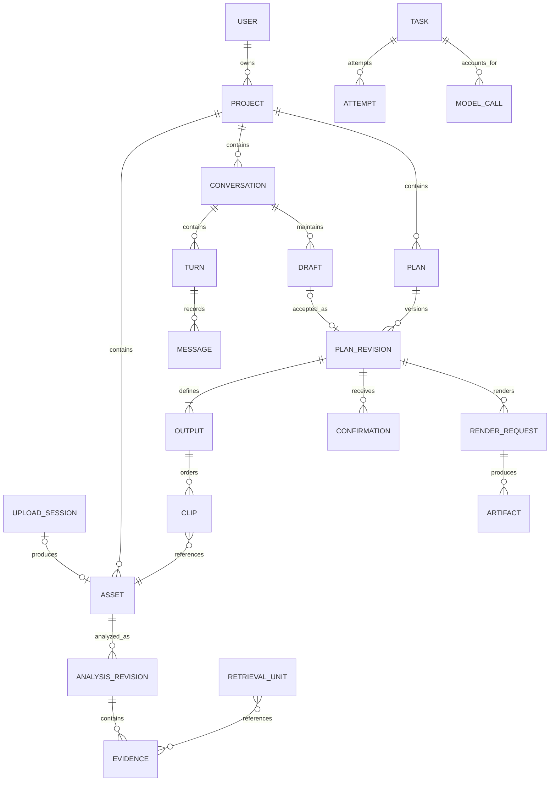
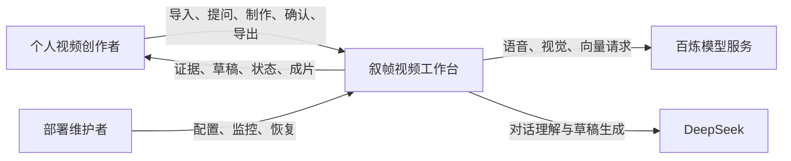
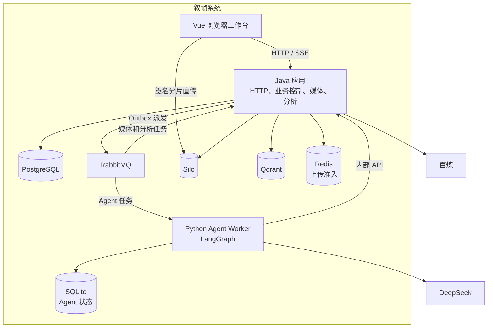

# 项目系统设计梳理

更新时间：2026-10-29。

叙帧是一个面向个人用户、以视频证据为依据、通过对话形成剪辑草稿，并由用户确认后交付成片的视频工作台。核心职责划分是：模型提出建议，Java 控制业务合法性与发布，媒体执行器完成确定性处理。

本文按需求、规模、黑盒接口、数据、高层架构、组件、扩展和取舍八步梳理当前系统。当前实现以 [部署配置](../compose.yaml)、[后端说明](../backend/README.md)、[Agent 说明](../agent-service/README.md)及代码契约为准；[早期架构](architecture.md)保留历史设计意义。本文不替代尚未实施的[视频分析与 Agent 最终设计规格](video-analysis-and-agent-final-spec.md)，也不将其目标视为当前能力。

数值估算均区分配置、示例与待测结果；本次核对为静态文档与代码检查，不构成性能或生产部署验收。

## 1. 澄清需求与范围

### 1.1 用户目标与功能边界

用户导入已有素材，查明素材里有什么，提出制作目标，核查并调整草稿，确认后获得可播放、下载的短片。

| 维度 | 当前范围 | 不应承诺的范围 |
| --- | --- | --- |
| 用户 | 多个独立账号，各自拥有私有项目 | 团队共享、多人协同编辑 |
| 素材 | 上传已有视频，断点续传、验证、分析 | 实时直播处理 |
| 理解 | 语音、稀疏画面和可见文字证据，附时间定位 | 逐帧完整理解；未检出等于不存在 |
| 制作 | 对话问答、澄清、单／多输出草稿、跨素材选段 | 任意专业时间线编辑、复杂特效 |
| 剪辑 | 硬切、原声、字幕、横竖屏等比例留边 | 完整替代专业剪辑软件 |
| 交付 | 草稿预览、整体接受与确认、逐条正式导出 | 当前浏览器批量导出 |
| 部署 | Apple Silicon 本机 Docker Compose | 已验收的生产高可用方案 |

当前浏览器链路为：

**草稿 → 显式预览 → 接受全部输出并冻结确认版本 → 另行导出某条输出。**

预览不是确认，确认不是导出。自然语言中的媒体操作目前引导用户使用按钮，不能沿用历史文档中“对话直接确认、导出”的描述。独立 CLI 的显式保存与预览另有契约，不应混同浏览器流程。

### 1.2 用户、规模与质量约束

当前适用对象是需要查找视频内容、选段和制作短片的个人用户。支持多个账号不代表已验证多人高负载服务能力。

必须成立的正确性要求：

- 项目隔离，素材访问及检索范围受服务端授权控制。
- 证据可以追溯到素材和分析版本，视觉观察点不冒充连续区间事实。
- 任务输入固定，页面查看变化不能改变正在执行的输入。
- 旧执行结果不能覆盖新尝试、已取消任务或失效编辑状态。
- 未经确认不能正式导出；确认绑定具体不可变版本。
- 失败原因可见，模型提交结果未知时不能无条件重新付费。

需要测量的体验指标包括上传成功率、分析耗时、检索质量、草稿成功率、排队时间、渲染速度和每分钟素材成本。

尚未确定的业务条件：目标活跃用户数、同时在线人数、每日导入时长、可接受等待时间、成本上限和数据保留期。

### 1.3 成功标准

用户能够完成素材导入、有依据的问答、合规草稿生成、预览确认和成片下载；刷新或执行中断后能够恢复观察状态，并获得明确的成功、失败、等待或取消结果。

功能正确性与性能验收分开：完成闭环不等于达到生产吞吐量或可用性目标。

## 2. 估算规模

### 2.1 当前配置边界

依据：[Compose](../compose.yaml)、[根配置说明](../README.md)。

| 项目 | 当前配置或运行约束 |
| --- | --- |
| 单文件 | 默认最多 2 GiB |
| 单项目原始素材 | 默认最多 5 GiB、10 份素材 |
| 上传准入 | 每用户桶容量 3，每 60 秒补充一个令牌 |
| 分析消费者 | 默认并发 2 |
| 媒体任务 | 当前默认同时执行 1 项 |
| Python Worker | 当前单实例 |
| Compose 内存限额 | 七个服务合计 4160 MiB，约 4.06 GiB |

内存合计不包含操作系统、Docker、构建过程和可选 Langfuse，也不代表应用实际工作集。配置上限不是实测吞吐量。

### 2.2 可复算的示例

规模估算以媒体分钟数、模型调用量和渲染工作量为主，HTTP QPS 只是其中一部分。

以下仅为测算输入，不是已有用户数据：每天上传 20 段视频，每段 10 分钟，平均码率 8 Mb/s。

| 项目 | 算式 | 示例结果 |
| --- | --- | --- |
| 单段原片 | 8 Mb/s × 600 s ÷ 8 | 600 MB |
| 每日原片 | 20 × 600 MB | 12 GB |
| 30 天原片保留 | 30 × 12 GB | 360 GB |
| 每日分析时长 | 20 × 10 分钟 | 200 分钟 |
| 假设每 5 秒抽一帧 | 200 × 60 ÷ 5 | 2400 帧／天 |

以上 MB、GB 为十进制；配置中的 MiB、GiB 为二进制。图片数量不等于模型请求数量，还取决于批处理规则。

渲染计算：

```text
每日计算分钟 = 每日输出分钟 × 实测渲染耗时 / 输出时长
```

若每天输出 60 分钟视频，实测渲染耗时为输出时长的两倍，则需要 120 个计算分钟。必须测得这个倍率，才能判断并发 1 是否足够。

总存储预算：

```text
原片 + 派生媒体 + 预览 + 正式成片 + 执行工作区峰值
     + 未完成上传及清理残留 + 备份
```

项目 5 GiB 的原片限制不等于项目总磁盘占用只有 5 GiB。模型费用还需按实际音频秒数、图片请求、输入输出 token 和向量调用分别核算，不能用一次 Agent 请求价格代表完整制作成本。

### 2.3 待补测量

选取有音轨、无音轨、横屏、竖屏及多素材样本，记录每个阶段的等待与执行耗时、工作区峰值、模型用量和成功率。明确目标并发后，再测混合负载下的 HTTP 延迟与任务积压。

## 3. 定义核心用例与 API 边界

### 3.1 黑盒动作

下表代表路径省略 `/api/v1`，不是完整请求字段清单。具体输入输出以对应 Controller 和 Contracts 为准。

| 用例 | 代表接口 | 成功的业务含义 |
| --- | --- | --- |
| 建立身份和项目 | `/auth/*`、`/projects` | 用户进入自己的项目 |
| 导入素材 | `/uploads/{id}/part-urls`、`resume`、`complete` | 对象完成后进入验证，不立即等于素材可用 |
| 查看素材与证据 | `/assets/{id}`、`/assets/{id}/evidence` | 返回有权限访问的素材及观察证据 |
| 查询内容 | `/projects/{id}/search` | 在有效分析范围内返回可核查结果 |
| 对话制作和修改 | `/conversations/{id}/turns` | 接纳固定输入的异步轮次 |
| 预览草稿 | `/conversations/{id}/drafts/previews` | 生成预览，不生成正式方案版本 |
| 接受草稿 | `/conversations/{id}/drafts/accept` | 冻结并确认完整方案版本 |
| 正式导出 | `/revisions/{id}/export-requests` | 对已确认版本中的指定输出另行执行渲染 |
| 恢复和管理结果 | `snapshot`、`events`、`/tasks/{id}/cancel`、产物授权接口 | 恢复观察状态、取消任务、访问结果 |

代码入口见[后端接口说明](../backend/README.md#5-公共接口与数据契约)。

### 3.2 契约边界

- 接纳成功不等于执行成功：耗时操作返回任务身份，最终结果另行读取。
- 页面查看状态不等于任务输入：切换素材或历史版本不能改变已接纳任务。
- 取消不等于撤销外部费用：系统撤销后续发布资格，但提供方可能已经执行。
- 重试必须辨认原操作：不能无条件重新付费或重复发布。
- 播放和下载依赖授权：业务资源 ID 本身不是访问凭据。
- SSE 是公开进展通道，快照与持久状态用于恢复；断开订阅不等于取消任务。

内部 Worker API 是独立边界，负责领取执行、心跳、受控工具调用和提交结果。浏览器不能直接使用内部凭据；模型也不能自行决定业务授权。

## 4. 设计数据模型

### 4.1 概念模型

领域围绕素材证据、制作结果和执行过程三条主线展开。



图中表达概念关系，不要求每个框成为独立表。输出和片段可作为完整结构化方案保存，素材、证据引用再通过关系表约束。草稿预览还可直接关联固定草稿内容，并不要求先存在正式版本；该路径未在简化关系图中展开。

实际表结构与一致性约束见[当前数据库模型与一致性设计](database-implementation-design.md)及[数据库迁移](../backend/src/main/resources/db/migration/)。

### 4.2 存储形态

| 数据类别 | 存储形态 | 选择原因 |
| --- | --- | --- |
| 用户、归属、上传、任务、确认、产物元数据 | PostgreSQL 关系表 | 事务、唯一性和合法状态转换 |
| 证据、分析版本、模型回执 | PostgreSQL，结构字段配合 JSON | 引用约束及原始模型信息保留 |
| 草稿和不可变方案 | PostgreSQL 结构化内容及引用关系 | 完整冻结、校验和追溯 |
| 原片、音频、图片、预览、成片 | Silo 对象存储 | 大文件与业务事务分离 |
| 向量和检索索引 | Qdrant | 加速召回，可从权威数据重建 |
| 上传准入令牌 | Redis | 短期原子计数，不保存业务事实 |
| 任务通知 | RabbitMQ | 解耦接纳与执行，不替代任务状态数据库 |
| Agent checkpoint、调用回执 | Python 本地 SQLite | 支撑当前单实例执行恢复 |
| FFmpeg 中间文件 | 本地工作卷 | 临时计算数据，需要峰值预算和清理 |

### 4.3 核心不变量

证据绑定素材及分析版本；视觉观察点不能冒充整段事实；源视频、音频和输出时间坐标不可混用。正式方案版本冻结后不能覆盖，确认绑定具体版本。Qdrant、MQ 和 Redis 不决定最终业务状态，Python checkpoint 也不能替代业务版本和确认记录。

## 5. 高层架构 C4

### 5.1 Context 系统上下文

本图将模型提供方置于系统之外；存储、消息及工作进程在下一层展开。



### 5.2 Container 应用与数据存储

C4 的 Container 指应用或数据存储运行单元，不等同于每个节点都有一个 Docker 容器。Vue 运行在浏览器中，静态资源由 Java 应用交付；SQLite 是 Worker 使用的数据文件。



当前 Java 媒体与分析在业务应用同一进程内；Python 负责 Agent，不再负责基础 ASR、VLM 和索引；checkpoint 当前使用 SQLite。早期独立媒体 Worker、Python 分析服务及 PostgreSQL checkpoint 描述不能作为当前部署事实。

## 6. 深入关键组件与架构模式

### 6.1 十类模式的适用性

“十大核心架构模式”未指定固定清单。这里选择十类常见模式作为分析视角，不要求全部实施，也不将其视为唯一分类标准。

| 模式 | 本项目的适用性与边界 |
| --- | --- |
| 分层架构 | 接口接纳请求，业务服务控制规则，数据库及外部适配处理持久化和调用 |
| 客户端—服务器 | 浏览器经 Java 获取业务能力，媒体分片按授权直传 |
| 模块化单体 | Java 当前主要形态，业务、媒体和分析按职责分包 |
| 微服务 | 保留必要的 Java／Python 进程边界，不按每个业务包拆服务 |
| 事件驱动 | Outbox 与 MQ 驱动耗时任务，数据库仍是权威 |
| 管道—过滤器 | 媒体准备、语音、视觉和索引分阶段执行，失败按阶段处理 |
| 工作流／状态机 | 任务、尝试、澄清、取消和恢复遵守合法状态转换 |
| 端口—适配器 | 百炼、DeepSeek、S3、Qdrant 的外部协议与业务规则分离 |
| CQRS | 写入控制与读取投影存在局部分工，无需建立完整双系统 |
| 事件溯源 | 当前不是全量事件溯源，Outbox 和公开事件不能重建全部业务事实 |

### 6.2 上传与准入

上传先经过身份、准入和容量校验，再建立上传会话，浏览器按签名直传。服务端核对对象后安排媒体验证。因此“允许上传”“对象完成”“素材可用”是三个不同状态。

取消先改变业务状态；真实对象清理完成后，才能释放对应字节占用。Redis 限制新上传会话创建频率，不是传输带宽限速器。

依据：[上传准入规格](upload-admission-rate-limit-spec.md)、[上传模块](../backend/src/main/java/com/agenticvideo/business/upload/README.md)。

### 6.3 任务、消息与恢复

业务事务保存任务和 Outbox，再派发 MQ。消费者收到通知后领取执行资格，提交结果时验证当前尝试。重复消息不能产生重复业务发布。

Python 使用网络租约与心跳；Java 本地执行另有本进程活动状态，两者不能套用完全相同的恢复逻辑。MQ ACK、业务结果提交和外部模型成功是不同边界。

依据：[任务模块](../backend/src/main/java/com/agenticvideo/business/task/README.md)、[消息模块](../backend/src/main/java/com/agenticvideo/business/messaging/README.md)。

### 6.4 分析与检索

先保存语音、视觉等原始观察，再构建检索单元和索引。各来源分阶段发布；一种来源失败不抹去另一种已成功结果。检索强制限制用户、项目及有效代次，返回候选时附带证据供核查。

检索单元是召回单位，不直接等于剪辑切点。固定 scope 还要保证后续工具分页不会悄悄切换到更新后的证据集合。

依据：[分析模块](../backend/src/main/java/com/agenticvideo/business/analysis/README.md)、[检索模块](../backend/src/main/java/com/agenticvideo/business/search/README.md)。

### 6.5 Agent 与业务控制

Java 固定本轮输入和证据范围；Python 调用受控读取工具，生成回答、澄清或草稿；Java 再检查素材、证据、切点、时长、字幕及执行资格，决定是否发布。

当前真实模型工具不包含确认和导出等写操作。工具权限与程序校验限制模型错误的影响范围，但不能替代用户对内容质量的核查。

依据：[Agent 说明](../agent-service/README.md)、[Agent 运行模块](../backend/src/main/java/com/agenticvideo/business/agentrun/README.md)。

### 6.6 版本与渲染

草稿预览绑定确定的草稿内容；正式导出绑定已确认的不可变版本和指定输出。FFmpeg 执行阶段不重新让模型解释用户意图，所以渲染失败不要求重新分析视频或重新生成草稿。

产物发布、播放授权、下载和删除有各自生命周期。下载不删除文件，删除正式成片不应删除原素材。

依据：[方案模块](../backend/src/main/java/com/agenticvideo/business/plan/README.md)、[渲染模块](../backend/src/main/java/com/agenticvideo/business/render/README.md)。

## 7. 找瓶颈并针对性扩展

以下是候选瓶颈，不是已经完成性能定位的结论。

| 候选瓶颈 | 先测量什么 | 有证据后采取什么措施 |
| --- | --- | --- |
| 媒体与 HTTP 共用 Java 资源 | 渲染期间 HTTP 延迟、CPU、内存和磁盘 I/O | 优先隔离媒体执行进程和工作目录 |
| 模型等待与额度 | 各模型耗时、429、排队和每分钟成本 | 分提供方控制并发，复用已有回执和分析 |
| 单实例 Python | Agent 排队、执行时长和恢复成功率 | 明确 checkpoint 归属及恢复方案后再多实例 |
| 本地磁盘 | 工作区峰值、残留、原片增长和清理速度 | 生命周期管理、存储扩容和并发预算 |
| 检索增长 | 项目级延迟、候选量和索引内存 | 调整索引和查询范围，再考虑扩容 |
| 历史累积 | 快照大小、消息加载和查询延迟 | 分页、合适索引和保留策略 |

扩展顺序：建立测量基线 → 优化复用及资源上限 → 隔离媒体负载 → 按证据扩展 Worker 与存储。

暂不因未来可能增长而提前分库分表，也不直接提高所有消费者并发。提高并发可能同时放大内存峰值、模型费用和磁盘争用。队列只能吸收短期波动，长期到达速度超过处理速度时，积压仍会增长。

拆分媒体执行器时，还必须重新核对执行资格、工作区可见性、结果提交和重启恢复，不能只把原进程复制到另一个容器。

## 8. 回顾取舍、风险与未决问题

### 8.1 当前取舍

| 取舍 | 收益 | 代价或风险 |
| --- | --- | --- |
| Java 集中业务和媒体 | 本地部署与事务协调较简单 | 重计算可能影响业务接口 |
| Python 单 Worker + SQLite | 执行恢复较直接 | 多实例不能直接复制容器 |
| PostgreSQL 统一权威 | 状态和授权易于核对 | 承载多种职责，需要维护与备份 |
| 稀疏视觉分析 | 成本和耗时可控 | 存在观察盲区 |
| 用户接受后冻结版本 | 授权、历史和渲染输入明确 | 增加一次交互 |
| 付费提交未知时不自动重付 | 降低重复收费风险 | 部分任务需要人工判断后继续 |
| 准入 Redis 故障时拒绝新上传 | 避免失去准入限制 | 上传入口增加可用性依赖 |
| 多套专用基础设施 | 职责明确、复用成熟能力 | 部署、观测与恢复成本增加 |

### 8.2 待决问题与解决依据

| 问题 | 为什么影响设计 | 下一步需要的依据 |
| --- | --- | --- |
| 单人本地工具还是对外多人服务 | 决定隔离、部署和扩展投入 | 产品定位与目标并发 |
| 可接受的分析、问答和导出等待时间 | 决定容量是否足够 | 用户等待目标及基准测试 |
| 是否设置硬成本预算 | 当前费用预警不阻断 | 用户级／项目级预算规则 |
| 数据保留与恢复目标 | 决定清理、备份和恢复方案 | 保留期、可接受数据损失和停机时间 |
| 视频理解如何验收 | 模型答复流畅不等于证据正确 | 固定样本、召回、引用与硬约束评测 |
| 历史文档如何与现状区分 | 避免按退役路径继续开发 | 标注适用阶段并链接当前代码与决定 |

### 8.3 当前结论

当前架构适合作为本地、小规模、重视可追溯与受控执行的视频制作工作台。下一步应明确规模与等待目标，测量完整制作链路，再决定是否拆分服务。本文的扩展方向和待测指标不是已批准的实施任务，也不代表相关能力已经实现。
