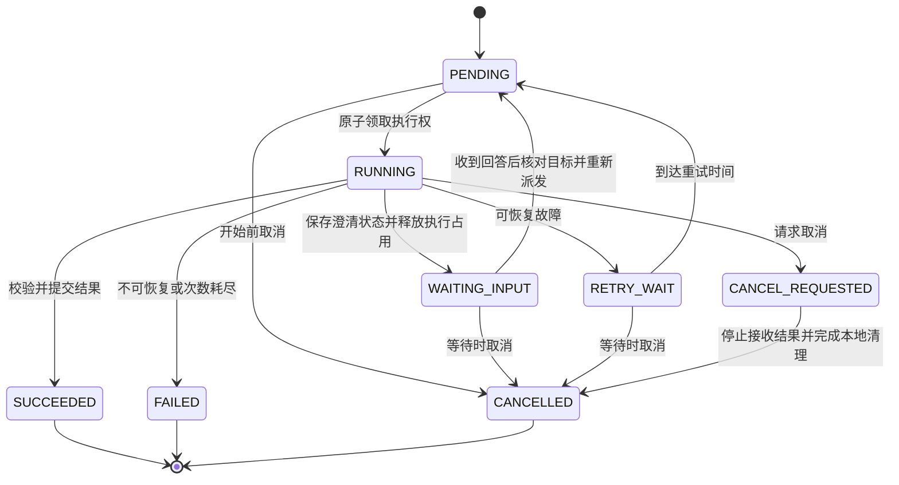

# 任务、消息与恢复协议

本文件细化 Q58 整体确认后的 PostgreSQL 权威任务状态、事务 Outbox、RabbitMQ 派发、内部 HTTP 结果回报与 SSE。具体表与 HTTP 命名以 database-design.md／api-contract.md 为准，公开事件与消费策略见 event-protocol.md；已实现及验证进度见 implementation-status.md，2026-10-12 新增统一自然语言接纳规则待实施。

## 权威状态与执行边界

- Spring Boot 业务后端管理任务生命周期及结果发布；Worker 和 Agent 通过内部接口操作业务状态。
- RabbitMQ 消息是执行通知；消息存在、被确认或被移除均不能独立代表业务任务成功。
- 单次执行由 task_id、attempt_id 和执行权凭证确定，领取及状态变更须原子校验。旧尝试的结果不得覆盖新尝试或取消状态。
- 对外部模型保存提供方任务标识与调用用量；本地超时不代表提供方未执行或未收费。
- SSE 用于及时展示；重连后可重新读取持久化任务状态，不把连接存活作为任务存活依据。

## 任务类型

| 类型 | 执行者 | 固定输入 |
| --- | --- | --- |
| MEDIA_PREPARE | Java Worker | 待验证不可变素材对象、声明大小／哈希与探测／提取规则 |
| CONTENT_ANALYZE | Python Agent 服务的固定流程 | 素材及准备产物、分析规则、模型配置版本 |
| CONTENT_REFINE | Python Agent 服务 | 指定候选时间范围与补充分析要求 |
| AGENT_TURN | Python Agent 服务 | 会话、轮次、用户原文、发送时上下文、引用及权限／预算范围；理解后关联经校验的固定执行请求，查询不必关联方案 |
| PREVIEW_RENDER | Java Worker | 方案版本、单条输出与预览配置 |
| FINAL_RENDER | Java Worker | 已确认方案版本、单条输出与正式配置 |
| INDEX_SYNC | 业务后端 | 已持久化证据、向量、索引版本与权限范围 |

任务输入固定后不受前端切换版本影响。媒体准备与内容分析是不同步骤，索引失败可单独恢复，不必重做已经成功的模型调用。详细分析不让模型绕过后端任意创建或调度任务。

AGENT_TURN 是 Q53 后的统一命名基线，取代此前 AGENT_EDIT 示意，既有编辑执行权与版本提交语义保留。用户消息／轮次／任务／Outbox 同事务接纳，按会话和客户端幂等键防重复；查询也有持久运行身份，进入编辑阶段才取得方案编辑占用。首次新建方案的目标由业务后端分配，不能用模型生成的 ID 当作授权。

### 统一自然语言接纳补充（待实施）

先持久接纳消息、理解任务和发送时上下文；Agent 返回制作请求后，业务后端核对来源、权限、对象和条件，保存固定执行请求，再分配新方案或取得编辑占用。解析结果与后续执行请求作为关联记录，不能原地改写已接纳任务输入。恢复／重试复用已有解析、执行接纳和已提交结果；连续步骤绑定前一步实际成功结果，不因创建关联任务重置预算。

同一输入框的消息须先区分当前问题的回答、取消或明确的新需求，再进入原 questionId 关联和恢复校验；含糊输入澄清。统一入口不会绕过 WAITING_INPUT 的活动资格或开启并发轮次。

自动补查的项目授权与每个制作需求累计 4 次新增视觉调用由业务后端管理，查询、澄清、修改和关联重试共享记录。授权撤回后不提交新调用，未知回执保留占用并核对已有外部执行。次数额度与费用预警分开，完整分析或扩大额度须另行明确批准。详见 [统一自然语言设计](natural-language-workflow-design.md)；具体存储字段和接口在实施时校准。

## 状态机

PENDING 表示数据库中存在待执行任务，不代表消息一定已进入 Broker。终态不被迟到消息回退。执行权过期触发恢复检查，不能仅凭缺少一次心跳就立即启动第二个本地进程。

Agent 等待用户澄清时使用 WAITING_INPUT，保存 checkpoint 和可见问题后释放当前尝试及方案编辑占用；恢复检查不将它当成崩溃的 RUNNING 任务。回答后重新核对用户希望操作的版本与权限，领取新尝试；如用户改为操作不同基准，结束原等待任务并创建关联的新任务。中断节点恢复可能重执行，持久化问题、模型请求与业务回报需幂等。

FAILED 后用户显式重试可创建关联原任务的新任务；系统自动重试保持 task_id，并创建新的 attempt_id。对相同预览输入，业务层复用已有成功产物或有效任务。已经删除的预览记录不再作为可用结果返回。

每个制作会话只允许一个活动逻辑轮次；WAITING_INPUT 不占执行槽或方案锁，但仍保留会话中的等待关系。回答关联 question_id，取消／开始新需求显式结束原等待；失败重试关联原轮次和输入并重新取得会话活动资格，不添加重复用户消息，已提交结果直接返回。会话串行不替代方案互斥，公开消息／问题／版本结果与任务状态协调提交。

CANCELLED 表示系统不再发布该任务后续结果，本地执行已停止并清理；外部模型服务是否支持停止、是否继续收费由提供方决定。终态提交与取消请求原子竞争，已成功提交的任务不能再改写成取消。

## 事务 Outbox

1. 在一个 PostgreSQL 事务内写入任务、必要业务约束和 outbox_events。
2. 发布器领取待发送事件，发布持久消息，并等待 RabbitMQ publisher confirm。
3. 收到确认后标记事件已发送；确认丢失时允许重发同一个 event_id。
4. 消费者用 task_id 领取业务执行权，处理重复通知、已完成任务与当前已有执行者的情况。
5. 内部结果提交按 task_id／attempt_id 幂等，产物只有通过当前执行权校验后才能对用户发布。

初期发布器可在业务应用内运行，扩容后用数据库领取机制防止多个发布器重复抢占；重复投递本身仍按协议容忍。Outbox 不与 RabbitMQ 建立一个跨系统 ACID 事务，也不能保证外部模型只调用一次。

详细规格选定领取并提交持久化执行权后 ACK，恢复依赖数据库租约检查与执行器核对，避免长媒体任务持续占用未确认消息。执行权、ACK、启动和恢复之间的中断窗口必须验证；不能因消息已 ACK 就把业务任务当成成功，见 event-protocol.md。

## 执行、取消与产物提交

- Java Worker 使用 FFmpeg 参数列表启动进程，命令由受控渲染编译器产生，不执行模型生成的 shell。持续读取或重定向 stdout／stderr，避免管道阻塞。
- 执行者定期发送心跳及阶段进度，短暂网络故障应重试回报。恢复检查结合任务租约与执行器状态，不把数据库恢复简单等同于重新发送所有任务。
- 取消先撤销结果提交资格，通知执行器；本地进程先尝试正常结束，超时后强制停止并确认退出，再清理工作目录。失败／取消不删除输入素材或已有成功成片。
- 每次尝试在独立临时目录和对象空间工作；校验产物可播放性、时长、尺寸及音轨后提交 manifest，业务后端校验执行权并发布引用。
- 已上传但未成功提交的文件成为待清理候选；不能误删已经被成功产物记录引用的文件。
- Agent 轮次在理解并经业务校验后，进入编辑阶段时取得方案编辑占用，执行基准固定；统一自然语言消息接纳阶段不提前分配方案或占用，纯查询不占锁。版本追加、任务完成和释放占用应在业务事务中协调；失败、取消和过期恢复也需释放有效占用，旧执行者不得释放后续任务的锁。

## 重试分类

| 情况 | 处理 |
| --- | --- |
| 网络暂时失败、限流、服务暂不可用 | 有限退避重试；遵守提供方要求并记录调用 |
| 外部异步任务请求后状态不明 | 先使用已保存任务标识查询／恢复；无可查询标识时记录不确定性，避免无上限重复请求 |
| 素材缺失、越界片段、无法解码、无效配置 | 报告可解释错误，不无限自动重试 |
| 任务已完成而消息或回报重复 | 返回既有业务结果，不再次发布 |
| 租约过期、容器退出、本机重启 | 检查执行者与已有产物，恢复或重试未完成步骤，阻止迟到尝试提交 |

具体超时、退避、次数和并发限制配置化，通过实施阶段故障验证固定。首期正式渲染并发 1；预览与其他媒体处理也需要独立的资源限额，避免挤占整个 Docker 虚拟机。

## 内部接口基线

| 接口 | 核心语义 |
| --- | --- |
| POST /internal/tasks/{id}/claim | 认证执行服务，原子领取，返回固定输入与执行凭证 |
| POST /internal/tasks/{id}/heartbeat | 仅当前有效尝试续期，记录进度 |
| GET /internal/tasks/{id}/control | 返回取消等控制状态；轮询可作为通知失效后的保障 |
| POST /internal/tasks/{id}/complete | 校验当前尝试，幂等提交 manifest／分析／方案提议 |
| POST /internal/tasks/{id}/fail | 记录结构化错误，决定重试或终止 |
| POST /internal/tasks/{id}/await-input | 保存待续 checkpoint 引用与澄清问题，释放当前执行及编辑占用 |
| POST /api/tasks/{id}/resume | 鉴权、记录回答并核对操作对象，重新派发或创建关联新任务 |
| POST /api/tasks/{id}/cancel | 验证用户归属并请求取消 |
| GET /api/tasks/{id} | 返回用户可见持久化状态 |
| POST /api/conversations/{id}/turns | 幂等接纳消息、操作对象和轮次／任务，忙碌时拒绝新需求而非隐式排队 |
| GET /api/conversations/{id}/snapshot | 返回分页历史、活动轮次／问题和一致事件游标 |
| GET /api/projects/{id}/events | 鉴权后的 SSE；按游标重放，过期时要求重载快照 |

上述是能力路径示意；正式命名以 api-contract.md 的 `/api/v1` 与 `/internal/v1` 为准，澄清恢复使用 questionId 答案入口，不能绕过原问题关联直接改变任务输入。

消息示意只携带协议版本、event_id、task_id、task_type 和关联标识；执行所需授权由领取接口短期下发。内部凭证不对浏览器暴露，模型工具也不能任意声明用户身份或提升任务权限。

SSE 断开不取消持久任务，前端通过显式取消接口停止运行。关键公开事件持久化后推送，文字增量合批并保留草稿快照，按尝试隔离；快照游标与重放遵循作用域内提交顺序，过期游标重载。事件、认证与前端恢复详见 conversation-design.md。

## 数据基线

业务后端管理 users、projects、upload_sessions、upload_parts、storage_reservations、assets、asset_analysis_revisions、evidence_segments、retrieval_units、asset_summaries、asset_index_generations、editing_sessions、messages、conversation_turns、clarification_questions、public_events、edit_plans、plan_revisions、plan_confirmations、tasks、task_attempts、artifacts、outbox_events 与 model_usage。表名为设计基线，迁移时可调整；不可变媒体引用、不可变方案版本、修改来源、任务执行权与原子提交语义必须保留。

上传会话独立于执行任务状态机，分片不经 RabbitMQ 搬运；对象完成后保存待验证素材与 MEDIA_PREPARE 任务／Outbox，验证通过才发布可用素材。multipart 创建、完成与取消的跨库恢复、过期残留和容量释放详见 upload-design.md。

素材的媒体准备、内容分析和索引就绪分开记录，允许显示“可以播放但仍在分析”，也允许对已准备好的素材直接播放。索引最终一致，不能把尚未同步的证据当作检索可用。LangGraph 运行数据独立 schema／权限，不能用 checkpoint 覆盖业务表。

Q45 已确认语音、视觉及其对应索引分阶段可用，分析阶段状态不替代持久化任务状态机；失败只重试受影响阶段。索引结果在新代次写入并验证，业务后端校验有效任务尝试后才发布数据库中的有效代次映射，各召回通道查询前按该映射过滤；迟到尝试写出的未发布索引不影响在线结果。历史观察证据受引用保护，具体时间、来源、版本与保留规则见 video-understanding-retrieval.md。

## 事实来源

- [RabbitMQ confirms](https://www.rabbitmq.com/docs/confirms)：publisher confirm、consumer ack 与重投递。
- [RabbitMQ reliability](https://www.rabbitmq.com/docs/reliability)：可靠投递仍需消费者幂等。
- [Outbox 原理](https://debezium.io/blog/2019/02/19/reliable-microservices-data-exchange-with-the-outbox-pattern/)：数据库事务与消息发送缺口。
- [LangGraph persistence](https://docs.langchain.com/oss/python/langgraph/persistence)：运行状态、thread 与 checkpoint。
