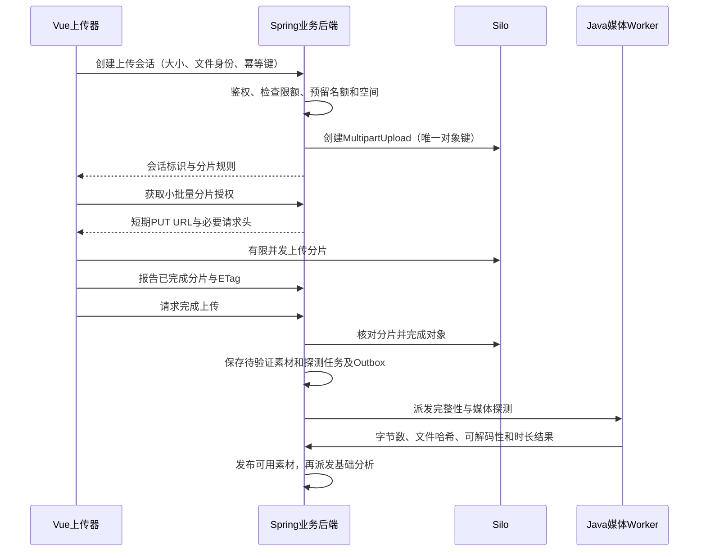

# 视频上传设计

状态：Q49–Q52 已确认，Q58 已确认整体共同理解。分片直传、可恢复上传会话、完整媒体验证与空间限额为首期基线；字段与接口展开见 database-design.md／api-contract.md，分片参数和固定 Silo 版本仍需实测验证，应用实施尚未开始。参见 ADR-0013。

## 上传分片与视频切片

这里的分片是源文件字节分片，用于可靠传输与重试，完成后还原同一原始文件；不是先转码为多个视频片段，也不是后续剪辑方案中的片段。不因上传而改变素材内容或时间轴。

## 浏览器直传与后端控制（Q49）

使用 S3 multipart：Spring Boot 管理上传会话、权限、对象键、分片规则与完成／取消；浏览器获得少量短期分片 PUT URL 后直传 Silo，不让整个文件经过业务 API 内存。首期不额外部署 tus 服务或自制磁盘分片合并服务。

Silo 官方源码注册了 multipart 创建、上传、列片、完成和取消路由，官方项目支持 arm64，但 main 包含未发布变化；需固定发行版，实际联调 Java SDK、预签名 PUT、CORS、分页、完成与取消，不能仅凭兼容声明判定通过。[Silo 源码](https://github.com/pgsty/silo/blob/main/cmd/api-router.go)、[项目说明](https://github.com/pgsty/silo)

会话记录基线包括用户／项目、业务上传 ID、S3 uploadId、唯一对象 key、声明大小与文件身份、partSize、partNumber／ETag 清单、空间预留、状态和最后活动时间；客户端存储只用于恢复界面，服务端负责最终状态与授权。Redis 不替代持久会话。会话创建与对象存储调用也需恢复协调：先持久保存唯一业务身份与对象键，再创建 multipart 并记录 uploadId；创建响应丢失时核对该键下未完成上传并清理重复项，不无限创建未登记上传。

首期分片尺寸与并发通过本机实测配置，可从有界的几十 MiB 分片、少量并发开始；始终限制总在途字节数，多文件共享并发池。AWS 规范要求最多 10,000 片，非末片至少 5 MiB，ListParts 每页最多 1,000；需要计算分片数并处理分页。这些是兼容测试依据，不是对 Silo 的未经验证承诺。[S3 multipart 规范](https://docs.aws.amazon.com/AmazonS3/latest/userguide/mpuoverview.html)、[分片限制](https://docs.aws.amazon.com/AmazonS3/latest/userguide/qfacts.html)

浏览器可访问地址与 Compose 内网地址分别配置，签名后不能替换 host。CORS 允许实际前端 origin、PUT 和所需请求头，并暴露 ETag。URL 到期时为同一会话／分片重新签名；不重建整个上传。所有创建、签发、完成和取消接口再次验证项目归属，签名 URL 不进入对话或长期日志。[CORS](https://docs.aws.amazon.com/AmazonS3/latest/userguide/ManageCorsUsing.html)、[预签名 URL](https://docs.aws.amazon.com/AmazonS3/latest/userguide/using-presigned-url.html)

## 暂停、逐片重试与刷新恢复（Q50）

支持暂停／继续、有限逐片退避重试和页面刷新后的恢复。暂停先停止调度，保留成功片；允许在途请求结束，错误只重传对应片。成功片的 ETag 由后端清单记录，恢复时后端分页列片核对，不单信浏览器进度。同一 partNumber 重传会替换原片，需要避免两个页面／上传执行者同时写同一会话。

跨浏览器基线是刷新后重新选择原文件，校验身份后接续；不能仅凭文件名重新获得本地 File。File System Access 持久 handle 可作为后续增强，仍需检查权限和浏览器支持。[Chrome 文件访问说明](https://developer.chrome.com/docs/capabilities/web-apis/file-system-access)

完整文件 SHA-256 用于重选后的同内容核对，并显示计算进度；Web Worker 使用有界读取和增量哈希，避免数 GiB 文件整体读入内存或复制进 IndexedDB。具体库与版本实施时选择，例如增量 SHA-256 库可支持流式输入。[hash-wasm 原项目](https://github.com/Daninet/hash-wasm)

客户端哈希只是上传声明与恢复身份检查，不是可信完整性结论。文件名／大小／修改时间用于快速筛查，不证明内容相同。首期不做跨用户哈希秒传，不泄露其他用户是否持有相同文件；完成后 Worker 独立读取对象计算哈希和字节数，与声明核对。完成清单须符合该会话预定片数、序号及各片字节规则，ListParts 只用于核对和修复清单，不能把“当前已上传的任意片”直接提交成完整文件。

## 限额、校验与正式入库（Q51）

本机只读快照（2026-10-10）：项目所在宿主 Data 卷可用约 15 GiB；不等于 Docker 卷可用空间，部署时需分别核验。此前 60 分钟／10 素材限制不能替代字节与临时空间限制。

本机起步单文件 2 GiB、每项目原始素材总量 5 GiB，均可配置；同时按实际可用空间预留全局余量，计入未完成分片、原始对象、派生缓存、Worker 工作区与正式输出。创建上传时原子预留字节及素材名额，完成后转为实际占用；取消后名额与空间分别核对释放，尚未清理的物理残留仍计入容量，不因标记取消就认为磁盘已释放。预留不是物理保证，开始探测／渲染前也检查所需空间。不能只用浏览器隐藏按钮防止超额上传。

后端限额依据声明大小和分片规则控制签发，完成前核对实际列片大小与总量；如果 Silo 无法对预签名 PUT 强制全部长度条件，需明确残余窗口、有限分片授权和清理策略，不把客户端声明当作物理容量保证。

完成对象后只产生“待验证素材”，由 Worker 检查真实字节数、服务端 SHA-256、ffprobe 可解码性、时长及项目媒体限制，合格后才能进入可用素材与基础分析。文件名后缀／MIME 是提示；失败显示原因，失败对象进入独立清理范围并释放占用，不进入 Agent 的可选素材。

ETag 不能当作整个文件 MD5；校验和扩展是否受固定 Silo 版本支持也需测试。Complete 可能 HTTP 200 内嵌错误，应由 SDK 解析完整响应；超时先核对唯一对象与持久状态，不能直接判定失败并创建第二份素材。对象完成与 PostgreSQL 不存在本方案假设的跨库事务，恢复扫描需处理“对象成功而业务提交失败”。[Multipart 总览](https://docs.aws.amazon.com/AmazonS3/latest/userguide/mpuoverview.html)、[Complete API](https://docs.aws.amazon.com/AmazonS3/latest/API/API_CompleteMultipartUpload.html)

## 上传期限、取消与清理（Q52）

未完成会话最后成功活动后 24 小时过期，可配置；暂停不会永久保留分片。界面显示剩余恢复期限，过期后重新上传。活动时间由合法服务端请求／分片事实更新，后台不能因单个前端时间字段延长保留。

取消与完成相互排斥，后端先撤销后续操作资格，客户端停止调度并取消／收敛在途请求，再 Abort 并核对残留，必要时重复清理。预签名 PUT 已签发后不一定能即时撤销，在途 PUT 也可能完成，不能“点取消即假定磁盘已释放”。清理跳过完成中的有效会话，处理过期 multipart、完成但未入库对象及媒体验证失败对象，不能触碰已发布素材和历史引用。[Abort API](https://docs.aws.amazon.com/AmazonS3/latest/API/API_AbortMultipartUpload.html)

## 前端与接口基线

上传区显示文件、已确认字节进度、当前传输进度、暂停／继续／取消、失败原因与恢复期限。传输达到 100% 后显示“正在确认／验证”，通过后分别显示可播放、语音就绪和视觉就绪；不能把上传完成等同于理解完成。路由切换时上传器位于应用级状态；关闭页面后不承诺浏览器继续传输，返回后恢复。

API 基线：创建会话、分页查询状态、批量签发分片 URL、幂等记录完成片、恢复核对、完成、取消。所有接口使用业务 upload ID，由后端映射 S3 uploadId 和对象 key；消息队列只在媒体验证等异步步骤参与，不搬运文件分片。

验收覆盖断网逐片重试、URL 到期、刷新重选、同名不同内容、重复完成、Complete 响应丢失、取消与完成竞争、双标签页上传、过期清理、低空间和超额、不可解码文件、跨账号操作与实际 CORS。
