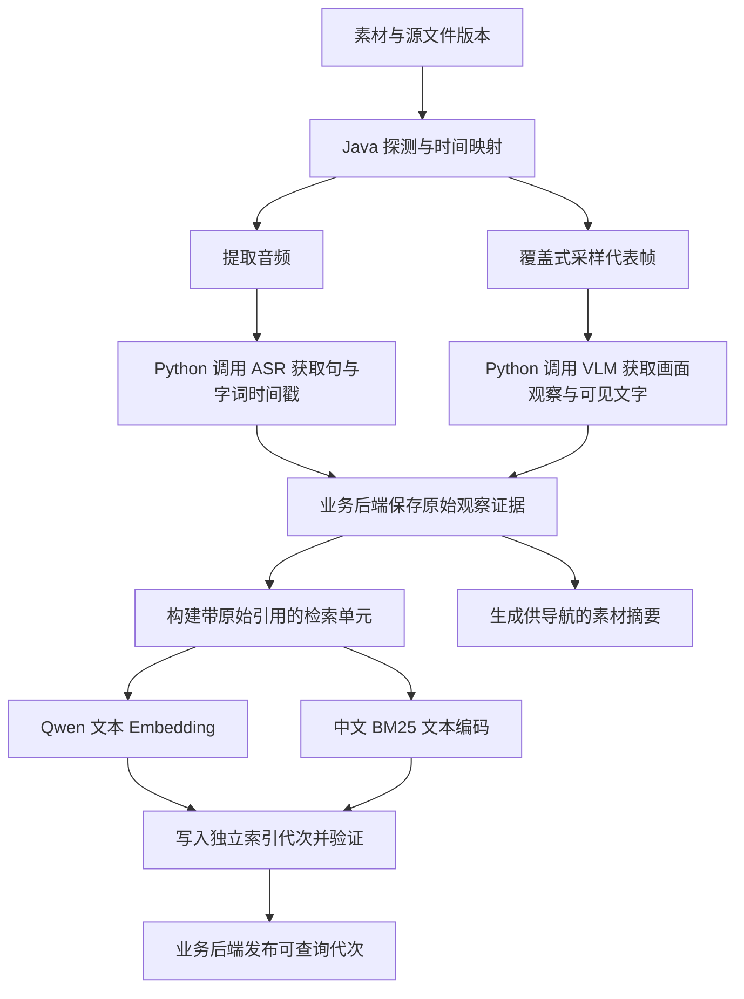
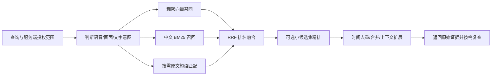

# 视频理解与检索设计

状态：Q42–Q47 已确认。本文细化已确认的“上传后基础分析、按需深入分析、带时间定位的文本证据、语义与关键词混合检索”，采用 Qdrant 原生中文 BM25 与 Qwen 稠密向量融合，替代此前关键词主通道的小规模包含查询基线；原文短语匹配保留为补充。数据字段及数值参数属于实施基线或待实测配置，模型媒体传递仍需实际联调；等待整体共同理解核对，未开始代码实现。参见 ADR-0011 与 ADR-0012。

## 已确认的基础与细化范围

已确认：Java 媒体 Worker 做本地探测和媒体提取；Python 服务内固定流程做 ASR、VLM、Embedding；PostgreSQL 保存分析证据，Qdrant 是可重建索引；两条剪辑主线共享这些结果；首期不依赖直接图像／视频向量，不保证每帧全部文字识别。检索和剪辑 Agent 可以在预算内复查候选区间。

本轮确认：证据层级与时间语义、中文 BM25 的具体实现、精排时机、阶段可用性与索引发布、未命中后的处理方式、证据及派生媒体保留。抽帧间隔、文本窗口长度、召回数量和精排阈值通过样本评测固定，无需凭经验将其当作产品保证。

## 离线处理流程（Q42）

### 探测与时间映射

保存时长、音视频流、分辨率、帧率与时间基准、旋转信息及源文件校验标识。建立“派生音频／采样帧 → 素材播放时间”的映射：包括音频相对视频起点的偏移、提取区间起点和帧的实际时间戳。不能用帧序号除以名义帧率替代可变帧率视频的实际时间。

统一业务时间使用毫秒和半开区间；导出仍按媒体时间基准执行并验证。ASR 模型返回时间戳不等于剪辑边界天然准确，完整语句、停顿及边缘词仍需检查。百炼非实时模型 `qwen3-asr-flash-filetrans` 支持句级时间戳和 `enable_words` 字／词级时间戳，OpenAI 兼容的 Qwen3-ASR-Flash 接口不返回时间戳，适配层需要原生异步路径。[官方非实时 ASR 文档](https://help.aliyun.com/zh/model-studio/non-realtime-speech-recognition-user-guide)

### 基础分析与代表帧

有音轨时覆盖整段音频转写；无音轨时该分支记为不适用。基础视觉分析覆盖素材各时间段，使用稀疏代表帧，可补充镜头变化附近的帧；去重只减少相近图像调用，保留各次出现时间的映射。讲话类视频无需先完成镜头检测才能转写和检索。

定时采样、编码关键帧和镜头变化检测是不同概念；编码 I 帧不能直接当作语义场景边界。FFmpeg 的 `select`／`fps` 与 `scdet` 可作为提取和镜头变化启发工具，阈值及收益需实测。[FFmpeg 采样过滤器](https://ffmpeg.org/ffmpeg-filters.html#select_002c-aselect)、[镜头变化检测](https://ffmpeg.org/ffmpeg-filters.html#scdet)

VLM 分别输出画面描述和画面上识别到的文字，使用结构化 schema 并引用输入帧。首期可由 VLM 提取可见文字，不默认增加独立 OCR 模型；若短暂文字的召回不达标，再评估 OCR 或更密集采样。Qwen 视觉视频输入理解画面，不提供音频理解；转写与视觉观察应显式汇合，非均匀采样应保留真实时间，不能假装等间隔帧。[Qwen 视觉输入文档](https://help.aliyun.com/en/model-studio/vision)

### 三个信息层级

| 层级 | 内容 | 使用原则 |
| --- | --- | --- |
| 原始观察证据 | ASR 句／字词及时间、帧上视觉描述、可见文字与对应帧 | 保留原始响应、来源、实际观察时间与模型／分析版本，能够复查 |
| 检索单元 | 适合索引的句段或视觉／文字观察，引用原始证据 | 允许重叠与上下文拼接；可重建，窗口边界不是剪辑切点 |
| 素材摘要 | 主要话题和供导航的章节说明 | 用于理解素材和导航，不作为唯一召回入口或精确切片依据 |

语音单元按句子完整性、话题变化和 Embedding 输入限制切分，适度携带前后句。视觉和可见文字单元保留自己的来源类型，可以关联邻近转写，但不把邻近语音当成视觉事实。初始窗口范围通过代表性素材评测确定，不预设一个长度适合所有视频。

例如，“他说想去海边”是语音证据，不能因此证明“画面出现海边”。单帧观察证明某个采样时刻可见，不能证明目标在整个相邻采样区间持续存在；候选区间用于复查，只有更密集观察后才能缩小边界。检索单元、候选片段和最终剪辑片段保持不同语义。

证据返回字段基线：素材与源版本、证据 ID、来源类型、原文／观察文本、观察时刻或时间范围、时间精度说明、帧／音频引用、分析版本。检索结果另外带单元 ID、排名信息、上下文引用及尚未完成的分析范围。模型自报置信度不能代替经过评测的可信度。

## 在线检索流程（Q43）

1. 业务后端验证用户与项目归属，生成检索范围；区分“说了什么”“画面有什么”“屏幕上写了什么”。必要时由 Agent 澄清歧义。素材、来源类型、时间及分析版本是结构化过滤条件。
2. 保留原查询，对语义查询允许有限改写；姓名、数字、产品名称和用户要求的原句不能被改写丢失。自然语言宽泛查询走语义召回，专名和字面文字同时保留词项通道。
3. 针对同一批检索单元并行做 Qwen 稠密向量和中文 BM25 召回。所有分支在召回前施加相同授权与有效代次范围，不能先跨项目召回再仅在显示时过滤。
4. 用 RRF 融合排名，初始不人为指定最优权重。BM25 分数与余弦分数不能直接相加；融合、窗口大小与分支召回量都通过样本调节。[Qdrant 混合查询与 RRF](https://qdrant.tech/documentation/search/hybrid-queries/)
5. 字面连续短语查询可以保留 PostgreSQL 参数化原文包含匹配，转义通配符并保留原文引用；该通道用于检查转写／识别文本中是否包含某串字符，不保证原音／原画面一定正确识别。中文 BM25 也不保证精确连续短语。
6. 对融合候选按需精排，再处理重叠、邻近时间与跨素材多样性；时间合并须保留原始证据 ID，不能将间隔中的未知内容表述为持续命中。选择完整语句与剪辑边界时读取原始上下文，视觉候选按需补采样。

### 中文 BM25 的落地选择

采用 **Qdrant 原生中文 BM25 + Qwen 文本稠密向量**；原文包含查找保留为字面补充。首期复用 Qdrant，不为 BM25 增加 Elasticsearch／OpenSearch 容器。这是 Q43 确认的选型，替代此前小规模 PostgreSQL 关键词包含查询的主通道。

普通稀疏向量不自动等于 BM25，payload 全文过滤也不等于 BM25 排名。需要明确词频、文档长度归一化与 IDF。Qdrant 原生 BM25 的索引与查询应使用相同 tokenizer 和参数；中文采用 `multilingual` 分词路径，避免默认英文词干处理，基于真实证据单元测量平均长度后配置。原生编码与 FastEmbed 客户端 BM25 不是同一套中文分词能力。[原生混合检索](https://qdrant.tech/documentation/search-tuning/hybrid-search/)、[文本分词配置](https://qdrant.tech/documentation/search/text-search/full-text-search/)

已核验固定版本候选为 `qdrant/qdrant:v1.19.2`：2026-10-05 发布，官方镜像构建覆盖 arm64。该版本的可用性已核验，仍需本项目实际建索引与查询验证。[发布记录](https://github.com/qdrant/qdrant/releases/tag/v1.19.2)、[官方镜像构建](https://github.com/qdrant/qdrant/blob/v1.19.2/.github/workflows/docker-image.yml)

IDF 默认范围不能假定自动等于当前项目。实施基线使用 v1.19 的 `params.idf.corpus` 明确本用户、本项目和有效分析代次的统计语料；用户临时限定某素材／时间时，查询过滤进一步收窄，但词频统计可保持项目范围以利比较。统计范围不是授权，所有召回仍需强制权限过滤。[Qdrant 多租户与 IDF 范围](https://qdrant.tech/documentation/manage-data/multitenancy/)

## 是否增加精排模型（Q44）

首期先评测稠密、BM25 和融合召回，预留独立精排接口，不立即增加必选模型。精排改善已召回候选的顺序，不能找回根本没有召回的内容；先检查分析覆盖、转写／分词质量与召回。

若候选已包含正确答案但排序差，再评估支持中文的 reranker API；具体提供方、费用、响应延迟和效果须核验。若改用 DeepSeek 在小候选集判断相关性，也应记录额外成本，并不将模型判断当作事实确认。本机首期不默认下载大型本地 reranker。[Qdrant 精排说明](https://qdrant.tech/documentation/tutorials-basics/reranking-hybrid-search/)

## 分阶段可用、增量处理与索引发布（Q45）

分别记录媒体准备、ASR、视觉观察、检索单元、Embedding、索引等阶段的状态与版本。转写及对应索引成功即可开放语音查询和讲话选段；画面查询提示视觉尚未完成或失败。已识别原文可先用于字面查询，但不能宣称语义索引已就绪。不将全部分析合并成一个阻塞成功标记。

失败只重试受影响阶段。例如 Embedding／索引失败不重跑已成功的 ASR、VLM；视觉失败不阻塞语音证据。保存外部异步任务标识，沿用任务协议的重试、取消、执行权与迟到结果限制。

复用键包括源文件校验版本、派生规则／时间映射、模型及参数、单元切分规则。变更 ASR／VLM 可创建新分析版本；仅替换 Embedding 或 BM25 参数通常复用原始证据重建索引；深度复查生成可溯源的新证据，不覆盖旧证据。历史方案引用的证据及版本需可复查，清理派生文件不能破坏这些引用。

Embedding 模型、维度、距离、切分与词项规则形成明确索引配置；不兼容向量分开保存。索引写入新代次，核对单元数、维度和可查询性后，由业务后端切换有效代次；旧代次保留至没有读者／引用后再清理。PostgreSQL 与 Qdrant 没有本方案假定的跨库事务：以数据库中的有效映射为权威，查询从该映射生成素材与代次的过滤，不能只信 Qdrant 中迟到任务写出的 `active=true`。未发布或过期任务写出的索引是待清理派生数据，不能进入在线召回。

索引可重建不等于原始模型证据可免费重建；保留证据和必要模型响应可避免重建索引时重新付费。分析证据和派生媒体采用下一节已确认的独立策略，具体缓存容量／期限实测固定；临时云上传遵循提供方有效期，不能直接套用低清预览的 2 GB／7 天策略。

## 分析证据与派生媒体的保留（Q47）

在素材保留期间保存分析证据、模型响应中必要的结果、时间映射及版本信息，历史方案引用的证据遵守引用保护。请求凭证和访问密钥不进入原始响应归档。大体积派生音频和普通代表帧作为可重建缓存，设独立容量限制；跳过执行中使用的文件，按源文件与提取规则重建，避免为重建媒体重复调用模型。

方案引用或界面用于佐证结论的关键证据帧应保留可用引用；若希望回收其文件，须保证能够根据受保护的原始素材与精确提取规则复现，不留下失效链接。无法保证复现的佐证帧按引用保护保留。首期缓存容量待本机实测后固定，不能无限保存整套抽帧图片。

## 未命中、视觉边界与深入检索（Q46）

响应说明已查的素材、证据类型及分析覆盖。没有命中可能来自内容确实不存在、ASR／视觉识别错误、稀疏采样遗漏或索引未完成；结果应表述为“在已分析范围内未找到”，不能一概表述为素材不存在该内容。

候选已出现时，在预算内主动加密采样、提升图像分辨率或扩展相邻语句，再缩小时间范围。首次搜索没有候选时不能只在命中附近复查：可在预算内补充覆盖性采样、替代检索词或另一证据通道。

对于“找出所有出现”“很短暂的小字”等高覆盖需求，明确基础采样的限制；可提供针对指定素材／时间的深入检索。需要超过既有预算时按已确认规则澄清是否扩大范围或投入，不能静默启动全视频高密度昂贵分析。深入分析提高覆盖度，但仍不承诺模型识别无遗漏。

## 本地文件如何交给云模型

Compose 内网／localhost 的 Silo 地址无法直接作为云提供方可读取地址。模型适配层需要处理媒体传递，签名链接的有效期需覆盖排队与提供方下载，不能只够前端一次点击。

本机小规模测试可先验证官方临时文件上传：获取上传凭证，上传派生音频，获得 `oss://` 临时地址，再用长音频 ASR 的 REST 异步调用及 `X-DashScope-OssResourceResolve: enable`。该模型特定文档说明 REST 支持临时地址而 SDK 不支持，上传与调用需匹配模型及账号。临时地址有效 48 小时，官方不建议其用于生产高并发；这只是本地验证候选路径，尚未实际联调。生产阶段再选择稳定可读取存储或有效期足够的受控 URL。[Qwen ASR API](https://help.aliyun.com/zh/model-studio/qwen-asr-api-reference)、[临时文件上传](https://help.aliyun.com/zh/model-studio/get-temporary-file-url/)

VLM 可按接口限制使用上传或 Base64 图片；处理每次调用的图像数、尺寸与输入量上限。无需为验证模型读取而公开整套 Silo。[Qwen 视觉文件输入](https://help.aliyun.com/en/model-studio/vision#file-input-methods)

## 最小评测与实施验证

用人工标注的代表性样本比较语义单路、BM25 单路、融合和必要时精排，先验证证据，再调 Agent 提示词。样本覆盖：

- 精确人名／数字／短语、同义改写、长段完整观点和相邻上下文。
- 画面出现但没有语音提及、语音提及但画面未出现、短暂屏幕文字。
- 重复片段、相似帧在不同时间出现、无音轨、音画起点偏移和可变帧率。
- 分析未完成／某分支失败、负例、不同项目包含同名素材与相同查询词。

指标分别记录召回率 Recall@K、排序质量、时间定位误差与句意完整性、视觉观察覆盖、查询延迟、每小时分析调用量和费用、跨项目泄露数量（必须为零）。不能只用 Agent 自评“答案正确”来验收。

实施先用一段中文讲话加屏幕文字样本验证：云模型真实读取本机派生媒体、ASR 时间映射、视觉帧来源、Qwen 向量维度、Qdrant 中文 BM25 的索引／查询一致性、RRF 及权限／代次过滤。通过后再跑三条产品闭环；具体参数记录为配置与评测结果。
