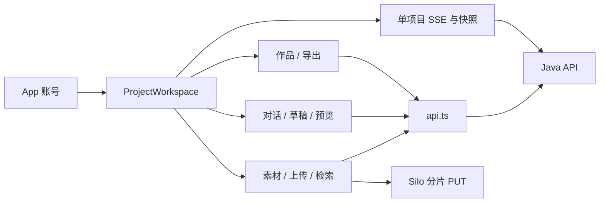

# 浏览器工作台

> 叙帧的 Vue 3 界面：在私有项目中上传和核查素材、对话制作草稿、预览并确认方案，再明确导出与管理成片。

[根 README](../README.md) · [目录职责](#3-目录与组件职责) · [交互流程](#4-架构与内部交互流程) · [测试](#8-测试)

## 1. 模块定位与边界

用户从浏览器进入同源 Java 应用；前端负责状态展示、操作意图、引用选择、任务恢复和播放器交互。普通请求通过 Java `/api/v1`，分片文件按 Java 签发的 URL 直传 Silo。

Java 决定用户权限、素材可用性、草稿资格、版本确认、任务状态及产物可访问性；Python 负责 Agent 决策。前端不调用模型、不持有内部 Worker Token、不从页面草稿自行生成正式版本。切换主视图不取消后台任务；聊天停止与媒体停止分开。

## 2. 快速导航与本地运行

| 目的 | 入口 |
| --- | --- |
| 页面启动／账号 | [main.ts](src/main.ts)、[App.vue](src/App.vue)、[index.html](index.html) |
| 项目与主视图 | [ProjectWorkspace.vue](src/ProjectWorkspace.vue) |
| API、上传、事件 | [api.ts](src/api.ts)、[uploads.ts](src/uploads.ts)、[projectEvents.ts](src/projectEvents.ts) |
| 对话／草稿／作品 | [ConversationPanel.vue](src/ConversationPanel.vue)、[DraftCard.vue](src/DraftCard.vue)、[PlanPanel.vue](src/PlanPanel.vue) |
| 配置与脚本 | [package.json](package.json)、[vite.config.ts](vite.config.ts)、[tsconfig.json](tsconfig.json)、[playwright.config.ts](playwright.config.ts) |

从仓库根目录执行，Node.js 24／npm 是宿主开发工具；完整业务运行优先用[根快速开始](../README.md#6-快速开始)。

```bash
npm --prefix frontend ci
npm --prefix frontend run dev -- --host 127.0.0.1 --port 5173 --strictPort
```

Vite 代理 `/api` 到 `http://localhost:8080`。手工通过 `http://127.0.0.1:5173` 调用真实后端时，后端 `APP_ALLOWED_ORIGIN` 须匹配该完整 Origin 并重建；它同时改变原 `8080` 页面写请求的可信范围。HTTP 受控测试无需因此更改后端。

## 3. 目录与组件职责

源码目前平铺于 `src/`，没有另外的 Router、Store 或组件目录；按现有职责定位即可。

| 路径 | 职责／协作 |
| --- | --- |
| [App.vue](src/App.vue) | 注册／登录／退出、当前账号和 auth-required 全局事件 |
| [ProjectWorkspace.vue](src/ProjectWorkspace.vue) | 项目分页／打开、URL 历史、素材／制作／作品、播放器与用量面板协调 |
| [AssetLibrary.vue](src/AssetLibrary.vue) | 素材列表、上传条目合并、媒体详情与播放入口 |
| [UploadPanel.vue](src/UploadPanel.vue) | 上传队列 UI、文件选择、暂停／恢复／取消意图 |
| [uploads.ts](src/uploads.ts) | 项目关联上传状态、文件保留、有限并发、重试和服务端恢复核对 |
| [fileHash.worker.ts](src/fileHash.worker.ts) | 2 MiB 读取块增量 SHA-256，向主线程报告进度／结果 |
| [AnalysisStatus.vue](src/AnalysisStatus.vue) | 分阶段分析状态；诊断模式下显式恢复／索引重建 |
| [SpeechSearch.vue](src/SpeechSearch.vue) | 语音／画面／文字的原文／语义检索、上下文与代表帧核查 |
| [InspectionPanel.vue](src/InspectionPanel.vue) | 既有有界补查、扩展提议与授权 UI；默认后端写入口关闭 |
| [MediaPlayer.vue](src/MediaPlayer.vue) | 原素材播放、区间定位、媒体信息和授权续期 |
| [ConversationPanel.vue](src/ConversationPanel.vue) | 会话、原文／引用发送、快照、草稿及聊天内预览历史 |
| [DraftCard.vue](src/DraftCard.vue) | 当前草稿绑定、单输出预览、接受全部输出与幂等请求 |
| [DraftContent.vue](src/DraftContent.vue) | 当前或历史只读草稿的结构化内容与源片核查 |
| [PlanPanel.vue](src/PlanPanel.vue) | 方案／版本／输出选择、确认、预览、导出历史及显式删除 |
| [ArtifactPlayer.vue](src/ArtifactPlayer.vue) | 按 artifactId 获取授权并播放，错误时重新核对访问 |
| [UsagePanel.vue](src/UsagePanel.vue) | 存储／模型费用、未知项、阈值和诊断回执展示 |
| [api.ts](src/api.ts) | 同源 Cookie、写请求 CSRF、data 解包和 ApiFailure |
| [projectEvents.ts](src/projectEvents.ts) | 每项目一个 SSE、快照恢复、序号／代次隔离与订阅分发 |
| [main.ts](src/main.ts)、[style.css](src/style.css) | Vue 挂载和共享界面样式 |
| [e2e/](e2e/) | Playwright 当前与历史场景；fixtures 含媒体、受控服务和当前资源适配 |

## 4. 架构与内部交互流程



### 上传并核查素材

1. UploadPanel 交给 uploads.ts 入队；Worker 计算原文件 SHA-256，使用稳定幂等键与页面 writerId 创建／恢复会话。
2. 所有文件共享两条传输槽，每条一次只传一个有界分片；签名、PUT、ETag 报告成功后更新已确认字节，网络错误只做有限重试。
3. 暂停／取消核对在途动作；刷新重选原文件，由后端校验哈希并返回真实已有分片。传输完成显示“待媒体验证”，不直接标记可用。
4. 素材与搜索结果请求 Java 播放授权，MediaPlayer 使用源片时间定位；签名过期重新授权，不重新上传。

### 对话、草稿与作品

1. ConversationPanel 恢复会话快照；发送原文和 references，使用固定 Idempotency-Key 处理响应丢失，不提交执行 context。
2. 项目 SSE 到达后刷新相应对象；项目／会话切换通过代次判断忽略迟到响应，不把旧结果显示到新项目。
3. DraftCard 绑定 messageId、validationId、editGeneration 与两种 hash。预览只选择一条 output_key；“确认全部输出”接受整个当前草稿。
4. 作品使用保存后的 outputId 和不可变版本；正式导出另行选择规格与输出，播放／下载／删除分别发送明确请求。

### 项目事件恢复

provideProjectEvents 先读取 snapshot cursor 再建立 EventSource；监听器全部处理成功才推进序号。stream.reset、事件校验失败或网络中断重新取快照；stream.auth-required 转登录。事件是刷新依据，不能替代服务器权威状态。

## 5. 公共接口与数据契约

| 导出／组件边界 | 输入 | 输出／使用约定 |
| --- | --- | --- |
| `request<T>` | `/api/v1` 后的相对 path、method、data、extraHeaders | data；失败抛 ApiFailure；401 触发 auth-required |
| `provideProjectEvents`／`useProjectEvents` | 项目 Ref／异步监听器 | 单项目连接状态／自动取消订阅；null 表示快照恢复 |
| `enqueueFiles/loadUploads` | projectId、File[]／项目 UUID | 更新响应式 uploadRows |
| `pauseUpload/continueUpload/reselectFile/cancelUpload` | 队列 key、可选原 File | 上传调度／核对；不是立即删除已发布素材 |
| `AssetLibrary`／`ConversationPanel` | projectId 等 props | play、loaded／plan／session 事件，结构见组件 defineEmits |
| `DraftCard` | draft、DraftBinding、canPreview、canAccept | changed(accept/preview)、play |
| `PlanPanel` | projectId、sessionId、selection 等 | play、base、reference；PlanSelection／PlanReference 导出 |

Playback 类型来自 AssetLibrary，包含 assetId、filename、url、durationMs、expiresAt 与可选 startMs／endMs。DraftBinding 来自 DraftCard；草稿 output_key 与版本 outputId 不混用。证据引用只表达来源，不由前端修改真实性。

## 6. 依赖与配置

[package.json](package.json) 固定 Vue 和 hash-wasm；开发工具为 Vite、TypeScript、vue-tsc、Playwright。当前没有定义一组应用 `VITE_*` 环境变量，也没有通用 Feature Flag 系统。

| 配置 | 来源／默认 | 用途 |
| --- | --- | --- |
| API 前缀 | api.ts 固定 `/api/v1` | 同源认证及响应契约 |
| 开发代理 | vite.config.ts 固定 localhost:8080 | 开发端口代理，不等同于后端 Origin 放行 |
| `E2E_BASE_URL` | Playwright 默认 http://localhost:8080 | 测试目标，不是产品运行配置 |
| `E2E_UI_ORIGIN` | e2e/fixtures/current-frontend.ts，可选 | 真实服务测试保持可信 Origin，仅替换页面资源 |
| `E2E_REDESIGN_REAL` | baseline 测试显式 `1` | 需要已有真实数据，默认不运行该组 |
| `E2E_REDESIGN_SCREENSHOTS` | baseline 默认 test-results/frontend-redesign | 测试截图输出位置 |

视图偏好以账号／项目为键保存 localStorage；会话选择按项目保存；上传 writerId 放 sessionStorage，实际 File 仅在内存中。浏览器存储不是权限来源。组件的 diagnostics／maintenance 是展示维护入口的 props，不绕过 Java 权限或默认关闭的补查能力。

## 7. 错误处理、日志与可观测性

页面就近展示请求原因；权限失效统一关闭项目视图并回登录。上传只对网络／明确 retryable 错误有限重试，失败保留已确认分片。服务端 UNKNOWN 或预算耗尽不提供强制重付入口。

定时器、EventSource、Worker 及组件订阅按各自生命周期释放；项目切换隔离迟到响应。切换隐藏面板时处理焦点，键盘导航和删除确认可取消。开发用浏览器 Network、Console 与工作台诊断核对 requestId／taskId／artifactId；前端没有独立远端日志或指标采集 SDK。

## 8. 测试

从仓库根目录安装依赖并执行类型／生产构建：

```bash
npm --prefix frontend ci
npm --prefix frontend run build
```

build 为 `vue-tsc --noEmit && vite build`。浏览器使用已安装 Google Chrome；保持第 2 节 Vite 服务运行，在另一终端执行当前 HTTP 受控清单：

```bash
E2E_BASE_URL=http://127.0.0.1:5173 npm --prefix frontend run test:e2e -- results-usage-workspace.spec.ts production-workspace.spec.ts conversation-lifecycle.spec.ts workspace-navigation.spec.ts frontend-redesign-baseline.spec.ts assets-workflow.spec.ts --grep-invert 'real existing'
```

| 测试边界 | 入口与含义 |
| --- | --- |
| 当前受控 UI | 上述六文件；route 受控 HTTP，覆盖导航／素材／制作／作品，不代表真实模型成功 |
| 真实媒体浏览器 | Java LocalMediaIntegrationTest 的 lifecycle.browser=true／lifecycle.model=false；需要 frontend/dist 与宿主依赖 |
| 既有部署基线 | baseline 的 real existing 组，需显式开关与既有样本来源；不自动创建真实素材 |
| 真实模型 | conversation-lifecycle-model 及历史显式验收，可能付费，按阶段计划另行安排 |
| 历史全目录 | 含退役协议与依赖既有数据的场景，不作为当前默认门槛 |

当前没有独立 Vitest／组件单元测试脚本。媒体夹具许可见 [LICENSES.md](e2e/fixtures/LICENSES.md)。成功上传静音视频也可能触发 VLM，不能把共享部署上传测试一律标为免费。准确范围与补跑记录见[阶段验收](../docs/verification/frontend-redesign-stage.md)。本次文档修改不执行应用测试。

## 9. 扩展与维护

新增交互优先放入现有职责组件；新增通用 API 继续用 request，直接 Silo PUT 才使用签名 fetch。新公共事件同步维护 Java 快照／事件发布和 projectEvents 的恢复规则。

新增草稿动作保留所见绑定和稳定幂等键；不要用旧校验给新内容开放按钮。切换项目、会话、版本时同时核对异步请求代次、播放器来源、焦点和清理，不为了 UI 切换取消后台业务。

新增配置先查 Java／Compose 是否真实支持，不虚构 VITE_* 变量。新增补查或冻结版本编辑 UI 不能绕过尚未开放的后端能力。生产部署通过 [backend/Dockerfile](../backend/Dockerfile) 打包为 Java 同源静态资源，没有独立托管前端的已验收方案。

## 10. 相关文档

[根 README](../README.md) · [领域术语](../GLOSSARY.md) · [后端 README](../backend/README.md) · [Agent README](../agent-service/README.md)

[前端设计](../docs/frontend-redesign-design.md) · [实施计划](../docs/frontend-redesign-implementation-plan.md) · [阶段验收与试用](../docs/verification/frontend-redesign-stage.md) · [当前生命周期设计](../docs/conversation-lifecycle-browser-design.md)
