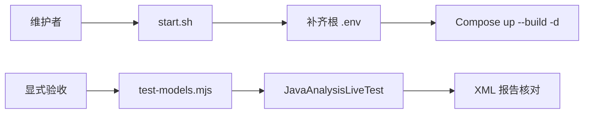

# 本机启动与显式模型验收脚本

> 提供仓库根目录的两个维护入口：生成本机私有配置并启动 Compose，以及显式执行 Java 真实模型验收。

## 1. 模块定位与边界

[start.sh](start.sh) 由新用户或维护者执行，调用 Docker Compose 构建和运行已有应用；[test-models.mjs](test-models.mjs) 由验收者显式执行，调用 JavaAnalysisLiveTest 并检查实际测试报告。脚本不实现业务 API，不替代模块测试，也不负责 Python 完整问答或自动部署到远程环境。

## 2. 快速导航与目录职责

| 文件 | 输入与职责 | 依赖 |
| --- | --- | --- |
| [start.sh](start.sh) | 根 `.env`、可选 Agent Langfuse 配置；补齐随机凭据，启动业务栈 | Bash、OpenSSL、Docker Compose、根 compose.yaml |
| [test-models.mjs](test-models.mjs) | 环境或根 `.env` 百炼凭据；运行四样本付费测试并核对 XML | Node.js、Maven、Docker、测试夹具与宿主媒体工具 |

本目录没有子目录。下列命令从仓库根目录执行；启动与开发条件见[根 README](../README.md)。

## 3. 内部交互流程



1. start.sh 切换到仓库根目录；根 `.env` 不存在时以 umask 077 创建，写入随机 DATABASE_PASSWORD 和默认端口／Origin。
2. 缺少 STORAGE_SECRET_KEY、RABBITMQ_PASSWORD 或 INTERNAL_WORKER_TOKEN 时补齐；已有值保留，脚本不打印凭据，也不生成模型 API Key。
3. 如存在 `agent-service/.env.langfuse`，按该文件、根 `.env` 顺序交给 Compose；随后 `up --build -d`。服务健康和模型配置仍需另行验证。
4. test-models.mjs 以进程环境优先、根 `.env` 补缺读取百炼凭据，设置 RUN_LIVE_JAVA_ANALYSIS=1 调 Maven；结束后检查 JavaAnalysisLiveTest 报告确有四条且无跳过。

## 4. 公共命令与结果

```bash
./scripts/start.sh
```

首次启动后手动补齐根 `.env` 中的 DASHSCOPE_API_KEY／DEEPSEEK_API_KEY，再运行同一命令应用。此命令会构建、创建或重建容器，不是只读检查，不会主动删除数据卷。

以下命令会产生真实百炼费用：

```bash
node scripts/test-models.mjs
```

| 入口 | 成功条件 | 失败／未验证 |
| --- | --- | --- |
| start.sh | Compose 命令成功退出 | `set -euo pipefail` 快速失败；退出成功仍不代表模型已验收 |
| test-models.mjs | Maven 成功，报告 tests=4 且 skipped=0，输出 VERIFIED | 缺凭据、无法启动 Maven、测试未实际运行为 UNVERIFIED／2；Maven 非零按其退出码返回 |

综合 Python／DeepSeek 链路使用 [verify_java_m1.py](../agent-service/scripts/verify_java_m1.py)，不是此 Java 脚本的隐式组成部分。

## 5. 依赖与配置

配置依据为[根 Compose](../compose.yaml)与[根配置说明](../README.md#8-配置说明)。start.sh 默认 APP_PORT=8080、APP_ALLOWED_ORIGIN=http://localhost:8080；改变访问 Origin 时同步调整。四个基础凭据随机生成，模型凭据由使用者提供。

脚本启动单实例 Agent Worker 并保留 `agent_state`；不要为了验收清空回执或删除卷。Langfuse 是可选独立栈，start.sh 只读取已生成的观测凭据，不负责启动它。

## 6. 错误、日志与测试

启动输出直接来自 Compose；健康验证使用 `docker compose ps` 和根 README 的 HTTP 请求。模型验收的 stdout／stderr 继承 Maven 输出，报告在 `backend/target/surefire-reports/`。当前脚本没有独立指标或 Trace。

本目录没有单独自动化测试套件；付费脚本对应 [JavaAnalysisLiveTest.java](../backend/src/test/java/com/agenticvideo/business/task/JavaAnalysisLiveTest.java)。只检查语法可运行以下非业务命令：

```bash
bash -n scripts/start.sh
node --check scripts/test-models.mjs
```

真实模型、媒体故障或破坏性实验按各阶段验收计划单独安排，不纳入普通文档检查。

## 7. 扩展与维护

新增根配置要区分脚本补缺、Compose 参数化和固定注入；不要覆盖用户已有凭据。新增验收入口明确费用、数据创建／服务中断、副作用、退出码和输出位置。变更四样本验收时同步核对 Java 测试数量和报告判定，不能让跳过冒充成功。

## 8. 相关文档

[根 README](../README.md) · [后端 README](../backend/README.md) · [Agent README](../agent-service/README.md) · [M1 分析验收](../docs/verification/java-tools-m1-stage2.md) · [M1 综合验收](../docs/verification/java-tools-m1-stage5.md)
